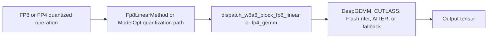
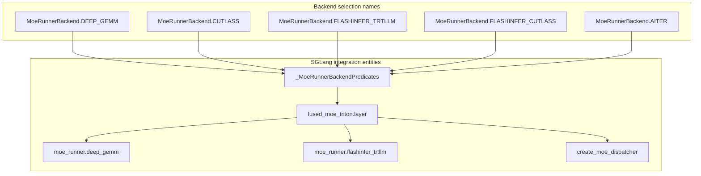
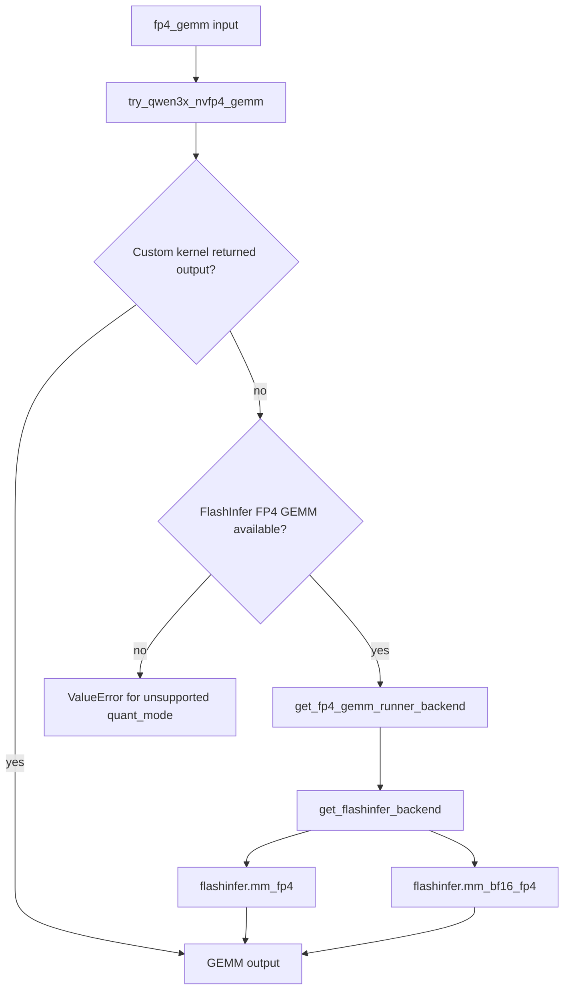

<!-- source: DeepWiki mcp.deepwiki.com · repo sgl-project/sglang · page 11.5 Third-Party Library Integration · fetched 2026-10-30 -->

# Third-Party Library Integration

Relevant source files

The following files were used as context for generating this wiki page:

- [.claude/rules/comment-style.md](.claude/rules/comment-style.md)
- [.github/actions/download-rust-ext/action.yml](.github/actions/download-rust-ext/action.yml)
- [.github/workflows/_pr-test-rust-ext-build.yml](.github/workflows/_pr-test-rust-ext-build.yml)
- [.github/workflows/_pr-test-sgl-kernel-build.yml](.github/workflows/_pr-test-sgl-kernel-build.yml)
- [.github/workflows/_pr-test-stage.yml](.github/workflows/_pr-test-stage.yml)
- [.github/workflows/nightly-test-nvidia.yml](.github/workflows/nightly-test-nvidia.yml)
- [.github/workflows/pr-test-extra.yml](.github/workflows/pr-test-extra.yml)
- [.github/workflows/pr-test-jit-kernel.yml](.github/workflows/pr-test-jit-kernel.yml)
- [.github/workflows/pr-test-multimodal-gen.yml](.github/workflows/pr-test-multimodal-gen.yml)
- [.github/workflows/pr-test-sgl-kernel.yml](.github/workflows/pr-test-sgl-kernel.yml)
- [.github/workflows/pr-test.yml](.github/workflows/pr-test.yml)
- [.github/workflows/release-whl-deepgemm.yml](.github/workflows/release-whl-deepgemm.yml)
- [.github/workflows/rerun-test.yml](.github/workflows/rerun-test.yml)
- [.github/workflows/seed-rust-ext-cache.yml](.github/workflows/seed-rust-ext-cache.yml)
- [docker/sgl-deep-gemm.Dockerfile](docker/sgl-deep-gemm.Dockerfile)
- [python/sglang/kernels/jit/csrc/elementwise/activation.cuh](python/sglang/kernels/jit/csrc/elementwise/activation.cuh)
- [python/sglang/kernels/ops/activation/activation.py](python/sglang/kernels/ops/activation/activation.py)
- [python/sglang/kernels/ops/activation/minimax_m3_swiglu.py](python/sglang/kernels/ops/activation/minimax_m3_swiglu.py)
- [python/sglang/multimodal_gen/test/unit/test_ernie_rope_geglu_fusion.py](python/sglang/multimodal_gen/test/unit/test_ernie_rope_geglu_fusion.py)
- [python/sglang/srt/layers/moe/cutlass_moe.py](python/sglang/srt/layers/moe/cutlass_moe.py)
- [python/sglang/srt/layers/moe/cutlass_w4a8_moe.py](python/sglang/srt/layers/moe/cutlass_w4a8_moe.py)
- [python/sglang/srt/layers/moe/fused_moe_triton/fused_marlin_moe.py](python/sglang/srt/layers/moe/fused_moe_triton/fused_marlin_moe.py)
- [python/sglang/srt/layers/moe/moe_runner/marlin.py](python/sglang/srt/layers/moe/moe_runner/marlin.py)
- [python/sglang/srt/layers/moe/token_dispatcher/deepep.py](python/sglang/srt/layers/moe/token_dispatcher/deepep.py)
- [python/sglang/srt/layers/quantization/gguf.py](python/sglang/srt/layers/quantization/gguf.py)
- [python/sglang/srt/layers/quantization/marlin_utils.py](python/sglang/srt/layers/quantization/marlin_utils.py)
- [python/sglang/srt/layers/quantization/marlin_utils_fp4.py](python/sglang/srt/layers/quantization/marlin_utils_fp4.py)
- [python/sglang/srt/layers/quantization/mxfp4_marlin_moe.py](python/sglang/srt/layers/quantization/mxfp4_marlin_moe.py)
- [python/sglang/srt/layers/quantization/w4afp8.py](python/sglang/srt/layers/quantization/w4afp8.py)
- [python/sglang/srt/model_loader/ci_weight_validation.py](python/sglang/srt/model_loader/ci_weight_validation.py)
- [scripts/build_sgl_deep_gemm.sh](scripts/build_sgl_deep_gemm.sh)
- [scripts/ci/cuda/ci_download_flashinfer_jit_cache.sh](scripts/ci/cuda/ci_download_flashinfer_jit_cache.sh)
- [scripts/ci/cuda/ci_install_dependency.sh](scripts/ci/cuda/ci_install_dependency.sh)
- [scripts/ci/partition_rerun_tests.py](scripts/ci/partition_rerun_tests.py)
- [scripts/ci/utils/install_rustup.sh](scripts/ci/utils/install_rustup.sh)
- [scripts/ci/utils/slash_command_handler.py](scripts/ci/utils/slash_command_handler.py)
- [scripts/ci/utils/stage_rust_ext_modules.sh](scripts/ci/utils/stage_rust_ext_modules.sh)
- [scripts/rename_sgl_deep_gemm_whl.sh](scripts/rename_sgl_deep_gemm_whl.sh)
- [scripts/update_deepgemm_whl_index.py](scripts/update_deepgemm_whl_index.py)
- [test/manual/test_weight_validation.py](test/manual/test_weight_validation.py)
- [test/registered/kernels/benchmark/moe/bench_fp8_per_token_to_per_tensor_quant.py](test/registered/kernels/benchmark/moe/bench_fp8_per_token_to_per_tensor_quant.py)
- [test/registered/kernels/ops/activation/test_activation.py](test/registered/kernels/ops/activation/test_activation.py)
- [test/registered/kernels/ops/moe/test_fp8_per_token_to_per_tensor_quant.py](test/registered/kernels/ops/moe/test_fp8_per_token_to_per_tensor_quant.py)
- [test/registered/kernels/ops/moe/test_marlin_moe.py](test/registered/kernels/ops/moe/test_marlin_moe.py)
- [test/registered/kernels/ops/moe/test_moe_tma_down_padding_rows.py](test/registered/kernels/ops/moe/test_moe_tma_down_padding_rows.py)
- [test/registered/unit/layers/moe/test_deepep_import_guard.py](test/registered/unit/layers/moe/test_deepep_import_guard.py)
- [test/registered/unit/layers/moe/test_w4afp8_deepep_dtype.py](test/registered/unit/layers/moe/test_w4afp8_deepep_dtype.py)
- [test/registered/unit/layers/moe/test_w4afp8_deepep_post_reorder.py](test/registered/unit/layers/moe/test_w4afp8_deepep_post_reorder.py)

## Purpose and scope

This page describes how SGLang connects external kernel libraries to runtime compute paths, with emphasis on the integration points visible in the supplied code: CUTLASS, DeepGEMM, FlashInfer, AITER, and MoE runner dispatch. It also covers the FP8 and FP4 quantization paths that adapt tensors and weights for those backends, plus the DeepGEMM wheel build and validation workflow. The supplied file excerpts do not include the attention backend implementations, so this page does not document specific Flash-Attention or FlashInfer attention call paths.

Sources: [python/sglang/srt/layers/quantization/fp8.py:55-80](), [python/sglang/srt/layers/quantization/modelopt_quant.py:38-49](), [python/sglang/srt/layers/moe/utils.py:112-217](), [.github/workflows/release-whl-deepgemm.yml:1-180]()

---

## 1. Integration Architecture

SGLang’s integration pattern is not a single universal wrapper. Backend names and predicates are defined in the MoE utilities; quantization code selects compatible operations and can adapt weight layouts; MoE layers construct dispatchers and runner configurations; and external libraries are imported when the corresponding integration path is used. The available code explicitly exposes runner backends for DeepGEMM, CUTLASS, FlashInfer variants, AITER, Triton, and others. [python/sglang/srt/layers/moe/utils.py:112-217]()

For linear FP8 operations, `fp8.py` imports backend-selection helpers from `fp8_utils.py`, including `dispatch_w8a8_block_fp8_linear`, `dispatch_w8a8_mxfp8_linear`, and DeepGEMM fallback functions. The quantized execution path therefore connects a quantization method to a selected GEMM implementation through these helpers. [python/sglang/srt/layers/quantization/fp8.py:55-80]()

For MoE, `fused_moe_triton/layer.py` imports runner and dispatcher interfaces, including `MoeRunnerConfig`, `BaseDispatcher`, `DeepEPv2Dispatcher`, `FlashinferDispatcher`, and `StandardDispatcher`; it also imports `get_moe_a2a_backend` and `get_moe_runner_backend` for backend-specific setup. [python/sglang/srt/layers/moe/fused_moe_triton/layer.py:25-58]()

### Integration flow: quantization to kernel backend

**Diagram 1: Quantized linear integration from runtime selection to backend operation**

Sources: [python/sglang/srt/layers/quantization/fp8.py:55-80](), [python/sglang/srt/layers/quantization/modelopt_quant.py:38-49](), [python/sglang/srt/layers/quantization/modelopt_quant.py:106-184](), [python/sglang/srt/layers/moe/utils.py:112-217]()

### Integration flow: MoE backend names to code entities

**Diagram 2: MoE runner and dispatcher names mapped to implementation entities**

Sources: [python/sglang/srt/layers/moe/utils.py:112-217](), [python/sglang/srt/layers/moe/fused_moe_triton/layer.py:25-58](), [python/sglang/srt/layers/moe/fused_moe_triton/layer.py:171-186](), [python/sglang/srt/layers/quantization/fp8.py:31-36]()

---

## 2. CUTLASS Integration

CUTLASS appears in the provided code as a MoE runner backend and as a backend compatibility condition in quantized execution. `MoeRunnerBackend` includes `CUTLASS` and the predicate `is_cutlass()`, which tests whether the configured backend value matches the CUTLASS entry. [python/sglang/srt/layers/moe/utils.py:112-160](), [python/sglang/srt/layers/moe/utils.py:194-217]()

The MoE layer’s `_fuses_routed_scaling_factor_in_topk` helper recognizes a CUTLASS runner when the quantization method is `Fp8MoEMethod`; this lets the layer account for routed scaling in the backend-specific execution arrangement. [python/sglang/srt/layers/moe/fused_moe_triton/layer.py:105-127]()

The FP4 quantization module defines `FP4_GEMM_ALIGNMENT = 32` and uses that alignment as the default for padding packed NVFP4 weights. The source comment identifies the alignment requirement as applicable to CUTLASS/FlashInfer FP4 GEMM kernels. [python/sglang/srt/layers/quantization/modelopt_quant.py:187-212]()

The supplied excerpts do not show CUTLASS kernel definitions, build flags, or a direct CUTLASS call site. The documented integration here is therefore limited to backend naming, MoE routing compatibility, and FP4 weight alignment.

Sources: [python/sglang/srt/layers/moe/utils.py:112-160](), [python/sglang/srt/layers/moe/utils.py:194-217](), [python/sglang/srt/layers/moe/fused_moe_triton/layer.py:105-127](), [python/sglang/srt/layers/quantization/modelopt_quant.py:187-212]()

---

## 3. DeepGEMM Integration

### FP8 linear operations

`fp8.py` imports DeepGEMM support checks and execution helpers from `fp8_utils.py`, including `_deepgemm_block_fp8_supported`, `deepgemm_w8a8_block_fp8_linear_with_fallback`, and `deepgemm_w8a8_mxfp8_linear_with_fallback`. It also imports dispatch and backend-resolution helpers for block-FP8 and MXFP8 operations. [python/sglang/srt/layers/quantization/fp8.py:55-80]()

This integration is mediated by quantization utilities rather than a direct `deep_gemm` import in the shown `fp8.py` excerpt. The helper names indicate that DeepGEMM paths have fallback-capable entry points; the precise fallback conditions and kernel invocation are in `fp8_utils.py`, whose full contents were not supplied. [python/sglang/srt/layers/quantization/fp8.py:55-80]()

### MoE backend and quantization metadata

The FP8 quantization module imports `DeepGemmMoeQuantInfo` from `moe_runner.deep_gemm`, alongside the `MoeRunner`, `MoeRunnerBackend`, and `MoeRunnerConfig` abstractions. This connects FP8 MoE quantization metadata to the DeepGEMM runner implementation. [python/sglang/srt/layers/quantization/fp8.py:31-36]()

The runner registry names DeepGEMM as `MoeRunnerBackend.DEEP_GEMM`, and exposes it through `is_deep_gemm()`. [python/sglang/srt/layers/moe/utils.py:112-126](), [python/sglang/srt/layers/moe/utils.py:194-200]()

### DeepGEMM wheel build and validation

The `Release sgl-deep-gemm` workflow builds the DeepGEMM project from a separately checked-out `sgl-project/DeepGEMM` repository. The workflow takes a version, target, branch, validation-only flag, and test-skipping flag; its shown build matrix covers CUDA 13.0, Python 3.12, and `x86_64` and `aarch64`. [ .github/workflows/release-whl-deepgemm.yml:1-59]()

The build job writes the requested version into `DeepGEMM/sgl_deep_gemm/VERSION`, then invokes `scripts/build_sgl_deep_gemm.sh` and uploads wheel artifacts. [ .github/workflows/release-whl-deepgemm.yml:81-102]()

The test job selects GPU runners for the shown `sm90`, `sm100`, and `sm100-aarch64` cases. It installs a CUDA-matched PyTorch version and dependencies before force-reinstalling the built wheel; the workflow comments explain that the compiled `_C.so` is linked against the matching Torch ABI. [ .github/workflows/release-whl-deepgemm.yml:104-162]()

| Concern | Integration detail |
|---|---|
| FP8 dense GEMM | `fp8.py` imports DeepGEMM block-FP8 and MXFP8 fallback-capable helper functions. [python/sglang/srt/layers/quantization/fp8.py:55-80]() |
| FP8 MoE | `DeepGemmMoeQuantInfo` is imported alongside the MoE runner interfaces. [python/sglang/srt/layers/quantization/fp8.py:31-36]() |
| Runner selection name | `MoeRunnerBackend.DEEP_GEMM`; queried with `is_deep_gemm()`. [python/sglang/srt/layers/moe/utils.py:112-126](), [python/sglang/srt/layers/moe/utils.py:194-200]() |
| Wheel targets shown | CUDA 13.0, Python 3.12, `x86_64` and `aarch64`. [.github/workflows/release-whl-deepgemm.yml:45-59]() |
| GPU validation targets shown | `sm90`, `sm100`, and `sm100-aarch64`. [.github/workflows/release-whl-deepgemm.yml:104-128]() |

Sources: [python/sglang/srt/layers/quantization/fp8.py:31-36](), [python/sglang/srt/layers/quantization/fp8.py:55-80](), [python/sglang/srt/layers/moe/utils.py:112-126](), [python/sglang/srt/layers/moe/utils.py:194-200](), [.github/workflows/release-whl-deepgemm.yml:1-162]()

---

## 4. FlashInfer Integration

### FP4 GEMM integration

`modelopt_quant.py` attempts to import FlashInfer’s `mm_fp4`, `reorder_rows_for_gated_act_gemm`, and `shuffle_matrix_sf_a`. If the import fails, the module sets `enable_flashinfer_fp4_gemm` to false and clears the associated optional function references. [python/sglang/srt/layers/quantization/modelopt_quant.py:106-115]()

The registered `fp4_gemm` custom operation first tries `try_qwen3x_nvfp4_gemm`; if that returns a result, it is returned directly. Otherwise, the function requires the FlashInfer FP4 GEMM import to be available, resolves an FP4 runner backend, and maps that backend to the FlashInfer API backend name. [python/sglang/srt/layers/quantization/modelopt_quant.py:136-167]()

For quantization mode `w4a4`, `fp4_gemm` calls FlashInfer’s `mm_fp4`. For `w4a16`, it imports and calls `mm_bf16_fp4`. Other modes raise `ValueError`. [python/sglang/srt/layers/quantization/modelopt_quant.py:168-184]()

### MoE runner and deferred finalization

SGLang’s MoE runner backend registry includes `FLASHINFER_TRTLLM`, `FLASHINFER_TRTLLM_ROUTED`, `FLASHINFER_CUTLASS`, `FLASHINFER_CUTEDSL`, `FLASHINFER_MEGAMOE`, and `FLASHINFER_MXFP4`. [python/sglang/srt/layers/moe/utils.py:194-217]()

`moe_runner/flashinfer_trtllm.py` adapts FlashInfer MoE operations through wrapper functions imported from `flashinfer_trtllm_moe.py`. It includes `FlashInferTrtllmDeferredFinalizeOutput` to hold the second GEMM output, expert weights, remapped indices, and `top_k`. [python/sglang/srt/layers/moe/moe_runner/flashinfer_trtllm.py:25-35](), [python/sglang/srt/layers/moe/moe_runner/flashinfer_trtllm.py:64-70]()

When deferred finalization is enabled, `finalize_flashinfer_trtllm_deferred_output` calls `moe_finalize_fuse_shared`, passing those deferred values and the optional shared-expert output. The wrapper also computes whether to enable PDL based on forward state, architecture support, and a token-count limit. [python/sglang/srt/layers/moe/moe_runner/flashinfer_trtllm.py:47-61](), [python/sglang/srt/layers/moe/moe_runner/flashinfer_trtllm.py:72-100]()

The adapter validates the returned deferred-output ABI: expert weights must be BF16 or FP32, the GEMM2 result must be BF16, and the remapped indices must be Int32. [python/sglang/srt/layers/moe/moe_runner/flashinfer_trtllm.py:103-132]()

### Data flow: FlashInfer FP4 GEMM

**Diagram 3: `fp4_gemm` dispatch and fallback flow**

Sources: [python/sglang/srt/layers/quantization/modelopt_quant.py:136-184]()

Sources: [python/sglang/srt/layers/quantization/modelopt_quant.py:106-115](), [python/sglang/srt/layers/quantization/modelopt_quant.py:136-184](), [python/sglang/srt/layers/moe/utils.py:194-217](), [python/sglang/srt/layers/moe/moe_runner/flashinfer_trtllm.py:25-35](), [python/sglang/srt/layers/moe/moe_runner/flashinfer_trtllm.py:64-132]()

---

## 5. Flash-Attention and Other Attention Libraries

The supplied file excerpts do not show the Flash-Attention backend implementation, attention backend registry, or calls into Flash-Attention kernels. They also do not establish the integration details for FlashInfer attention. Accordingly, this section does not describe attention execution or claim particular attention classes, functions, or dependency versions.

The supplied code does show FlashInfer integration for FP4 GEMM and MoE runner operations; these are documented in the preceding section. [python/sglang/srt/layers/quantization/modelopt_quant.py:106-184](), [python/sglang/srt/layers/moe/moe_runner/flashinfer_trtllm.py:25-35]()

Sources: [python/sglang/srt/layers/quantization/modelopt_quant.py:106-184](), [python/sglang/srt/layers/moe/moe_runner/flashinfer_trtllm.py:25-35]()

---

## 6. AITER and Hardware-Specific Backend Selection

### AITER activation in FP8 and MoE code

`fp8_utils.py` computes `_use_aiter` from the `SGLANG_USE_AITER` environment setting and HIP platform detection, with an additional exclusion for the supported gfx1250 path. The source comments explain that gfx1250 lacks the instructions required by the relevant AITER CK kernels, so the block-FP8 path is forced to Triton there. [python/sglang/srt/layers/quantization/fp8_utils.py:71-78]()

The FP8 quantization module also derives `_use_aiter` from `SGLANG_USE_AITER` and HIP detection. When enabled, it imports AITER weight/scale shuffle operations; it separately imports AITER linear helpers under that condition. [python/sglang/srt/layers/quantization/fp8.py:137-185]()

The MoE layer has a corresponding HIP-gated `_use_aiter` flag. The MoE runner backend registry also includes `AITER` and exposes `is_aiter()`. [python/sglang/srt/layers/moe/fused_moe_triton/layer.py:93-98](), [python/sglang/srt/layers/moe/utils.py:184-214]()

### FP8 path resolution and safety constraints

The FP8 utility defines shape-specific safe-`M` limits for AITER CK W8A8 kernels on gfx95. The comments explain that some CK paths can produce NaNs for larger shapes on older ROCm releases; the configured limits preserve the CK route for verified-safe shapes and use Triton for affected larger cases. [python/sglang/srt/layers/quantization/fp8_utils.py:82-96]()

The same module gates the dense MX-scale path on whether the installed AITER exposes `get_mxscale_bpreshuffle_config`. `set_dense_mxscale` disables that option and logs a warning if the capability is absent. [python/sglang/srt/layers/quantization/fp8_utils.py:151-171]()

`fp8.py` imports resolver and dispatch helpers for block-FP8 and MXFP8, including `resolve_block_fp8_mxfp8_backend`, `resolve_mxfp8_dense_gemm_backend`, and the `dispatch_*` functions. These APIs are the visible connection between FP8 quantization and backend-specific GEMM selection in the supplied excerpt. [python/sglang/srt/layers/quantization/fp8.py:55-80]()

Sources: [python/sglang/srt/layers/quantization/fp8_utils.py:71-96](), [python/sglang/srt/layers/quantization/fp8_utils.py:151-171](), [python/sglang/srt/layers/quantization/fp8.py:55-80](), [python/sglang/srt/layers/quantization/fp8.py:137-185](), [python/sglang/srt/layers/moe/fused_moe_triton/layer.py:93-98](), [python/sglang/srt/layers/moe/utils.py:184-214]()

---

## 7. Backend Registry and Integration Matrix

`MoeRunnerBackend` is the shared vocabulary for MoE kernel implementations. Its values cover DeepGEMM, CUTLASS, FlashInfer variants, AITER, Triton, Marlin, and platform-specific or specialized runners. Predicate methods provide the corresponding checks used by runtime code. [python/sglang/srt/layers/moe/utils.py:112-217]()

| Library or backend family | Code-level integration point | Role visible in supplied code |
|---|---|---|
| CUTLASS | `MoeRunnerBackend.CUTLASS`, `is_cutlass()` | MoE runner selection; recognized in FP8 MoE routed-scaling handling. [python/sglang/srt/layers/moe/utils.py:147-160](), [python/sglang/srt/layers/moe/fused_moe_triton/layer.py:105-127]() |
| DeepGEMM | `MoeRunnerBackend.DEEP_GEMM`, `DeepGemmMoeQuantInfo` | MoE runner selection and FP8 MoE quantization metadata. [python/sglang/srt/layers/moe/utils.py:112-126](), [python/sglang/srt/layers/quantization/fp8.py:31-36]() |
| FlashInfer FP4 | `fp4_gemm`, `mm_fp4`, `mm_bf16_fp4` | Optional FP4 GEMM integration with a custom-kernel attempt first. [python/sglang/srt/layers/quantization/modelopt_quant.py:106-115](), [python/sglang/srt/layers/quantization/modelopt_quant.py:136-184]() |
| FlashInfer MoE | `moe_runner/flashinfer_trtllm.py` | Adapts FlashInfer MoE wrappers and deferred finalization. [python/sglang/srt/layers/moe/moe_runner/flashinfer_trtllm.py:25-35](), [python/sglang/srt/layers/moe/moe_runner/flashinfer_trtllm.py:64-132]() |
| AITER | `SGLANG_USE_AITER`, `MoeRunnerBackend.AITER` | HIP-gated FP8 and MoE integration, with architecture and shape constraints. [python/sglang/srt/layers/quantization/fp8_utils.py:71-96](), [python/sglang/srt/layers/moe/utils.py:184-214]() |
| Flash-Attention | Not shown in the supplied excerpts | Attention integration details cannot be established from the provided content. |

Sources: [python/sglang/srt/layers/moe/utils.py:112-217](), [python/sglang/srt/layers/moe/fused_moe_triton/layer.py:105-127](), [python/sglang/srt/layers/quantization/fp8.py:31-80](), [python/sglang/srt/layers/quantization/modelopt_quant.py:106-184](), [python/sglang/srt/layers/moe/moe_runner/flashinfer_trtllm.py:25-132](), [python/sglang/srt/layers/quantization/fp8_utils.py:71-96]()

---

## 8. CI and Dependency Validation

The CUDA dependency-install script sets `CU_VERSION` to `cu130` by default and rejects versions outside CUDA 13. Its comments identify the version as controlling the PyTorch index, FlashInfer JIT cache index, and SGLang wheel index. [scripts/ci/cuda/ci_install_dependency.sh:33-42]()

The DeepGEMM release workflow builds and tests wheels separately. The build matrix includes `x86_64` and `aarch64`; the test matrix selects hardware labels for the shown `sm90` and `sm100` validation jobs. [ .github/workflows/release-whl-deepgemm.yml:45-59](), [ .github/workflows/release-whl-deepgemm.yml:104-128]()

During DeepGEMM wheel testing, the workflow pins the Torch version to match the wheel ABI, reinstalls the wheel with `--force-reinstall`, restores the expected NCCL package after dependency installation, and imports `deep_gemm` as part of validation. [ .github/workflows/release-whl-deepgemm.yml:147-179]()

The PR test workflow sets `SGLANG_JIT_DEEPGEMM_FAST_WARMUP` in its environment, showing that the test environment explicitly configures DeepGEMM JIT warmup behavior. [ .github/workflows/pr-test.yml:57-64]()

The `rerun-test.yml` workflow also sets `SGLANG_JIT_DEEPGEMM_FAST_WARMUP` in its environment, ensuring consistent JIT warmup behavior for re-run tests. [ .github/workflows/rerun-test.yml:65-71]() Similarly, the `_pr-test-stage.yml` reusable workflow, which is called by various PR test stages, also sets this environment variable. [ .github/workflows/_pr-test-stage.yml:88-89]() The `pr-test-extra.yml` workflow, for additional CI tests, also configures `SGLANG_JIT_DEEPGEMM_FAST_WARMUP`. [ .github/workflows/pr-test-extra.yml:63-66]() The `pr-test-jit-kernel.yml` workflow, specifically for JIT kernel tests, also sets this variable. [ .github/workflows/pr-test-jit-kernel.yml:40-43]()

Sources: [scripts/ci/cuda/ci_install_dependency.sh:33-42](), [.github/workflows/release-whl-deepgemm.yml:45-59](), [.github/workflows/release-whl-deepgemm.yml:104-179](), [.github/workflows/pr-test.yml:57-64](), [.github/workflows/rerun-test.yml:65-71](), [.github/workflows/_pr-test-stage.yml:88-89](), [.github/workflows/pr-test-extra.yml:63-66](), [.github/workflows/pr-test-jit-kernel.yml:40-43]()

---

