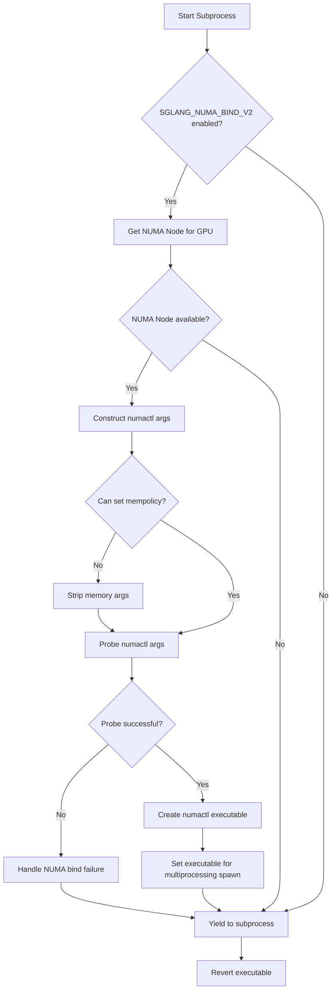
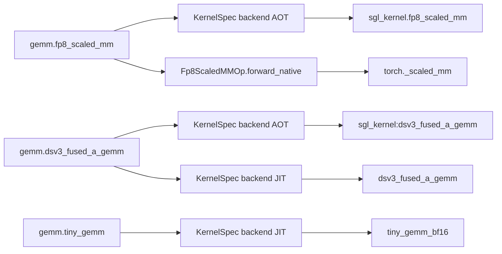
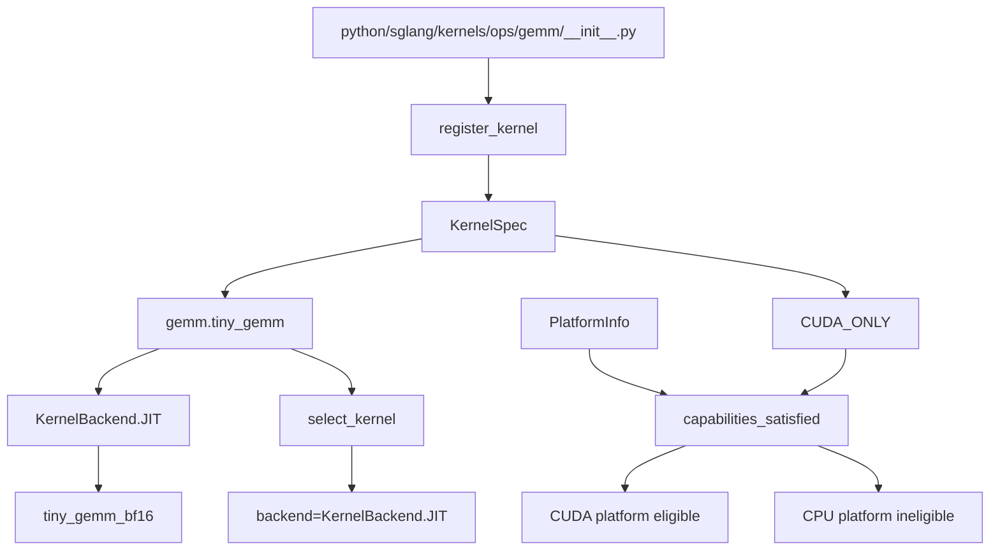
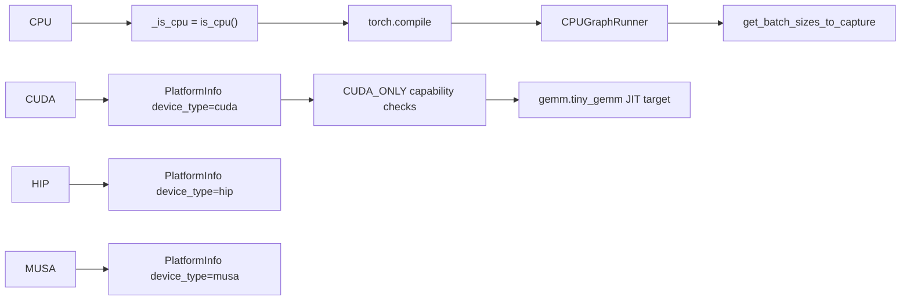

<!-- source: DeepWiki mcp.deepwiki.com · repo sgl-project/sglang · page 11.6 CPU and JIT Kernel Support · fetched 2026-10-30 -->

# CPU and JIT Kernel Support

Relevant source files

The following files were used as context for generating this wiki page:

- [docs/docs/sglang-diffusion/disaggregation.mdx](docs/docs/sglang-diffusion/disaggregation.mdx)
- [docs/docs/sglang-diffusion/performance-optimization.mdx](docs/docs/sglang-diffusion/performance-optimization.mdx)
- [python/sglang/kernels/aot/csrc/cpu/decode.cpp](python/sglang/kernels/aot/csrc/cpu/decode.cpp)
- [python/sglang/kernels/aot/csrc/cpu/extend.cpp](python/sglang/kernels/aot/csrc/cpu/extend.cpp)
- [python/sglang/kernels/aot/csrc/cpu/norm.cpp](python/sglang/kernels/aot/csrc/cpu/norm.cpp)
- [python/sglang/kernels/aot/csrc/cpu/topk.cpp](python/sglang/kernels/aot/csrc/cpu/topk.cpp)
- [python/sglang/kernels/aot/csrc/cpu/torch_extension_cpu.cpp](python/sglang/kernels/aot/csrc/cpu/torch_extension_cpu.cpp)
- [python/sglang/kernels/aot/csrc/cpu/vec_pack.h](python/sglang/kernels/aot/csrc/cpu/vec_pack.h)
- [python/sglang/multimodal_gen/runtime/disaggregation/orchestrator.py](python/sglang/multimodal_gen/runtime/disaggregation/orchestrator.py)
- [python/sglang/multimodal_gen/runtime/disaggregation/request_state.py](python/sglang/multimodal_gen/runtime/disaggregation/request_state.py)
- [python/sglang/multimodal_gen/runtime/disaggregation/scheduler_mixin.py](python/sglang/multimodal_gen/runtime/disaggregation/scheduler_mixin.py)
- [python/sglang/multimodal_gen/runtime/launch_server.py](python/sglang/multimodal_gen/runtime/launch_server.py)
- [python/sglang/multimodal_gen/runtime/managers/request_gc.py](python/sglang/multimodal_gen/runtime/managers/request_gc.py)
- [python/sglang/multimodal_gen/runtime/server_warmup.py](python/sglang/multimodal_gen/runtime/server_warmup.py)
- [python/sglang/multimodal_gen/runtime/utils/perf_logger.py](python/sglang/multimodal_gen/runtime/utils/perf_logger.py)
- [python/sglang/multimodal_gen/runtime/warmup_request_builder.py](python/sglang/multimodal_gen/runtime/warmup_request_builder.py)
- [python/sglang/multimodal_gen/test/unit/test_async_output_save.py](python/sglang/multimodal_gen/test/unit/test_async_output_save.py)
- [python/sglang/multimodal_gen/test/unit/test_cfg_parallel_warmup.py](python/sglang/multimodal_gen/test/unit/test_cfg_parallel_warmup.py)
- [python/sglang/multimodal_gen/test/unit/test_disagg_orchestration.py](python/sglang/multimodal_gen/test/unit/test_disagg_orchestration.py)
- [python/sglang/multimodal_gen/test/unit/test_gpu_worker_cpu_threads.py](python/sglang/multimodal_gen/test/unit/test_gpu_worker_cpu_threads.py)
- [python/sglang/multimodal_gen/test/unit/test_launch_server_shutdown.py](python/sglang/multimodal_gen/test/unit/test_launch_server_shutdown.py)
- [python/sglang/multimodal_gen/test/unit/test_load_inclusive_e2e.py](python/sglang/multimodal_gen/test/unit/test_load_inclusive_e2e.py)
- [python/sglang/multimodal_gen/test/unit/test_performance_metrics.py](python/sglang/multimodal_gen/test/unit/test_performance_metrics.py)
- [python/sglang/srt/hardware_backend/musa/attention/flashattention_backend.py](python/sglang/srt/hardware_backend/musa/attention/flashattention_backend.py)
- [python/sglang/srt/layers/attention/intel_amx_backend.py](python/sglang/srt/layers/attention/intel_amx_backend.py)
- [python/sglang/srt/layers/attention/torch_native_backend.py](python/sglang/srt/layers/attention/torch_native_backend.py)
- [python/sglang/srt/model_executor/cpu_graph_runner.py](python/sglang/srt/model_executor/cpu_graph_runner.py)
- [python/sglang/srt/models/grok.py](python/sglang/srt/models/grok.py)
- [python/sglang/srt/utils/__init__.py](python/sglang/srt/utils/__init__.py)
- [python/sglang/srt/utils/numa_utils.py](python/sglang/srt/utils/numa_utils.py)
- [test/registered/cpu/test_activation.py](test/registered/cpu/test_activation.py)
- [test/registered/cpu/test_bmm.py](test/registered/cpu/test_bmm.py)
- [test/registered/cpu/test_decode.py](test/registered/cpu/test_decode.py)
- [test/registered/cpu/test_extend.py](test/registered/cpu/test_extend.py)
- [test/registered/cpu/test_gemm.py](test/registered/cpu/test_gemm.py)
- [test/registered/cpu/test_mamba.py](test/registered/cpu/test_mamba.py)
- [test/registered/cpu/test_mla.py](test/registered/cpu/test_mla.py)
- [test/registered/cpu/test_moe.py](test/registered/cpu/test_moe.py)
- [test/registered/cpu/test_norm.py](test/registered/cpu/test_norm.py)
- [test/registered/cpu/test_qkv_proj_with_rope.py](test/registered/cpu/test_qkv_proj_with_rope.py)
- [test/registered/cpu/test_qwen3.py](test/registered/cpu/test_qwen3.py)
- [test/registered/cpu/test_rope.py](test/registered/cpu/test_rope.py)
- [test/registered/cpu/test_shared_expert.py](test/registered/cpu/test_shared_expert.py)
- [test/registered/cpu/test_store_cache.py](test/registered/cpu/test_store_cache.py)
- [test/registered/cpu/test_topk.py](test/registered/cpu/test_topk.py)
- [test/registered/utils/test_numa_utils.py](test/registered/utils/test_numa_utils.py)
- [test/registered/xpu/test_numa_utils_xpu.py](test/registered/xpu/test_numa_utils_xpu.py)

## Purpose and scope

This page describes CPU-side kernel paths and hardware-aware execution, the kernel registry and JIT selection model, and platform-specific optimizations visible in the provided implementation. It focuses on Intel AMX, CPU/NUMA testing, JIT kernel registration and selection, and XPU kernel-cache handling. [python/sglang/srt/models/grok.py:1-14]()[python/sglang/kernels/ops/gemm/__init__.py:7-16]()[scripts/ci/xpu/xpu_ci_start_container.sh:112-151]()

Sources: `python/sglang/srt/models/grok.py`, `python/sglang/kernels/ops/gemm/__init__.py`, `scripts/ci/xpu/xpu_ci_start_container.sh`

---

## 1. CPU Kernel Implementations and NUMA/Thread Management

CPU execution has model-level dispatch points for AMX-aware operations, while Xeon CI exercises CPU test suites across different NUMA configurations. The supplied code identifies AMX-sensitive logits computation and confirms AMX support in CI; it does not expose the implementation of the CPU attention kernels, thread-binding utilities, or NUMA subprocess setup. [python/sglang/srt/layers/attention/intel_amx_backend.py:1-10]()[.github/workflows/pr-test-xeon.yml:85-115]()[.github/workflows/pr-test-xeon.yml:156-168]()

Sources: `python/sglang/srt/layers/attention/intel_amx_backend.py`, `.github/workflows/pr-test-xeon.yml`

### 1.1 AMX and Vectorized Operations

The `intel_amx_backend.py` module provides a `use_intel_amx_backend` function to determine if the Intel AMX backend should be used for a given module. This function checks if the module's weight is packed and if the current device is CPU. If both conditions are met, it returns `True`, indicating that AMX-optimized operations can be utilized. [python/sglang/srt/layers/attention/intel_amx_backend.py:1-10]()

The Xeon Granite Rapids CI job explicitly checks that PyTorch reports AMX tile support and that `torch.ops.sgl_kernel.convert_weight_packed` exists before running the CPU test suite. The check verifies a runtime capability and operator presence; it is not itself a kernel correctness or performance test. [`.github/workflows/pr-test-xeon.yml:143-168]()

| Concern | Code path or check | Meaning |
|---|---|---|
| AMX route selection | `use_intel_amx_backend(lm_head)` | Chooses the packed-weight path for the logits projection. [python/sglang/srt/layers/attention/intel_amx_backend.py:1-10]() |
| Packed linear operation | `torch.ops.sgl_kernel.weight_packed_linear` | Computes logits using weights in the packed layout. [python/sglang/srt/model_executor/cpu_graph_runner.py:191-194]() |
| AMX capability check | `torch.cpu._is_amx_tile_supported()` | Xeon CI asserts that the CPU runtime exposes AMX tile support. [`.github/workflows/pr-test-xeon.yml:156-161]()` |
| Operator availability check | `torch.ops.sgl_kernel.convert_weight_packed` | Xeon CI asserts that the packed-weight conversion operator is registered. [`.github/workflows/pr-test-xeon.yml:156-161]()` |

Sources: `python/sglang/srt/layers/attention/intel_amx_backend.py`, `python/sglang/srt/model_executor/cpu_graph_runner.py`, `.github/workflows/pr-test-xeon.yml`

### 1.2 NUMA Affinity and Subprocess Configuration

The Xeon CI workflow distinguishes Granite Rapids (GNR) and Sapphire Rapids (SPR) test execution. GNR runs a tensor-parallel suite on a full machine, with the workflow comment noting a requirement of at least six NUMA nodes for `--tp 6`. SPR jobs partition tests across socket-pinned containers: each machine has two sockets, and two partitions run in parallel per machine. [`.github/workflows/pr-test-xeon.yml:85-115]()`[`.github/workflows/pr-test-xeon.yml:143-175]()

The `numa_utils.py` module provides utilities for NUMA binding. The `configure_subprocess` context manager [python/sglang/srt/utils/numa_utils.py:27-80]() is used to bind a subprocess to a specific NUMA node and its associated CPUs and memory. This is controlled by the `SGLANG_NUMA_BIND_V2` environment variable. The `get_numa_node_if_available` function [python/sglang/srt/utils/numa_utils.py:128-156]() determines the NUMA node for a given GPU ID, either from `server_args` or by querying the system if `SGLANG_AUTO_NUMA_BIND` is enabled. If `set_mempolicy` is not permitted, memory binding is stripped, and only CPU affinity is applied. [python/sglang/srt/utils/numa_utils.py:33-36]()

**Diagram: NUMA Binding Process**

Sources: `python/sglang/srt/utils/numa_utils.py`, `.github/workflows/pr-test-xeon.yml`

### 1.3 CPU Thread Environment and OpenMP Bindings

The `numa_utils.py` module includes functions like `numa_bind_to_node` [test/registered/utils/test_numa_utils.py:22]() which uses `os.sched_setaffinity` to bind the current process to a set of CPUs associated with a NUMA node. It also attempts to set memory policy using `libnuma.numa_set_preferred` if permitted. [test/registered/utils/test_numa_utils.py:66-80]() The Xeon workflow does show how CPU tests are selected and scheduled: GNR runs the tensor-parallel CPU suite, while SPR runs partitions of stage-A and stage-B CPU suites. Those workflow details describe CI execution and should not be interpreted as evidence of a particular OpenMP binding policy. [`.github/workflows/pr-test-xeon.yml:85-115]()`[`.github/workflows/pr-test-xeon.yml:163-175]()

Sources: `python/sglang/srt/utils/numa_utils.py`, `test/registered/utils/test_numa_utils.py`, `.github/workflows/pr-test-xeon.yml`

---

## 2. JIT Kernel Infrastructure

The kernel package uses `KernelSpec` records to associate operation names with backend identifiers, target symbols, and optional hardware capability requirements. Registration and selection are separate concerns: operation modules register implementations, and selectors or fused operators consume those registrations. The GEMM module demonstrates this model with AOT, Torch, CuTeDSL, FlashInfer, and JIT entries. [python/sglang/kernels/ops/gemm/__init__.py:7-16]()[python/sglang/kernels/ops/gemm/__init__.py:151-212]()

**Diagram: Kernel names mapped to registry entities**

Sources: `python/sglang/kernels/ops/gemm/__init__.py`

### 2.1 JIT Compilation Flow and CPU Graph Execution

The `CPUGraphRunner` [python/sglang/srt/model_executor/cpu_graph_runner.py:1-1079]() is responsible for running the model with CPU `torch.compile`. It follows the design of `CudaGraphRunner`. The `set_torch_compile_config` function [python/sglang/srt/model_executor/cpu_graph_runner.py:122-133]() configures `torch._inductor` and `torch._dynamo` for optimal performance, enabling features like `fx_graph_cache` and `freezing`. It also registers inductor fallback operations for custom `sgl_kernel` CPU operators. [python/sglang/srt/model_executor/cpu_graph_runner.py:158-169]()

The `register_fake_ops` function [python/sglang/srt/model_executor/cpu_graph_runner.py:171-198]() registers fake/meta implementations for custom `sgl_kernel` CPU operators using `torch.library.register_fake` to support `torch.compile`. This allows `torch.compile` to trace the graph even for custom operations that don't have a direct PyTorch equivalent.

The provided GEMM registry declares JIT targets for `gemm.dsv3_fused_a_gemm` and `gemm.tiny_gemm`. Their targets identify Python module/function pairs, and the JIT GEMM entries carry CUDA capability requirements where specified. [python/sglang/kernels/ops/gemm/__init__.py:186-207]()

A separate namespace test establishes important selection behavior: a JIT registry entry can be selected by operation name, while capability checks exclude CPU for a CUDA-only JIT kernel. It also verifies that an operation with multiple eligible backends requires an explicit backend rather than relying on registry order as a ranking. [test/registered/unit/kernels/test_kernels_namespace.py:28-48]()[test/registered/unit/kernels/test_kernels_namespace.py:93-110]()

**Diagram: JIT operation registration and platform eligibility**

Sources: `python/sglang/srt/model_executor/cpu_graph_runner.py`, `python/sglang/kernels/ops/gemm/__init__.py`, `test/registered/unit/kernels/test_kernels_namespace.py`

### 2.2 DeepGEMM JIT Integration

The provided files do not include DeepGEMM compilation utilities or its runtime entry point. This section therefore does not describe DeepGEMM warmup, compilation locking, or kernel dispatch as current implementation facts. The supplied GEMM registry does demonstrate a general multi-backend pattern—such as AOT and JIT registrations for `gemm.dsv3_fused_a_gemm`—but it does not identify those entries as DeepGEMM. [python/sglang/kernels/ops/gemm/__init__.py:186-199]()

Sources: `python/sglang/kernels/ops/gemm/__init__.py`

---

## 3. Platform-Specific Optimizations and Dispatch

Platform-specific behavior appears in both model code and kernel selection. The `CPUGraphRunner` [python/sglang/srt/model_executor/cpu_graph_runner.py:1-1079]() enables `torch.compile` for CPU execution, which can significantly speed up decoding by reducing Python overhead. The `get_batch_sizes_to_capture` function [python/sglang/srt/model_executor/cpu_graph_runner.py:135-147]() determines the batch sizes to capture for `torch.compile` based on the `cuda_graph_config.decode.bs` setting. The kernel namespace tests exercise `PlatformInfo` capability filtering across CPU, CUDA, HIP, and MUSA, while the GEMM registry attaches architecture requirements to selected implementations. [python/sglang/kernels/ops/gemm/__init__.py:23-27]()[test/registered/unit/kernels/test_kernels_namespace.py:21-26]()

**Diagram: Platform names connected to implementation entities**

Sources: `python/sglang/srt/model_executor/cpu_graph_runner.py`, `python/sglang/kernels/ops/gemm/__init__.py`, `test/registered/unit/kernels/test_kernels_namespace.py`

### 3.1 Operator Dispatch Logic and Code Entities

The `Fp8ScaledMMOp` is a fused-operation implementation for row-scaled A and column-scaled B FP8 GEMM. Its backend priority is AOT followed by Torch, and AOT is marked CUDA-only. `backend_eligible` uses `_prefer_torch_rowwise_fp8` to exclude the AOT path for a measured SM90 shape envelope; the native path calls `torch._scaled_mm`, while the AOT path calls `sgl_kernel.fp8_scaled_mm`. [python/sglang/kernels/ops/gemm/__init__.py:30-38]()[python/sglang/kernels/ops/gemm/__init__.py:78-107]()[python/sglang/kernels/ops/gemm/__init__.py:109-146]()

`_prefer_torch_rowwise_fp8` checks device, dtype, strides, contiguity, scale dtype and sizes, output dtype, and bias before applying its measured shape condition. The implementation documents that the alternative is intended for large prefill `M` on SM90, not for decode or shapes outside the measured range. [python/sglang/kernels/ops/gemm/__init__.py:30-75]()

The `torch_extension_cpu.cpp` file [python/sglang/kernels/aot/csrc/cpu/torch_extension_cpu.cpp:1-193]() registers numerous CPU kernel implementations for various operations like `silu_and_mul_cpu`, `gelu_and_mul_cpu`, `fused_sigmoid_mul_cpu`, `l2norm_cpu`, `rmsnorm_cpu`, `layernorm_cpu`, and attention-related kernels. These are exposed to Python via `torch.library.impl` and `TORCH_LIBRARY_IMPL`.

| Operation or helper | Backend and target | Relevant eligibility |
|---|---|---|
| `gemm.fp8_scaled_mm` | AOT: `sgl_kernel.fp8_scaled_mm`; native Torch: `torch._scaled_mm` | AOT is CUDA-only; an SM90 shape check can prefer the Torch route. [python/sglang/kernels/ops/gemm/__init__.py:78-146]() |
| `gemm.dsv3_fused_a_gemm` | AOT and JIT registrations | JIT target is CUDA-only. [python/sglang/kernels/ops/gemm/__init__.py:186-199]() |
| `gemm.tiny_gemm` | JIT target `tiny_gemm_bf16` | CUDA-only. [python/sglang/kernels/ops/gemm/__init__.py:201-207]() |
| `gemm.dual_gemm_swiglu` | CuTeDSL target | SM10X capability requirement. [python/sglang/kernels/ops/gemm/__init__.py:151-157]() |
| `gemm.nvfp4_gemm_swiglu_nvfp4_quant` | CuTeDSL target | Minimum CUDA SM 10.0. [python/sglang/kernels/ops/gemm/__init__.py:167-175]() |
| CPU Kernels | `silu_and_mul_cpu`, `rmsnorm_cpu`, `decode_attention_cpu`, `assign_req_to_token_pool_cpu` | Implemented in C++ for CPU. [python/sglang/kernels/aot/csrc/cpu/torch_extension_cpu.cpp:23-193]() |

Sources: `python/sglang/kernels/ops/gemm/__init__.py`, `python/sglang/kernels/aot/csrc/cpu/torch_extension_cpu.cpp`

### 3.2 Advanced Fusions and Quantization Kernels

The supplied GEMM registry includes capability-scoped CuTeDSL operations for dual GEMM SwiGLU and NVFP4 GEMM-plus-SwiGLU quantization. It also registers a FlashInfer FP8 batched matrix multiplication target and an AOT DeepSeek fused-A GEMM target. These registrations describe backend availability and target symbols; they do not by themselves establish the full implementation or performance characteristics of the underlying kernels. [python/sglang/kernels/ops/gemm/__init__.py:151-199]()

The XPU CI container startup script maintains persistent JIT-related caches in separate `triton`, `inductor`, `neo`, and `sycl` directories. By default, the cache directory is keyed by GPU-affinity mask and Docker image ID, and is reset when it exceeds the configured size cap. This avoids reusing compiled artifacts across image versions and limits cache growth. [scripts/ci/xpu/xpu_ci_start_container.sh:112-151]()

| Optimization or support area | Implementation evidence |
|---|---|
| CuTeDSL fused GEMM | Registered `gemm.dual_gemm_swiglu` and FP8 variant with SM10X requirements. [python/sglang/kernels/ops/gemm/__init__.py:151-165]() |
| NVFP4 fused GEMM | Registered `gemm.nvfp4_gemm_swiglu_nvfp4_quant` with a minimum SM 10.0 requirement. [python/sglang/kernels/ops/gemm/__init__.py:167-175]() |
| FlashInfer batched FP8 GEMM | Registered as `gemm.bmm_fp8`. [python/sglang/kernels/ops/gemm/__init__.py:178-184]() |
| XPU JIT cache | Persistent per-device/image cache with named backend subdirectories and a configurable size cap. [scripts/ci/xpu/xpu_ci_start_container.sh:112-151]() |

Sources: `python/sglang/kernels/ops/gemm/__init__.py`, `scripts/ci/xpu/xpu_ci_start_container.sh`

---

## Summary

The available implementation shows CPU AMX use at the model logits boundary: when the AMX helper selects the packed-weight path, logits are computed with `torch.ops.sgl_kernel.weight_packed_linear`; otherwise the model uses `torch.mm`. Xeon CI validates AMX-related runtime support and runs CPU suites with GNR and socket-partitioned SPR configurations. [python/sglang/srt/layers/attention/intel_amx_backend.py:1-10]()[python/sglang/srt/model_executor/cpu_graph_runner.py:191-194]() [`.github/workflows/pr-test-xeon.yml:85-115]() [`.github/workflows/pr-test-xeon.yml:156-168]()

For JIT and platform dispatch, `KernelSpec` records map operation names to backend targets and capability constraints. The GEMM registry includes JIT, AOT, Torch, CuTeDSL, and FlashInfer entries, while XPU CI manages persistent JIT-related caches keyed to the selected device and image. [python/sglang/kernels/ops/gemm/__init__.py:78-107]()[python/sglang/kernels/ops/gemm/__init__.py:151-212]()[scripts/ci/xpu/xpu_ci_start_container.sh:112-151]()

Sources: `python/sglang/srt/layers/attention/intel_amx_backend.py`, `python/sglang/srt/model_executor/cpu_graph_runner.py`, `.github/workflows/pr-test-xeon.yml`, `python/sglang/kernels/ops/gemm/__init__.py`, `scripts/ci/xpu/xpu_ci_start_container.sh`

---

## References to Code Entities

| Area | Searchable code entities |
|---|---|
| CPU AMX logits | `use_intel_amx_backend`, `torch.ops.sgl_kernel.weight_packed_linear` [python/sglang/srt/layers/attention/intel_amx_backend.py:1-10]()[python/sglang/srt/model_executor/cpu_graph_runner.py:191-194]() |
| Xeon CPU/NUMA CI | `xeon-gnr`, `xeon-spr`, `stage-a-tp-test-cpu-intel`, `stage-a-test-cpu-intel`, `stage-b-test-cpu-intel` [`.github/workflows/pr-test-xeon.yml:85-115]()` |
| NUMA Utilities | `configure_subprocess`, `get_numa_node_if_available`, `numa_bind_to_node` [python/sglang/srt/utils/numa_utils.py:27-80]()[python/sglang/srt/utils/numa_utils.py:128-156]()[test/registered/utils/test_numa_utils.py:22]() |
| Kernel registration | `register_kernel`, `KernelSpec`, `KernelBackend` [python/sglang/kernels/ops/gemm/__init__.py:7-16]() |
| FP8 GEMM dispatch | `Fp8ScaledMMOp`, `_prefer_torch_rowwise_fp8`, `forward_native`, `forward_aot` [python/sglang/kernels/ops/gemm/__init__.py:30-38]()[python/sglang/kernels/ops/gemm/__init__.py:78-146]() |
| JIT GEMM registrations | `gemm.dsv3_fused_a_gemm`, `gemm.tiny_gemm` [python/sglang/kernels/ops/gemm/__init__.py:186-207]() |
| XPU kernel caches | `XPU_KERNEL_CACHE_DIR`, `XPU_KERNEL_CACHE_MAX_MB`, `triton`, `inductor`, `neo`, `sycl` [scripts/ci/xpu/xpu_ci_start_container.sh:112-151]() |
| CPU Graph Runner | `CPUGraphRunner`, `set_torch_compile_config`, `register_fake_ops`, `get_batch_sizes_to_capture` [python/sglang/srt/model_executor/cpu_graph_runner.py:1-1079]() |
| C++ CPU Kernels | `silu_and_mul_cpu`, `rmsnorm_cpu`, `decode_attention_cpu` [python/sglang/kernels/aot/csrc/cpu/torch_extension_cpu.cpp:23-193]() |

**Diagram: Cross-reference map from support topics to concrete symbols**

```mermaid
flowchart TB
    CPU["CPU AMX"] --> AMXDispatch["use_intel_amx_backend"]
    AMXDispatch --> PackedOp["weight_packed_linear"]
    CPU --> CPUGraphRunner["CPUGraphRunner"]
    CPUGraphRunner --> TorchCompile["torch.compile"]
    CPUGraphRunner --> FakeOps["register_fake_ops"]
    CPU --> XeonCI["pr-test-xeon.yml"]
    XeonCI --> GNR["xeon-gnr"]
    XeonCI --> SPR["xeon-spr"]
    NUMA["NUMA Binding"] --> NumaUtils["numa_utils.py"]
    NumaUtils --> ConfigureSubprocess["configure_subprocess"]
    NumaUtils --> GetNumaNode["get_numa_node_if_available"]
    JIT["JIT kernels"] --> Registry["register_kernel and KernelSpec"]
    Registry --> DSV3["gemm.dsv3_fused_a_gemm"]
    Registry --> Tiny["gemm.tiny_gemm"]
    Platform["Platform capabilities"] --> Eligibility["capabilities_satisfied"]
    XPU["XPU cache"] --> CacheScript["xpu_ci_start_container.sh"]
    CacheScript --> CacheDirs["triton / inductor / neo / sycl"]
    CPPKernels["C++ CPU Kernels"] --> TorchExtensionCPU["torch_extension_cpu.cpp"]
    TorchExtensionCPU --> SiluAndMul["silu_and_mul_cpu"]
    TorchExtensionCPU --> RmsNorm["rmsnorm_cpu"]
```

Sources: `python/sglang/srt/layers/attention/intel_amx_backend.py`, `python/sglang/srt/model_executor/cpu_graph_runner.py`, `python/sglang/srt/utils/numa_utils.py`, `test/registered/utils/test_numa_utils.py`, `.github/workflows/pr-test-xeon.yml`, `python/sglang/kernels/ops/gemm/__init__.py`, `scripts/ci/xpu/xpu_ci_start_container.sh`, `python/sglang/kernels/aot/csrc/cpu/torch_extension_cpu.cpp`

---

