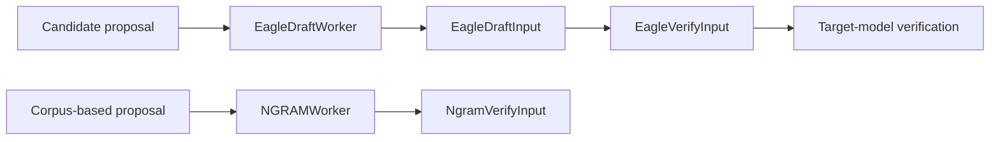
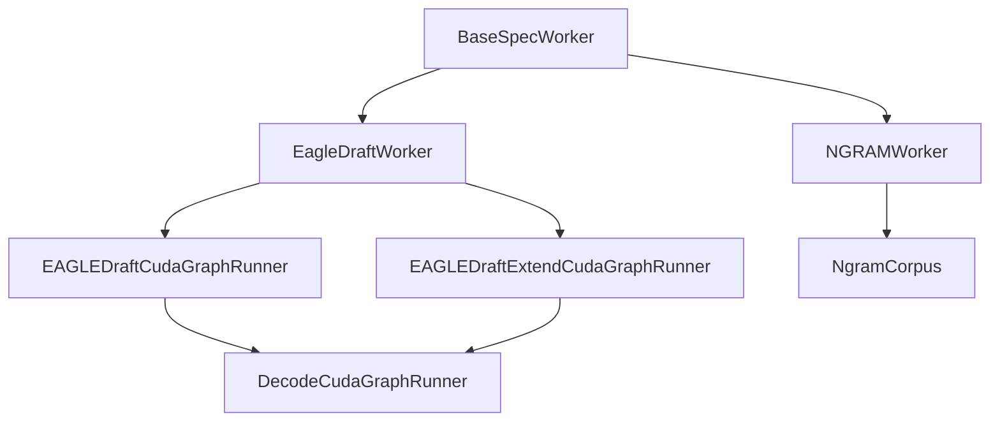

<!-- source: DeepWiki mcp.deepwiki.com · repo sgl-project/sglang · page 12 Speculative Decoding · fetched 2026-10-30 -->

# Speculative Decoding

Relevant source files

The following files were used as context for generating this wiki page:

- [python/sglang/srt/batch_overlap/two_batch_overlap.py](python/sglang/srt/batch_overlap/two_batch_overlap.py)
- [python/sglang/srt/managers/tp_worker.py](python/sglang/srt/managers/tp_worker.py)
- [python/sglang/srt/model_executor/forward_batch_info.py](python/sglang/srt/model_executor/forward_batch_info.py)
- [python/sglang/srt/model_executor/runner/decode_cuda_graph_runner.py](python/sglang/srt/model_executor/runner/decode_cuda_graph_runner.py)
- [python/sglang/srt/speculative/base_spec_worker.py](python/sglang/srt/speculative/base_spec_worker.py)
- [python/sglang/srt/speculative/dflash_info.py](python/sglang/srt/speculative/dflash_info.py)
- [python/sglang/srt/speculative/eagle_draft_cuda_graph_runner.py](python/sglang/srt/speculative/eagle_draft_cuda_graph_runner.py)
- [python/sglang/srt/speculative/eagle_draft_extend_cuda_graph_runner.py](python/sglang/srt/speculative/eagle_draft_extend_cuda_graph_runner.py)
- [python/sglang/srt/speculative/eagle_info.py](python/sglang/srt/speculative/eagle_info.py)
- [python/sglang/srt/speculative/eagle_utils.py](python/sglang/srt/speculative/eagle_utils.py)
- [python/sglang/srt/speculative/eagle_worker_v2.py](python/sglang/srt/speculative/eagle_worker_v2.py)
- [python/sglang/srt/speculative/frozen_kv_mtp_cuda_graph_runner.py](python/sglang/srt/speculative/frozen_kv_mtp_cuda_graph_runner.py)
- [python/sglang/srt/speculative/frozen_kv_mtp_worker_v2.py](python/sglang/srt/speculative/frozen_kv_mtp_worker_v2.py)
- [python/sglang/srt/speculative/multi_layer_eagle_draft_extend_cuda_graph_runner.py](python/sglang/srt/speculative/multi_layer_eagle_draft_extend_cuda_graph_runner.py)
- [python/sglang/srt/speculative/multi_layer_eagle_worker_v2.py](python/sglang/srt/speculative/multi_layer_eagle_worker_v2.py)
- [python/sglang/srt/speculative/ngram_info.py](python/sglang/srt/speculative/ngram_info.py)
- [python/sglang/srt/speculative/ngram_worker.py](python/sglang/srt/speculative/ngram_worker.py)
- [python/sglang/srt/speculative/spec_utils.py](python/sglang/srt/speculative/spec_utils.py)
- [python/sglang/srt/speculative/standalone_worker_v2.py](python/sglang/srt/speculative/standalone_worker_v2.py)

## Purpose and Scope

This page gives a high-level map of speculative decoding in SGLang: how draft proposals relate to target-model verification, which implementation families are represented in the supplied code, and where scheduling and execution fit. It is a parent page; implementation details belong in the child pages. [python/sglang/srt/speculative/eagle_worker_v2.py:173-198](), [python/sglang/srt/speculative/ngram_worker.py:76-103](), [python/sglang/srt/speculative/dflash_worker_v2.py:13-20]()

Sources: [python/sglang/srt/speculative/eagle_worker_v2.py:173-198](), [python/sglang/srt/speculative/ngram_worker.py:76-103](), [python/sglang/srt/speculative/dflash_worker_v2.py:13-20]()

## Architecture and Key Components

At a high level, a speculative worker proposes candidate tokens; the target model evaluates proposals, and the runtime represents proposal and verification inputs using algorithm-specific data structures. For EAGLE, the visible code includes `EagleDraftWorker`, `EagleDraftInput`, and `EagleVerifyInput`. The N-gram worker has no draft model: its candidates come from a CPU-side corpus. [python/sglang/srt/speculative/eagle_worker_v2.py:173-198](), [python/sglang/srt/speculative/eagle_info.py:16-49](), [python/sglang/srt/speculative/ngram_worker.py:76-103](), [python/sglang/srt/speculative/ngram_worker.py:145-148]()

**Diagram: Speculative-decoding concepts mapped to code entities**

Sources: [python/sglang/srt/speculative/eagle_worker_v2.py:173-198](), [python/sglang/srt/speculative/eagle_info.py:16-49](), [python/sglang/srt/speculative/ngram_worker.py:76-103]()

The code separates algorithm-specific workers and inputs from execution infrastructure. For example, EAGLE draft graph runners subclass `DecodeCudaGraphRunner`; this is one connection between speculative execution and the model executor, rather than a separate end-to-end serving path. [python/sglang/srt/speculative/eagle_draft_cuda_graph_runner.py:87-100](), [python/sglang/srt/speculative/eagle_draft_extend_cuda_graph_runner.py:95-101](), [python/sglang/srt/model_executor/runner/decode_cuda_graph_runner.py:14-24]()

**Diagram: Worker and execution entities**

Sources: [python/sglang/srt/speculative/eagle_worker_v2.py:173-181](), [python/sglang/srt/speculative/eagle_draft_cuda_graph_runner.py:87-100](), [python/sglang/srt/speculative/eagle_draft_extend_cuda_graph_runner.py:95-101](), [python/sglang/srt/model_executor/runner/decode_cuda_graph_runner.py:14-24](), [python/sglang/srt/speculative/ngram_worker.py:76-123]()

## Supported Algorithms

The following table identifies implementation families visible in the supplied files. It is an orientation, not a complete compatibility or feature matrix.

| Family | High-level role | Code pointer |
|---|---|---|
| `EAGLE` | Draft-worker path with EAGLE-specific proposal and verification input structures. | [python/sglang/srt/speculative/eagle_worker_v2.py:173-198](), [python/sglang/srt/speculative/eagle_info.py:16-49]() |
| Multi-layer EAGLE | A multi-layer draft worker with its own draft runner list. | [python/sglang/srt/speculative/multi_layer_eagle_worker_v2.py:118-128](), [python/sglang/srt/speculative/multi_layer_eagle_worker_v2.py:164-183]() |
| `NGRAM` | Candidate proposals sourced from an N-gram corpus rather than a draft model. | [python/sglang/srt/speculative/ngram_worker.py:76-103](), [python/sglang/srt/speculative/ngram_worker.py:145-148]() |
| DFlash | A speculative worker implementation with DFlash-specific utilities and inputs. | [python/sglang/srt/speculative/dflash_worker_v2.py:58-80]() |
| DSpark | Referenced in the DFlash worker’s acceptance-sampling imports; detailed behavior is outside the supplied excerpts. | [python/sglang/srt/speculative/dflash_worker_v2.py:18-20]() |
| Frozen-KV MTP and standalone | Additional worker implementations present in the repository cluster. | [python/sglang/srt/speculative/frozen_kv_mtp_worker_v2.py](), [python/sglang/srt/speculative/standalone_worker_v2.py]() |

Algorithm names and draft configuration are handled by `handle_speculative_decoding`; it normalizes the algorithm setting and includes alias handling. For algorithm selection and constraints, see [Integration with Scheduling](#12.3) and [Draft and Verification Flow](#12.2). [python/sglang/srt/arg_groups/speculative_hook.py:80-117](), [python/sglang/srt/arg_groups/speculative_hook.py:120-159]()

Sources: [python/sglang/srt/speculative/eagle_worker_v2.py:173-198](), [python/sglang/srt/speculative/multi_layer_eagle_worker_v2.py:118-183](), [python/sglang/srt/speculative/ngram_worker.py:76-103](), [python/sglang/srt/speculative/dflash_worker_v2.py:18-20](), [python/sglang/srt/speculative/dflash_worker_v2.py:58-80](), [python/sglang/srt/arg_groups/speculative_hook.py:80-117]()

## EAGLE Algorithm and Architecture

EAGLE’s worker is constructed with a target `TpModelWorker` and reads speculative settings such as top-k, step count, and draft-token count. Its verification input carries draft tokens, positions, tree-retrieval metadata, and related shape information. The multi-layer worker is a separate implementation that creates a draft worker configured for multi-layer EAGLE. [python/sglang/srt/speculative/eagle_worker_v2.py:173-198](), [python/sglang/srt/speculative/eagle_info.py:16-49](), [python/sglang/srt/speculative/multi_layer_eagle_worker_v2.py:118-128](), [python/sglang/srt/speculative/multi_layer_eagle_worker_v2.py:164-183]()

For EAGLE/EAGLE2/EAGLE3 architecture, draft-model construction, tree verification, and adaptive speculative decoding, see [EAGLE Algorithm and Architecture](#12.1).

Sources: [python/sglang/srt/speculative/eagle_worker_v2.py:173-198](), [python/sglang/srt/speculative/eagle_info.py:16-49](), [python/sglang/srt/speculative/multi_layer_eagle_worker_v2.py:118-128]()

## Draft and Verification Flow

The common conceptual path is proposal followed by target verification, but the proposal source and input representation vary by algorithm. EAGLE defines `EagleDraftInput` and `EagleVerifyInput`; N-gram uses `NGRAMWorker` and `NgramVerifyInput`; DFlash has its own draft and verification input types. [python/sglang/srt/speculative/eagle_info.py:16-49](), [python/sglang/srt/speculative/eagle_info.py:156-173](), [python/sglang/srt/speculative/ngram_worker.py:25-28](), [python/sglang/srt/speculative/dflash_info.py:13-20]()

For draft token generation, tree construction, target verification, and alternative workers such as DFlash, DSpark, frozen-KV MTP, and standalone, see [Draft and Verification Flow](#12.2).

Sources: [python/sglang/srt/speculative/eagle_info.py:16-49](), [python/sglang/srt/speculative/eagle_info.py:156-173](), [python/sglang/srt/speculative/ngram_worker.py:25-28](), [python/sglang/srt/speculative/dflash_info.py:13-20]()

## Integration with Scheduling

Speculative worker interfaces use runtime batch types such as `ScheduleBatch` and return generation-batch results. The N-gram worker also reads scheduling configuration, including overlap scheduling, and maintains corpus state associated with decode batches. These references show the integration points; they do not imply that all algorithms use the same proposal or verification mechanics. [python/sglang/srt/speculative/eagle_worker_v2.py:40-42](), [python/sglang/srt/speculative/ngram_worker.py:14-16](), [python/sglang/srt/speculative/ngram_worker.py:94-123]()

For scheduler and batch integration, including the N-gram worker and spec registry, see [Integration with Scheduling](#12.3).

Sources: [python/sglang/srt/speculative/eagle_worker_v2.py:40-42](), [python/sglang/srt/speculative/ngram_worker.py:14-16](), [python/sglang/srt/speculative/ngram_worker.py:94-123]()

## Memory Management

Speculative execution uses cache-location and batch metadata alongside proposal inputs. The EAGLE verification input can carry a `KVLocPlan`; the N-gram worker obtains the target worker’s request-to-token pool and KV-pool allocator after those pools are allocated. These are integration points, not a complete description of speculative memory ownership. [python/sglang/srt/speculative/eagle_info.py:38-49](), [python/sglang/srt/speculative/ngram_worker.py:76-83]()

For the detailed relationship between speculative buffers, cache locations, and worker execution, see [Draft and Verification Flow](#12.2).

Sources: [python/sglang/srt/speculative/eagle_info.py:38-49](), [python/sglang/srt/speculative/ngram_worker.py:76-83]()

## CUDA Graph Optimization

EAGLE has dedicated draft and draft-extend graph runners, both built on the `DecodeCudaGraphRunner` infrastructure. The shared runner documents backend choices for decode execution, including full and breakable graph backends. The specific capture and replay behavior of speculative runners is covered in the child page. [python/sglang/srt/speculative/eagle_draft_cuda_graph_runner.py:87-100](), [python/sglang/srt/speculative/eagle_draft_extend_cuda_graph_runner.py:95-101](), [python/sglang/srt/model_executor/runner/decode_cuda_graph_runner.py:14-24]()

For graph capture, replay, and the interaction with draft and verification phases, see [Draft and Verification Flow](#12.2).

Sources: [python/sglang/srt/speculative/eagle_draft_cuda_graph_runner.py:87-100](), [python/sglang/srt/speculative/eagle_draft_extend_cuda_graph_runner.py:95-101](), [python/sglang/srt/model_executor/runner/decode_cuda_graph_runner.py:14-24]()

---

For deeper coverage, follow the child pages:

- [EAGLE Algorithm and Architecture](#12.1)
- [Draft and Verification Flow](#12.2)
- [Integration with Scheduling](#12.3)

---

