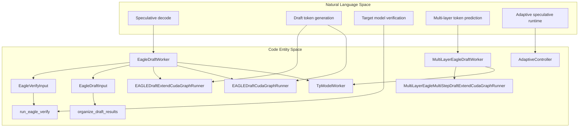
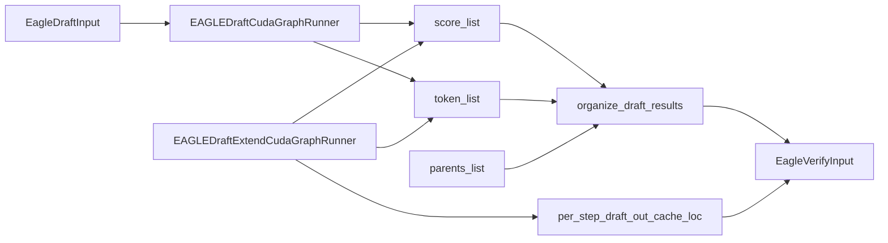
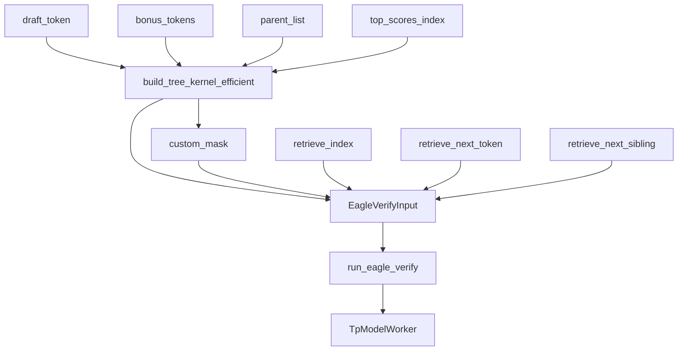
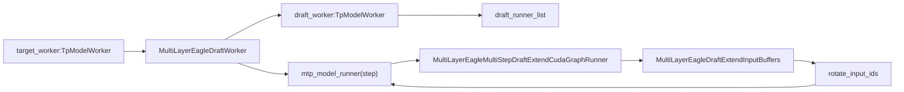

<!-- source: DeepWiki mcp.deepwiki.com · repo sgl-project/sglang · page 12.1 EAGLE Algorithm and Architecture · fetched 2026-10-30 -->

# EAGLE Algorithm and Architecture

Relevant source files

The following files were used as context for generating this wiki page:

- [docs/docs/hardware-platforms/plugin.mdx](docs/docs/hardware-platforms/plugin.mdx)
- [python/sglang/kernels/ops/speculative/spec_tree.py](python/sglang/kernels/ops/speculative/spec_tree.py)
- [python/sglang/srt/batch_overlap/two_batch_overlap.py](python/sglang/srt/batch_overlap/two_batch_overlap.py)
- [python/sglang/srt/hardware_backend/npu/graph_runner/npu_cudagraph_backend.py](python/sglang/srt/hardware_backend/npu/graph_runner/npu_cudagraph_backend.py)
- [python/sglang/srt/managers/tp_worker.py](python/sglang/srt/managers/tp_worker.py)
- [python/sglang/srt/model_executor/forward_batch_info.py](python/sglang/srt/model_executor/forward_batch_info.py)
- [python/sglang/srt/model_executor/runner/decode_cuda_graph_runner.py](python/sglang/srt/model_executor/runner/decode_cuda_graph_runner.py)
- [python/sglang/srt/platforms/__init__.py](python/sglang/srt/platforms/__init__.py)
- [python/sglang/srt/platforms/cpu.py](python/sglang/srt/platforms/cpu.py)
- [python/sglang/srt/platforms/cuda.py](python/sglang/srt/platforms/cuda.py)
- [python/sglang/srt/platforms/device_mixin.py](python/sglang/srt/platforms/device_mixin.py)
- [python/sglang/srt/platforms/interface.py](python/sglang/srt/platforms/interface.py)
- [python/sglang/srt/platforms/musa.py](python/sglang/srt/platforms/musa.py)
- [python/sglang/srt/platforms/npu.py](python/sglang/srt/platforms/npu.py)
- [python/sglang/srt/platforms/rocm.py](python/sglang/srt/platforms/rocm.py)
- [python/sglang/srt/platforms/sail.py](python/sglang/srt/platforms/sail.py)
- [python/sglang/srt/platforms/xpu.py](python/sglang/srt/platforms/xpu.py)
- [python/sglang/srt/speculative/adaptive_runtime_state.py](python/sglang/srt/speculative/adaptive_runtime_state.py)
- [python/sglang/srt/speculative/adaptive_spec_params.py](python/sglang/srt/speculative/adaptive_spec_params.py)
- [python/sglang/srt/speculative/base_spec_worker.py](python/sglang/srt/speculative/base_spec_worker.py)
- [python/sglang/srt/speculative/dflash_info.py](python/sglang/srt/speculative/dflash_info.py)
- [python/sglang/srt/speculative/eagle_draft_cuda_graph_runner.py](python/sglang/srt/speculative/eagle_draft_cuda_graph_runner.py)
- [python/sglang/srt/speculative/eagle_draft_extend_cuda_graph_runner.py](python/sglang/srt/speculative/eagle_draft_extend_cuda_graph_runner.py)
- [python/sglang/srt/speculative/eagle_info.py](python/sglang/srt/speculative/eagle_info.py)
- [python/sglang/srt/speculative/eagle_utils.py](python/sglang/srt/speculative/eagle_utils.py)
- [python/sglang/srt/speculative/eagle_worker_v2.py](python/sglang/srt/speculative/eagle_worker_v2.py)
- [python/sglang/srt/speculative/frozen_kv_mtp_cuda_graph_runner.py](python/sglang/srt/speculative/frozen_kv_mtp_cuda_graph_runner.py)
- [python/sglang/srt/speculative/frozen_kv_mtp_worker_v2.py](python/sglang/srt/speculative/frozen_kv_mtp_worker_v2.py)
- [python/sglang/srt/speculative/multi_layer_eagle_draft_extend_cuda_graph_runner.py](python/sglang/srt/speculative/multi_layer_eagle_draft_extend_cuda_graph_runner.py)
- [python/sglang/srt/speculative/multi_layer_eagle_worker_v2.py](python/sglang/srt/speculative/multi_layer_eagle_worker_v2.py)
- [python/sglang/srt/speculative/ngram_info.py](python/sglang/srt/speculative/ngram_info.py)
- [python/sglang/srt/speculative/ngram_worker.py](python/sglang/srt/speculative/ngram_worker.py)
- [python/sglang/srt/speculative/spec_utils.py](python/sglang/srt/speculative/spec_utils.py)
- [python/sglang/srt/speculative/standalone_worker_v2.py](python/sglang/srt/speculative/standalone_worker_v2.py)
- [test/registered/spec/eagle/test_adaptive_speculative.py](test/registered/spec/eagle/test_adaptive_speculative.py)
- [test/registered/spec/test_frozen_kv_mtp.py](test/registered/spec/test_frozen_kv_mtp.py)
- [test/registered/spec/test_gemma4_mtp_31b_extra.py](test/registered/spec/test_gemma4_mtp_31b_extra.py)
- [test/registered/unit/distributed/test_get_default_distributed_backend.py](test/registered/unit/distributed/test_get_default_distributed_backend.py)
- [test/registered/unit/distributed/test_oot_group_coordinator_hooks.py](test/registered/unit/distributed/test_oot_group_coordinator_hooks.py)
- [test/registered/unit/platforms/test_platform_interface.py](test/registered/unit/platforms/test_platform_interface.py)
- [test/registered/unit/spec/test_adaptive_runtime_state.py](test/registered/unit/spec/test_adaptive_runtime_state.py)
- [test/registered/unit/spec/test_adaptive_spec_params.py](test/registered/unit/spec/test_adaptive_spec_params.py)
- [test/registered/unit/spec/test_oot_eagle_hooks.py](test/registered/unit/spec/test_oot_eagle_hooks.py)

## Purpose and Scope

This page explains the EAGLE speculative-decoding implementation in SGLang: how draft workers and target workers cooperate, how proposals are represented and verified as a tree, how multi-layer EAGLE differs from the single-worker path, and where adaptive speculative runtime state and CUDA graph runners fit. The code excerpts provided establish implementation details for the EAGLE workers, input structures, tree helpers, configuration resolution, and graph runners; they do not establish the historical algorithmic differences among EAGLE, EAGLE2, and EAGLE3. [python/sglang/srt/speculative/eagle_worker_v2.py:173-203]() [python/sglang/srt/speculative/multi_layer_eagle_worker_v2.py:118-185]() [python/sglang/srt/speculative/eagle_info.py:16-60]()

Sources: [python/sglang/srt/speculative/eagle_worker_v2.py:173-203]() [python/sglang/srt/speculative/multi_layer_eagle_worker_v2.py:118-185]() [python/sglang/srt/speculative/eagle_info.py:16-60]()

---

## Architecture Overview

EAGLE’s runtime is organized around a target model worker and a speculative worker. `EagleDraftWorker` receives a `TpModelWorker` as its target, reads speculative settings from runtime context, and constructs draft execution support. `EagleVerifyInput` carries the proposed tokens, attention mask, positions, and tree traversal metadata used by verification. [python/sglang/srt/speculative/eagle_worker_v2.py:173-203]() [python/sglang/srt/speculative/eagle_info.py:16-60]()

### High-Level Components and Code Entities Mapping

**Diagram: EAGLE concepts mapped to SGLang entities**

The diagram maps conceptual roles to code identifiers. `EagleDraftWorker` and `MultiLayerEagleDraftWorker` are defined in their respective worker files; the EAGLE runners subclass or compose decode graph-runner infrastructure; and `EagleDraftInput` / `EagleVerifyInput` are dataclasses in `eagle_info.py`. The worker imports `AdaptiveController` and `SpecRuntimeState`, but the supplied excerpt does not show their implementation or the worker’s adaptive-control call sites. [python/sglang/srt/speculative/eagle_worker_v2.py:72-77]() [python/sglang/srt/speculative/eagle_worker_v2.py:173-203]() [python/sglang/srt/speculative/multi_layer_eagle_worker_v2.py:118-185]() [python/sglang/srt/speculative/eagle_draft_cuda_graph_runner.py:87-101]() [python/sglang/srt/speculative/eagle_draft_extend_cuda_graph_runner.py:95-102]() [python/sglang/srt/speculative/multi_layer_eagle_draft_extend_cuda_graph_runner.py:111-149]() [python/sglang/srt/speculative/eagle_info.py:16-60]() [python/sglang/srt/speculative/eagle_info.py:156-173]()

Sources: [python/sglang/srt/speculative/eagle_worker_v2.py:72-77]() [python/sglang/srt/speculative/eagle_worker_v2.py:173-203]() [python/sglang/srt/speculative/multi_layer_eagle_worker_v2.py:118-185]() [python/sglang/srt/speculative/eagle_draft_cuda_graph_runner.py:87-101]() [python/sglang/srt/speculative/eagle_draft_extend_cuda_graph_runner.py:95-102]() [python/sglang/srt/speculative/multi_layer_eagle_draft_extend_cuda_graph_runner.py:111-149]() [python/sglang/srt/speculative/eagle_info.py:16-60]() [python/sglang/srt/speculative/eagle_info.py:156-173]()

### EAGLE Family and Configuration

The worker reads `speculative_eagle_topk`, `speculative_num_steps`, `speculative_num_draft_tokens`, and `speculative_algorithm` from the speculative runtime context. The single-layer worker asserts `topk == 1` when rejection sampling is enabled. The multi-layer worker also reads the rejection-sampling setting and requires `speculative_num_draft_tokens == speculative_num_steps + 1`. [python/sglang/srt/speculative/eagle_worker_v2.py:189-198]() [python/sglang/srt/speculative/multi_layer_eagle_worker_v2.py:138-155]()

| Setting or type | Role visible in the implementation |
|---|---|
| `speculative_eagle_topk` | Draft branching width; used as `topk` by the workers. [python/sglang/srt/speculative/eagle_worker_v2.py:189-195]() |
| `speculative_num_steps` | Number of configured speculative steps. [python/sglang/srt/speculative/eagle_worker_v2.py:194-198]() |
| `speculative_num_draft_tokens` | Draft-token width used by worker setup and input sizing. [python/sglang/srt/speculative/eagle_worker_v2.py:194-198]() |
| `speculative_algorithm` | Parsed into `SpeculativeAlgorithm` by each EAGLE worker. [python/sglang/srt/speculative/eagle_worker_v2.py:196-198]() [python/sglang/srt/speculative/multi_layer_eagle_worker_v2.py:153-155]() |
| `speculative_use_rejection_sampling` | Enables rejection-sampling behavior; the single-layer worker constrains it to `topk == 1`. [python/sglang/srt/speculative/eagle_worker_v2.py:191-194]() |
| `EagleVerifyInput` | Holds tree verification tensors and derives default per-request verification width from `draft_token_num`. [python/sglang/srt/speculative/eagle_info.py:16-49]() |

Sources: [python/sglang/srt/speculative/eagle_worker_v2.py:189-198]() [python/sglang/srt/speculative/multi_layer_eagle_worker_v2.py:138-155]() [python/sglang/srt/speculative/eagle_info.py:16-49]()

---

## Core Components and Data Flow

### `EagleDraftWorker`

`EagleDraftWorker` receives `ServerArgs`, device and communication parameters, and a target `TpModelWorker`. It stores those references, reads the runtime device and speculative settings, converts the configured algorithm to `SpeculativeAlgorithm`, and rebuilds its top-k-one chain buffers. The shown constructor excerpt also identifies `draft_owns_attention` as a topology decision, but does not show the remainder of that logic. [python/sglang/srt/speculative/eagle_worker_v2.py:173-203]()

The worker file imports the shared EAGLE preparation and verification functions `prepare_for_draft`, `prepare_for_draft_extend`, `build_eagle_verify_input`, and `run_eagle_verify`. The supplied excerpt shows these imports but not their call sites, so the exact invocation sequence is not inferred here. [python/sglang/srt/speculative/eagle_worker_v2.py:100-105]()

Sources: [python/sglang/srt/speculative/eagle_worker_v2.py:173-203]() [python/sglang/srt/speculative/eagle_worker_v2.py:100-105]()

### Draft and Verification Input Structures

`EagleDraftInput` includes top-k probabilities and token indices, optional draft proposal probabilities, optional hidden states, and a capture-hidden mode. Its comments distinguish proposal distributions used with rejection sampling and note that some draft algorithms do not consume hidden states. [python/sglang/srt/speculative/eagle_info.py:156-173]()

`EagleVerifyInput` includes `draft_token`, `custom_mask`, token `positions`, tree retrieval arrays, step and top-k metadata, sequence-length data, and optional proposal distributions and cache-location planning data. Its `__post_init__` sets the input type to `EAGLE_VERIFY`, fills a missing `num_tokens_per_req` from `draft_token_num`, and sets the per-request log-probability width to that draft-token count. `max_tree_depth` returns `spec_steps + 1`; `tree_topk` returns `topk`. [python/sglang/srt/speculative/eagle_info.py:16-63]()

| Structure | Relevant fields | Purpose indicated by code |
|---|---|---|
| `EagleDraftInput` | `topk_p`, `topk_index`, `draft_probs`, `hidden_states`, `capture_hidden_mode` | Carries draft candidates, optional distributions, and optional hidden-state input. [python/sglang/srt/speculative/eagle_info.py:156-173]() |
| `EagleVerifyInput` | `draft_token`, `custom_mask`, `positions`, `retrieve_index`, `retrieve_next_token`, `retrieve_next_sibling`, `retrieve_cum_len` | Carries the draft tree and verification metadata. [python/sglang/srt/speculative/eagle_info.py:16-40]() |
| `EagleVerifyInput` sizing | `num_tokens_per_req`, `num_tokens_for_logprob_per_req`, `max_tree_depth`, `tree_topk` | Supplies verification-width and tree-shape information. [python/sglang/srt/speculative/eagle_info.py:42-63]() |

Sources: [python/sglang/srt/speculative/eagle_info.py:16-63]() [python/sglang/srt/speculative/eagle_info.py:156-173]()

---

## Draft Model and Tree Generation

### Draft Execution

`EAGLEDraftCudaGraphRunner` is an EAGLE-specific subclass of `DecodeCudaGraphRunner`. Its constructor selects the model runner from the EAGLE worker, sets the draft attention backend and capture mode, obtains capture batch sizes, and resolves a static capture width for the `draft_decode` phase. It initializes attention graph state and allocates static buffers sized using the maximum captured batch size and that width. [python/sglang/srt/speculative/eagle_draft_cuda_graph_runner.py:87-101]() [python/sglang/srt/speculative/eagle_draft_cuda_graph_runner.py:103-168]()

`EAGLEDraftExtendCudaGraphRunner` is another `DecodeCudaGraphRunner` subclass, configured for `ForwardMode.DRAFT_EXTEND_V2`. It resolves its static capture width for the `draft_extend` phase, initializes the attention backend’s graph state, and keeps draft-extend-specific buffers including token IDs, cache locations, positions, hidden states, sequence lengths, and acceptance-related values. [python/sglang/srt/speculative/eagle_draft_extend_cuda_graph_runner.py:74-102]() [python/sglang/srt/speculative/eagle_draft_extend_cuda_graph_runner.py:103-163]()

The shared width resolver defines `draft_decode` width as `speculative_eagle_topk` and `draft_extend` width as `speculative_num_draft_tokens`; the target verification width is delegated to the selected algorithm. [python/sglang/srt/speculative/spec_utils.py:83-110]()

### Draft Results and Tree Assembly

`organize_draft_results` concatenates per-step scores and tokens, selects the highest-scoring `num_draft_token - 1` candidates, sorts the selected indices, gathers the corresponding tokens, and returns parent information, selected indices, and draft tokens. The helper documents its score layout in terms of batch, steps, and `topk`. [python/sglang/srt/speculative/eagle_utils.py:100-129]()

`per_step_draft_out_cache_loc` checks that the cache-location buffer has `batch_size * topk * num_steps` elements, then reshapes and permutes it into one cache-location slice per draft step. [python/sglang/srt/speculative/eagle_utils.py:57-78]()

**Diagram: draft-runner and tree-assembly entities**

This diagram summarizes the relationship among the named data structures and helpers. It is not a complete call graph: the provided excerpts define the runners and tree-assembly utilities but do not show the worker’s full draft-loop call sites. [python/sglang/srt/speculative/eagle_draft_cuda_graph_runner.py:87-168]() [python/sglang/srt/speculative/eagle_draft_extend_cuda_graph_runner.py:74-163]() [python/sglang/srt/speculative/eagle_utils.py:57-78]() [python/sglang/srt/speculative/eagle_utils.py:100-129]() [python/sglang/srt/speculative/eagle_info.py:16-49]() [python/sglang/srt/speculative/eagle_info.py:156-173]()

Sources: [python/sglang/srt/speculative/eagle_draft_cuda_graph_runner.py:87-168]() [python/sglang/srt/speculative/eagle_draft_extend_cuda_graph_runner.py:74-163]() [python/sglang/srt/speculative/spec_utils.py:83-110]() [python/sglang/srt/speculative/eagle_utils.py:57-78]() [python/sglang/srt/speculative/eagle_utils.py:100-129]() [python/sglang/srt/speculative/eagle_info.py:16-49]() [python/sglang/srt/speculative/eagle_info.py:156-173]()

---

## Verification and Acceptance

### Tree-Based Verification Input

`EagleVerifyInput` represents verification as a batch of draft tokens plus the metadata needed to apply tree-shaped attention and recover traversal paths. The retrieval fields include `retrieve_index`, `retrieve_next_token`, `retrieve_next_sibling`, and `retrieve_cum_len`; `custom_mask` and `positions` provide attention-related inputs. Optional fields include proposal distributions for rejection sampling and a `KVLocPlan` associated with the planned verification window. [python/sglang/srt/speculative/eagle_info.py:16-44]()

`generate_attn_arg_prefill` widens the paged sequence lengths by `draft_token_num`, constructs cumulative KV lengths and query indptr values, allocates packed KV indices, and asks `KVIndexTranslator.pack_read_stream` to populate those indices using the supplied plan and request-pool indices. It also ensures the custom mask has enough elements for the verify shape. [python/sglang/srt/speculative/eagle_info.py:90-153]()

### Tree Mask Construction

`build_tree_kernel_efficient` prepends each request’s bonus token to its draft tokens, determines the batch and device from sequence lengths, and prepares a tree mask according to `TreeMaskMode`. In the shown excerpt, `QLEN_ONLY` and `QLEN_ONLY_BITPACKING` initialize masks differently, while `FULL_MASK` conditionally fills the prefix mask before the tree kernel writes tree cells. `default_tree_mask_mode` selects `QLEN_ONLY` on CPU and `FULL_MASK` otherwise. [python/sglang/srt/speculative/eagle_utils.py:132-173]()

`EagleVerifyInput.max_tree_depth` bounds the root-to-leaf verification path as `spec_steps + 1`; `tree_topk` exposes the configured branching factor, with the code comment identifying `-1` as the irregular-tree value. [python/sglang/srt/speculative/eagle_info.py:51-63]()

**Diagram: tree verification data mapping**

`build_tree_kernel_efficient` and `EagleVerifyInput` establish the tree-building and input-data sides of this mapping. `run_eagle_verify` is imported by the workers, but the excerpts do not show its implementation or the worker call site; the diagram indicates the named verification boundary rather than asserting an unshown call sequence. [python/sglang/srt/speculative/eagle_utils.py:138-173]() [python/sglang/srt/speculative/eagle_info.py:16-40]() [python/sglang/srt/speculative/eagle_worker_v2.py:100-105]() [python/sglang/srt/speculative/multi_layer_eagle_worker_v2.py:65-70]()

Sources: [python/sglang/srt/speculative/eagle_info.py:16-63]() [python/sglang/srt/speculative/eagle_info.py:90-153]() [python/sglang/srt/speculative/eagle_utils.py:132-173]() [python/sglang/srt/speculative/eagle_worker_v2.py:100-105]() [python/sglang/srt/speculative/multi_layer_eagle_worker_v2.py:65-70]()

---

## CUDA Graph Optimizations

The general `DecodeCudaGraphRunner` supports decode, target verification, and DLLM extend under a configurable backend. Its module documentation describes `full` capture, experimental `breakable` capture, and fallback from unsupported `tc_piecewise` decode to `full`. [python/sglang/srt/model_executor/runner/decode_cuda_graph_runner.py:14-24]()

The EAGLE draft and draft-extend runners reuse the parent’s capture and backend scaffolding while overriding EAGLE-specific buffers, capture behavior, replay behavior, or graph eligibility. The draft runner documents that it does not call the parent initializer and instead establishes the fields required by the parent capture contract. The draft-extend runner documents that it inherits the outer capture loop and overrides `capture_one_shape`, `replay`, and `can_run_graph` for its semantics. [python/sglang/srt/speculative/eagle_draft_cuda_graph_runner.py:87-101]() [python/sglang/srt/speculative/eagle_draft_extend_cuda_graph_runner.py:95-102]()

The multi-layer draft-extend graph runner uses a persistent input-buffer structure shared across MTP draft steps. Its buffer fields include input IDs, cache locations, positions, sequence lengths, hidden states, selected indices, and optional proposal-sampling data. [python/sglang/srt/speculative/multi_layer_eagle_draft_extend_cuda_graph_runner.py:111-140]()

Sources: [python/sglang/srt/model_executor/runner/decode_cuda_graph_runner.py:14-24]() [python/sglang/srt/speculative/eagle_draft_cuda_graph_runner.py:87-101]() [python/sglang/srt/speculative/eagle_draft_extend_cuda_graph_runner.py:95-102]() [python/sglang/srt/speculative/multi_layer_eagle_draft_extend_cuda_graph_runner.py:111-149]()

---

## Multi-Layer EAGLE (MTP)

### `MultiLayerEagleDraftWorker`

`MultiLayerEagleDraftWorker` receives a target `TpModelWorker`, retains the target model configuration, reads speculative settings, and asserts that the configured draft-token count equals the number of steps plus one. It creates a draft `TpModelWorker` under draft-specific pipeline-parallel, MoE, and model-build contexts, marks it as a draft worker and multi-layer EAGLE worker, and sets its context length from the target model configuration. [python/sglang/srt/speculative/multi_layer_eagle_worker_v2.py:118-178]()

The worker exposes `draft_runner_list` from the draft worker’s model-runner list and aliases the first entry as `draft_runner`. The excerpt also describes chain-style MTP state propagation, but does not include the full implementation of that propagation. [python/sglang/srt/speculative/multi_layer_eagle_worker_v2.py:180-185]()

### Multi-Step Draft-Extend Runner

`MultiLayerEagleMultiStepDraftExtendCudaGraphRunner` is a composite runner that coordinates multi-layer draft-extend execution. Its per-step runner shares a buffer set owned by the composite; `MultiLayerEagleDraftExtendInputBuffers` describes that persistent set. The per-step runner obtains its model runner from `mtp_model_runner(self.step)` and uses the EAGLE draft-extend forward mode. [python/sglang/srt/speculative/multi_layer_eagle_draft_extend_cuda_graph_runner.py:111-149]() [python/sglang/srt/speculative/multi_layer_eagle_draft_extend_cuda_graph_runner.py:142-177]()

Multi-layer utilities imported by the worker include `compute_widened_draft_extend_locs_positions`, `fill_widened_draft_extend_inputs_triton`, `rotate_input_ids`, and boundary-state helpers. Their names indicate the specialized input and boundary-state operations used by this path, but the supplied excerpts do not show their function bodies. [python/sglang/srt/speculative/multi_layer_eagle_worker_v2.py:75-80]()

**Diagram: multi-layer worker and shared graph buffers**

The worker creates the multi-layer draft worker and exposes its runner list; the graph-runner module documents shared buffers and per-step model-runner selection. The diagram presents these entity relationships, not a complete runtime call sequence. [python/sglang/srt/speculative/multi_layer_eagle_worker_v2.py:164-185]() [python/sglang/srt/speculative/multi_layer_eagle_draft_extend_cuda_graph_runner.py:111-149]() [python/sglang/srt/speculative/multi_layer_eagle_draft_extend_cuda_graph_runner.py:152-177]()

Sources: [python/sglang/srt/speculative/multi_layer_eagle_worker_v2.py:118-185]() [python/sglang/srt/speculative/multi_layer_eagle_worker_v2.py:75-80]() [python/sglang/srt/speculative/multi_layer_eagle_draft_extend_cuda_graph_runner.py:111-149]() [python/sglang/srt/speculative/multi_layer_eagle_draft_extend_cuda_graph_runner.py:142-177]()

---

## Adaptive Speculative Decoding

The EAGLE worker imports `AdaptiveController`, `SpecRuntimeState`, and `AdaptiveSpeculativeParams`; the supplied worker excerpt does not show how these objects are instantiated, updated, or used to change runtime settings. [python/sglang/srt/speculative/eagle_worker_v2.py:72-77]()

The shared token-width resolver documents an adaptive-sizing consideration: adaptive speculative decoding may capture candidate-step configurations with overridden leaves, so buffer sizing must follow the active override rather than assume only startup values. It selects widths by phase: `draft_decode` uses EAGLE top-k, `draft_extend` uses the configured draft-token count, and `target_verify` delegates to the algorithm’s width hook. [python/sglang/srt/speculative/spec_utils.py:83-110]()

The `EagleDraftWorker` constructor reads top-k, step count, draft-token count, and algorithm from runtime context. Those settings determine worker configuration, but the supplied excerpt is insufficient to claim a specific acceptance-rate controller policy or identify which values are dynamically changed. [python/sglang/srt/speculative/eagle_worker_v2.py:189-200]()

Sources: [python/sglang/srt/speculative/eagle_worker_v2.py:72-77]() [python/sglang/srt/speculative/eagle_worker_v2.py:189-200]() [python/sglang/srt/speculative/spec_utils.py:83-110]()

---

## Related Speculative-Decoding Implementations

SGLang’s speculative package includes alternatives to EAGLE. `NGRAMWorker` has no draft model: its `draft_worker` property returns `None`, and it obtains proposals from `NgramCorpus`. Its constructor reads n-gram matching and corpus settings from runtime context. [python/sglang/srt/speculative/ngram_worker.py:76-123]() [python/sglang/srt/speculative/ngram_worker.py:145-148]()

Sources: [python/sglang/srt/speculative/ngram_worker.py:76-123]() [python/sglang/srt/speculative/ngram_worker.py:145-148]()

---

