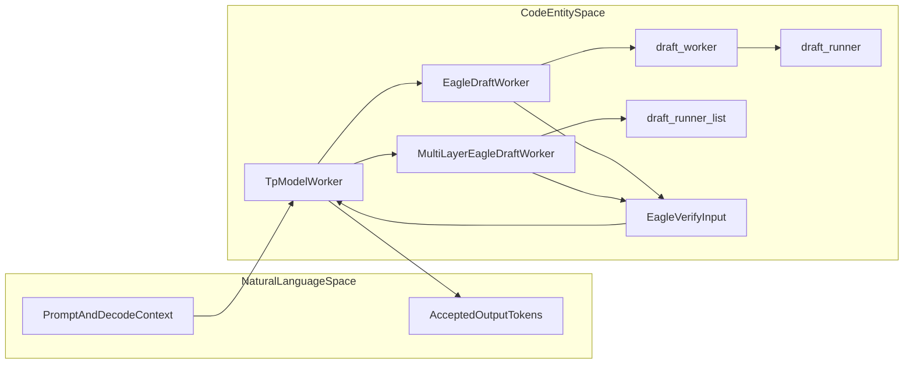
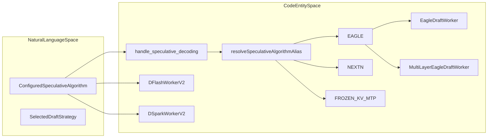
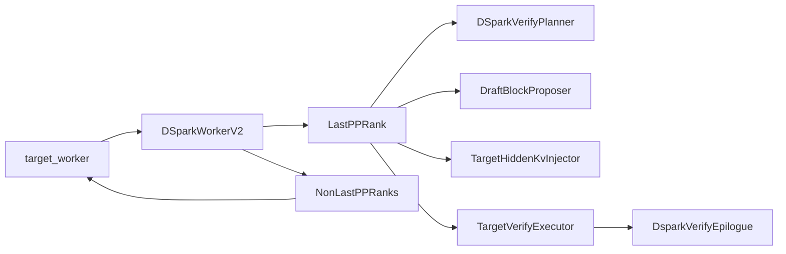
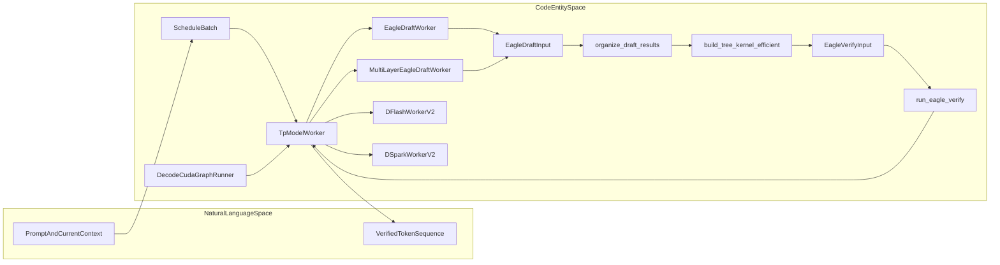

<!-- source: DeepWiki mcp.deepwiki.com · repo sgl-project/sglang · page 12.2 Draft and Verification Flow · fetched 2026-10-30 -->

# Draft and Verification Flow

Relevant source files

The following files were used as context for generating this wiki page:

- [python/sglang/kernels/ops/speculative/dspark/dspark_attn_metadata.py](python/sglang/kernels/ops/speculative/dspark/dspark_attn_metadata.py)
- [python/sglang/kernels/ops/speculative/dspark/dspark_verify_window.py](python/sglang/kernels/ops/speculative/dspark/dspark_verify_window.py)
- [python/sglang/srt/arg_groups/fields/spec.py](python/sglang/srt/arg_groups/fields/spec.py)
- [python/sglang/srt/arg_groups/speculative_hook.py](python/sglang/srt/arg_groups/speculative_hook.py)
- [python/sglang/srt/batch_overlap/two_batch_overlap.py](python/sglang/srt/batch_overlap/two_batch_overlap.py)
- [python/sglang/srt/disaggregation/decode_schedule_batch_mixin.py](python/sglang/srt/disaggregation/decode_schedule_batch_mixin.py)
- [python/sglang/srt/managers/overlap_utils.py](python/sglang/srt/managers/overlap_utils.py)
- [python/sglang/srt/managers/tp_worker.py](python/sglang/srt/managers/tp_worker.py)
- [python/sglang/srt/model_executor/forward_batch_info.py](python/sglang/srt/model_executor/forward_batch_info.py)
- [python/sglang/srt/model_executor/runner/decode_cuda_graph_runner.py](python/sglang/srt/model_executor/runner/decode_cuda_graph_runner.py)
- [python/sglang/srt/model_executor/runner_utils/shared_read_event.py](python/sglang/srt/model_executor/runner_utils/shared_read_event.py)
- [python/sglang/srt/models/deepseek_v4_dspark.py](python/sglang/srt/models/deepseek_v4_dspark.py)
- [python/sglang/srt/models/dflash.py](python/sglang/srt/models/dflash.py)
- [python/sglang/srt/models/dspark.py](python/sglang/srt/models/dspark.py)
- [python/sglang/srt/speculative/base_spec_worker.py](python/sglang/srt/speculative/base_spec_worker.py)
- [python/sglang/srt/speculative/dflash_info.py](python/sglang/srt/speculative/dflash_info.py)
- [python/sglang/srt/speculative/dflash_utils.py](python/sglang/srt/speculative/dflash_utils.py)
- [python/sglang/srt/speculative/dflash_worker_v2.py](python/sglang/srt/speculative/dflash_worker_v2.py)
- [python/sglang/srt/speculative/dspark_components/dspark_config.py](python/sglang/srt/speculative/dspark_components/dspark_config.py)
- [python/sglang/srt/speculative/dspark_components/dspark_draft.py](python/sglang/srt/speculative/dspark_components/dspark_draft.py)
- [python/sglang/srt/speculative/dspark_components/dspark_draft_sampler.py](python/sglang/srt/speculative/dspark_components/dspark_draft_sampler.py)
- [python/sglang/srt/speculative/dspark_components/dspark_kv_inject.py](python/sglang/srt/speculative/dspark_components/dspark_kv_inject.py)
- [python/sglang/srt/speculative/dspark_components/dspark_planner.py](python/sglang/srt/speculative/dspark_components/dspark_planner.py)
- [python/sglang/srt/speculative/dspark_components/dspark_verify.py](python/sglang/srt/speculative/dspark_components/dspark_verify.py)
- [python/sglang/srt/speculative/dspark_components/dspark_worker_v2.py](python/sglang/srt/speculative/dspark_components/dspark_worker_v2.py)
- [python/sglang/srt/speculative/eagle_disaggregation.py](python/sglang/srt/speculative/eagle_disaggregation.py)
- [python/sglang/srt/speculative/eagle_draft_cuda_graph_runner.py](python/sglang/srt/speculative/eagle_draft_cuda_graph_runner.py)
- [python/sglang/srt/speculative/eagle_draft_extend_cuda_graph_runner.py](python/sglang/srt/speculative/eagle_draft_extend_cuda_graph_runner.py)
- [python/sglang/srt/speculative/eagle_info.py](python/sglang/srt/speculative/eagle_info.py)
- [python/sglang/srt/speculative/eagle_utils.py](python/sglang/srt/speculative/eagle_utils.py)
- [python/sglang/srt/speculative/eagle_worker_v2.py](python/sglang/srt/speculative/eagle_worker_v2.py)
- [python/sglang/srt/speculative/frozen_kv_mtp_cuda_graph_runner.py](python/sglang/srt/speculative/frozen_kv_mtp_cuda_graph_runner.py)
- [python/sglang/srt/speculative/frozen_kv_mtp_worker_v2.py](python/sglang/srt/speculative/frozen_kv_mtp_worker_v2.py)
- [python/sglang/srt/speculative/multi_layer_eagle_draft_extend_cuda_graph_runner.py](python/sglang/srt/speculative/multi_layer_eagle_draft_extend_cuda_graph_runner.py)
- [python/sglang/srt/speculative/multi_layer_eagle_worker_v2.py](python/sglang/srt/speculative/multi_layer_eagle_worker_v2.py)
- [python/sglang/srt/speculative/ngram_info.py](python/sglang/srt/speculative/ngram_info.py)
- [python/sglang/srt/speculative/ngram_worker.py](python/sglang/srt/speculative/ngram_worker.py)
- [python/sglang/srt/speculative/spec_info.py](python/sglang/srt/speculative/spec_info.py)
- [python/sglang/srt/speculative/spec_registry.py](python/sglang/srt/speculative/spec_registry.py)
- [python/sglang/srt/speculative/spec_tp_sync.py](python/sglang/srt/speculative/spec_tp_sync.py)
- [python/sglang/srt/speculative/spec_utils.py](python/sglang/srt/speculative/spec_utils.py)
- [python/sglang/srt/speculative/standalone_worker_v2.py](python/sglang/srt/speculative/standalone_worker_v2.py)
- [test/registered/amd/test_deepseek_v4_pro_fp4_dspark.py](test/registered/amd/test_deepseek_v4_pro_fp4_dspark.py)
- [test/registered/spec/dspark/test_dspark_dp_tier.py](test/registered/spec/dspark/test_dspark_dp_tier.py)
- [test/registered/spec/dspark/test_dspark_draft_graph.py](test/registered/spec/dspark/test_dspark_draft_graph.py)
- [test/registered/spec/dspark/test_dspark_draft_path_default.py](test/registered/spec/dspark/test_dspark_draft_path_default.py)
- [test/registered/spec/dspark/test_dspark_kernel_parity.py](test/registered/spec/dspark/test_dspark_kernel_parity.py)
- [test/registered/unit/model_executor/runner/test_prefill_shared_read_done.py](test/registered/unit/model_executor/runner/test_prefill_shared_read_done.py)
- [test/registered/unit/spec/test_dspark_target_hidden_projection.py](test/registered/unit/spec/test_dspark_target_hidden_projection.py)
- [test/registered/unit/spec/test_spec_registry.py](test/registered/unit/spec/test_spec_registry.py)
- [test/registered/unit/spec/test_spec_tp_sync.py](test/registered/unit/spec/test_spec_tp_sync.py)
- [test/registered/unit/speculative/test_pd_eagle_draft_proposal.py](test/registered/unit/speculative/test_pd_eagle_draft_proposal.py)

## Purpose and scope

This page describes how speculative decoding workers generate candidate tokens, represent proposals for target-model verification, and hand verification results back into the decode flow. It covers the visible EAGLE and multi-layer EAGLE structures, DFlash and DSpark worker components, and the algorithm-resolution path for frozen-KV MTP and standalone workers [python/sglang/srt/speculative/eagle_worker_v2.py:173-203](), [python/sglang/srt/speculative/multi_layer_eagle_worker_v2.py:118-185](), [python/sglang/srt/speculative/dflash_worker_v2.py:130-180](), [python/sglang/srt/speculative/dspark_components/dspark_worker_v2.py:153-199](), [python/sglang/srt/arg_groups/speculative_hook.py:80-117]().

Sources: [python/sglang/srt/speculative/eagle_worker_v2.py:173-203](), [python/sglang/srt/speculative/multi_layer_eagle_worker_v2.py:118-185](), [python/sglang/srt/speculative/dflash_worker_v2.py:130-180](), [python/sglang/srt/speculative/dspark_components/dspark_worker_v2.py:153-199](), [python/sglang/srt/arg_groups/speculative_hook.py:80-117]()

---

## Architectural position

A speculative worker is constructed with a target `TpModelWorker`; EAGLE-family workers also initialize or manage draft-side model runners. The single-model EAGLE worker reads speculative settings such as top-k, step count, and draft-token count from runtime configuration, while the multi-layer worker creates a draft `TpModelWorker` inside draft-specific contexts and retains its model runners [python/sglang/srt/speculative/eagle_worker_v2.py:173-203](), [python/sglang/srt/speculative/multi_layer_eagle_worker_v2.py:118-185]().

At a conceptual level, a worker produces candidate tokens and the metadata needed to verify them. For EAGLE, `EagleVerifyInput` carries the flattened draft tokens, tree mask, retrieval links, positions, and optional proposal distributions. The target verification path is represented by `run_eagle_verify` and `build_eagle_verify_input`, which the EAGLE workers import from `eagle_worker_common.py` [python/sglang/srt/speculative/eagle_info.py:16-49](), [python/sglang/srt/speculative/eagle_worker_v2.py:100-105](), [python/sglang/srt/speculative/multi_layer_eagle_worker_v2.py:65-70]().

### System names and code entities

Diagram: Natural-language request to speculative worker and model runners

`EagleDraftWorker` receives `target_worker` and stores it; `MultiLayerEagleDraftWorker` likewise stores the target worker and creates a draft worker whose runners are exposed as `draft_runner_list` and `draft_runner`. `EagleVerifyInput` is the typed structure that carries EAGLE verification data [python/sglang/srt/speculative/eagle_worker_v2.py:173-188](), [python/sglang/srt/speculative/multi_layer_eagle_worker_v2.py:118-185](), [python/sglang/srt/speculative/eagle_info.py:16-49]().

Sources: [python/sglang/srt/speculative/eagle_worker_v2.py:173-188](), [python/sglang/srt/speculative/multi_layer_eagle_worker_v2.py:118-185](), [python/sglang/srt/speculative/eagle_info.py:16-49]()

---

## Configuration and algorithm resolution

`handle_speculative_decoding` normalizes the configured algorithm and resolves aliases. In particular, `NEXTN` resolves to `EAGLE`; if the draft model is detected as a Gemma 4 assistant architecture, `NEXTN` or `EAGLE` resolves to `FROZEN_KV_MTP`, while `EAGLE3` is rejected for that draft architecture. The resolver also validates selected combinations, including block verification restrictions [python/sglang/srt/arg_groups/speculative_hook.py:80-117](), [python/sglang/srt/arg_groups/speculative_hook.py:120-159](), [python/sglang/srt/arg_groups/speculative_hook.py:161-190]().

| Setting or concept | Role evidenced by the implementation |
|---|---|
| `speculative_algorithm` | Selects an algorithm and passes through alias resolution. `NEXTN` becomes `EAGLE`, except that a Gemma 4 assistant draft promotes `NEXTN` or `EAGLE` to `FROZEN_KV_MTP` [python/sglang/srt/arg_groups/speculative_hook.py:80-117](). |
| `speculative_num_steps` | Read by EAGLE workers to configure draft iterations [python/sglang/srt/speculative/eagle_worker_v2.py:189-198](), [python/sglang/srt/speculative/multi_layer_eagle_worker_v2.py:138-157](). |
| `speculative_eagle_topk` | Read by EAGLE workers as the draft branching width [python/sglang/srt/speculative/eagle_worker_v2.py:189-198](), [python/sglang/srt/speculative/multi_layer_eagle_worker_v2.py:138-157](). |
| `speculative_num_draft_tokens` | Sets the configured draft-token count. Multi-layer EAGLE asserts that it equals `speculative_num_steps + 1` [python/sglang/srt/speculative/eagle_worker_v2.py:189-198](), [python/sglang/srt/speculative/multi_layer_eagle_worker_v2.py:138-152](). |
| `speculative_use_rejection_sampling` | Affects EAGLE constraints and proposal-distribution handling. The single-layer worker requires top-k 1 when this mode is enabled; `EagleVerifyInput.draft_probs` is optional and used for rejection sampling [python/sglang/srt/speculative/eagle_worker_v2.py:189-198](), [python/sglang/srt/speculative/eagle_info.py:31-40](). |

Diagram: Algorithm names and implementation entities

Sources: [python/sglang/srt/arg_groups/speculative_hook.py:80-117](), [python/sglang/srt/speculative/eagle_worker_v2.py:173-198](), [python/sglang/srt/speculative/multi_layer_eagle_worker_v2.py:118-157](), [python/sglang/srt/speculative/dflash_worker_v2.py:130-143](), [python/sglang/srt/speculative/dspark_components/dspark_worker_v2.py:153-175]()

---

## Core data structures and transitions

The EAGLE worker’s draft and verify phases use distinct input structures. `EagleDraftInput` holds proposal-related state such as top-k probabilities and token indices, optional draft distributions, and hidden states [python/sglang/srt/speculative/eagle_info.py:16-49](), [python/sglang/srt/speculative/eagle_info.py:156-173](). `EagleVerifyInput` represents the verification tree and carries the draft tokens, custom attention mask, positions, retrieval links, step/top-k metadata, and optional `draft_probs` [python/sglang/srt/speculative/eagle_info.py:16-49]().

Diagram: EAGLE draft-to-verification data transition

`organize_draft_results` joins per-step scores and tokens, selects the requested number of draft tokens, and returns parent information, selected indices, and token IDs [python/sglang/srt/speculative/eagle_utils.py:100-129](). `build_tree_kernel_efficient` prepends bonus tokens to the draft tokens and builds the tree mask [python/sglang/srt/speculative/eagle_utils.py:138-173]().

### `EagleVerifyInput`

`EagleVerifyInput` extends `SpecInput`. Its fields include:
- `draft_token` and `custom_mask`, which encode candidate tokens and attention visibility [python/sglang/srt/speculative/eagle_info.py:16-49]().
- `positions`, `retrieve_index`, `retrieve_next_token`, and `retrieve_next_sibling`, which represent position and tree traversal data [python/sglang/srt/speculative/eagle_info.py:16-49]().
- `spec_steps`, `topk`, and `draft_token_num`, which describe the proposal shape [python/sglang/srt/speculative/eagle_info.py:16-49]().
- Optional `draft_probs`, `prepared_out_cache_loc`, `prepared_mrope_positions`, and `kv_loc_plan` [python/sglang/srt/speculative/eagle_info.py:16-49]().

`generate_attn_arg_prefill` widens paged sequence lengths by the verify-token count, constructs query and cumulative key/value indptr arrays, and asks `KVIndexTranslator.pack_read_stream` to populate the verification KV indices [python/sglang/srt/speculative/eagle_info.py:90-153]().

### Draft-width sizing

`resolve_num_tokens_per_req` is the shared sizing function for speculative phases [python/sglang/srt/speculative/spec_utils.py:83-110](). It returns `speculative_eagle_topk` for `draft_decode`, `speculative_num_draft_tokens` for `draft_extend`, and delegates target-verification width to the algorithm’s `get_num_tokens_per_req_for_target_verify` method [python/sglang/srt/speculative/spec_utils.py:83-110]().

Sources: [python/sglang/srt/speculative/eagle_info.py:16-62](), [python/sglang/srt/speculative/eagle_info.py:90-153](), [python/sglang/srt/speculative/eagle_info.py:156-173](), [python/sglang/srt/speculative/eagle_utils.py:100-129](), [python/sglang/srt/speculative/eagle_utils.py:138-173](), [python/sglang/srt/speculative/spec_utils.py:83-110]()

---

## Execution flow: draft and verify

### Draft proposal generation

`EagleDraftWorker` records the target worker and reads the speculative top-k, step count, draft-token count, and algorithm from runtime configuration [python/sglang/srt/speculative/eagle_worker_v2.py:173-203](). When rejection sampling is enabled, it asserts that top-k is 1 [python/sglang/srt/speculative/eagle_worker_v2.py:196-197]().

For multi-layer EAGLE, `MultiLayerEagleDraftWorker` creates a draft `TpModelWorker` in `draft_pp_context`, `speculative_moe_backend_context`, and `draft_model_build_scope` [python/sglang/srt/speculative/multi_layer_eagle_worker_v2.py:172-177](). It retains the model runners in `draft_runner_list`, with the first runner exposed as `draft_runner` [python/sglang/srt/speculative/multi_layer_eagle_worker_v2.py:118-185]().

### Tree organization and proposal sampling

`organize_draft_results` concatenates per-step scores and token proposals, selects the highest-scoring draft entries, sorts the selected indices, gathers corresponding tokens, and returns the parent list and selected tokens [python/sglang/srt/speculative/eagle_utils.py:100-129](). `build_tree_kernel_efficient` prepends each request’s bonus token and constructs a tree mask according to the selected `TreeMaskMode` [python/sglang/srt/speculative/eagle_utils.py:138-173]().

`fast_sample` supports seeded sampling using `murmur_hash32` and exponential-race Gumbel-max sampling [python/sglang/srt/speculative/spec_utils.py:119-177]().

Sources: [python/sglang/srt/speculative/eagle_worker_v2.py:173-203](), [python/sglang/srt/speculative/multi_layer_eagle_worker_v2.py:118-185](), [python/sglang/srt/speculative/eagle_utils.py:100-173](), [python/sglang/srt/speculative/spec_utils.py:119-177]()

---

## Alternative workers and algorithms

### DFlash

`dflash_worker_v2.py` defines `_DflashDraftSampler`, a capture-safe greedy sampler over the target model’s LM-head weights [python/sglang/srt/speculative/dflash_worker_v2.py:135-145](). Its class documentation states that the DFlash draft has no LM head of its own and borrows the target `lm_head` [python/sglang/srt/speculative/dflash_worker_v2.py:137-139]().

### DSpark

`DSparkWorkerV2` is built around separate draft, planner, verification, and epilogue components [python/sglang/srt/speculative/dspark_components/dspark_worker_v2.py:45-88](). Its class documentation states that non-last pipeline-parallel stages run only the target, while draft state belongs to the last stage [python/sglang/srt/speculative/dspark_components/dspark_worker_v2.py:159-160]().

Diagram: DSpark component names and worker placement

Sources: [python/sglang/srt/speculative/dflash_worker_v2.py:130-180](), [python/sglang/srt/speculative/dspark_components/dspark_worker_v2.py:45-88](), [python/sglang/srt/speculative/dspark_components/dspark_worker_v2.py:153-199]()

---

## CUDA graph execution

`DecodeCudaGraphRunner` supports decode, target verification, and DLLM extend through a selected backend [python/sglang/srt/model_executor/runner/decode_cuda_graph_runner.py:14-24](). EAGLE draft-extend has a specialized runner, `EAGLEDraftExtendCudaGraphRunner`, which subclasses `DecodeCudaGraphRunner` and sets its forward mode to `DRAFT_EXTEND_V2` [python/sglang/srt/speculative/eagle_draft_extend_cuda_graph_runner.py:95-113]().

Sources: [python/sglang/srt/model_executor/runner/decode_cuda_graph_runner.py:14-24](), [python/sglang/srt/speculative/eagle_draft_extend_cuda_graph_runner.py:95-113]()

---

## End-to-end entity map

Diagram: Natural-language request to speculative proposal, verification metadata, and output

Sources: [python/sglang/srt/speculative/eagle_worker_v2.py:173-203](), [python/sglang/srt/speculative/multi_layer_eagle_worker_v2.py:118-185](), [python/sglang/srt/speculative/eagle_info.py:16-49](), [python/sglang/srt/speculative/eagle_utils.py:100-173](), [python/sglang/srt/speculative/dflash_worker_v2.py:130-180](), [python/sglang/srt/speculative/dspark_components/dspark_worker_v2.py:153-199](), [python/sglang/srt/model_executor/runner/decode_cuda_graph_runner.py:14-24]()

---

