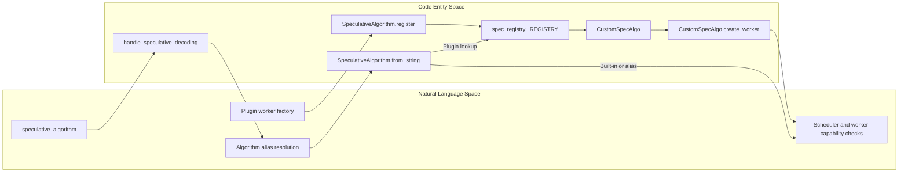
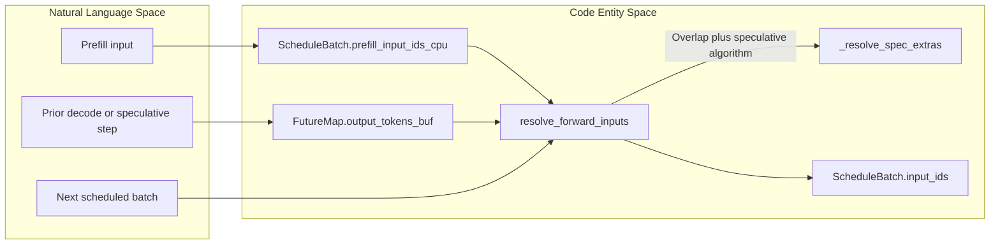
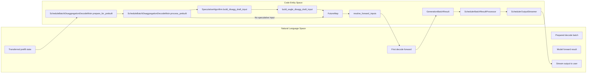
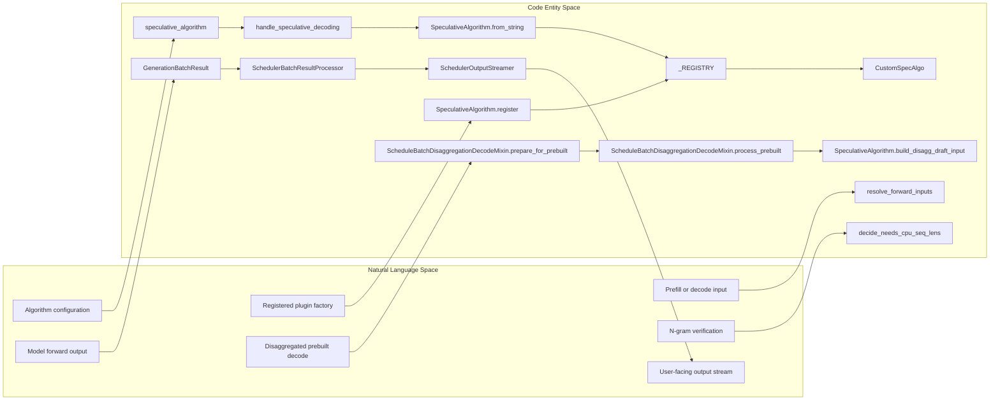

<!-- source: DeepWiki mcp.deepwiki.com · repo sgl-project/sglang · page 12.3 Integration with Scheduling · fetched 2026-10-30 -->

# Integration with Scheduling

Relevant source files

The following files were used as context for generating this wiki page:

- [python/sglang/kernels/ops/speculative/dspark/dspark_attn_metadata.py](python/sglang/kernels/ops/speculative/dspark/dspark_attn_metadata.py)
- [python/sglang/kernels/ops/speculative/dspark/dspark_verify_window.py](python/sglang/kernels/ops/speculative/dspark/dspark_verify_window.py)
- [python/sglang/srt/arg_groups/fields/spec.py](python/sglang/srt/arg_groups/fields/spec.py)
- [python/sglang/srt/arg_groups/speculative_hook.py](python/sglang/srt/arg_groups/speculative_hook.py)
- [python/sglang/srt/disaggregation/decode_schedule_batch_mixin.py](python/sglang/srt/disaggregation/decode_schedule_batch_mixin.py)
- [python/sglang/srt/dllm/mixin/scheduler.py](python/sglang/srt/dllm/mixin/scheduler.py)
- [python/sglang/srt/managers/overlap_utils.py](python/sglang/srt/managers/overlap_utils.py)
- [python/sglang/srt/managers/scheduler_components/batch_result_processor.py](python/sglang/srt/managers/scheduler_components/batch_result_processor.py)
- [python/sglang/srt/managers/scheduler_components/output_streamer.py](python/sglang/srt/managers/scheduler_components/output_streamer.py)
- [python/sglang/srt/managers/utils.py](python/sglang/srt/managers/utils.py)
- [python/sglang/srt/mem_cache/allocation.py](python/sglang/srt/mem_cache/allocation.py)
- [python/sglang/srt/model_executor/runner_utils/shared_read_event.py](python/sglang/srt/model_executor/runner_utils/shared_read_event.py)
- [python/sglang/srt/models/deepseek_v4_dspark.py](python/sglang/srt/models/deepseek_v4_dspark.py)
- [python/sglang/srt/models/dflash.py](python/sglang/srt/models/dflash.py)
- [python/sglang/srt/models/dspark.py](python/sglang/srt/models/dspark.py)
- [python/sglang/srt/speculative/dflash_utils.py](python/sglang/srt/speculative/dflash_utils.py)
- [python/sglang/srt/speculative/dflash_worker_v2.py](python/sglang/srt/speculative/dflash_worker_v2.py)
- [python/sglang/srt/speculative/dspark_components/dspark_config.py](python/sglang/srt/speculative/dspark_components/dspark_config.py)
- [python/sglang/srt/speculative/dspark_components/dspark_draft.py](python/sglang/srt/speculative/dspark_components/dspark_draft.py)
- [python/sglang/srt/speculative/dspark_components/dspark_draft_sampler.py](python/sglang/srt/speculative/dspark_components/dspark_draft_sampler.py)
- [python/sglang/srt/speculative/dspark_components/dspark_kv_inject.py](python/sglang/srt/speculative/dspark_components/dspark_kv_inject.py)
- [python/sglang/srt/speculative/dspark_components/dspark_planner.py](python/sglang/srt/speculative/dspark_components/dspark_planner.py)
- [python/sglang/srt/speculative/dspark_components/dspark_verify.py](python/sglang/srt/speculative/dspark_components/dspark_verify.py)
- [python/sglang/srt/speculative/dspark_components/dspark_worker_v2.py](python/sglang/srt/speculative/dspark_components/dspark_worker_v2.py)
- [python/sglang/srt/speculative/eagle_disaggregation.py](python/sglang/srt/speculative/eagle_disaggregation.py)
- [python/sglang/srt/speculative/spec_info.py](python/sglang/srt/speculative/spec_info.py)
- [python/sglang/srt/speculative/spec_registry.py](python/sglang/srt/speculative/spec_registry.py)
- [python/sglang/srt/speculative/spec_tp_sync.py](python/sglang/srt/speculative/spec_tp_sync.py)
- [test/registered/amd/test_deepseek_v4_pro_fp4_dspark.py](test/registered/amd/test_deepseek_v4_pro_fp4_dspark.py)
- [test/registered/scheduler/test_retract_decode_logprob.py](test/registered/scheduler/test_retract_decode_logprob.py)
- [test/registered/spec/dspark/test_dspark_dp_tier.py](test/registered/spec/dspark/test_dspark_dp_tier.py)
- [test/registered/spec/dspark/test_dspark_draft_graph.py](test/registered/spec/dspark/test_dspark_draft_graph.py)
- [test/registered/spec/dspark/test_dspark_draft_path_default.py](test/registered/spec/dspark/test_dspark_draft_path_default.py)
- [test/registered/spec/dspark/test_dspark_kernel_parity.py](test/registered/spec/dspark/test_dspark_kernel_parity.py)
- [test/registered/unit/managers/test_batch_result_processor_hidden_states.py](test/registered/unit/managers/test_batch_result_processor_hidden_states.py)
- [test/registered/unit/managers/test_batch_result_processor_mamba_boundary.py](test/registered/unit/managers/test_batch_result_processor_mamba_boundary.py)
- [test/registered/unit/managers/test_batch_result_processor_spec_grammar.py](test/registered/unit/managers/test_batch_result_processor_spec_grammar.py)
- [test/registered/unit/managers/test_mm_token_counts.py](test/registered/unit/managers/test_mm_token_counts.py)
- [test/registered/unit/managers/test_output_streamer_customized_info.py](test/registered/unit/managers/test_output_streamer_customized_info.py)
- [test/registered/unit/managers/test_output_streamer_logprobs.py](test/registered/unit/managers/test_output_streamer_logprobs.py)
- [test/registered/unit/managers/test_scheduler_chunked_req_gate.py](test/registered/unit/managers/test_scheduler_chunked_req_gate.py)
- [test/registered/unit/mem_cache/test_dllm_fdfo_kv_reuse.py](test/registered/unit/mem_cache/test_dllm_fdfo_kv_reuse.py)
- [test/registered/unit/model_executor/runner/test_prefill_shared_read_done.py](test/registered/unit/model_executor/runner/test_prefill_shared_read_done.py)
- [test/registered/unit/spec/test_decode_bookkeeping_ownership.py](test/registered/unit/spec/test_decode_bookkeeping_ownership.py)
- [test/registered/unit/spec/test_dspark_target_hidden_projection.py](test/registered/unit/spec/test_dspark_target_hidden_projection.py)
- [test/registered/unit/spec/test_spec_registry.py](test/registered/unit/spec/test_spec_registry.py)
- [test/registered/unit/spec/test_spec_tp_sync.py](test/registered/unit/spec/test_spec_tp_sync.py)
- [test/registered/unit/speculative/test_pd_eagle_draft_proposal.py](test/registered/unit/speculative/test_pd_eagle_draft_proposal.py)

## Purpose and Scope

This page explains the code-visible boundary between speculative algorithms, scheduler batches, and overlap input resolution. It covers algorithm selection through `SpeculativeAlgorithm`, N-gram-specific sequence-length requirements, the `FutureMap` input path, prebuilt batches used by disaggregated decode, and the plugin-facing `CustomSpecAlgo` interface. [python/sglang/srt/speculative/spec_info.py:32-65](), [python/sglang/srt/managers/overlap_utils.py:26-51](), [python/sglang/srt/managers/overlap_utils.py:113-154](), [python/sglang/srt/disaggregation/decode_schedule_batch_mixin.py:22-29](), [python/sglang/srt/speculative/spec_registry.py:26-55]()

Sources: [python/sglang/srt/speculative/spec_info.py:32-65](), [python/sglang/srt/managers/overlap_utils.py:26-51,113-154](), [python/sglang/srt/disaggregation/decode_schedule_batch_mixin.py:22-29](), [python/sglang/srt/speculative/spec_registry.py:26-55]()

## Speculative Algorithm Registry and Configuration

The `spec` configuration namespace exposes `speculative_algorithm` as an optional string; its documented built-ins include `EAGLE`, `EAGLE3`, `NEXTN`, `STANDALONE`, `NGRAM`, `DFLASH`, `DSPARK`, and `UNO`. [python/sglang/srt/arg_groups/fields/spec.py:24-35]()

`SpeculativeAlgorithm.from_string()` maps `None` to `NONE`, resolves built-in enum names case-insensitively, maps reserved alias `NEXTN` to `EAGLE`, and otherwise looks up a plugin algorithm. Unknown names raise `ValueError`. [python/sglang/srt/speculative/spec_info.py:32-65]()

Built-in algorithms and registered plugins share capability predicates such as `is_ngram()`, `supports_mixed_chunk()`, and `supports_grammar_overlap()`. These predicates let callers query algorithm behavior through a common interface rather than branching on the enum versus plugin type. [python/sglang/srt/speculative/spec_info.py:93-100](), [python/sglang/srt/speculative/spec_info.py:132-172]()

`SpeculativeAlgorithm.register()` is the plugin-facing decorator. It delegates registration to the registry implementation and accepts options including `supports_overlap`, a server-argument validator, and a `CustomSpecAlgo` subclass. [python/sglang/srt/speculative/spec_info.py:67-91]()

`CustomSpecAlgo` stores the plugin name, factory, overlap capability, and optional validator. Its default capability methods are conservative: it identifies itself as speculative, but does not claim built-in algorithm features. Its `create_worker()` checks the resolved overlap configuration and rejects an algorithm that does not support overlap when overlap scheduling is enabled. [python/sglang/srt/speculative/spec_registry.py:26-55](), [python/sglang/srt/speculative/spec_registry.py:60-116](), [python/sglang/srt/speculative/spec_registry.py:134-152]()

The `handle_speculative_decoding` function in `speculative_hook.py` performs several resolutions and validations for speculative decoding. It ensures that if `speculative_draft_model_path` is set, `speculative_draft_model_revision` defaults to "main". It also resolves aliases for `speculative_algorithm`, for example, promoting `NEXTN` or `EAGLE` to `FROZEN_KV_MTP` if a `Gemma4AssistantForCausalLM` draft model is detected. [python/sglang/srt/arg_groups/speculative_hook.py:121-160]() It also validates compatibility between `disaggregation_mode`, `speculative_algorithm`, and `speculative_use_block_verification`. [python/sglang/srt/arg_groups/speculative_hook.py:164-191]()

### Speculative Algorithm Registry Overview

Sources: [python/sglang/srt/arg_groups/fields/spec.py:24-35](), [python/sglang/srt/speculative/spec_info.py:32-91](), [python/sglang/srt/speculative/spec_registry.py:26-55,134-152,178-183](), [python/sglang/srt/arg_groups/speculative_hook.py:121-191]()

## Scheduler Integration and Overlap Dataflow

With overlap enabled, `resolve_forward_inputs(batch, future_map)` materializes the batch’s input tokens at forward entry. For prefill, it copies `prefill_input_ids_cpu` to the batch device. For a mixed batch, it gathers decode tokens from `future_map.output_tokens_buf` using `mix_running_indices` and concatenates them with the prefill tokens. For ordinary decode with no pre-supplied `input_ids`, it gathers from the same buffer using `req_pool_indices`. [python/sglang/srt/managers/overlap_utils.py:113-148]()

When overlap is enabled and the batch uses a speculative algorithm, `resolve_forward_inputs()` also calls `future_map._resolve_spec_extras(batch)`. The code comments distinguish this overlap relay path from the synchronous non-overlap V2 path, which installs `next_draft_input` directly. [python/sglang/srt/managers/overlap_utils.py:150-154]()

The CPU sequence-length mirror has an explicit scheduling dependency: `decide_needs_cpu_seq_lens()` returns true when two-batch overlap is enabled, because that path reads the mirror to split a batch. It also forces the mirror for N-gram because N-gram’s `USE_FULL_MASK` verification path uses per-request CPU sequence lengths to size its tree mask, regardless of attention backend preference. Otherwise, the decision is based on the configured attention backends’ `needs_cpu_seq_lens` declarations; an undeclared flag defaults to true. [python/sglang/srt/managers/overlap_utils.py:26-51]()

### Overlap Data Flow and Input Resolution

Sources: [python/sglang/srt/managers/overlap_utils.py:113-154]()

## Request Initialization, KV Bookkeeping, and Ownership Contracts

This integration path exposes specific batch fields used to prepare and relay inputs; the available implementation excerpts do not establish the broader KV ownership fields or commit rules described in some scheduler designs. In particular, this page does not assign ownership to fields such as `kv_committed_len` or `kv_allocated_len`. [python/sglang/srt/managers/overlap_utils.py:113-154](), [python/sglang/srt/disaggregation/decode_schedule_batch_mixin.py:22-109]()

For disaggregated prebuilt batches, `prepare_for_prebuilt()` sets `forward_mode` to `PREBUILT`, builds sequence-length and request-pool metadata, gathers output-cache locations for each request’s extend range, and creates `SamplingBatchInfo`. Its comments specify that a prebuilt batch does not enter a model forward to process the transferred prompt and does not copy every transferred prompt to the GPU only to discard it. [python/sglang/srt/disaggregation/decode_schedule_batch_mixin.py:22-29](), [python/sglang/srt/disaggregation/decode_schedule_batch_mixin.py:31-109]()

Sources: [python/sglang/srt/managers/overlap_utils.py:113-154](), [python/sglang/srt/disaggregation/decode_schedule_batch_mixin.py:22-109]()

## N-gram and Specialized Worker Integration

### N-gram Worker

N-gram is represented by the `NGRAM` built-in algorithm and is detected through `SpeculativeAlgorithm.is_ngram()`. Its scheduling-specific requirement visible here is the CPU sequence-length mirror: `decide_needs_cpu_seq_lens()` forces that mirror for N-gram’s `USE_FULL_MASK` verification path, even if an attention backend opts out. [python/sglang/srt/speculative/spec_info.py:32-48,132-134](), [python/sglang/srt/managers/overlap_utils.py:26-51]()

The provided implementation excerpts do not show the `NGRAMWorker` definition or the structure and relay construction of `NgramVerifyInput`. Therefore, worker internals and N-gram relay payload fields are not specified here. [python/sglang/srt/speculative/spec_info.py:22-29]()

Sources: [python/sglang/srt/speculative/spec_info.py:22-29,32-48,132-134](), [python/sglang/srt/managers/overlap_utils.py:26-51]()

### Other Speculative Worker Families (DFlash, DSPark, and EAGLE)

`SpeculativeAlgorithm` exposes capability checks that affect scheduling and batch compatibility. For example, EAGLE-family algorithms, DFLASH, and DSPARK report support for mixed-chunk prefill; N-gram is excluded because its overlap relay does not provide the output-token buffer that mixed-input resolution reads. [python/sglang/srt/speculative/spec_info.py:147-158]()

The same capability interface distinguishes algorithms that support ragged verification, grammar overlap, draft KV, and draft hidden-state transfer. The built-in predicates are algorithm-specific; `CustomSpecAlgo` defaults generally do not opt into these capabilities. [python/sglang/srt/speculative/spec_info.py:160-183](), [python/sglang/srt/speculative/spec_registry.py:72-116]()

For disaggregated prebuilt batches, `process_prebuilt()` collects each request’s last output token, calls `spec_algorithm.build_disagg_draft_input()`, and installs the result as `spec_info` when one is returned. If the algorithm returns no speculative input, it stashes the last token in `FutureMap` so the first decode can resolve it through the normal forward-input path. [python/sglang/srt/disaggregation/decode_schedule_batch_mixin.py:111-156](), [python/sglang/srt/speculative/spec_registry.py:164-175]()

For EAGLE disaggregation, `build_eagle_disagg_draft_input()` creates `EagleDraftInput` from transferred top-k probabilities, token indices, hidden states, and last-token bonus inputs. In overlap mode it publishes the request indices and sequence lengths to the future map and stashes a relay payload derived from the draft input. [python/sglang/srt/speculative/eagle_disaggregation.py:50-78](), [python/sglang/srt/speculative/eagle_disaggregation.py:124-147]()

The `_DflashDraftSampler` class in `dflash_worker_v2.py` handles capture-safe greedy argmax over the target LM head within the draft CUDA graph. It supports both single-TP and multi-TP scenarios, ensuring bit-exact tie resolution. [python/sglang/srt/speculative/dflash_worker_v2.py:135-179]() The `DSparkWorkerV2` class in `dspark_components/dspark_worker_v2.py` is a `BaseSpecWorker` implementation for the DSPARK algorithm. It manages the draft model (if it hosts it, which is typically the last PP stage) and coordinates with the target worker. It also handles the configuration of target hidden projection for DSPARK. [python/sglang/srt/speculative/dspark_components/dspark_worker_v2.py:159-201]()

The `DSparkAttention` class in `deepseek_v4_dspark.py` is a specialized attention mechanism for DSPARK drafts, requiring `compress_ratio == 0`. It uses `RadixAttention` and includes methods for storing block KV and computing queries. [python/sglang/srt/models/deepseek_v4_dspark.py:100-194]()

`dflash_utils.py` provides utility functions for DFLASH, including `dflash_draft_cell_size_per_token` to calculate the exact KV pool size for the DFLASH draft model and `scale_kv_cell_size_per_token_for_dflash` to compute the combined KV budget for target and draft models. [python/sglang/srt/speculative/dflash_utils.py:121-175]() It also defines `_dflash_npu_top_k_top_p_renorm_prob`, `_dflash_top_k_renorm_prob`, and `_dflash_top_p_renorm_prob` for handling sampling probabilities, with specific NPU optimizations. [python/sglang/srt/speculative/dflash_utils.py:55-119]()

### Speculative Feature Flags and Worker Behavior

The scheduler-facing capability methods express constraints without requiring generic scheduling code to know every worker implementation. Examples include `supports_mixed_chunk()`, `supports_ragged_verify()`, `supports_grammar_overlap()`, `has_draft_kv()`, and `carries_draft_hidden_states()`. [python/sglang/srt/speculative/spec_info.py:147-183]()

For plugins, `CustomSpecAlgo` provides default implementations for these queries. A plugin that needs built-in-specific scheduler or model-runner branches can supply a subclass and override the relevant `is_*()` or `supports_*()` methods. [python/sglang/srt/spec_registry.py:26-42](), [python/sglang/srt/spec_registry.py:60-116]()

Sources: [python/sglang/srt/speculative/spec_info.py:147-183](), [python/sglang/srt/speculative/spec_registry.py:26-42,60-116](), [python/sglang/srt/disaggregation/decode_schedule_batch_mixin.py:111-156](), [python/sglang/srt/speculative/eagle_disaggregation.py:50-78,124-147](), [python/sglang/srt/speculative/dflash_worker_v2.py:135-179](), [python/sglang/srt/speculative/dspark_components/dspark_worker_v2.py:159-201](), [python/sglang/srt/models/deepseek_v4_dspark.py:100-194](), [python/sglang/srt/speculative/dflash_utils.py:55-119,121-175]()

## Batch Forward Modes and Caching Integration

`ScheduleBatchDisaggregationDecodeMixin.prepare_for_prebuilt()` prepares metadata for a `PREBUILT` batch without running a model forward over the transferred prompt. It sets request indices, sequence lengths, cache locations, extend metadata, multimodal inputs, and sampling information. [python/sglang/srt/disaggregation/decode_schedule_batch_mixin.py:22-29](), [python/sglang/srt/disaggregation/decode_schedule_batch_mixin.py:31-109]()

`process_prebuilt()` then handles the per-request last output token, checkpoints the KV cache, updates grammar state when present, and builds algorithm-specific disaggregated draft input. A non-speculative result is routed through `FutureMap.stash()` instead. [python/sglang/srt/disaggregation/decode_schedule_batch_mixin.py:111-156]()

The `SchedulerBatchResultProcessor` class is responsible for processing the results of a batch, including speculative decoding outputs. It handles collecting routed experts and indexer top-k results for finished requests. [python/sglang/srt/managers/scheduler_components/batch_result_processor.py:96-181]() The `GenerationBatchResult` dataclass carries various outputs from the model forward pass, including `num_correct_drafts`, `num_block_accept_tokens`, `accept_length_per_req_cpu`, and `next_draft_input` for speculative decoding. It also includes fields for PP+spec synchronization like `next_verify_chain`, `next_verify_parent_list`, and `next_verify_top_scores_index`. [python/sglang/srt/managers/utils.py:56-154]()

The `SchedulerOutputStreamer` handles streaming output to the detokenizer or Rust egress. It can retrieve detailed cache breakdown for a request, including device, host, and storage cached tokens. [python/sglang/srt/managers/scheduler_components/output_streamer.py:67-134]()

The available excerpts do not show general scheduler batch formation, `ForwardBatch` construction, or radix-cache prefix matching. The flow below is limited to the documented prebuilt-batch and speculative-input boundary. [python/sglang/srt/disaggregation/decode_schedule_batch_mixin.py:22-156]()

### Scheduler, Batch, and Speculative Input Data Flow

Sources: [python/sglang/srt/disaggregation/decode_schedule_batch_mixin.py:22-29,111-156](), [python/sglang/srt/speculative/spec_registry.py:164-175](), [python/sglang/srt/speculative/eagle_disaggregation.py:50-54,124-147](), [python/sglang/srt/managers/overlap_utils.py:113-154](), [python/sglang/srt/managers/scheduler_components/batch_result_processor.py:96-181](), [python/sglang/srt/managers/utils.py:56-154](), [python/sglang/srt/managers/scheduler_components/output_streamer.py:67-134]()

---

# Summary Diagram: From Natural Language Space to Code Entity Space in Speculative Scheduling

Sources: [python/sglang/srt/arg_groups/fields/spec.py:24-35](), [python/sglang/srt/speculative/spec_info.py:32-91](), [python/sglang/srt/speculative/spec_registry.py:26-55,178-183](), [python/sglang/srt/arg_groups/speculative_hook.py:121-191](), [python/sglang/srt/managers/overlap_utils.py:26-51,113-154](), [python/sglang/srt/disaggregation/decode_schedule_batch_mixin.py:22-29,111-156](), [python/sglang/srt/managers/scheduler_components/batch_result_processor.py:96-181](), [python/sglang/srt/managers/utils.py:56-154](), [python/sglang/srt/managers/scheduler_components/output_streamer.py:67-134]()

---

# Summary

Speculative scheduling integration is exposed through a shared algorithm interface, overlap-aware input resolution, and batch-specific hooks. `SpeculativeAlgorithm` resolves built-ins and plugins and provides capability predicates; `CustomSpecAlgo` supplies the plugin contract and worker factory checks. [python/sglang/srt/speculative/spec_info.py:32-91](), [python/sglang/srt/speculative/spec_registry.py:26-55,134-152]() The `handle_speculative_decoding` function performs initial configuration and validation of speculative decoding parameters. [python/sglang/srt/arg_groups/speculative_hook.py:121-191]()

For overlap execution, `resolve_forward_inputs()` gathers decode tokens from `FutureMap` or stages prefill inputs, and resolves speculative extras when appropriate. N-gram additionally forces publication of CPU sequence lengths for its full-mask verification path. [python/sglang/srt/managers/overlap_utils.py:26-51,113-154]()

For disaggregated decode, prebuilt batch preparation establishes batch metadata, while `process_prebuilt()` constructs algorithm-specific draft input or stashes a non-speculative last token for the first decode step. [python/sglang/srt/disaggregation/decode_schedule_batch_mixin.py:22-109,111-156]() The `SchedulerBatchResultProcessor` and `SchedulerOutputStreamer` handle the post-processing and streaming of results, including speculative outputs. [python/sglang/srt/managers/scheduler_components/batch_result_processor.py:96-181](), [python/sglang/srt/managers/scheduler_components/output_streamer.py:67-134]()

Sources: [python/sglang/srt/speculative/spec_info.py:32-91](), [python/sglang/srt/speculative/spec_registry.py:26-55,134-152](), [python/sglang/srt/arg_groups/speculative_hook.py:121-191](), [python/sglang/srt/managers/overlap_utils.py:26-51,113-154](), [python/sglang/srt/disaggregation/decode_schedule_batch_mixin.py:22-109,111-156](), [python/sglang/srt/managers/scheduler_components/batch_result_processor.py:96-181](), [python/sglang/srt/managers/scheduler_components/output_streamer.py:67-134]()

---

