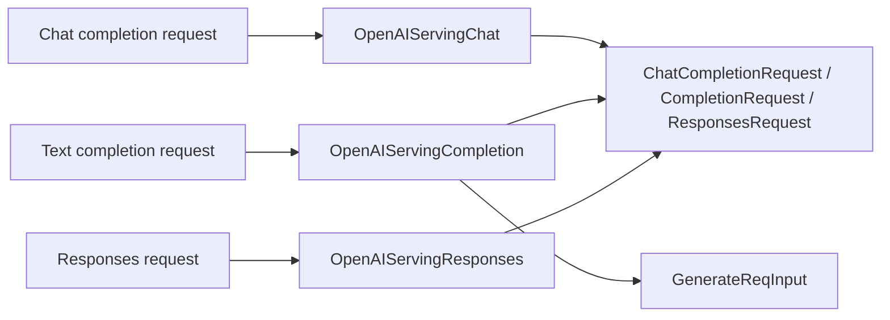
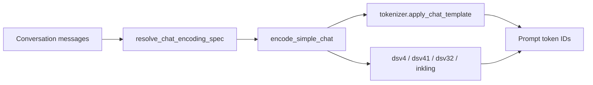

<!-- source: DeepWiki mcp.deepwiki.com · repo sgl-project/sglang · page 13 API Interfaces · fetched 2026-10-30 -->

# API Interfaces

Relevant source files

The following files were used as context for generating this wiki page:

- [python/sglang/srt/entrypoints/context.py](python/sglang/srt/entrypoints/context.py)
- [python/sglang/srt/entrypoints/harmony_utils.py](python/sglang/srt/entrypoints/harmony_utils.py)
- [python/sglang/srt/entrypoints/openai/chat_encoding.py](python/sglang/srt/entrypoints/openai/chat_encoding.py)
- [python/sglang/srt/entrypoints/openai/chat_encoding_adapters.py](python/sglang/srt/entrypoints/openai/chat_encoding_adapters.py)
- [python/sglang/srt/entrypoints/openai/protocol.py](python/sglang/srt/entrypoints/openai/protocol.py)
- [python/sglang/srt/entrypoints/openai/responses_adapters.py](python/sglang/srt/entrypoints/openai/responses_adapters.py)
- [python/sglang/srt/entrypoints/openai/serving_chat.py](python/sglang/srt/entrypoints/openai/serving_chat.py)
- [python/sglang/srt/entrypoints/openai/serving_completions.py](python/sglang/srt/entrypoints/openai/serving_completions.py)
- [python/sglang/srt/entrypoints/openai/serving_deepseek_recipe.py](python/sglang/srt/entrypoints/openai/serving_deepseek_recipe.py)
- [python/sglang/srt/entrypoints/openai/serving_embedding.py](python/sglang/srt/entrypoints/openai/serving_embedding.py)
- [python/sglang/srt/entrypoints/openai/serving_inkling.py](python/sglang/srt/entrypoints/openai/serving_inkling.py)
- [python/sglang/srt/entrypoints/openai/serving_responses.py](python/sglang/srt/entrypoints/openai/serving_responses.py)
- [python/sglang/srt/entrypoints/openai/utils.py](python/sglang/srt/entrypoints/openai/utils.py)
- [python/sglang/srt/function_call/deepseekv41_detector.py](python/sglang/srt/function_call/deepseekv41_detector.py)
- [python/sglang/srt/parser/deepseek_recipe_output.py](python/sglang/srt/parser/deepseek_recipe_output.py)
- [python/sglang/srt/parser/deepseek_recipe_renderer.py](python/sglang/srt/parser/deepseek_recipe_renderer.py)
- [python/sglang/srt/parser/jinja_template_utils.py](python/sglang/srt/parser/jinja_template_utils.py)
- [python/sglang/srt/parser/template_manager.py](python/sglang/srt/parser/template_manager.py)
- [test/registered/openai_server/basic/test_openai_server.py](test/registered/openai_server/basic/test_openai_server.py)
- [test/registered/unit/entrypoints/openai/test_protocol.py](test/registered/unit/entrypoints/openai/test_protocol.py)
- [test/registered/unit/entrypoints/openai/test_responses_custom_tools.py](test/registered/unit/entrypoints/openai/test_responses_custom_tools.py)
- [test/registered/unit/entrypoints/openai/test_responses_namespace_tools.py](test/registered/unit/entrypoints/openai/test_responses_namespace_tools.py)
- [test/registered/unit/entrypoints/openai/test_responses_protocol.py](test/registered/unit/entrypoints/openai/test_responses_protocol.py)
- [test/registered/unit/entrypoints/openai/test_serving_chat.py](test/registered/unit/entrypoints/openai/test_serving_chat.py)
- [test/registered/unit/entrypoints/openai/test_serving_completions.py](test/registered/unit/entrypoints/openai/test_serving_completions.py)
- [test/registered/unit/entrypoints/openai/test_serving_deepseek_recipe.py](test/registered/unit/entrypoints/openai/test_serving_deepseek_recipe.py)
- [test/registered/unit/entrypoints/openai/test_serving_embedding.py](test/registered/unit/entrypoints/openai/test_serving_embedding.py)
- [test/registered/unit/entrypoints/openai/test_serving_responses.py](test/registered/unit/entrypoints/openai/test_serving_responses.py)
- [test/registered/unit/entrypoints/openai/test_serving_responses_stream.py](test/registered/unit/entrypoints/openai/test_serving_responses_stream.py)
- [test/registered/unit/entrypoints/openai/utils.py](test/registered/unit/entrypoints/openai/utils.py)
- [test/registered/unit/function_call/test_deepseekv41_detector.py](test/registered/unit/function_call/test_deepseekv41_detector.py)
- [test/registered/unit/parser/test_deepseek_recipe_renderer.py](test/registered/unit/parser/test_deepseek_recipe_renderer.py)
- [test/registered/unit/parser/test_jinja_template_utils.py](test/registered/unit/parser/test_jinja_template_utils.py)

## Purpose and scope

SGLang exposes interfaces for using model serving from Python applications and remote clients. This parent page maps those entry points to the serving and conversation-formatting components; it does not document method signatures or wire formats in depth. For details, see the child pages linked below. [python/sglang/srt/entrypoints/openai/serving_chat.py:50-78]()

Sources: [python/sglang/srt/entrypoints/openai/serving_chat.py:50-78]()

## Interface overview

The interfaces covered here sit at different boundaries: the Python Engine is the programmatic entry point, while HTTP/OpenAI-compatible and gRPC interfaces serve remote clients. Chat formatting and encoding connect chat-oriented requests to model-specific prompts. The available source excerpts detail the OpenAI serving and chat-encoding path; consult the child pages for the Engine, HTTP server, and gRPC implementations. [python/sglang/srt/entrypoints/openai/serving_chat.py:50-78]()

### Interface-to-code map

| User-facing area | Code entity in the available sources | Role |
|---|---|---|
| Chat completions | `OpenAIServingChat` in `serving_chat.py` | Handles chat-serving behavior and uses OpenAI protocol types. [python/sglang/srt/entrypoints/openai/serving_chat.py:50-78]() |
| Text completions | `OpenAIServingCompletion` in `serving_completions.py` | Converts completion requests into internal `GenerateReqInput` requests. [python/sglang/srt/entrypoints/openai/serving_completions.py:49-76]() |
| Responses | `OpenAIServingResponses` in `serving_responses.py` | Extends chat serving for `/v1/responses` requests. [python/sglang/srt/entrypoints/openai/serving_responses.py:165-180]() |
| Protocol models | `ChatCompletionRequest`, `CompletionRequest`, and response types in `protocol.py` | Define request and response data structures for OpenAI-style APIs. [python/sglang/srt/entrypoints/openai/protocol.py:14-14]() |
| Chat encoding | `resolve_chat_encoding_spec`, `encode_simple_chat` in `chat_encoding.py` | Selects model-aware chat encoding, including the default Hugging Face template path. [python/sglang/srt/entrypoints/openai/chat_encoding.py:20-59](), [python/sglang/srt/entrypoints/openai/chat_encoding.py:91-135]() |

Sources: [python/sglang/srt/entrypoints/openai/serving_chat.py:50-78](), [python/sglang/srt/entrypoints/openai/serving_completions.py:49-76](), [python/sglang/srt/entrypoints/openai/serving_responses.py:165-180](), [python/sglang/srt/entrypoints/openai/protocol.py:14-14](), [python/sglang/srt/entrypoints/openai/chat_encoding.py:20-59](), [python/sglang/srt/entrypoints/openai/chat_encoding.py:91-135]()

### Natural-language requests and serving code

This map connects API names a user may encounter to concrete handler and protocol entities. The available sources define the handlers and protocol models, but do not include the server route-registration code. [python/sglang/srt/entrypoints/openai/serving_chat.py:50-78](), [python/sglang/srt/entrypoints/openai/serving_completions.py:49-76](), [python/sglang/srt/entrypoints/openai/serving_responses.py:165-180]()

Title for Diagram: "HTTP API Names to Serving Code Entities"

Sources: [python/sglang/srt/entrypoints/openai/serving_chat.py:50-78](), [python/sglang/srt/entrypoints/openai/serving_completions.py:49-76](), [python/sglang/srt/entrypoints/openai/serving_completions.py:116-146](), [python/sglang/srt/entrypoints/openai/serving_responses.py:165-180]()

## Python Engine API

The Python Engine API is the programmatic interface area for applications that call SGLang directly. Its class, generation methods, session handling, and weight-update APIs are covered in [Python Engine API](#13.1). The supplied code excerpts do not include Engine definitions, so this parent page does not enumerate its methods. [python/sglang/srt/entrypoints/openai/serving_chat.py:50-78]()

Sources: [python/sglang/srt/entrypoints/openai/serving_chat.py:50-78]()

## HTTP and compatibility APIs

The supplied HTTP-serving sources show separate handlers for chat completions, text completions, and responses. The completion handler converts a `CompletionRequest` into an internal `GenerateReqInput`; the responses handler subclasses `OpenAIServingChat`. Anthropic and Ollama compatibility are part of this API area, but their route and adapter implementations are not present in the supplied excerpts. For endpoint behavior, compatibility details, and request/response formats, see [HTTP Server and OpenAI-Compatible API](#13.2). [python/sglang/srt/entrypoints/openai/serving_completions.py:49-76](), [python/sglang/srt/entrypoints/openai/serving_completions.py:116-146](), [python/sglang/srt/entrypoints/openai/serving_responses.py:165-180]()

Sources: [python/sglang/srt/entrypoints/openai/serving_completions.py:49-76](), [python/sglang/srt/entrypoints/openai/serving_completions.py:116-146](), [python/sglang/srt/entrypoints/openai/serving_responses.py:165-180]()

## Chat templates and conversation formatting

Chat encoding is model-dependent: `resolve_chat_encoding_spec` selects a custom encoding when applicable, while `encode_simple_chat` falls back to `tokenizer.apply_chat_template` when no custom encoder is selected. The chat-serving module also imports conversation-generation and template-formatting utilities, connecting incoming chat messages to the prompt preparation path. For template selection, model-specific formats, and full conversation handling, see [Chat Templates and Conversation Formatting](#13.3). [python/sglang/srt/entrypoints/openai/chat_encoding.py:20-59](), [python/sglang/srt/entrypoints/openai/chat_encoding.py:91-135](), [python/sglang/srt/entrypoints/openai/serving_chat.py:102-110]()

Sources: [python/sglang/srt/entrypoints/openai/chat_encoding.py:20-59](), [python/sglang/srt/entrypoints/openai/chat_encoding.py:91-135](), [python/sglang/srt/entrypoints/openai/serving_chat.py:102-110]()

### Natural-language chat messages and encoding entities

The diagram associates the chat concepts with names searchable in the codebase. It summarizes encoding selection rather than the complete request-serving lifecycle. [python/sglang/srt/entrypoints/openai/chat_encoding.py:20-59](), [python/sglang/srt/entrypoints/openai/chat_encoding.py:91-135]()

Title for Diagram: "Chat Messages to Encoding Code Entities"

Sources: [python/sglang/srt/entrypoints/openai/chat_encoding.py:20-59](), [python/sglang/srt/entrypoints/openai/chat_encoding.py:91-135]()

## gRPC server interface

The gRPC interface is a separate user-facing API area, with its protocol definitions, request manager, Rust extension, and Rust frontend pipeline documented in the child page. The supplied file excerpts do not include gRPC implementation files, so implementation details are intentionally deferred. For those details, see [gRPC Server Interface](#13.4). [python/sglang/srt/entrypoints/openai/protocol.py:14-14]()

Sources: [python/sglang/srt/entrypoints/openai/protocol.py:14-14]()

## Rust workspace crates

Beyond the core Python and gRPC servers, the `rust/` workspace contains auxiliary crates supporting high-performance rendering, multimodal pipelines, API contract generation, and benchmarking. For complete details on these crates, see [Rust Workspace Crates (processor, mm, api-types, bench)](#13.5). [python/sglang/srt/entrypoints/openai/protocol.py:14-14]()

Sources: [python/sglang/srt/entrypoints/openai/protocol.py:14-14]()

## Child pages

- [Python Engine API](#13.1) — Engine methods, sessions, and weight updates.
- [HTTP Server and OpenAI-Compatible API](#13.2) — HTTP serving, OpenAI endpoints, Anthropic/Ollama compatibility, and formats.
- [Chat Templates and Conversation Formatting](#13.3) — Template selection, model-specific encoding, and conversation formatting.
- [gRPC Server Interface](#13.4) — gRPC schemas, request handling, and Rust frontend components.
- [Rust Workspace Crates (processor, mm, api-types, bench)](#13.5) — Document the rust/ workspace crates beyond sglang-server: sglang-processor, sglang-mm, sglang-api-types/api-codegen, and sglang-bench.

Sources: [python/sglang/srt/entrypoints/openai/serving_chat.py:50-78](), [python/sglang/srt/entrypoints/openai/chat_encoding.py:20-59]()

---

