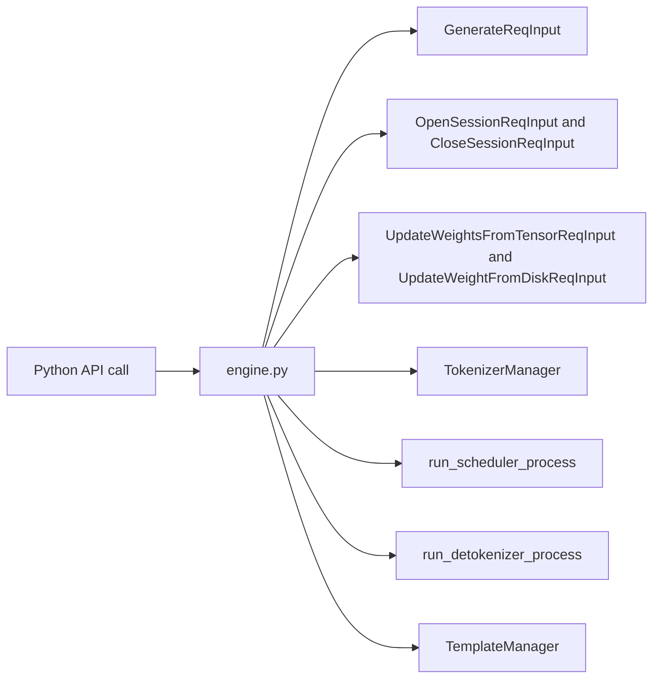
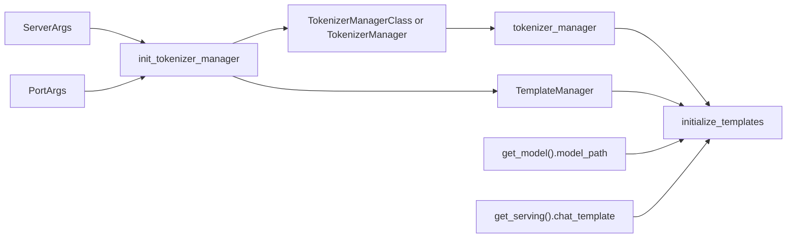
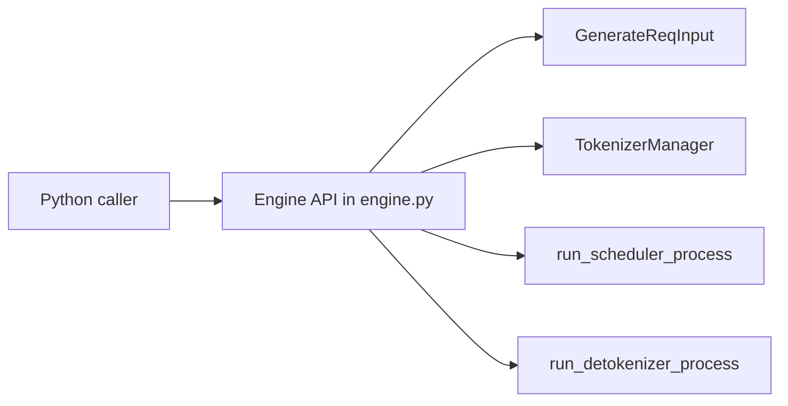
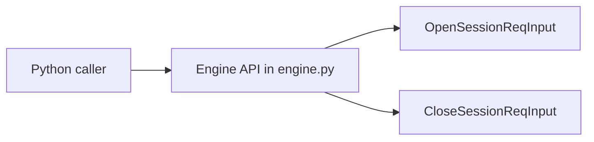
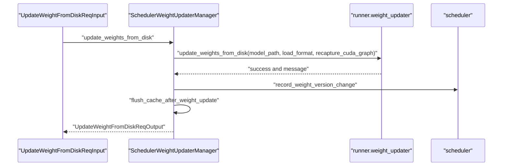

<!-- source: DeepWiki mcp.deepwiki.com · repo sgl-project/sglang · page 13.1 Python Engine API · fetched 2026-10-30 -->

# Python Engine API

Relevant source files

The following files were used as context for generating this wiki page:

- [.github/workflows/release-pypi-nightly.yml](.github/workflows/release-pypi-nightly.yml)
- [.github/workflows/release-pypi-pr.yml](.github/workflows/release-pypi-pr.yml)
- [3rdparty/amd/wheel/sglang/pyproject.toml](3rdparty/amd/wheel/sglang/pyproject.toml)
- [docker/Dockerfile](docker/Dockerfile)
- [python/pyproject.toml](python/pyproject.toml)
- [python/pyproject_cpu.toml](python/pyproject_cpu.toml)
- [python/pyproject_npu.toml](python/pyproject_npu.toml)
- [python/pyproject_other.toml](python/pyproject_other.toml)
- [python/pyproject_xpu.toml](python/pyproject_xpu.toml)
- [python/sglang/srt/entrypoints/engine.py](python/sglang/srt/entrypoints/engine.py)
- [python/sglang/srt/function_call/deepseekv32_detector.py](python/sglang/srt/function_call/deepseekv32_detector.py)
- [python/sglang/srt/function_call/kimik2_detector.py](python/sglang/srt/function_call/kimik2_detector.py)
- [python/sglang/srt/managers/scheduler_components/weight_updater.py](python/sglang/srt/managers/scheduler_components/weight_updater.py)
- [python/sglang/srt/model_executor/model_runner_components/weight_updater.py](python/sglang/srt/model_executor/model_runner_components/weight_updater.py)
- [python/sglang/srt/utils/common.py](python/sglang/srt/utils/common.py)
- [python/sglang/srt/utils/json_response.py](python/sglang/srt/utils/json_response.py)
- [python/sglang/srt/utils/weight_checker.py](python/sglang/srt/utils/weight_checker.py)
- [python/sglang/srt/utils/weight_checker_comparator.py](python/sglang/srt/utils/weight_checker_comparator.py)
- [python/sglang/srt/weight_sync/tensor_bucket.py](python/sglang/srt/weight_sync/tensor_bucket.py)
- [scripts/update_nightly_whl_index.py](scripts/update_nightly_whl_index.py)
- [test/registered/function_call/test_kimik2_detector.py](test/registered/function_call/test_kimik2_detector.py)
- [test/registered/moe/test_cutedsl_moe.py](test/registered/moe/test_cutedsl_moe.py)
- [test/registered/rl/test_tensor_bucket.py](test/registered/rl/test_tensor_bucket.py)
- [test/registered/rl/test_weight_checker_e2e.py](test/registered/rl/test_weight_checker_e2e.py)
- [test/registered/unit/function_call/test_deepseekv4_detector.py](test/registered/unit/function_call/test_deepseekv4_detector.py)
- [test/registered/unit/function_call/test_json_schema_constraint.py](test/registered/unit/function_call/test_json_schema_constraint.py)
- [test/registered/unit/function_call/test_structural_tag_excludes.py](test/registered/unit/function_call/test_structural_tag_excludes.py)
- [test/registered/unit/function_call/test_unknown_tool_name.py](test/registered/unit/function_call/test_unknown_tool_name.py)
- [test/registered/unit/model_executor/test_weight_update_tensor_rank.py](test/registered/unit/model_executor/test_weight_update_tensor_rank.py)
- [test/registered/unit/models/test_glm_moe_gate_fp32.py](test/registered/unit/models/test_glm_moe_gate_fp32.py)
- [test/registered/unit/utils/test_common.py](test/registered/unit/utils/test_common.py)
- [test/registered/unit/utils/test_json_response.py](test/registered/unit/utils/test_json_response.py)
- [test/registered/unit/utils/test_weight_checker.py](test/registered/unit/utils/test_weight_checker.py)
- [test/registered/unit/utils/test_weight_checker_comparator.py](test/registered/unit/utils/test_weight_checker_comparator.py)
- [test/registered/unit/utils/test_weight_checker_cpu.py](test/registered/unit/utils/test_weight_checker_cpu.py)

## Purpose and scope

This page describes the Python runtime entry point and the code-visible API surface for generation, sessions, and weight updates. The provided implementation establishes the runtime components and request types wired into `engine.py`, detailing initialization routines, scheduler-side weight update handlers, and weight checking utilities [python/sglang/srt/entrypoints/engine.py:14-18](), [python/sglang/srt/managers/scheduler_components/weight_updater.py:87-177](), [python/sglang/srt/utils/weight_checker.py:110-204]().

Sources: [python/sglang/srt/entrypoints/engine.py:14-18](), [python/sglang/srt/managers/scheduler_components/weight_updater.py:87-177](), [python/sglang/srt/utils/weight_checker.py:110-204]()

---

## 1. Overview

`python/sglang/srt/entrypoints/engine.py` identifies itself as the Python API entry point for the SGLang Runtime (SRT). It imports runtime managers, process launchers, request structures, and configuration types needed to connect a Python-facing engine to the serving runtime [python/sglang/srt/entrypoints/engine.py:14-18](), [python/sglang/srt/entrypoints/engine.py:54-110]().

The visible imports indicate API areas for:

| API area | Relevant code entities |
|---|---|
| Request handling | `GenerateReqInput`, `EmbeddingReqInput`, `RpcReqInput`, `RpcReqOutput` [python/sglang/srt/entrypoints/engine.py:73-92]() |
| Sessions | `OpenSessionReqInput`, `CloseSessionReqInput` [python/sglang/srt/entrypoints/engine.py:75-85]() |
| Weight updates | `BeginWeightUpdateReqInput`, `EndWeightUpdateReqInput`, `UpdateWeightsFromTensorReqInput`, `UpdateWeightFromDiskReqInput`, `UpdateWeightsFromDistributedReqInput`, `UpdateWeightsFromIPCReqInput` [python/sglang/srt/entrypoints/engine.py:74-98]() |
| LoRA adapters | `LoadLoRAAdapterReqInput`, `LoadLoRAAdapterFromTensorsReqInput`, `UnloadLoRAAdapterReqInput` [python/sglang/srt/entrypoints/engine.py:82-93]() |
| Runtime configuration | `ServerArgs`, `PortArgs` [python/sglang/srt/entrypoints/engine.py:131-131]() |
| Runtime managers | `TokenizerManager`, `run_scheduler_process`, `run_detokenizer_process` [python/sglang/srt/entrypoints/engine.py:69-110]() |

Sources: [python/sglang/srt/entrypoints/engine.py:14-18](), [python/sglang/srt/entrypoints/engine.py:54-110](), [python/sglang/srt/entrypoints/engine.py:73-110](), [python/sglang/srt/entrypoints/engine.py:131-131]()

### Natural-language concepts mapped to code entities

The following diagram maps API concepts to names used directly in the implementation code, bridging natural language request types to exact module symbols.

**Diagram: Python API concepts and runtime code entities**

Sources: [python/sglang/srt/entrypoints/engine.py:73-110](), [python/sglang/srt/entrypoints/engine.py:194-208]()

---

## 2. Engine Architecture and Process Model

The engine module imports `TokenizerManager`, `run_scheduler_process`, and `run_detokenizer_process`, as well as tokenizer-manager and scheduler process helpers used by the runtime [python/sglang/srt/entrypoints/engine.py:69-72](), [python/sglang/srt/entrypoints/engine.py:109-110]().

The initialization function `init_tokenizer_manager` selects the supplied `TokenizerManagerClass` or defaults to `TokenizerManager`, constructs the manager with `server_args` and `port_args`, creates a `TemplateManager`, and initializes templates [python/sglang/srt/entrypoints/engine.py:194-208]().

**Diagram: `init_tokenizer_manager` and its code entities**

Sources: [python/sglang/srt/entrypoints/engine.py:131-131](), [python/sglang/srt/entrypoints/engine.py:194-208]()

### Process and message entities

The module imports scheduler and detokenizer launch functions alongside request and response structures used at the engine boundary [python/sglang/srt/entrypoints/engine.py:69-100](), [python/sglang/srt/entrypoints/engine.py:109-110]().

| Concern | Imported entities |
|---|---|
| Scheduler execution | `run_scheduler_process`, `run_scheduler_process_with_init_pipe`, `run_data_parallel_controller_process` [python/sglang/srt/entrypoints/engine.py:66-70](), [python/sglang/srt/entrypoints/engine.py:109-110]() |
| Detokenizer execution | `run_detokenizer_process` [python/sglang/srt/entrypoints/engine.py:71-71]() |
| Request transport helpers | `sock_send`, `sock_recv` [python/sglang/srt/entrypoints/engine.py:98-99]() |
| Request/response typing | `GenerateReqInput`, `EmbeddingReqInput`, `RpcReqInput`, `RpcReqOutput` [python/sglang/srt/entrypoints/engine.py:77-92]() |

Sources: [python/sglang/srt/entrypoints/engine.py:66-110]()

---

## 3. Engine Initialization and Configuration

### Tokenizer and template initialization

`init_tokenizer_manager(server_args, port_args, TokenizerManagerClass=None)` initializes tokenizer-facing components. If no class override is supplied, it uses `TokenizerManager`, constructs the manager, and initializes a `TemplateManager` [python/sglang/srt/entrypoints/engine.py:194-208]().

Sources: [python/sglang/srt/entrypoints/engine.py:194-208]()

### Runtime configuration symbols

`ServerArgs` and `PortArgs` are imported from `server_args.py` and appear in the `init_tokenizer_manager` signature [python/sglang/srt/entrypoints/engine.py:131-131](), [python/sglang/srt/entrypoints/engine.py:194-198]().

| Symbol | Use visible in this excerpt |
|---|---|
| `ServerArgs` | Runtime configuration argument to `init_tokenizer_manager` [python/sglang/srt/entrypoints/engine.py:131-131](), [python/sglang/srt/entrypoints/engine.py:196-196]() |
| `PortArgs` | Port configuration argument to `init_tokenizer_manager` [python/sglang/srt/entrypoints/engine.py:131-131](), [python/sglang/srt/entrypoints/engine.py:197-197]() |
| `TokenizerManagerClass` | Optional implementation override; defaults to `TokenizerManager` [python/sglang/srt/entrypoints/engine.py:198-202]() |
| `TemplateManager` | Constructed and initialized during tokenizer-manager setup [python/sglang/srt/entrypoints/engine.py:205-208]() |

Sources: [python/sglang/srt/entrypoints/engine.py:131-131](), [python/sglang/srt/entrypoints/engine.py:194-208]()

---

## 4. Text Generation APIs

### Generation request types

`engine.py` imports `GenerateReqInput` as the request structure associated with generation, alongside `EmbeddingReqInput`, `ReturnHiddenStatesMode`, and `MultimodalDataInputFormat` [python/sglang/srt/entrypoints/engine.py:73-90]().

Sources: [python/sglang/srt/entrypoints/engine.py:73-90]()

### Generation-related code map

**Diagram: Generation API entities**

Sources: [python/sglang/srt/entrypoints/engine.py:69-110]()

---

## 5. Session Management

The engine module imports `OpenSessionReqInput` and `CloseSessionReqInput`, establishing request structures for session-related operations [python/sglang/srt/entrypoints/engine.py:75-85]().

**Diagram: Session request entities**

Sources: [python/sglang/srt/entrypoints/engine.py:75-85]()

---

## 6. Weight Update APIs and Advanced Operations

### Weight-update request surface

`engine.py` imports request structures for beginning and ending an update, retrieving weights by name, and updating weights from tensors, disk, distributed sources, or IPC [python/sglang/srt/entrypoints/engine.py:74-98]().

The scheduler-side implementation (`SchedulerWeightUpdaterManager`) iterates through selected runners, invokes each runner's `weight_updater.update_weights_from_disk`, records weight version changes, and flushes the cache if the target runner is updated [python/sglang/srt/managers/scheduler_components/weight_updater.py:87-99](), [python/sglang/srt/managers/scheduler_components/weight_updater.py:120-163]().

| Operation category | Request type imported by `engine.py` |
|---|---|
| Begin/end update session | `BeginWeightUpdateReqInput`, `EndWeightUpdateReqInput` [python/sglang/srt/entrypoints/engine.py:74-78]() |
| Update from tensor | `UpdateWeightsFromTensorReqInput` [python/sglang/srt/entrypoints/engine.py:97-97]() |
| Update from disk | `UpdateWeightFromDiskReqInput` [python/sglang/srt/entrypoints/engine.py:94-94]() |
| Update from distributed source | `UpdateWeightsFromDistributedReqInput` [python/sglang/srt/entrypoints/engine.py:95-95]() |
| Update through IPC | `UpdateWeightsFromIPCReqInput` [python/sglang/srt/entrypoints/engine.py:96-96]() |
| Initialize/destroy update group | `InitWeightsUpdateGroupReqInput`, `DestroyWeightsUpdateGroupReqInput` [python/sglang/srt/entrypoints/engine.py:76-81]() |
| Retrieve named weights | `GetWeightsByNameReqInput` [python/sglang/srt/entrypoints/engine.py:80-80]() |

Sources: [python/sglang/srt/entrypoints/engine.py:74-98]()

### Scheduler-side disk update behavior

`SchedulerWeightUpdaterManager.update_weights_from_disk` observes load duration under the `"disk"` source label, selects runners, and invokes disk updaters [python/sglang/srt/managers/scheduler_components/weight_updater.py:105-118](), [python/sglang/srt/managers/scheduler_components/weight_updater.py:135-163](). Cache flushing is conditional on `recv_req.flush_cache` [python/sglang/srt/managers/scheduler_components/weight_updater.py:120-133]().

**Diagram: Disk weight update in `SchedulerWeightUpdaterManager`**

Sources: [python/sglang/srt/managers/scheduler_components/weight_updater.py:120-163]()

### Update-group operations and runner selection

`init_weights_update_group` and `destroy_weights_update_group` delegate to `tp_worker`. `_parse_runner_selector` accepts `"all"`, `"target"`, or `"draft"`, and `_WeightUpdateSession` tracks state [python/sglang/srt/managers/scheduler_components/weight_updater.py:71-85](), [python/sglang/srt/managers/scheduler_components/weight_updater.py:165-177]().

Sources: [python/sglang/srt/managers/scheduler_components/weight_updater.py:71-85](), [python/sglang/srt/managers/scheduler_components/weight_updater.py:165-177]()

### Weight checking

`WeightChecker` supports `snapshot`, `reset_tensors`, `compare`, and `checksum` actions via `handle` [python/sglang/srt/utils/weight_checker.py:110-149](). Snapshots utilize an `_ArenaAllocator` backed by mmap [python/sglang/srt/utils/weight_checker.py:95-108](), [python/sglang/srt/utils/weight_checker.py:151-167]().

Sources: [python/sglang/srt/utils/weight_checker.py:95-167]()

---

## 7. LoRA and Related Runtime Operations

`engine.py` imports request types for loading LoRA adapters from paths or tensors (`LoadLoRAAdapterReqInput`, `LoadLoRAAdapterFromTensorsReqInput`) and unloading them (`UnloadLoRAAdapterReqInput`) [python/sglang/srt/entrypoints/engine.py:82-93](). It also includes memory occupation release/resume and profiling inputs [python/sglang/srt/entrypoints/engine.py:86-90]().

Sources: [python/sglang/srt/entrypoints/engine.py:82-93]()

---

## Summary

The visible Python entrypoint code establishes `engine.py` as the SRT inference API module, connecting `TokenizerManager`, `TemplateManager`, and runtime processes to typed request structures [python/sglang/srt/entrypoints/engine.py:14-18](), [python/sglang/srt/entrypoints/engine.py:66-110](). Scheduler-side components handle disk weight updates, version recording, and validation through `SchedulerWeightUpdaterManager` and `WeightChecker` [python/sglang/srt/managers/scheduler_components/weight_updater.py:120-177](), [python/sglang/srt/utils/weight_checker.py:110-204]().

Sources: [python/sglang/srt/entrypoints/engine.py:14-18](), [python/sglang/srt/entrypoints/engine.py:66-110](), [python/sglang/srt/managers/scheduler_components/weight_updater.py:120-177](), [python/sglang/srt/utils/weight_checker.py:110-204]()

---

## Appendix: Key Code Files

| File | Role evidenced by implementation |
|---|---|
| `python/sglang/srt/entrypoints/engine.py` | Python inference API module; imports runtime managers, request types, and initialization dependencies [python/sglang/srt/entrypoints/engine.py:14-18](), [python/sglang/srt/entrypoints/engine.py:54-110]() |
| `python/sglang/srt/managers/scheduler_components/weight_updater.py` | Scheduler-side weight update manager, managing disk updates, update-group delegation, and runner selection [python/sglang/srt/managers/scheduler_components/weight_updater.py:71-177]() |
| `python/sglang/srt/utils/weight_checker.py` | Tensor snapshot, reset, comparison, and checksum verification logic for model weights [python/sglang/srt/utils/weight_checker.py:95-204]() |

Sources: [python/sglang/srt/entrypoints/engine.py:14-18](), [python/sglang/srt/entrypoints/engine.py:54-110](), [python/sglang/srt/managers/scheduler_components/weight_updater.py:71-177](), [python/sglang/srt/utils/weight_checker.py:95-204]()

---

