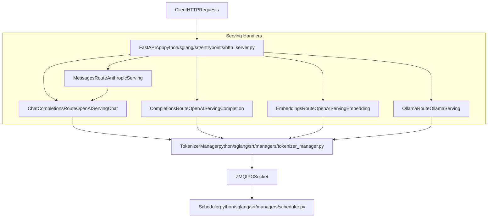

<!-- source: DeepWiki mcp.deepwiki.com · repo sgl-project/sglang · page 13.2 HTTP Server and OpenAI-Compatible API · fetched 2026-10-30 -->

# HTTP Server and OpenAI-Compatible API

Relevant source files

The following files were used as context for generating this wiki page:

- [docs/cards/logos/iquestlab.png](docs/cards/logos/iquestlab.png)
- [docs/cards/logos/perplexity.png](docs/cards/logos/perplexity.png)
- [docs/cookbook/autoregressive/DeepReinforce/Ornith-1.0.mdx](docs/cookbook/autoregressive/DeepReinforce/Ornith-1.0.mdx)
- [docs/cookbook/autoregressive/DeepReinforce/Ornith-1.5.mdx](docs/cookbook/autoregressive/DeepReinforce/Ornith-1.5.mdx)
- [docs/cookbook/autoregressive/Perplexity/PPLX-Decider-v1-27B.mdx](docs/cookbook/autoregressive/Perplexity/PPLX-Decider-v1-27B.mdx)
- [docs/cookbook/autoregressive/Perplexity/PPLX-Decider-v1.1-27B.mdx](docs/cookbook/autoregressive/Perplexity/PPLX-Decider-v1.1-27B.mdx)
- [docs/cookbook/autoregressive/intro.mdx](docs/cookbook/autoregressive/intro.mdx)
- [docs/docs.json](docs/docs.json)
- [docs/docs/advanced_features/hicache_design.mdx](docs/docs/advanced_features/hicache_design.mdx)
- [docs/docs/references/production_metrics.mdx](docs/docs/references/production_metrics.mdx)
- [docs/docs/supported-models/decision_models.mdx](docs/docs/supported-models/decision_models.mdx)
- [docs/src/snippets/configs/ornith-ai/ornith-1.5.jsx](docs/src/snippets/configs/ornith-ai/ornith-1.5.jsx)
- [docs/src/snippets/configs/perplexity-ai/pplx-decider-v1-27b-benchmarks.jsx](docs/src/snippets/configs/perplexity-ai/pplx-decider-v1-27b-benchmarks.jsx)
- [docs/src/snippets/configs/perplexity-ai/pplx-decider-v1-27b.jsx](docs/src/snippets/configs/perplexity-ai/pplx-decider-v1-27b.jsx)
- [docs/src/snippets/configs/perplexity-ai/pplx-decider-v1.1-27b-benchmarks.jsx](docs/src/snippets/configs/perplexity-ai/pplx-decider-v1.1-27b-benchmarks.jsx)
- [docs/src/snippets/configs/perplexity-ai/pplx-decider-v1.1-27b.jsx](docs/src/snippets/configs/perplexity-ai/pplx-decider-v1.1-27b.jsx)
- [docs/src/snippets/configs/popular-models.jsx](docs/src/snippets/configs/popular-models.jsx)
- [python/sglang/srt/entrypoints/context.py](python/sglang/srt/entrypoints/context.py)
- [python/sglang/srt/entrypoints/harmony_utils.py](python/sglang/srt/entrypoints/harmony_utils.py)
- [python/sglang/srt/entrypoints/http_server.py](python/sglang/srt/entrypoints/http_server.py)
- [python/sglang/srt/entrypoints/openai/chat_encoding.py](python/sglang/srt/entrypoints/openai/chat_encoding.py)
- [python/sglang/srt/entrypoints/openai/chat_encoding_adapters.py](python/sglang/srt/entrypoints/openai/chat_encoding_adapters.py)
- [python/sglang/srt/entrypoints/openai/protocol.py](python/sglang/srt/entrypoints/openai/protocol.py)
- [python/sglang/srt/entrypoints/openai/responses_adapters.py](python/sglang/srt/entrypoints/openai/responses_adapters.py)
- [python/sglang/srt/entrypoints/openai/serving_base.py](python/sglang/srt/entrypoints/openai/serving_base.py)
- [python/sglang/srt/entrypoints/openai/serving_chat.py](python/sglang/srt/entrypoints/openai/serving_chat.py)
- [python/sglang/srt/entrypoints/openai/serving_completions.py](python/sglang/srt/entrypoints/openai/serving_completions.py)
- [python/sglang/srt/entrypoints/openai/serving_decisions.py](python/sglang/srt/entrypoints/openai/serving_decisions.py)
- [python/sglang/srt/entrypoints/openai/serving_deepseek_recipe.py](python/sglang/srt/entrypoints/openai/serving_deepseek_recipe.py)
- [python/sglang/srt/entrypoints/openai/serving_embedding.py](python/sglang/srt/entrypoints/openai/serving_embedding.py)
- [python/sglang/srt/entrypoints/openai/serving_inkling.py](python/sglang/srt/entrypoints/openai/serving_inkling.py)
- [python/sglang/srt/entrypoints/openai/serving_responses.py](python/sglang/srt/entrypoints/openai/serving_responses.py)
- [python/sglang/srt/entrypoints/openai/utils.py](python/sglang/srt/entrypoints/openai/utils.py)
- [python/sglang/srt/entrypoints/systemone/protocol.py](python/sglang/srt/entrypoints/systemone/protocol.py)
- [python/sglang/srt/entrypoints/systemone/serving.py](python/sglang/srt/entrypoints/systemone/serving.py)
- [python/sglang/srt/function_call/deepseekv41_detector.py](python/sglang/srt/function_call/deepseekv41_detector.py)
- [python/sglang/srt/managers/data_parallel_controller.py](python/sglang/srt/managers/data_parallel_controller.py)
- [python/sglang/srt/managers/detokenizer_manager.py](python/sglang/srt/managers/detokenizer_manager.py)
- [python/sglang/srt/managers/io_struct.py](python/sglang/srt/managers/io_struct.py)
- [python/sglang/srt/managers/multi_tokenizer_mixin.py](python/sglang/srt/managers/multi_tokenizer_mixin.py)
- [python/sglang/srt/managers/tokenizer_control_mixin.py](python/sglang/srt/managers/tokenizer_control_mixin.py)
- [python/sglang/srt/managers/tokenizer_manager.py](python/sglang/srt/managers/tokenizer_manager.py)
- [python/sglang/srt/parser/deepseek_recipe_output.py](python/sglang/srt/parser/deepseek_recipe_output.py)
- [python/sglang/srt/parser/deepseek_recipe_renderer.py](python/sglang/srt/parser/deepseek_recipe_renderer.py)
- [python/sglang/srt/parser/jinja_template_utils.py](python/sglang/srt/parser/jinja_template_utils.py)
- [python/sglang/srt/parser/template_manager.py](python/sglang/srt/parser/template_manager.py)
- [python/sglang/srt/ray/data_parallel_controller.py](python/sglang/srt/ray/data_parallel_controller.py)
- [python/sglang/srt/ray/engine.py](python/sglang/srt/ray/engine.py)
- [test/registered/lora/test_lora_openai_api.py](test/registered/lora/test_lora_openai_api.py)
- [test/registered/openai_server/basic/test_openai_server.py](test/registered/openai_server/basic/test_openai_server.py)
- [test/registered/unit/entrypoints/openai/test_protocol.py](test/registered/unit/entrypoints/openai/test_protocol.py)
- [test/registered/unit/entrypoints/openai/test_responses_custom_tools.py](test/registered/unit/entrypoints/openai/test_responses_custom_tools.py)
- [test/registered/unit/entrypoints/openai/test_responses_namespace_tools.py](test/registered/unit/entrypoints/openai/test_responses_namespace_tools.py)
- [test/registered/unit/entrypoints/openai/test_responses_protocol.py](test/registered/unit/entrypoints/openai/test_responses_protocol.py)
- [test/registered/unit/entrypoints/openai/test_serving_chat.py](test/registered/unit/entrypoints/openai/test_serving_chat.py)
- [test/registered/unit/entrypoints/openai/test_serving_completions.py](test/registered/unit/entrypoints/openai/test_serving_completions.py)
- [test/registered/unit/entrypoints/openai/test_serving_decisions.py](test/registered/unit/entrypoints/openai/test_serving_decisions.py)
- [test/registered/unit/entrypoints/openai/test_serving_deepseek_recipe.py](test/registered/unit/entrypoints/openai/test_serving_deepseek_recipe.py)
- [test/registered/unit/entrypoints/openai/test_serving_embedding.py](test/registered/unit/entrypoints/openai/test_serving_embedding.py)
- [test/registered/unit/entrypoints/openai/test_serving_responses.py](test/registered/unit/entrypoints/openai/test_serving_responses.py)
- [test/registered/unit/entrypoints/openai/test_serving_responses_stream.py](test/registered/unit/entrypoints/openai/test_serving_responses_stream.py)
- [test/registered/unit/entrypoints/openai/utils.py](test/registered/unit/entrypoints/openai/utils.py)
- [test/registered/unit/entrypoints/test_server_info.py](test/registered/unit/entrypoints/test_server_info.py)
- [test/registered/unit/function_call/test_deepseekv41_detector.py](test/registered/unit/function_call/test_deepseekv41_detector.py)
- [test/registered/unit/managers/test_data_parallel_controller.py](test/registered/unit/managers/test_data_parallel_controller.py)
- [test/registered/unit/managers/test_multi_tokenizer_mixin.py](test/registered/unit/managers/test_multi_tokenizer_mixin.py)
- [test/registered/unit/managers/test_tokenizer_manager_rid_cleanup.py](test/registered/unit/managers/test_tokenizer_manager_rid_cleanup.py)
- [test/registered/unit/parser/test_deepseek_recipe_renderer.py](test/registered/unit/parser/test_deepseek_recipe_renderer.py)
- [test/registered/unit/parser/test_jinja_template_utils.py](test/registered/unit/parser/test_jinja_template_utils.py)

## Purpose and Scope
This page explains the FastAPI-based HTTP server implementation in SGLang (`python/sglang/srt/entrypoints/http_server.py`), OpenAI-compatible API endpoints (`/v1/chat/completions`, `/v1/completions`, `/v1/embeddings`, etc.), compatibility layers for Anthropic and Ollama, and request/response data formats. It covers endpoint wiring, protocol validation, serving handlers, and the transformation pipeline mapping external requests to internal generation structures.

Sources: [python/sglang/srt/entrypoints/http_server.py:14-20](), [python/sglang/srt/entrypoints/openai/protocol.py:14-16](), [python/sglang/srt/entrypoints/anthropic/serving.py:1-5](), [python/sglang/srt/entrypoints/ollama/serving.py:1-10]()

---

## FastAPI Server Architecture and Endpoint Wiring

The HTTP server is implemented using FastAPI in `python/sglang/srt/entrypoints/http_server.py`. It initializes the FastAPI application, mounts middleware (CORS, Prometheus, request metrics, tracing), and registers routes for OpenAI-compatible endpoints, Anthropic Messages, and Ollama requests.

### Route Registration and Serving Handlers

| Endpoint Path | Serving Class / Handler | Purpose |
|---|---|---|
| `/v1/chat/completions` | `OpenAIServingChat` | OpenAI-compatible chat completions with tool calling and structured outputs. |
| `/v1/completions` | `OpenAIServingCompletion` | OpenAI-compatible text completions. |
| `/v1/embeddings` | `OpenAIServingEmbedding` | Text embedding generation. |
| `/v1/responses` | `OpenAIServingResponses` | OpenAI Responses API. |
| `/v1/tokenize` / `/v1/detokenize` | `OpenAIServingTokenize` / `OpenAIServingDetokenize` | Tokenization and detokenization utilities. |
| `/v1/rerank` | `OpenAIServingRerank` | Document reranking. |
| `/api/chat` / `/api/generate` | `OllamaServing` | Ollama-compatible chat and generation endpoints. |
| `/v1/messages` | `AnthropicServing` | Anthropic Messages API translation layer. |

Sources: [python/sglang/srt/entrypoints/http_server.py:76-125](), [python/sglang/srt/entrypoints/openai/serving_chat.py:24-87](), [python/sglang/srt/entrypoints/openai/serving_completions.py:9-22](), [python/sglang/srt/entrypoints/anthropic/serving.py:1-5]()

### Natural Language Space to Code Entity Space: HTTP Server Architecture

Sources: [python/sglang/srt/entrypoints/http_server.py:76-125](), [python/sglang/srt/entrypoints/openai/serving_chat.py:87-105](), [python/sglang/srt/managers/tokenizer_manager.py:14-80]()

---

## Request Processing Pipeline and Data Mapping

When an HTTP request arrives at the FastAPI server, it is parsed and validated against Pydantic protocol models defined in `python/sglang/srt/entrypoints/openai/protocol.py`.

### Request Conversion and Sampling Parameters

The serving handlers convert external requests into internal IPC structures such as `GenerateReqInput` defined in `python/sglang/srt/managers/io_struct.py`.
- **Text Completions (`OpenAIServingCompletion`)**: Validates prompts, applies completion templates if configured, selects `text` or `input_ids`, and constructs `GenerateReqInput` with sampling parameters (`SamplingParams`).
- **Chat Completions (`OpenAIServingChat`)**: Resolves chat encoding specs via `resolve_chat_encoding_spec`, processes chat messages, normalizes tool content and tool call arguments, and builds internal generation requests.

### Natural Language Space to Code Entity Space: Request Lifecycle

Sources: [python/sglang/srt/entrypoints/openai/protocol.py:14-38](), [python/sglang/srt/entrypoints/openai/serving_completions.py:71-146](), [python/sglang/srt/managers/io_struct.py:176-181]()

---

## Response Formats, Streaming, and Token Usage

The server produces responses using `ORJSONResponse` for non-streaming calls and `StreamingResponse` with Server-Sent Events (SSE) via `build_sse_content` for streaming calls.

### Usage and Cache Reporting
Response metadata includes `UsageInfo`, `PromptTokensDetails`, and `CachedTokensDetails`, tracking:
- Prompt and completion token counts.
- Cached tokens broken down by device (GPU) cache (`device`), host CPU cache (`host`), and L3 storage tiers (`storage`).
- Reasoning token counts (`completion_tokens_details.reasoning_tokens`).

Sources: [python/sglang/srt/entrypoints/openai/protocol.py:173-227](), [python/sglang/srt/entrypoints/openai/sse_utils.py:1-20]()

---

## Anthropic and Ollama Compatibility Layers

### Anthropic Messages API
`AnthropicServing` translates incoming `AnthropicMessagesRequest` payloads into OpenAI chat completion structures, delegates to `OpenAIServingChat`, and translates the generated outputs and usage stats back into Anthropic response format and SSE events.

### Ollama Compatibility
`OllamaServing` translates Ollama chat and generate requests into internal generation calls, enabling seamless integration with tools expecting the Ollama API.

Sources: [python/sglang/srt/entrypoints/anthropic/serving.py:1-203](), [python/sglang/srt/entrypoints/ollama/serving.py:1-100]()

---

## Summary
- SGLang exposes a high-performance FastAPI server in `python/sglang/srt/entrypoints/http_server.py`.
- Supports OpenAI-compatible chat, completions, embeddings, and responses APIs, alongside Anthropic and Ollama compatibility layers.
- Validates requests via Pydantic models in `python/sglang/srt/entrypoints/openai/protocol.py` and maps them to `GenerateReqInput` for internal processing by `TokenizerManager`.
- Emits responses via `ORJSONResponse` or SSE streaming with detailed token usage and cache reporting.

Sources: [python/sglang/srt/entrypoints/http_server.py:14-20](), [python/sglang/srt/entrypoints/openai/protocol.py:14-38](), [python/sglang/srt/entrypoints/anthropic/serving.py:1-5](), [python/sglang/srt/entrypoints/ollama/serving.py:1-10]()

---

