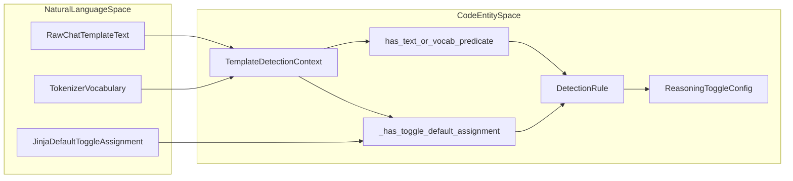
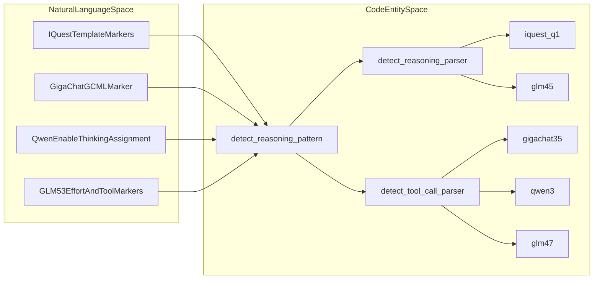
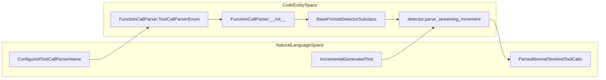

<!-- source: DeepWiki mcp.deepwiki.com · repo sgl-project/sglang · page 13.3 Chat Templates and Conversation Formatting · fetched 2026-10-30 -->

# Chat Templates and Conversation Formatting

Relevant source files

The following files were used as context for generating this wiki page:

- [python/sglang/srt/arg_groups/model_overrides/__init__.py](python/sglang/srt/arg_groups/model_overrides/__init__.py)
- [python/sglang/srt/configs/__init__.py](python/sglang/srt/configs/__init__.py)
- [python/sglang/srt/configs/minimax_vl.py](python/sglang/srt/configs/minimax_vl.py)
- [python/sglang/srt/configs/model_config.py](python/sglang/srt/configs/model_config.py)
- [python/sglang/srt/entrypoints/context.py](python/sglang/srt/entrypoints/context.py)
- [python/sglang/srt/entrypoints/harmony_utils.py](python/sglang/srt/entrypoints/harmony_utils.py)
- [python/sglang/srt/entrypoints/openai/chat_encoding.py](python/sglang/srt/entrypoints/openai/chat_encoding.py)
- [python/sglang/srt/entrypoints/openai/chat_encoding_adapters.py](python/sglang/srt/entrypoints/openai/chat_encoding_adapters.py)
- [python/sglang/srt/entrypoints/openai/protocol.py](python/sglang/srt/entrypoints/openai/protocol.py)
- [python/sglang/srt/entrypoints/openai/responses_adapters.py](python/sglang/srt/entrypoints/openai/responses_adapters.py)
- [python/sglang/srt/entrypoints/openai/serving_chat.py](python/sglang/srt/entrypoints/openai/serving_chat.py)
- [python/sglang/srt/entrypoints/openai/serving_completions.py](python/sglang/srt/entrypoints/openai/serving_completions.py)
- [python/sglang/srt/entrypoints/openai/serving_deepseek_recipe.py](python/sglang/srt/entrypoints/openai/serving_deepseek_recipe.py)
- [python/sglang/srt/entrypoints/openai/serving_embedding.py](python/sglang/srt/entrypoints/openai/serving_embedding.py)
- [python/sglang/srt/entrypoints/openai/serving_inkling.py](python/sglang/srt/entrypoints/openai/serving_inkling.py)
- [python/sglang/srt/entrypoints/openai/serving_responses.py](python/sglang/srt/entrypoints/openai/serving_responses.py)
- [python/sglang/srt/entrypoints/openai/usage_processor.py](python/sglang/srt/entrypoints/openai/usage_processor.py)
- [python/sglang/srt/entrypoints/openai/utils.py](python/sglang/srt/entrypoints/openai/utils.py)
- [python/sglang/srt/function_call/base_format_detector.py](python/sglang/srt/function_call/base_format_detector.py)
- [python/sglang/srt/function_call/deepseekv41_detector.py](python/sglang/srt/function_call/deepseekv41_detector.py)
- [python/sglang/srt/function_call/function_call_parser.py](python/sglang/srt/function_call/function_call_parser.py)
- [python/sglang/srt/function_call/minimax_m3.py](python/sglang/srt/function_call/minimax_m3.py)
- [python/sglang/srt/layers/quantization/__init__.py](python/sglang/srt/layers/quantization/__init__.py)
- [python/sglang/srt/layers/quantization/base_config.py](python/sglang/srt/layers/quantization/base_config.py)
- [python/sglang/srt/parser/deepseek_recipe_output.py](python/sglang/srt/parser/deepseek_recipe_output.py)
- [python/sglang/srt/parser/deepseek_recipe_renderer.py](python/sglang/srt/parser/deepseek_recipe_renderer.py)
- [python/sglang/srt/parser/jinja_template_utils.py](python/sglang/srt/parser/jinja_template_utils.py)
- [python/sglang/srt/parser/reasoning_parser.py](python/sglang/srt/parser/reasoning_parser.py)
- [python/sglang/srt/parser/template_detection.py](python/sglang/srt/parser/template_detection.py)
- [python/sglang/srt/parser/template_manager.py](python/sglang/srt/parser/template_manager.py)
- [python/sglang/srt/utils/hf_transformers/common.py](python/sglang/srt/utils/hf_transformers/common.py)
- [test/registered/openai_server/basic/test_openai_server.py](test/registered/openai_server/basic/test_openai_server.py)
- [test/registered/unit/entrypoints/openai/test_protocol.py](test/registered/unit/entrypoints/openai/test_protocol.py)
- [test/registered/unit/entrypoints/openai/test_responses_custom_tools.py](test/registered/unit/entrypoints/openai/test_responses_custom_tools.py)
- [test/registered/unit/entrypoints/openai/test_responses_namespace_tools.py](test/registered/unit/entrypoints/openai/test_responses_namespace_tools.py)
- [test/registered/unit/entrypoints/openai/test_responses_protocol.py](test/registered/unit/entrypoints/openai/test_responses_protocol.py)
- [test/registered/unit/entrypoints/openai/test_serving_chat.py](test/registered/unit/entrypoints/openai/test_serving_chat.py)
- [test/registered/unit/entrypoints/openai/test_serving_completions.py](test/registered/unit/entrypoints/openai/test_serving_completions.py)
- [test/registered/unit/entrypoints/openai/test_serving_deepseek_recipe.py](test/registered/unit/entrypoints/openai/test_serving_deepseek_recipe.py)
- [test/registered/unit/entrypoints/openai/test_serving_embedding.py](test/registered/unit/entrypoints/openai/test_serving_embedding.py)
- [test/registered/unit/entrypoints/openai/test_serving_responses.py](test/registered/unit/entrypoints/openai/test_serving_responses.py)
- [test/registered/unit/entrypoints/openai/test_serving_responses_stream.py](test/registered/unit/entrypoints/openai/test_serving_responses_stream.py)
- [test/registered/unit/entrypoints/openai/utils.py](test/registered/unit/entrypoints/openai/utils.py)
- [test/registered/unit/function_call/test_deepseekv41_detector.py](test/registered/unit/function_call/test_deepseekv41_detector.py)
- [test/registered/unit/function_call/test_minimax_m3_detector.py](test/registered/unit/function_call/test_minimax_m3_detector.py)
- [test/registered/unit/parser/test_deepseek_recipe_renderer.py](test/registered/unit/parser/test_deepseek_recipe_renderer.py)
- [test/registered/unit/parser/test_jinja_template_utils.py](test/registered/unit/parser/test_jinja_template_utils.py)
- [test/registered/unit/parser/test_reasoning_parser.py](test/registered/unit/parser/test_reasoning_parser.py)
- [test/registered/unit/parser/test_template_manager.py](test/registered/unit/parser/test_template_manager.py)

## Purpose and Scope

This page documents the chat template system, rule-based reasoning and tool-call parser detection, conversation formatting logic, and parser dispatch mechanisms in SGLang [python/sglang/srt/parser/template_detection.py:14-19](), [python/sglang/srt/function_call/function_call_parser.py:67-74](). It details how raw template strings and tokenizer vocabularies are inspected to infer runtime parsers, how model-specific tool calls and reasoning segments are decoded, and how requests are formatted for serving.

Sources: [python/sglang/srt/parser/template_detection.py:14-19](), [python/sglang/srt/function_call/function_call_parser.py:67-74]()

## Template Inputs and Responsibilities

A chat template is evaluated via detection infrastructure where `TemplateDetectionContext` encapsulates the template text, optional `ReasoningToggleConfig`, forced reasoning flags, and vocabulary sets [python/sglang/srt/parser/template_detection.py:38-56](). Helper methods on the context inspect literal strings, regular expressions, and vocabulary tokens.

Tokenizer loading and vocabulary extraction provide the underlying metadata required by these detection rules [test/registered/unit/parser/test_template_manager.py:25-32]().

| Concern | Code entity | Role |
|---|---|---|
| Detection input | `TemplateDetectionContext` | Holds template text, reasoning configuration, force flag, and vocabulary; exposes text and vocabulary predicates [python/sglang/srt/parser/template_detection.py:38-56](). |
| Detection rule | `DetectionRule` | Associates a name and result value with a predicate over the context [python/sglang/srt/parser/template_detection.py:59-64](). |
| Reasoning configuration | `ReasoningToggleConfig` | Represents a toggle parameter, default state, special case, or effort keyword [python/sglang/srt/parser/template_detection.py:66-76](). |
| Tokenizer vocabulary fixture | `_DummyTokenizer.get_vocab()` | Provides vocabulary inspection interfaces used in parser-detection unit tests [test/registered/unit/parser/test_template_manager.py:25-32](). |

Sources: [python/sglang/srt/parser/template_detection.py:38-76](), [test/registered/unit/parser/test_template_manager.py:25-32]()

## Detection Flow: Template and Vocabulary to Parser Settings

Detection is rule-driven: a `DetectionRule` evaluates predicates against a `TemplateDetectionContext`. For reasoning toggles, `_has_toggle_default_assignment` parses templates using Jinja2 AST inspection to identify boolean defaults on named parameters [python/sglang/srt/parser/template_detection.py:91-141]().

Specific model markers determine reasoning patterns, effort levels, and tool call behaviors [python/sglang/srt/parser/template_detection.py:144-171]().

### Diagram: Natural-Language Inputs to Detection Entities

Sources: [python/sglang/srt/parser/template_detection.py:38-76](), [python/sglang/srt/parser/template_detection.py:91-141]()

### Rule Ordering and Model-Specific Cases

Unit tests validate detection behavior via `detect_reasoning_pattern`, `detect_reasoning_parser`, and `detect_tool_call_parser` [test/registered/unit/parser/test_template_manager.py:62-93](). Specific template signatures take precedence over broad patterns.

| Tested template signals | Tested result |
|---|---|
| `<|iquest_assistant|>` and IQuest tool markers | Reasoning and tool-call parser: `iquest_q1` [test/registered/unit/parser/test_template_manager.py:70-77](). |
| `<｜GCML｜tool_calls>` with `<think>` | Reasoning and tool-call parser: `gigachat35` [test/registered/unit/parser/test_template_manager.py:79-93](). |
| Qwen-style `enable_thinking` default and `<tool_call>` | Reasoning toggle default enabled; parser: `qwen3` [test/registered/unit/parser/test_template_manager.py:95-109](). |
| GLM-5.3 reasoning-effort header and compact tool format | Forced reasoning; reasoning parser: `glm45`; tool-call parser: `glm47` [test/registered/unit/parser/test_template_manager.py:147-169](). |

Sources: [python/sglang/srt/parser/template_detection.py:144-178](), [test/registered/unit/parser/test_template_manager.py:62-169]()

### Diagram: Model Markers to Detector Names

Sources: [test/registered/unit/parser/test_template_manager.py:62-169]()

## Reasoning Configuration Detection

`ReasoningToggleConfig` defines toggle argument names, default enabled states, special cases, and effort keywords [python/sglang/srt/parser/template_detection.py:66-76](). 

`_GenerationTagExtension` supplies parse-time support for Jinja `` blocks, enabling AST construction for complex templates [python/sglang/srt/parser/template_detection.py:78-141]().

Sources: [python/sglang/srt/parser/template_detection.py:66-141]()

## Tool-Call Parser Dispatch

`FunctionCallParser` maps parser-name identifiers to `BaseFormatDetector` implementations defined in `ToolCallParserEnum` [python/sglang/srt/function_call/function_call_parser.py:67-120](). During initialization, invalid or unsupported parser names trigger a `ValueError` [python/sglang/srt/function_call/function_call_parser.py:122-141]().

Streaming updates are processed by calling `detector.parse_streaming_increment`, which segments generated tokens into normal text and tool call actions [python/sglang/srt/function_call/function_call_parser.py:67-74]().

| Parser name | Detector class |
|---|---|
| `deepseekv4` | `DeepSeekV4Detector` [python/sglang/srt/function_call/function_call_parser.py:79-84]() |
| `glm47` | `Glm47MoeDetector` [python/sglang/srt/function_call/function_call_parser.py:85-88]() |
| `kimi_k3` | `KimiK3Detector` [python/sglang/srt/function_call/function_call_parser.py:89-92]() |
| `qwen` | `Qwen25Detector` [python/sglang/srt/function_call/function_call_parser.py:101-105]() |
| `response_template` | `ResponseTemplateToolDetector` [python/sglang/srt/function_call/function_call_parser.py:116-120]() |

Sources: [python/sglang/srt/function_call/function_call_parser.py:67-153]()

### Diagram: Parser Name to Streaming Detector

Sources: [python/sglang/srt/function_call/function_call_parser.py:67-74](), [python/sglang/srt/function_call/function_call_parser.py:76-153]()

## Model and Tokenizer Configuration Context

Tokenizer management helpers resolve identifiers and load instances via Hugging Face `AutoTokenizer`, with fallback support to inspect `tokenizer_config.json` when necessary [python/sglang/srt/utils/hf_transformers/tokenizer.py:55-126](). Configuration mappings are maintained in `_CONFIG_REGISTRY` [python/sglang/srt/utils/hf_transformers/common.py:112-188]().

Sources: [python/sglang/srt/utils/hf_transformers/tokenizer.py:55-126](), [python/sglang/srt/utils/hf_transformers/common.py:112-188]()

## Conversation Formatting Boundaries

Conversation messages undergo preprocessing and normalization—such as flattening pure-text OpenAI tool blocks or formatting assistant tool arguments—before rendering via chat templates [python/sglang/srt/entrypoints/openai/serving_chat.py:159-207]().

Sources: [python/sglang/srt/entrypoints/openai/serving_chat.py:159-207]()

## Summary

- `TemplateDetectionContext` evaluates template content and token vocabularies [python/sglang/srt/parser/template_detection.py:38-64]().
- `ReasoningToggleConfig` and Jinja AST inspection manage reasoning defaults [python/sglang/srt/parser/template_detection.py:66-141]().
- `FunctionCallParser` maps string identifiers to streaming format detectors [python/sglang/srt/function_call/function_call_parser.py:67-153]().
- Unit tests validate template signature resolution and parser selection [test/registered/unit/parser/test_template_manager.py:62-169]().

Sources: [python/sglang/srt/parser/template_detection.py:38-141](), [python/sglang/srt/function_call/function_call_parser.py:67-153](), [test/registered/unit/parser/test_template_manager.py:62-169]()

---

