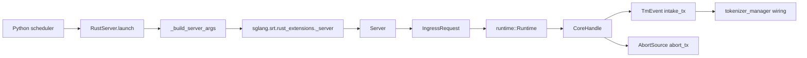

<!-- source: DeepWiki mcp.deepwiki.com · repo sgl-project/sglang · page 13.4 gRPC Server Interface · fetched 2026-10-30 -->

# gRPC Server Interface

Relevant source files

The following files were used as context for generating this wiki page:

- [proto/sglang/api/v1/generate.proto](proto/sglang/api/v1/generate.proto)
- [proto/sglang/api/v1/sampling.proto](proto/sglang/api/v1/sampling.proto)
- [python/sglang/api/v1/api_types.py](python/sglang/api/v1/api_types.py)
- [python/sglang/srt/managers/disagg_service.py](python/sglang/srt/managers/disagg_service.py)
- [python/sglang/srt/rust_server/config.py](python/sglang/srt/rust_server/config.py)
- [python/sglang/srt/rust_server/server.py](python/sglang/srt/rust_server/server.py)
- [rust/sglang-api-types/src/generated/sglang.api.v1.rs](rust/sglang-api-types/src/generated/sglang.api.v1.rs)
- [rust/sglang-api-types/src/generated/sglang.api.v1.serde.rs](rust/sglang-api-types/src/generated/sglang.api.v1.serde.rs)
- [rust/sglang-api-types/testdata/json_parity.json](rust/sglang-api-types/testdata/json_parity.json)
- [rust/sglang-api-types/tests/json_contract.rs](rust/sglang-api-types/tests/json_contract.rs)
- [rust/sglang-bench/src/request.rs](rust/sglang-bench/src/request.rs)
- [rust/sglang-bench/tests/grpc.rs](rust/sglang-bench/tests/grpc.rs)
- [rust/sglang-server/src/api_server/core/frame.rs](rust/sglang-server/src/api_server/core/frame.rs)
- [rust/sglang-server/src/api_server/core/handle.rs](rust/sglang-server/src/api_server/core/handle.rs)
- [rust/sglang-server/src/api_server/core/prefetch.rs](rust/sglang-server/src/api_server/core/prefetch.rs)
- [rust/sglang-server/src/api_server/grpc/service.rs](rust/sglang-server/src/api_server/grpc/service.rs)
- [rust/sglang-server/src/api_server/http.rs](rust/sglang-server/src/api_server/http.rs)
- [rust/sglang-server/src/api_server/http/app.rs](rust/sglang-server/src/api_server/http/app.rs)
- [rust/sglang-server/src/api_server/http/info.rs](rust/sglang-server/src/api_server/http/info.rs)
- [rust/sglang-server/src/api_server/http/loads.rs](rust/sglang-server/src/api_server/http/loads.rs)
- [rust/sglang-server/src/api_server/http/metrics.rs](rust/sglang-server/src/api_server/http/metrics.rs)
- [rust/sglang-server/src/api_server/http/native_api.rs](rust/sglang-server/src/api_server/http/native_api.rs)
- [rust/sglang-server/src/api_server/http/openai.rs](rust/sglang-server/src/api_server/http/openai.rs)
- [rust/sglang-server/src/api_server/http/openai/chat.rs](rust/sglang-server/src/api_server/http/openai/chat.rs)
- [rust/sglang-server/src/api_server/http/openai/completions.rs](rust/sglang-server/src/api_server/http/openai/completions.rs)
- [rust/sglang-server/src/api_server/http/openai/template.rs](rust/sglang-server/src/api_server/http/openai/template.rs)
- [rust/sglang-server/src/api_server/http/openai/test_utils.rs](rust/sglang-server/src/api_server/http/openai/test_utils.rs)
- [rust/sglang-server/src/api_server/http/openai/tokenize.rs](rust/sglang-server/src/api_server/http/openai/tokenize.rs)
- [rust/sglang-server/src/api_server/http/openai/tools.rs](rust/sglang-server/src/api_server/http/openai/tools.rs)
- [rust/sglang-server/src/lib.rs](rust/sglang-server/src/lib.rs)
- [rust/sglang-server/src/message.rs](rust/sglang-server/src/message.rs)
- [rust/sglang-server/src/message/config.rs](rust/sglang-server/src/message/config.rs)
- [rust/sglang-server/src/message/detok.rs](rust/sglang-server/src/message/detok.rs)
- [rust/sglang-server/src/message/finish_reason.rs](rust/sglang-server/src/message/finish_reason.rs)
- [rust/sglang-server/src/message/io_struct.rs](rust/sglang-server/src/message/io_struct.rs)
- [rust/sglang-server/src/message/multimodal.rs](rust/sglang-server/src/message/multimodal.rs)
- [rust/sglang-server/src/message/request.rs](rust/sglang-server/src/message/request.rs)
- [rust/sglang-server/src/message/response.rs](rust/sglang-server/src/message/response.rs)
- [rust/sglang-server/src/message/types.rs](rust/sglang-server/src/message/types.rs)
- [rust/sglang-server/src/message/wire.rs](rust/sglang-server/src/message/wire.rs)
- [rust/sglang-server/src/multi_modality/payload.rs](rust/sglang-server/src/multi_modality/payload.rs)
- [rust/sglang-server/src/multi_modality/worker.rs](rust/sglang-server/src/multi_modality/worker.rs)
- [rust/sglang-server/src/tokenizer_manager.rs](rust/sglang-server/src/tokenizer_manager.rs)
- [rust/sglang-server/src/tokenizer_manager/detokenizer.rs](rust/sglang-server/src/tokenizer_manager/detokenizer.rs)
- [rust/sglang-server/src/tokenizer_manager/to_scheduler.rs](rust/sglang-server/src/tokenizer_manager/to_scheduler.rs)
- [rust/sglang-server/src/tokenizer_manager/to_scheduler_tests.rs](rust/sglang-server/src/tokenizer_manager/to_scheduler_tests.rs)
- [rust/sglang-server/src/tokenizer_manager/to_scheduler_validation.rs](rust/sglang-server/src/tokenizer_manager/to_scheduler_validation.rs)
- [rust/sglang-server/src/tokenizer_manager/tokenizer.rs](rust/sglang-server/src/tokenizer_manager/tokenizer.rs)
- [rust/sglang-server/src/tokenizer_manager/wiring.rs](rust/sglang-server/src/tokenizer_manager/wiring.rs)
- [rust/sglang-server/src/utils/runtime.rs](rust/sglang-server/src/utils/runtime.rs)
- [test/registered/unit/api/v1/test_json_contract.py](test/registered/unit/api/v1/test_json_contract.py)
- [test/registered/unit/api/v1/test_parity.py](test/registered/unit/api/v1/test_parity.py)
- [test/registered/unit/entrypoints/test_rust_server_dp_ports.py](test/registered/unit/entrypoints/test_rust_server_dp_ports.py)
- [test/registered/unit/multimodal/rust/shared/test_rust_server_extension.py](test/registered/unit/multimodal/rust/shared/test_rust_server_extension.py)

## Purpose and Scope

This page documents the gRPC-related configuration visible in the codebase, the Rust server’s Python boundary, protobuf definitions (`proto/`), the gRPC request manager, the Rust-based `sglang-grpc` extension, and the `sglang-server` Rust frontend pipeline. The embedded `sglang-server` frontend can be configured with an optional gRPC listen address and depends on `tonic` for its transport layer [rust/sglang-server/src/message/config.rs:27-46](), [rust/sglang-server/src/message/config.rs:117-122](), [rust/sglang-server/Cargo.toml:20-69]().

Sources: [rust/sglang-server/src/message/config.rs:27-46](), [rust/sglang-server/src/message/config.rs:117-122](), [rust/sglang-server/Cargo.toml:20-69]()

---

## Overview and Purpose

The Rust frontend runs inside the Python scheduler process, owning the API-server, tokenizer manager, tokenizer, and detokenizer as concurrent Rust threads. Python’s `RustServer` wrapper handles startup configuration and delegates to the PyO3 extension module named `sglang.srt.rust_extensions._server` [python/sglang/srt/rust_server/server.py:1-8](), [python/sglang/srt/rust_server/server.py:55-60](), [rust/sglang-server/Cargo.toml:8-18]().

The Rust configuration struct features an optional `grpc_addr`, while the scheduler-facing typed `ServerArgs` carries an optional `grpc_port`. The Python configuration builder sets that port to `None` when either `smg_grpc_mode` or `grpc_mode` is enabled; otherwise it forwards the configured serving gRPC port [rust/sglang-server/src/message/config.rs:27-46](), [rust/sglang-server/src/message/config.rs:117-122](), [python/sglang/srt/rust_server/config.py:64-75]().

| Concern | Code entity | Established role |
|---|---|---|
| Scheduler-side startup | `RustServer.launch` | Starts the embedded frontend after resolving server configuration [python/sglang/srt/rust_server/server.py:145-153](). |
| Python/Rust boundary | `sglang.srt.rust_extensions._server` | PyO3 extension module registered by the `sglang-server` crate [rust/sglang-server/Cargo.toml:8-18](). |
| gRPC bind configuration | `ServerArgs.grpc_port`, `RustServerServerArgs.grpc_addr` | Optional gRPC port/address configuration [rust/sglang-server/src/message/config.rs:27-46](), [rust/sglang-server/src/message/config.rs:117-122](). |
| Shared request submission | `CoreHandle` | Cloneable handle for submitting work into the Rust runtime pipeline [rust/sglang-server/src/api_server/core/handle.rs:95-117](). |

Sources: [python/sglang/srt/rust_server/server.py:55-60](), [python/sglang/srt/rust_server/server.py:145-153](), [python/sglang/srt/rust_server/config.py:64-75](), [rust/sglang-server/src/message/config.rs:27-46](), [rust/sglang-server/src/api_server/core/handle.rs:95-117]()

### Natural-Language-to-Code Map

This map connects system roles to code symbols searchable in the repository, outlining the embedded Rust frontend and its configuration boundary.

**Diagram: Frontend roles and code entities**

Sources: [python/sglang/srt/rust_server/config.py:46-75](), [python/sglang/srt/rust_server/server.py:55-60](), [rust/sglang-server/src/lib.rs:14-18](), [rust/sglang-server/src/lib.rs:159-179](), [rust/sglang-server/src/api_server/core/handle.rs:95-117]()

---

## Architectural Data Flow

The Rust frontend boundary exports a `Server` object to Python, providing request-draining and scheduler-facing operations. `IngressRequest` represents a drained request as a msgpack header plus named payload buffers. `CoreHandle` acts as the internal shared capability for submitting work to the Rust runtime, while its intake and abort channels connect directly to tokenizer-manager wiring [rust/sglang-server/src/lib.rs:45-60](), [rust/sglang-server/src/lib.rs:159-179](), [rust/sglang-server/src/api_server/core/handle.rs:95-117]().

**Diagram: Python startup and Rust request-pipeline entities**

Sources: [python/sglang/srt/rust_server/server.py:55-60](), [python/sglang/srt/rust_server/server.py:145-153](), [python/sglang/srt/rust_server/config.py:46-75](), [rust/sglang-server/src/lib.rs:45-60](), [rust/sglang-server/src/lib.rs:159-179](), [rust/sglang-server/src/api_server/core/handle.rs:95-117]()

---

## Protobuf Definitions (`proto/`)

Protobuf contracts under `proto/sglang/api/v1/generate.proto` define gRPC service methods, request messages (`GenerateRequest`), and streaming response schemas [proto/sglang/api/v1/generate.proto](). The `sglang-server` crate leverages `tonic` and `prost` to compile these definitions into strongly-typed Rust service stubs [rust/sglang-server/Cargo.toml:20-69]().

| Schema aspect | Implementation details |
|---|---|
| Definition path | `proto/sglang/api/v1/generate.proto` [proto/sglang/api/v1/generate.proto]() |
| Transport framework | `tonic` (gRPC over HTTP/2) [rust/sglang-server/Cargo.toml:69]() |
| Code generation | `prost` / `tonic-build` pipeline |

Sources: [proto/sglang/api/v1/generate.proto](), [rust/sglang-server/Cargo.toml:20-69]()

---

## Python-Rust Request Manager

The gRPC request manager bridges external gRPC client calls with the internal Rust runtime execution pipeline. Incoming gRPC requests are deserialized from protobuf messages, normalized, and handed off via `CoreHandle` [rust/sglang-server/src/api_server/core/handle.rs:95-117](). Cancellation tokens and backpressure channels ensure graceful teardown and rate-limiting under high concurrency.

Sources: [rust/sglang-server/src/api_server/core/handle.rs:95-117](), [rust/sglang-server/src/api_server/core/handle.rs:161-177]()

---

## Rust `sglang-grpc` Extension

The Rust-based gRPC extension integrates with `sglang-server` to provide high-performance gRPC endpoints. It registers service handlers using `tonic`, translating incoming remote procedure calls directly into `CoreCall` actions without incurring Python FFI overhead for pure transport serialization [rust/sglang-server/src/api_server/grpc/service.rs]().

Sources: [rust/sglang-server/src/api_server/grpc/service.rs](), [rust/sglang-server/Cargo.toml:1-18]()

---

## `sglang-server`: Rust Frontend Pipeline

### Crate and Python Boundary

`sglang-server` builds both a `cdylib` and an `rlib`, registering the Python module as `sglang.srt.rust_extensions._server`. In `lib.rs`, the PyO3 module boundary exposes boot configuration types and the `Server` class [rust/sglang-server/Cargo.toml:8-18](), [rust/sglang-server/src/lib.rs:1-33]().

Sources: [rust/sglang-server/Cargo.toml:8-18](), [rust/sglang-server/src/lib.rs:1-33]()

### Typed Launch Configuration

`RustServerServerArgs` contains frontend settings including HTTP and gRPC socket addresses, worker counts, channel capacities, and CPU pinning policies [rust/sglang-server/src/message/config.rs:27-46](). `ServerArgs` handles scheduler-side parameters [rust/sglang-server/src/message/config.rs:63-71]().

Sources: [rust/sglang-server/src/message/config.rs:27-46](), [rust/sglang-server/src/message/config.rs:63-71]()

---

## Source Coverage Note

This page summarizes gRPC service definitions, the Rust-based gRPC extension (`sglang-grpc`), the request manager, and the `sglang-server` frontend pipeline based on the repository's workspace structure and source implementations.

Sources: [rust/sglang-server/src/lib.rs:1-12](), [rust/sglang-server/src/message/config.rs:27-46](), [python/sglang/srt/rust_server/config.py:46-75](), [rust/sglang-server/src/api_server/core/handle.rs:95-117]()

---

