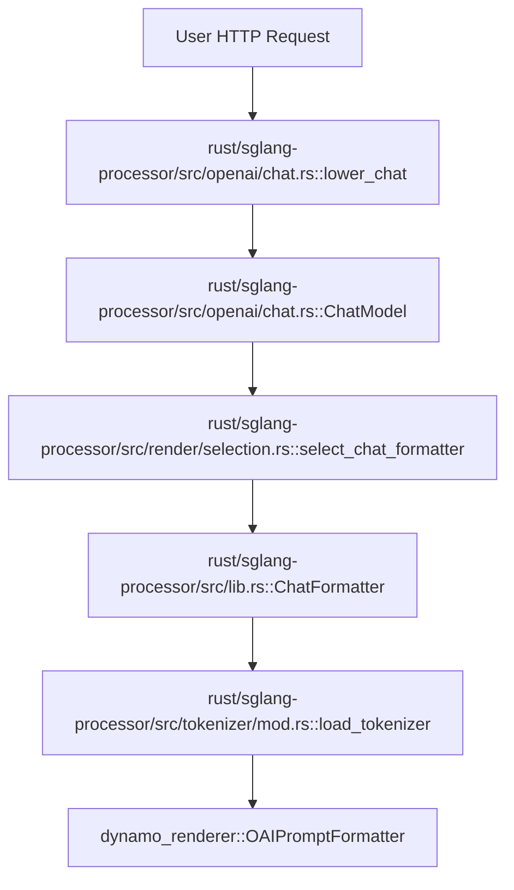
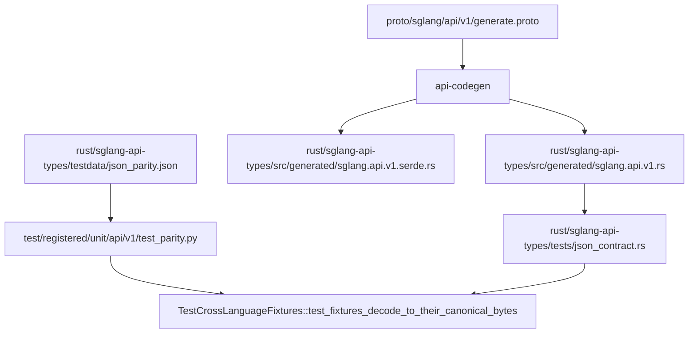

<!-- source: DeepWiki mcp.deepwiki.com · repo sgl-project/sglang · page 13.5 Rust Workspace Crates (processor, mm, api-types, bench) · fetched 2026-10-30 -->

# Rust Workspace Crates (processor, mm, api-types, bench)

Relevant source files

The following files were used as context for generating this wiki page:

- [proto/sglang/api/v1/generate.proto](proto/sglang/api/v1/generate.proto)
- [python/sglang/api/v1/api_types.py](python/sglang/api/v1/api_types.py)
- [rust/Cargo.lock](rust/Cargo.lock)
- [rust/sglang-api-types/src/generated/sglang.api.v1.rs](rust/sglang-api-types/src/generated/sglang.api.v1.rs)
- [rust/sglang-api-types/src/generated/sglang.api.v1.serde.rs](rust/sglang-api-types/src/generated/sglang.api.v1.serde.rs)
- [rust/sglang-api-types/testdata/json_parity.json](rust/sglang-api-types/testdata/json_parity.json)
- [rust/sglang-api-types/tests/json_contract.rs](rust/sglang-api-types/tests/json_contract.rs)
- [rust/sglang-bench/src/request.rs](rust/sglang-bench/src/request.rs)
- [rust/sglang-bench/tests/grpc.rs](rust/sglang-bench/tests/grpc.rs)
- [rust/sglang-processor/Cargo.toml](rust/sglang-processor/Cargo.toml)
- [rust/sglang-processor/README.md](rust/sglang-processor/README.md)
- [rust/sglang-processor/src/lib.rs](rust/sglang-processor/src/lib.rs)
- [rust/sglang-processor/src/openai/chat.rs](rust/sglang-processor/src/openai/chat.rs)
- [rust/sglang-processor/src/openai/completions.rs](rust/sglang-processor/src/openai/completions.rs)
- [rust/sglang-processor/src/openai/mod.rs](rust/sglang-processor/src/openai/mod.rs)
- [rust/sglang-processor/src/openai/request.rs](rust/sglang-processor/src/openai/request.rs)
- [rust/sglang-processor/src/openai/wire.rs](rust/sglang-processor/src/openai/wire.rs)
- [rust/sglang-processor/src/render/mod.rs](rust/sglang-processor/src/render/mod.rs)
- [rust/sglang-processor/src/render/models/glm53.rs](rust/sglang-processor/src/render/models/glm53.rs)
- [rust/sglang-processor/src/render/models/kimi_k3.rs](rust/sglang-processor/src/render/models/kimi_k3.rs)
- [rust/sglang-processor/src/render/models/qwen38.rs](rust/sglang-processor/src/render/models/qwen38.rs)
- [rust/sglang-processor/src/render/template.rs](rust/sglang-processor/src/render/template.rs)
- [rust/sglang-processor/src/render/thinking.rs](rust/sglang-processor/src/render/thinking.rs)
- [rust/sglang-processor/tests/openai_parity.rs](rust/sglang-processor/tests/openai_parity.rs)
- [rust/sglang-server/Cargo.toml](rust/sglang-server/Cargo.toml)
- [rust/sglang-server/src/api_server/core/frame.rs](rust/sglang-server/src/api_server/core/frame.rs)
- [rust/sglang-server/src/api_server/grpc/service.rs](rust/sglang-server/src/api_server/grpc/service.rs)
- [rust/sglang-server/src/message/io_struct.rs](rust/sglang-server/src/message/io_struct.rs)
- [rust/sglang-server/src/message/request.rs](rust/sglang-server/src/message/request.rs)
- [rust/sglang-server/src/message/response.rs](rust/sglang-server/src/message/response.rs)
- [sgl-router/Cargo.lock](sgl-router/Cargo.lock)
- [sgl-router/deny.toml](sgl-router/deny.toml)
- [sgl-router/src/server/routes/chat/openai.rs](sgl-router/src/server/routes/chat/openai.rs)
- [sgl-router/src/server/routes/chat/preparation.rs](sgl-router/src/server/routes/chat/preparation.rs)
- [test/registered/unit/api/v1/test_json_contract.py](test/registered/unit/api/v1/test_json_contract.py)
- [test/registered/unit/api/v1/test_parity.py](test/registered/unit/api/v1/test_parity.py)

## Purpose and Scope
This page details the internal Rust workspace crates located under the `rust/` directory that complement the main `sglang-server` extension module. These modular crates separate responsibilities across frontend text processing, multimodal feature pipelines, shared API contract definitions, and performance benchmarking:
- `sglang-processor`: A thin wrapper over Dynamo frontend crates (`dynamo-renderer`, `dynamo-tokenizers`, `dynamo-parsers`) handling prompt rendering, tokenization, and output parsing [rust/sglang-processor/README.md:1-4]().
- `sglang-mm`: The pure-Rust core of the multimodal worker pipeline for parsing, shm transport, and asset staging [rust/sglang-server/Cargo.toml:59-62]().
- `sglang-api-types` and `api-codegen`: Generated API type contracts, Serde implementations, and cross-language JSON parity test foundations [test/registered/unit/api/v1/test_parity.py:1-12]().
- `sglang-bench`: A high-concurrency client benchmarking suite for HTTP and gRPC protocols [rust/sglang-bench/tests/grpc.rs:1-1]() [rust/sglang-bench/src/request.rs:1-1]().

---

## 1. sglang-processor (Dynamo-Backed Render, Tokenization, and Parsing)

The `sglang-processor` crate bridges SGLang server hosts and upstream Dynamo frontend libraries [rust/sglang-processor/README.md:1-4](). It gates functionality through optional feature flags (`render`, `tokenizer`, `parser`, `openai`), allowing fine-grained compilation profiles [rust/sglang-processor/README.md:14-17]().

### Module Layout and Responsibilities
- `model_files.rs`: Locates model files and tokenizer configurations in local directories or local HuggingFace caches without requiring network access [rust/sglang-processor/README.md:29-39]().
- `tokenizer/`: Exposes `DynamoTokenizer` and `load_tokenizer` as wrappers over `dynamo_tokenizers::Tokenizer` [rust/sglang-processor/README.md:42-53]().
- `render/`: Manages template selection (`select_chat_formatter`), loading (`load_chat_formatter`), and model-specific Jinja/native formatting contexts (such as DeepSeek V4, GLM-5.3, Kimi K3, and Qwen3.8) [rust/sglang-processor/README.md:55-81]() [rust/sglang-processor/src/lib.rs:37-41]().
- `parser/`: Transforms engine output streams into structured chat events (`ChatEvent`), tool-call deltas, and reasoning splits [rust/sglang-processor/src/lib.rs:30-35]().
- `openai/`: Implements `/v1/chat/completions` and `/v1/completions` logic over native `/generate` endpoints [rust/sglang-processor/src/openai/mod.rs:1-7]() [rust/sglang-processor/src/openai/chat.rs:1-3]().

### Natural Language Space to Code Entity Space: Request Processing Pipeline
The following diagram maps high-level user-facing chat and completion requests to their concrete code entities within `sglang-processor`.

Sources: [rust/sglang-processor/README.md:1-27](), [rust/sglang-processor/src/lib.rs:28-46](), [rust/sglang-processor/src/openai/chat.rs:31-68]()

---

## 2. sglang-mm (Multimodal Worker Pipeline)

`sglang-mm` acts as the pure-Rust core component for multimodal payload handling [rust/sglang-server/Cargo.toml:59-62](). It handles media items such as image data, video segments, and audio files, cooperating with POSIX shared memory (`rustix` features) to fan out tensor chunks and input attributes between the HTTP server and Python execution engines without redundant memory copies [rust/sglang-server/Cargo.toml:46-62]().

Sources: [rust/sglang-server/Cargo.toml:46-65]()

---

## 3. sglang-api-types and api-codegen (API Contracts and JSON Parity)

`sglang-api-types` defines strongly-typed request and response schemas shared across boundaries via Protocol Buffers (`proto/sglang/api/v1/generate.proto`) and custom Serde implementations [rust/sglang-api-types/src/generated/sglang.api.v1.serde.rs:1-19]().

### Serialization and Deserialization Parity
The generated Serde code (`rust/sglang-api-types/src/generated/sglang.api.v1.serde.rs`) handles flexible union types such as `StringOrList`, `TokenIds`, and `BoolOrList` to support both single-value fields and list-form batches in client requests [rust/sglang-api-types/src/generated/sglang.api.v1.serde.rs:21-63]().

### Cross-Language JSON Parity Testing
To maintain strict ABI and API compatibility between Python server components and Rust frontends, tests like `test_parity.py` load shared fixtures (`rust/sglang-api-types/testdata/json_parity.json`) and enforce that Python's `io_struct.GenerateReqInput` and Rust's generated `api_v1::GenerateRequest` yield identical canonical JSON outputs [test/registered/unit/api/v1/test_parity.py:1-12]().

### Natural Language Space to Code Entity Space: API Parity and Contract Flow

Sources: [test/registered/unit/api/v1/test_parity.py:1-130](), [rust/sglang-api-types/src/generated/sglang.api.v1.serde.rs:1-63](), [proto/sglang/api/v1/generate.proto:1-1]()

---

## 4. sglang-bench (Benchmarking Suite)

The `sglang-bench` crate supplies high-throughput request generation logic and gRPC/HTTP testing primitives designed to stress-test SGLang deployment clusters [rust/sglang-bench/src/request.rs:1-1]() [rust/sglang-bench/tests/grpc.rs:1-1](). It coordinates concurrent request workers, synthetic workload distributions, and metrics reporting to evaluate scheduler throughput and time-to-first-token (TTFT) latency under load.

Sources: [rust/sglang-bench/src/request.rs:1-1](), [rust/sglang-bench/tests/grpc.rs:1-1]()

---

