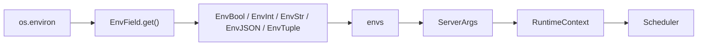
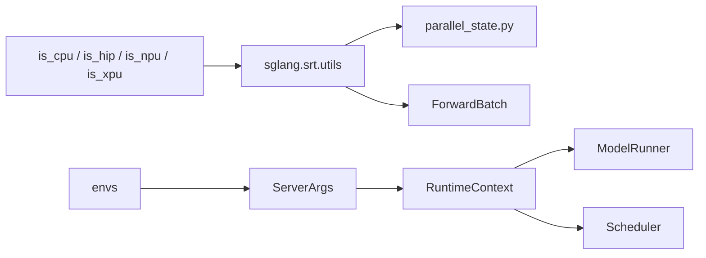

<!-- source: DeepWiki mcp.deepwiki.com · repo sgl-project/sglang · page 14 Environment and Configuration · fetched 2026-10-30 -->

# Environment and Configuration

Relevant source files

The following files were used as context for generating this wiki page:

- [docs/docs/references/environment_variables.mdx](docs/docs/references/environment_variables.mdx)
- [python/sglang/benchmark/one_batch.py](python/sglang/benchmark/one_batch.py)
- [python/sglang/srt/arg_groups/attention_hook.py](python/sglang/srt/arg_groups/attention_hook.py)
- [python/sglang/srt/arg_groups/overrides.py](python/sglang/srt/arg_groups/overrides.py)
- [python/sglang/srt/arg_groups/pd_disaggregation_hook.py](python/sglang/srt/arg_groups/pd_disaggregation_hook.py)
- [python/sglang/srt/disaggregation/role_switch.py](python/sglang/srt/disaggregation/role_switch.py)
- [python/sglang/srt/distributed/bootstrap.py](python/sglang/srt/distributed/bootstrap.py)
- [python/sglang/srt/distributed/parallel_state.py](python/sglang/srt/distributed/parallel_state.py)
- [python/sglang/srt/environ.py](python/sglang/srt/environ.py)
- [python/sglang/srt/layers/dp_attention.py](python/sglang/srt/layers/dp_attention.py)
- [python/sglang/srt/managers/schedule_batch.py](python/sglang/srt/managers/schedule_batch.py)
- [python/sglang/srt/managers/scheduler.py](python/sglang/srt/managers/scheduler.py)
- [python/sglang/srt/mem_cache/common.py](python/sglang/srt/mem_cache/common.py)
- [python/sglang/srt/model_executor/model_runner.py](python/sglang/srt/model_executor/model_runner.py)
- [python/sglang/srt/runtime_context.py](python/sglang/srt/runtime_context.py)
- [python/sglang/srt/server_args.py](python/sglang/srt/server_args.py)
- [test/manual/test_forward_split_prefill.py](test/manual/test_forward_split_prefill.py)
- [test/manual/test_vlm_accuracy.py](test/manual/test_vlm_accuracy.py)
- [test/registered/unit/disaggregation/test_pd_role_switch.py](test/registered/unit/disaggregation/test_pd_role_switch.py)
- [test/registered/unit/server_args/test_server_args.py](test/registered/unit/server_args/test_server_args.py)
- [test/registered/unit/test_model_overrides.py](test/registered/unit/test_model_overrides.py)
- [test/registered/unit/test_runtime_context.py](test/registered/unit/test_runtime_context.py)

## Purpose and scope

SGLang’s environment and configuration mechanisms provide runtime settings and connect platform information to execution. Environment fields read and parse process environment variables; server-argument resolution and runtime context make configuration available to runtime components. For details, see [Environment Variables System](#14.1) and [Hardware Detection and Platform Configuration](#14.2). [python/sglang/srt/environ.py:45-115]() [python/sglang/srt/runtime_context.py:14-23]()

Sources: [python/sglang/srt/environ.py:45-115]() [python/sglang/srt/runtime_context.py:14-23]()

## Environment Variables System

`EnvField` provides a common interface for reading, parsing, setting, and temporarily overriding environment values. Typed subclasses include `EnvBool`, `EnvInt`, `EnvFloat`, `EnvStr`, `EnvJSON`, and `EnvTuple`; the environment module also supports deprecated-name fallbacks. For details, see [Environment Variables System](#14.1). [python/sglang/srt/environ.py:45-115]() [python/sglang/srt/environ.py:123-205]()

**Diagram: Environment settings flow into runtime configuration**

Sources: [python/sglang/srt/environ.py:45-115]() [python/sglang/srt/environ.py:123-205]() [python/sglang/srt/server_args.py:31-55]() [python/sglang/srt/managers/scheduler.py:31-49]() [python/sglang/srt/runtime_context.py:14-23]()

## Hardware Detection and Platform Configuration

Hardware detection is used alongside configuration resolution to select platform-appropriate behavior. Runtime code imports platform helpers such as `is_cpu`, `is_hip`, `is_npu`, and `is_xpu`; `ServerArgs` also accesses the runtime platform context, while model execution components use runtime configuration and environment values. For details, see [Hardware Detection and Platform Configuration](#14.2). [python/sglang/srt/distributed/parallel_state.py:66-85]() [python/sglang/srt/server_args.py:50-58]() [python/sglang/srt/model_executor/model_runner.py:60-61]()

**Diagram: Platform checks and runtime configuration connect to execution entities**

Sources: [python/sglang/srt/distributed/parallel_state.py:66-85]() [python/sglang/srt/server_args.py:50-58]() [python/sglang/srt/model_executor/model_runner.py:60-61]() [python/sglang/srt/managers/scheduler.py:31-49]()

## Summary

Environment fields and hardware checks are complementary: environment variables supply configurable values, while platform detection informs runtime behavior. `ServerArgs` and `RuntimeContext` provide the connection from configuration inputs to runtime components. [python/sglang/srt/environ.py:45-115]() [python/sglang/srt/server_args.py:50-58]() [python/sglang/srt/runtime_context.py:14-23]()

Sources: [python/sglang/srt/environ.py:45-115]() [python/sglang/srt/server_args.py:50-58]() [python/sglang/srt/runtime_context.py:14-23]()

---

