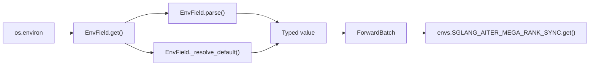
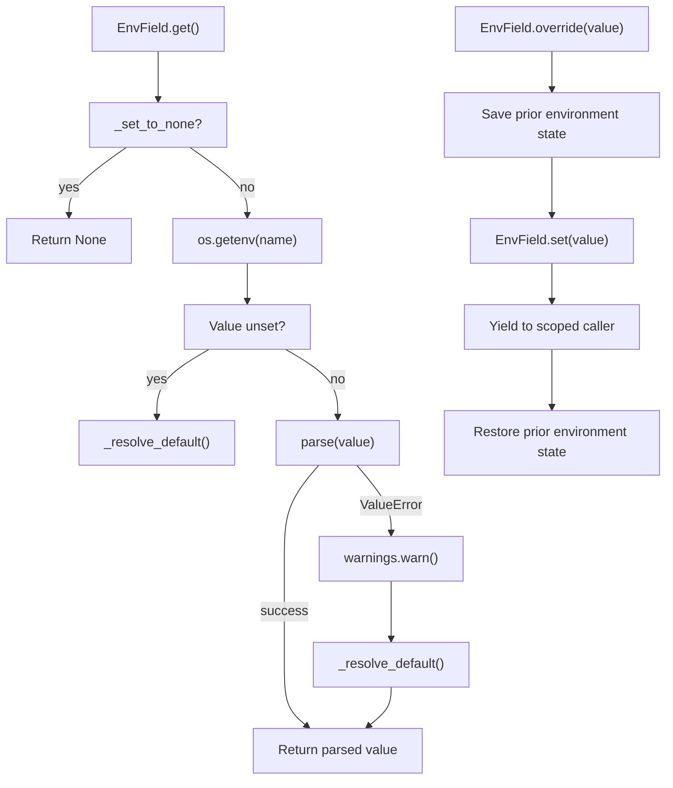
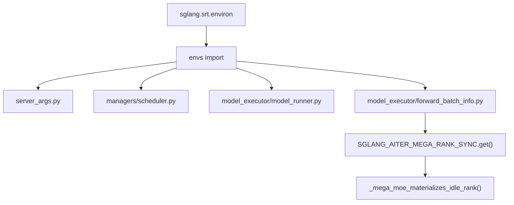

<!-- source: DeepWiki mcp.deepwiki.com · repo sgl-project/sglang · page 14.1 Environment Variables System · fetched 2026-10-30 -->

# Environment Variables System

Relevant source files

The following files were used as context for generating this wiki page:

- [docs/docs/advanced_features/server_arguments.mdx](docs/docs/advanced_features/server_arguments.mdx)
- [docs/docs/advanced_features/server_arguments_undocumented.txt](docs/docs/advanced_features/server_arguments_undocumented.txt)
- [docs/docs/references/environment_variables.mdx](docs/docs/references/environment_variables.mdx)
- [python/sglang/benchmark/one_batch.py](python/sglang/benchmark/one_batch.py)
- [python/sglang/srt/arg_groups/arg_utils.py](python/sglang/srt/arg_groups/arg_utils.py)
- [python/sglang/srt/arg_groups/attention_hook.py](python/sglang/srt/arg_groups/attention_hook.py)
- [python/sglang/srt/arg_groups/cuda_graph_hook.py](python/sglang/srt/arg_groups/cuda_graph_hook.py)
- [python/sglang/srt/arg_groups/field_order.py](python/sglang/srt/arg_groups/field_order.py)
- [python/sglang/srt/arg_groups/fields/exec_.py](python/sglang/srt/arg_groups/fields/exec_.py)
- [python/sglang/srt/arg_groups/fields/schedule.py](python/sglang/srt/arg_groups/fields/schedule.py)
- [python/sglang/srt/arg_groups/fields/serving.py](python/sglang/srt/arg_groups/fields/serving.py)
- [python/sglang/srt/arg_groups/memory_hook.py](python/sglang/srt/arg_groups/memory_hook.py)
- [python/sglang/srt/arg_groups/model_hook.py](python/sglang/srt/arg_groups/model_hook.py)
- [python/sglang/srt/arg_groups/overrides.py](python/sglang/srt/arg_groups/overrides.py)
- [python/sglang/srt/arg_groups/pd_disaggregation_hook.py](python/sglang/srt/arg_groups/pd_disaggregation_hook.py)
- [python/sglang/srt/arg_groups/pipeline.py](python/sglang/srt/arg_groups/pipeline.py)
- [python/sglang/srt/arg_groups/platform_hook.py](python/sglang/srt/arg_groups/platform_hook.py)
- [python/sglang/srt/arg_groups/resolution_hooks.py](python/sglang/srt/arg_groups/resolution_hooks.py)
- [python/sglang/srt/arg_groups/serving_hook.py](python/sglang/srt/arg_groups/serving_hook.py)
- [python/sglang/srt/arg_groups/validation_hook.py](python/sglang/srt/arg_groups/validation_hook.py)
- [python/sglang/srt/disaggregation/role_switch.py](python/sglang/srt/disaggregation/role_switch.py)
- [python/sglang/srt/distributed/bootstrap.py](python/sglang/srt/distributed/bootstrap.py)
- [python/sglang/srt/distributed/parallel_state.py](python/sglang/srt/distributed/parallel_state.py)
- [python/sglang/srt/environ.py](python/sglang/srt/environ.py)
- [python/sglang/srt/layers/dp_attention.py](python/sglang/srt/layers/dp_attention.py)
- [python/sglang/srt/managers/schedule_batch.py](python/sglang/srt/managers/schedule_batch.py)
- [python/sglang/srt/managers/scheduler.py](python/sglang/srt/managers/scheduler.py)
- [python/sglang/srt/mem_cache/common.py](python/sglang/srt/mem_cache/common.py)
- [python/sglang/srt/mem_cache/unified_cache/linker_config.py](python/sglang/srt/mem_cache/unified_cache/linker_config.py)
- [python/sglang/srt/model_executor/model_runner.py](python/sglang/srt/model_executor/model_runner.py)
- [python/sglang/srt/model_executor/model_runner_components/layer_setup.py](python/sglang/srt/model_executor/model_runner_components/layer_setup.py)
- [python/sglang/srt/runtime_context.py](python/sglang/srt/runtime_context.py)
- [python/sglang/srt/server_args.py](python/sglang/srt/server_args.py)
- [test/manual/test_forward_split_prefill.py](test/manual/test_forward_split_prefill.py)
- [test/manual/test_vlm_accuracy.py](test/manual/test_vlm_accuracy.py)
- [test/registered/disaggregation/test_disaggregation_optimistic_prefill.py](test/registered/disaggregation/test_disaggregation_optimistic_prefill.py)
- [test/registered/unit/disaggregation/test_pd_role_switch.py](test/registered/unit/disaggregation/test_pd_role_switch.py)
- [test/registered/unit/managers/test_schedule_policy.py](test/registered/unit/managers/test_schedule_policy.py)
- [test/registered/unit/managers/test_scheduler_hicache_events.py](test/registered/unit/managers/test_scheduler_hicache_events.py)
- [test/registered/unit/managers/test_scheduler_prefill_decode_interval.py](test/registered/unit/managers/test_scheduler_prefill_decode_interval.py)
- [test/registered/unit/mem_cache/test_hicache_file_storage_path_unit.py](test/registered/unit/mem_cache/test_hicache_file_storage_path_unit.py)
- [test/registered/unit/model_executor/model_runner_components/test_layer_setup.py](test/registered/unit/model_executor/model_runner_components/test_layer_setup.py)
- [test/registered/unit/server_args/test_resolution_declarations.py](test/registered/unit/server_args/test_resolution_declarations.py)
- [test/registered/unit/server_args/test_resolution_hook_registry.py](test/registered/unit/server_args/test_resolution_hook_registry.py)
- [test/registered/unit/server_args/test_resolution_is_reproducible.py](test/registered/unit/server_args/test_resolution_is_reproducible.py)
- [test/registered/unit/server_args/test_server_args.py](test/registered/unit/server_args/test_server_args.py)
- [test/registered/unit/test_global_config_read_ratchet.py](test/registered/unit/test_global_config_read_ratchet.py)
- [test/registered/unit/test_model_overrides.py](test/registered/unit/test_model_overrides.py)
- [test/registered/unit/test_rocm_pageable_h2d_staging.py](test/registered/unit/test_rocm_pageable_h2d_staging.py)
- [test/registered/unit/test_runtime_context.py](test/registered/unit/test_runtime_context.py)
- [test/registered/unit/test_server_args_cli_metadata.py](test/registered/unit/test_server_args_cli_metadata.py)
- [test/registered/unit/test_server_args_migration.py](test/registered/unit/test_server_args_migration.py)
- [test/registered/unit/test_server_args_namespaces.py](test/registered/unit/test_server_args_namespaces.py)

## Purpose and Scope

SGLang’s environment-variable interface is centered on typed `EnvField` objects exposed through the `envs` import used by runtime modules (`python/sglang/srt/environ.py`). It provides parsing, defaults, validation warnings, aliases, and scoped overrides over the process environment. This page documents the implementation visible in `python/sglang/srt/environ.py` and representative runtime access sites; hardware detection and platform configuration are covered in section 14.2. [python/sglang/srt/environ.py:45-206]()

Sources: [python/sglang/srt/environ.py:45-206]()

---

## System Architecture

`EnvField.get()` reads a field’s named value from the process environment, resolves a default when it is unset, or parses the value with the field’s parser. Runtime consumers import `envs` and call `.get()` to read typed values; for example, `ForwardBatch` construction checks `envs.SGLANG_AITER_MEGA_RANK_SYNC.get()`. [python/sglang/srt/environ.py:45-86](), [python/sglang/srt/model_executor/forward_batch_info.py:164-176]()

### Environment Variable Data Flow

Sources: [python/sglang/srt/environ.py:45-86](), [python/sglang/srt/model_executor/forward_batch_info.py:164-176]()

---

## Core Components

### EnvField Descriptor System

`EnvField` stores a default, a `secret` flag, and a marker for values explicitly set to `None`. Its `__set_name__()` method records the field name used as the environment key and asserts against a prohibited descriptor-usage pattern. Subclasses implement `parse()`. [python/sglang/srt/environ.py:45-60]()

`get()` reads the named variable using `os.getenv()`. An explicitly marked `None` returns `None`; an unset variable resolves to its default; and a set variable is parsed. If parsing raises `ValueError`, `get()` warns and returns the resolved default. Callable defaults are evaluated lazily, only when needed. [python/sglang/srt/environ.py:62-86]()

`set()` writes `str(value)` to `os.environ` and tracks whether the value was Python `None`. `override()` saves the prior environment value and marker, applies the temporary value, and restores the saved state after the context block. `clear()` removes the variable and resets the marker. [python/sglang/srt/environ.py:88-110]()

Implicit truth-value and length checks are rejected: `__bool__()` and `__len__()` raise `RuntimeError`, directing callers to use `.get()` explicitly. [python/sglang/srt/environ.py:112-120]()

### EnvField Read and Override Flow

Sources: [python/sglang/srt/environ.py:62-110]()

### Type-Specific EnvField Classes

| Class | Parsing behavior |
|---|---|
| `EnvTuple` | Splits on commas, strips whitespace, discards empty entries, and returns a tuple of strings. [python/sglang/srt/environ.py:123-126]() |
| `EnvStr` | Returns the input string unchanged. [python/sglang/srt/environ.py:128-131]() |
| `EnvJSON` | Returns `None` for an empty value; otherwise loads JSON from a path if that path exists, or parses the value as inline JSON. [python/sglang/srt/environ.py:133-141]() |
| `EnvBool` | Accepts case-insensitive `true`, `1`, `yes`, and `y` as true; accepts `false`, `0`, `no`, and `n` as false; rejects other values with `ValueError`. [python/sglang/srt/environ.py:143-151]() |
| `EnvInt` | Converts the value to an integer and raises `ValueError` with a diagnostic for invalid input. [python/sglang/srt/environ.py:153-159]() |
| `EnvFloat` | Converts the value to a float and raises `ValueError` with a diagnostic for invalid input. [python/sglang/srt/environ.py:200-206]() |

Sources: [python/sglang/srt/environ.py:123-159](), [python/sglang/srt/environ.py:200-206]()

### Deprecated Variable Fallbacks

`_DeprecatedEnvFallback` adds a deprecated-name lookup to an `EnvField` subclass. If the canonical variable is unset and the deprecated variable is present, `get()` emits a `DeprecationWarning`, copies the deprecated value into the canonical environment key, and delegates to the normal parsing and default logic. The concrete combinations are `EnvBoolWithAlias`, `EnvIntWithAlias`, and `EnvStrWithAlias`. [python/sglang/srt/environ.py:161-197]()

Sources: [python/sglang/srt/environ.py:161-197]()

---

## Environment Variable Domains and Examples

Runtime access sites check specific environment properties via `envs.<FIELD>.get()`. For instance, `ForwardBatch` uses `envs.SGLANG_AITER_MEGA_RANK_SYNC.get()` as part of its condition for materializing an idle rank. [python/sglang/srt/model_executor/forward_batch_info.py:164-176]()

| Code-level name | Observed use |
|---|---|
| `SGLANG_AITER_MEGA_RANK_SYNC` | Read through `.get()` in `_mega_moe_materializes_idle_rank()`. [python/sglang/srt/model_executor/forward_batch_info.py:164-176]() |

Sources: [python/sglang/srt/model_executor/forward_batch_info.py:164-176]()

---

## Usage Patterns and Integration

### Accessing Environment Variables

Runtime modules import `envs` from `sglang.srt.environ` and use `.get()` to obtain values. In `forward_batch_info.py`, `_mega_moe_materializes_idle_rank()` reads `envs.SGLANG_AITER_MEGA_RANK_SYNC.get()` and combines it with platform and batch-state checks. The `envs` import is also present in `server_args.py`, `scheduler.py`, and `model_runner.py`. [python/sglang/srt/server_args.py:50-51](), [python/sglang/srt/managers/scheduler.py:109-112](), [python/sglang/srt/model_executor/model_runner.py:60-61]()

Sources: [python/sglang/srt/server_args.py:50-51](), [python/sglang/srt/managers/scheduler.py:109-112](), [python/sglang/srt/model_executor/model_runner.py:60-61]()

### Temporary Overrides for Scoped Configuration

`EnvField.override(value)` provides a context manager that temporarily changes the process environment and restores the prior variable presence and value, along with the `_set_to_none` marker, when execution proceeds beyond the context block. Callers should use `.get()` to read a field rather than relying on its implicit truth value or length. [python/sglang/srt/environ.py:95-120]()

Sources: [python/sglang/srt/environ.py:95-120]()

---

## Component Integration Diagram: Environment Names to Runtime Entities

This diagram connects a concrete environment-field name to its accessor and the runtime function that consumes it. [python/sglang/srt/model_executor/forward_batch_info.py:164-176]()

Sources: [python/sglang/srt/model_executor/forward_batch_info.py:164-176]()

---

## Configuration Access Across Runtime Modules

Runtime modules import the same `envs` entry point, while `EnvField` centralizes environment parsing and default behavior. [python/sglang/srt/environ.py:45-86](), [python/sglang/srt/server_args.py:50-51](), [python/sglang/srt/managers/scheduler.py:109-112](), [python/sglang/srt/model_executor/model_runner.py:60-61]()

Sources: [python/sglang/srt/environ.py:45-86](), [python/sglang/srt/server_args.py:50-51](), [python/sglang/srt/managers/scheduler.py:109-112](), [python/sglang/srt/model_executor/model_runner.py:60-61](), [python/sglang/srt/model_executor/forward_batch_info.py:164-176]()

---

## Summary

`EnvField` provides the shared mechanics for reading and parsing environment values, resolving defaults, warning on invalid values, setting and clearing values, and applying scoped overrides. Typed subclasses implement parsing for strings, booleans, integers, floats, tuples, and JSON; alias subclasses support deprecated variable names. Runtime code accesses fields through `envs.<NAME>.get()`. [python/sglang/srt/environ.py:45-206]()

Sources: [python/sglang/srt/environ.py:45-206]()

---

