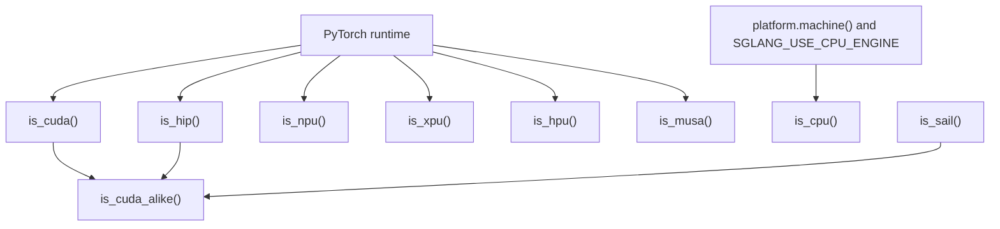
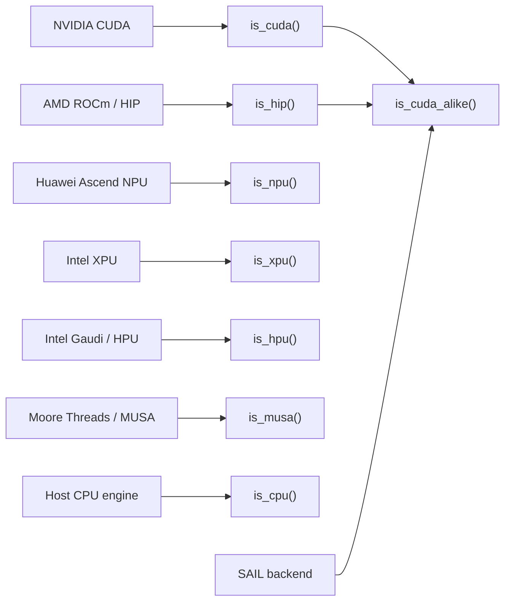
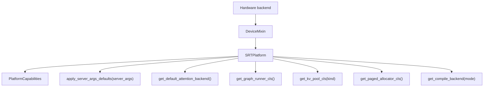

<!-- source: DeepWiki mcp.deepwiki.com · repo sgl-project/sglang · page 14.2 Hardware Detection and Platform Configuration · fetched 2026-10-30 -->

# Hardware Detection and Platform Configuration

Relevant source files

The following files were used as context for generating this wiki page:

- [.github/workflows/release-pypi-nightly.yml](.github/workflows/release-pypi-nightly.yml)
- [.github/workflows/release-pypi-pr.yml](.github/workflows/release-pypi-pr.yml)
- [3rdparty/amd/wheel/sglang/pyproject.toml](3rdparty/amd/wheel/sglang/pyproject.toml)
- [docker/Dockerfile](docker/Dockerfile)
- [docs/docs/hardware-platforms/plugin.mdx](docs/docs/hardware-platforms/plugin.mdx)
- [python/pyproject.toml](python/pyproject.toml)
- [python/pyproject_cpu.toml](python/pyproject_cpu.toml)
- [python/pyproject_npu.toml](python/pyproject_npu.toml)
- [python/pyproject_other.toml](python/pyproject_other.toml)
- [python/pyproject_xpu.toml](python/pyproject_xpu.toml)
- [python/sglang/kernels/ops/speculative/spec_tree.py](python/sglang/kernels/ops/speculative/spec_tree.py)
- [python/sglang/srt/entrypoints/engine.py](python/sglang/srt/entrypoints/engine.py)
- [python/sglang/srt/function_call/deepseekv32_detector.py](python/sglang/srt/function_call/deepseekv32_detector.py)
- [python/sglang/srt/function_call/kimik2_detector.py](python/sglang/srt/function_call/kimik2_detector.py)
- [python/sglang/srt/hardware_backend/npu/graph_runner/npu_cudagraph_backend.py](python/sglang/srt/hardware_backend/npu/graph_runner/npu_cudagraph_backend.py)
- [python/sglang/srt/platforms/__init__.py](python/sglang/srt/platforms/__init__.py)
- [python/sglang/srt/platforms/cpu.py](python/sglang/srt/platforms/cpu.py)
- [python/sglang/srt/platforms/cuda.py](python/sglang/srt/platforms/cuda.py)
- [python/sglang/srt/platforms/device_mixin.py](python/sglang/srt/platforms/device_mixin.py)
- [python/sglang/srt/platforms/interface.py](python/sglang/srt/platforms/interface.py)
- [python/sglang/srt/platforms/musa.py](python/sglang/srt/platforms/musa.py)
- [python/sglang/srt/platforms/npu.py](python/sglang/srt/platforms/npu.py)
- [python/sglang/srt/platforms/rocm.py](python/sglang/srt/platforms/rocm.py)
- [python/sglang/srt/platforms/sail.py](python/sglang/srt/platforms/sail.py)
- [python/sglang/srt/platforms/xpu.py](python/sglang/srt/platforms/xpu.py)
- [python/sglang/srt/speculative/adaptive_runtime_state.py](python/sglang/srt/speculative/adaptive_runtime_state.py)
- [python/sglang/srt/speculative/adaptive_spec_params.py](python/sglang/srt/speculative/adaptive_spec_params.py)
- [python/sglang/srt/utils/common.py](python/sglang/srt/utils/common.py)
- [python/sglang/srt/utils/json_response.py](python/sglang/srt/utils/json_response.py)
- [scripts/update_nightly_whl_index.py](scripts/update_nightly_whl_index.py)
- [test/registered/function_call/test_kimik2_detector.py](test/registered/function_call/test_kimik2_detector.py)
- [test/registered/moe/test_cutedsl_moe.py](test/registered/moe/test_cutedsl_moe.py)
- [test/registered/spec/eagle/test_adaptive_speculative.py](test/registered/spec/eagle/test_adaptive_speculative.py)
- [test/registered/spec/test_frozen_kv_mtp.py](test/registered/spec/test_frozen_kv_mtp.py)
- [test/registered/spec/test_gemma4_mtp_31b_extra.py](test/registered/spec/test_gemma4_mtp_31b_extra.py)
- [test/registered/unit/distributed/test_get_default_distributed_backend.py](test/registered/unit/distributed/test_get_default_distributed_backend.py)
- [test/registered/unit/distributed/test_oot_group_coordinator_hooks.py](test/registered/unit/distributed/test_oot_group_coordinator_hooks.py)
- [test/registered/unit/function_call/test_deepseekv4_detector.py](test/registered/unit/function_call/test_deepseekv4_detector.py)
- [test/registered/unit/function_call/test_json_schema_constraint.py](test/registered/unit/function_call/test_json_schema_constraint.py)
- [test/registered/unit/function_call/test_structural_tag_excludes.py](test/registered/unit/function_call/test_structural_tag_excludes.py)
- [test/registered/unit/function_call/test_unknown_tool_name.py](test/registered/unit/function_call/test_unknown_tool_name.py)
- [test/registered/unit/platforms/test_platform_interface.py](test/registered/unit/platforms/test_platform_interface.py)
- [test/registered/unit/spec/test_adaptive_runtime_state.py](test/registered/unit/spec/test_adaptive_runtime_state.py)
- [test/registered/unit/spec/test_adaptive_spec_params.py](test/registered/unit/spec/test_adaptive_spec_params.py)
- [test/registered/unit/spec/test_oot_eagle_hooks.py](test/registered/unit/spec/test_oot_eagle_hooks.py)
- [test/registered/unit/utils/test_common.py](test/registered/unit/utils/test_common.py)
- [test/registered/unit/utils/test_json_response.py](test/registered/unit/utils/test_json_response.py)

## Purpose and Scope

This page describes how SGLang detects hardware backends, represents platform capabilities, and exposes platform-specific configuration and dispatch hooks. The implementation distinguishes backend-presence checks such as `is_cuda()`, `is_hip()`, and `is_npu()` from the `SRTPlatform` abstraction, which declares capabilities and provides subsystem factories. It also summarizes the platform-specific dependency manifests present in the supplied repository contents. [python/sglang/srt/utils/common.py:123-235]() [python/sglang/srt/platforms/interface.py:1-10]()

Sources: `[python/sglang/srt/utils/common.py:123-235]()` `[python/sglang/srt/platforms/interface.py:1-10]()`

---

## Platform Detection Utilities (`is_cuda`, `is_hip`, `is_npu`, etc.)

The hardware and device utility section of `python/sglang/srt/utils/common.py` is explicitly scoped to backend detection, device and architecture queries, capability checks, and device helpers. It imports PyTorch and defines the detection predicates described here. [python/sglang/srt/utils/common.py:84-102]() [python/sglang/srt/utils/common.py:123-135]()

Most predicates shown below use `@lru_cache(maxsize=1)`, so their result is cached after the first call. This is important for interpretation: these predicates are runtime observations, not continuously refreshed checks. [python/sglang/srt/utils/common.py:139-142]() [python/sglang/srt/utils/common.py:157-175]() [python/sglang/srt/utils/common.py:188-199]() [python/sglang/srt/utils/common.py:201-234]()

### Key Detection Functions

| Function | Detection rule | Notes |
|---|---|---|
| `is_hip()` | Returns whether `torch.version.hip` is not `None`. | Cached. [python/sglang/srt/utils/common.py:139-142]() |
| `is_cuda()` | Requires both `torch.cuda.is_available()` and `torch.version.cuda is not None`. | Cached. [python/sglang/srt/utils/common.py:157-160]() |
| `is_cuda_alike()` | Returns `is_cuda() or is_hip() or is_sail()`. | The shown implementation includes SAIL in addition to CUDA and HIP. [python/sglang/srt/utils/common.py:162-165]() |
| `is_hpu()` | Requires `torch.hpu` to exist and `torch.hpu.is_available()` to be true. | Cached. [python/sglang/srt/utils/common.py:167-170]() |
| `is_xpu()` | Requires `torch.xpu` to exist and `torch.xpu.is_available()` to be true. | Cached. [python/sglang/srt/utils/common.py:172-175]() |
| `is_npu()` | Returns false if `torch.npu` is absent; raises `RuntimeError` if the module exists but no NPU is available; otherwise returns true. | Cached. [python/sglang/srt/utils/common.py:188-199]() |
| `is_host_cpu_x86()` | Checks an x86-family `platform.machine()` value and that `torch.cpu` exists and is available. | Cached. [python/sglang/srt/utils/common.py:201-208]() |
| `is_host_cpu_arm64()` | Checks `aarch64` or `arm64`, and that `torch.cpu` exists and is available. | Not decorated with `lru_cache` in the shown code. [python/sglang/srt/utils/common.py:211-218]() |
| `is_cpu()` | Requires `SGLANG_USE_CPU_ENGINE=1` and a supported x86 or ARM host CPU. | Cached. [python/sglang/srt/utils/common.py:220-224]() |
| `is_musa()` | Requires `torch.version.musa` to exist and be non-`None`, and a successful `torchada` import. | Cached. [python/sglang/srt/utils/common.py:226-235]() |

The different predicates have different failure semantics. For example, `is_npu()` does not simply return false when a recognized `torch.npu` backend has no visible device; it raises an error. By contrast, `is_xpu()` and `is_hpu()` return the conjunction of module presence and backend availability. [python/sglang/srt/utils/common.py:167-175]() [python/sglang/srt/utils/common.py:188-199]()

Sources: `[python/sglang/srt/utils/common.py:139-235]()`

### Hardware Detection Flow

**Diagram: Predicate checks and their inputs**

Sources: `[python/sglang/srt/utils/common.py:139-175]()` `[python/sglang/srt/utils/common.py:188-235]()`

### Related Detection and Device Utilities

The shown utility section also defines `register_xpu_device_properties_for_dynamo()`. It returns immediately when `is_xpu()` is false; otherwise it imports `torch._dynamo.utils`, looks up `torch.xpu._XpuDeviceProperties`, and, if present, adds that type to `common_constant_types`. [python/sglang/srt/utils/common.py:177-186]()

The file also adjusts the FP8 E4M3 maximum based on HIP detection: HIP uses `224.0`; other backends use `torch.finfo(torch.float8_e4m3fn).max`. The resulting maximum and its negation are assigned to builtins as `FP8_E4M3_MAX` and `FP8_E4M3_MIN`. [python/sglang/srt/utils/common.py:145-154]()

Sources: `[python/sglang/srt/utils/common.py:145-154]()` `[python/sglang/srt/utils/common.py:177-186]()`

---

## Platform Abstraction, Capabilities, and Dispatch Hooks

The SRT platform abstraction is defined by `SRTPlatform`, which inherits from `DeviceMixin`. Its stated role is to add SRT-specific subsystem factory methods, a capability declaration, and configuration lifecycle hooks; out-of-tree platforms are expected to subclass it and can register through the `sglang.srt.platforms` entry-point group. [python/sglang/srt/platforms/interface.py:1-10]() [python/sglang/srt/platforms/interface.py:76-86]()

Sources: `[python/sglang/srt/platforms/interface.py:1-10]()` `[python/sglang/srt/platforms/interface.py:76-86]()`

### `PlatformCapabilities`

`PlatformCapabilities` is a frozen, keyword-only `msgspec.Struct`. Its fields default conservatively to false, so a platform must explicitly declare support for the capabilities represented by these fields. [python/sglang/srt/platforms/interface.py:49-54]() [python/sglang/srt/platforms/interface.py:69-74]()

| Capability field | Meaning documented by the interface |
|---|---|
| `supports_triton` | Triton kernels can launch on the device. When false, core uses the torch-native allocator and request-to-token writers. [python/sglang/srt/platforms/interface.py:56-58]() |
| `graph_capture` | The decode graph runner can run. [python/sglang/srt/platforms/interface.py:58-60]() |
| `piecewise_graph` | The prefill piecewise compilation backend can run. [python/sglang/srt/platforms/interface.py:59-61]() |
| `hicache_device_kernels` | The `sgl_kernel` HiCache transfer and write-back kernels are available; otherwise host pools skip staging buffers. [python/sglang/srt/platforms/interface.py:61-63]() |
| `supports_pynccl` | For out-of-tree platforms, model-parallel groups use a PyNccl communicator when the caller does not choose one; in-tree devices make this decision in `parallel_state`. [python/sglang/srt/platforms/interface.py:64-66]() |

The interface describes the capability flow as core reading these declarations before constructing relevant components and choosing a usable code path. In other words, capability declarations inform selection before construction rather than being only a post-selection assertion. [python/sglang/srt/platforms/interface.py:49-54]()

Sources: `[python/sglang/srt/platforms/interface.py:49-74]()`

### Configuration and Subsystem Factory Hooks

`SRTPlatform.apply_server_args_defaults(server_args)` is a lifecycle hook documented as being called after `ServerArgs` is parsed. The base implementation is a no-op, leaving platforms an extension point for defaults. [python/sglang/srt/platforms/interface.py:92-101]()

The base class also defines hooks for platform-selected attention backends, graph runners, KV pools, paged allocators, and compilation backends. Some hooks deliberately return `None` to indicate that the caller should use an in-tree default or device-keyed fallback. [python/sglang/srt/platforms/interface.py:103-129]() [python/sglang/srt/platforms/interface.py:130-172]() [python/sglang/srt/platforms/interface.py:174-179]()

| Hook | Base behavior or contract |
|---|---|
| `get_default_attention_backend()` | Abstract in the base class; subclasses must provide the default attention backend name. [python/sglang/srt/platforms/interface.py:107-109]() |
| `get_default_speculative_draft_attention_backend(algorithm)` | Abstract in the base class; subclasses provide the draft attention backend for an algorithm. [python/sglang/srt/platforms/interface.py:111-113]() |
| `get_graph_runner_cls()` | Returns `None` by default. The documentation says `None` means no platform-specific opinion, allowing the caller to fall back to in-tree device-keyed selection. [python/sglang/srt/platforms/interface.py:115-124]() |
| `get_full_graph_backend_cls()` | Declares a platform hook for the full device-graph backend class; its shown base implementation returns `None`. [python/sglang/srt/platforms/interface.py:126-128]() |
| `get_kv_pool_cls(kind=...)` | Allows a platform to provide a KV pool class for `mha`, `mla`, or `dsa`; `None` selects the in-tree pool. The interface documents construction compatibility and legacy-hook handling. [python/sglang/srt/platforms/interface.py:39-45]() [python/sglang/srt/platforms/interface.py:130-162]() |
| `get_paged_allocator_cls()` | Returns `None` by default. The interface notes that the in-tree allocator falls back to torch-native kernels when `supports_triton` is false. [python/sglang/srt/platforms/interface.py:164-172]() |
| `get_compile_backend(mode=None)` | Returns `"inductor"` in the base class; `mode` is an optional platform hint. [python/sglang/srt/platforms/interface.py:174-179]() |

Sources: `[python/sglang/srt/platforms/interface.py:39-45]()` `[python/sglang/srt/platforms/interface.py:103-179]()`

### Device Identity and Tests

The supplied platform-interface tests enumerate `PlatformEnum` identity methods for CUDA, ROCm, CPU, XPU, MUSA, NPU, TPU, and MPS. The same test data checks `DeviceMixin.is_cuda_alike()` as true for CUDA, ROCm, and MUSA, and false for CPU and NPU. These tests describe the tested `DeviceMixin` contract; they are distinct from `common.py`’s `is_cuda_alike()` implementation, which explicitly includes CUDA, HIP, and SAIL. [test/registered/unit/platforms/test_platform_interface.py:90-109]() [test/registered/unit/platforms/test_platform_interface.py:112-127]() [python/sglang/srt/utils/common.py:162-165]()

`DeviceCapability` is tested for conversion to a version string and integer form: for example, major/minor values `9.0` and `8.9` map to integer values `90` and `89`. [test/registered/unit/platforms/test_platform_interface.py:69-83]()

Sources: `[test/registered/unit/platforms/test_platform_interface.py:69-83]()` `[test/registered/unit/platforms/test_platform_interface.py:90-127]()` `[python/sglang/srt/utils/common.py:162-165]()`

---

## Runtime Dispatch and Data Flow

The provided code establishes two complementary mechanisms:

1. **Detection predicates** in `common.py` query PyTorch runtime availability, version metadata, CPU architecture, and—in the CPU-engine case—`SGLANG_USE_CPU_ENGINE`. [python/sglang/srt/utils/common.py:139-175]() [python/sglang/srt/utils/common.py:188-235]()
2. **Platform hooks and capabilities** in `SRTPlatform` describe how core can select or construct platform-sensitive subsystems. Capability declarations cover Triton, graph capture, piecewise graphs, HiCache device kernels, and PyNccl support; factory methods expose backend choices and platform-specific implementations. [python/sglang/srt/platforms/interface.py:49-74]() [python/sglang/srt/platforms/interface.py:103-179]()

Sources: `[python/sglang/srt/utils/common.py:139-235]()` `[python/sglang/srt/platforms/interface.py:49-74]()` `[python/sglang/srt/platforms/interface.py:103-179]()`

---

## Platform-Specific Configuration and Build Variants

Platform detection and runtime hooks are complemented by separate dependency manifests. These manifests specify platform-specific PyTorch builds, kernels, and optional dependencies; they are installation configuration, not the runtime detection mechanism itself. [python/pyproject_other.toml:19-27]() [python/pyproject_other.toml:111-214]() [python/pyproject_xpu.toml:1-75]() [python/pyproject_npu.toml:1-71]()

| Manifest | Hardware-related configuration represented in the supplied contents |
|---|---|
| `python/pyproject.toml` | The primary project dependencies include CUDA-oriented packages such as `cuda-python`, `flashinfer_python[cu13]`, and `humming-kernels[cu13]`, as well as a pinned PyTorch dependency. [python/pyproject.toml:23-24]() [python/pyproject.toml:32-43]() [python/pyproject.toml:88-93]() |
| `python/pyproject_other.toml` | Defines a torch-free `srt_empty` installation path and platform extras including HIP/ROCm, HPU, SAIL, MUSA, and MPS. [python/pyproject_other.toml:19-27]() [python/pyproject_other.toml:72-85]() [python/pyproject_other.toml:111-214]() |
| `python/pyproject_xpu.toml` | Pins XPU-specific PyTorch packages and an XPU kernel wheel; its `ray` extra includes `dpctl` for Ray GPU-resource registration. [python/pyproject_xpu.toml:1-3]() [python/pyproject_xpu.toml:60-75]() [python/pyproject_xpu.toml:98-102]() |
| `python/pyproject_npu.toml` | Provides the NPU manifest and declares `srt_npu` as an empty extra, with `all_npu` and `dev_npu` extras layered on top. [python/pyproject_npu.toml:1-3]() [python/pyproject_npu.toml:113-116]() |
| `python/pyproject_cpu.toml` | Defines a CPU project manifest with CPU-oriented PyTorch and Triton pins; `intel-openmp` is conditional on x86_64. [python/pyproject_cpu.toml:1-4]() [python/pyproject_cpu.toml:29-32]() [python/pyproject_cpu.toml:65-76]() |
| `3rdparty/amd/wheel/sglang/pyproject.toml` | Defines the `amd-sglang` package, ROCm wheel dependencies, and an `srt_hip` extra for AMD HIP runtime dependencies. [3rdparty/amd/wheel/sglang/pyproject.toml:5-16]() [3rdparty/amd/wheel/sglang/pyproject.toml:69-86]() |

Sources: `[python/pyproject.toml:23-93]()` `[python/pyproject_other.toml:19-214]()` `[python/pyproject_xpu.toml:1-102]()` `[python/pyproject_npu.toml:1-116]()` `[python/pyproject_cpu.toml:1-76]()` `[3rdparty/amd/wheel/sglang/pyproject.toml:5-86]()`

---

## Appendix: Mapping Platform Concepts to Code Entities

### Hardware Concepts to Detection Functions

**Diagram: Hardware names to `common.py` predicates**

Sources: `[python/sglang/srt/utils/common.py:139-175]()` `[python/sglang/srt/utils/common.py:188-235]()`

### Platform Concepts to Abstraction Entities

**Diagram: Platform abstraction entities**

Sources: `[python/sglang/srt/platforms/interface.py:49-74]()` `[python/sglang/srt/platforms/interface.py:76-179]()`

---

## Summary

SGLang’s shown hardware checks are cached predicates over PyTorch runtime state, host architecture, and selected environment configuration. `is_cuda()`, `is_hip()`, and `is_npu()` have distinct detection and failure behavior; related predicates cover XPU, HPU, MUSA, and CPU execution. [python/sglang/srt/utils/common.py:139-175]() [python/sglang/srt/utils/common.py:188-235]()

`SRTPlatform` separates device identity from SRT-specific platform behavior. Its `PlatformCapabilities` declaration and factory hooks provide the interface through which core can choose supported execution paths and platform-specific subsystems. Platform-specific project manifests and container configuration provide corresponding dependency sets. [python/sglang/srt/platforms/interface.py:49-74]() [python/sglang/srt/platforms/interface.py:76-179]() [python/pyproject_other.toml:111-214]() [python/pyproject_xpu.toml:60-75]() [python/pyproject_npu.toml:113-116]() [python/pyproject_cpu.toml:65-76]()

Sources: `[python/sglang/srt/utils/common.py:139-235]()` `[python/sglang/srt/platforms/interface.py:49-179]()` `[python/pyproject_other.toml:111-214]()` `[python/pyproject_xpu.toml:60-75]()` `[python/pyproject_npu.toml:113-116]()` `[python/pyproject_cpu.toml:65-76]()`

---

