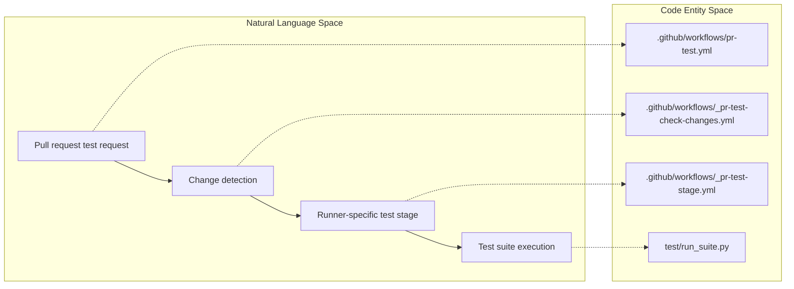
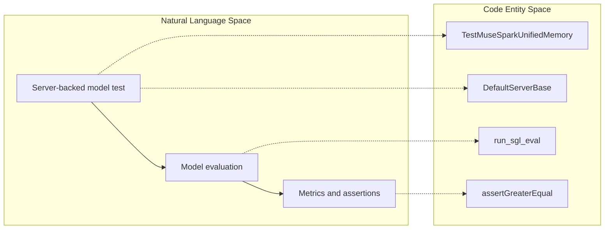
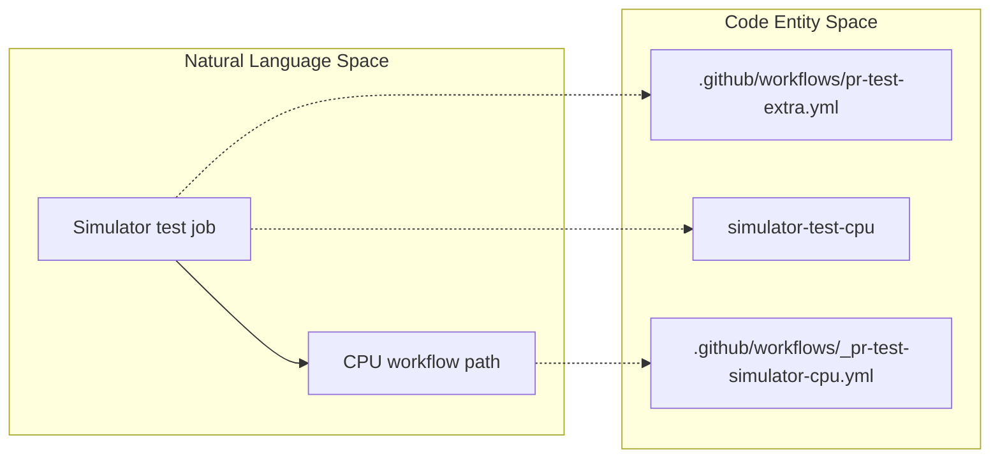

<!-- source: DeepWiki mcp.deepwiki.com · repo sgl-project/sglang · page 15 Testing and Development · fetched 2026-10-30 -->

# Testing and Development

Relevant source files

The following files were used as context for generating this wiki page:

- [.claude/rules/comment-style.md](.claude/rules/comment-style.md)
- [.github/actions/download-rust-ext/action.yml](.github/actions/download-rust-ext/action.yml)
- [.github/workflows/_pr-test-rust-ext-build.yml](.github/workflows/_pr-test-rust-ext-build.yml)
- [.github/workflows/_pr-test-sgl-kernel-build.yml](.github/workflows/_pr-test-sgl-kernel-build.yml)
- [.github/workflows/_pr-test-stage.yml](.github/workflows/_pr-test-stage.yml)
- [.github/workflows/nightly-test-nvidia.yml](.github/workflows/nightly-test-nvidia.yml)
- [.github/workflows/pr-test-extra.yml](.github/workflows/pr-test-extra.yml)
- [.github/workflows/pr-test-jit-kernel.yml](.github/workflows/pr-test-jit-kernel.yml)
- [.github/workflows/pr-test-multimodal-gen.yml](.github/workflows/pr-test-multimodal-gen.yml)
- [.github/workflows/pr-test-sgl-kernel.yml](.github/workflows/pr-test-sgl-kernel.yml)
- [.github/workflows/pr-test.yml](.github/workflows/pr-test.yml)
- [.github/workflows/release-whl-deepgemm.yml](.github/workflows/release-whl-deepgemm.yml)
- [.github/workflows/rerun-test.yml](.github/workflows/rerun-test.yml)
- [.github/workflows/seed-rust-ext-cache.yml](.github/workflows/seed-rust-ext-cache.yml)
- [docker/sgl-deep-gemm.Dockerfile](docker/sgl-deep-gemm.Dockerfile)
- [python/sglang/srt/model_loader/ci_weight_validation.py](python/sglang/srt/model_loader/ci_weight_validation.py)
- [scripts/build_sgl_deep_gemm.sh](scripts/build_sgl_deep_gemm.sh)
- [scripts/ci/cuda/ci_download_flashinfer_jit_cache.sh](scripts/ci/cuda/ci_download_flashinfer_jit_cache.sh)
- [scripts/ci/cuda/ci_install_dependency.sh](scripts/ci/cuda/ci_install_dependency.sh)
- [scripts/ci/partition_rerun_tests.py](scripts/ci/partition_rerun_tests.py)
- [scripts/ci/utils/install_rustup.sh](scripts/ci/utils/install_rustup.sh)
- [scripts/ci/utils/slash_command_handler.py](scripts/ci/utils/slash_command_handler.py)
- [scripts/ci/utils/stage_rust_ext_modules.sh](scripts/ci/utils/stage_rust_ext_modules.sh)
- [scripts/rename_sgl_deep_gemm_whl.sh](scripts/rename_sgl_deep_gemm_whl.sh)
- [scripts/update_deepgemm_whl_index.py](scripts/update_deepgemm_whl_index.py)
- [test/manual/test_weight_validation.py](test/manual/test_weight_validation.py)

## Purpose and scope

This parent page maps SGLang’s testing and development topics to the main workflows and code entities visible in the codebase. The GitHub Actions configuration includes pull-request, scheduled, rerun, JIT-kernel, and multimodal-generation test paths; details of test orchestration, benchmarking, test runners, debugging tools, and the simulator belong on the child pages. [.github/workflows/pr-test.yml:1-88](), [.github/workflows/nightly-test-nvidia.yml:1-40](), [.github/workflows/rerun-test.yml:1-43](), [.github/workflows/pr-test-jit-kernel.yml:1-20](), [.github/workflows/pr-test-multimodal-gen.yml:1-48]()

Sources: [.github/workflows/pr-test.yml:1-88](), [.github/workflows/nightly-test-nvidia.yml:1-40](), [.github/workflows/rerun-test.yml:1-43](), [.github/workflows/pr-test-jit-kernel.yml:1-20](), [.github/workflows/pr-test-multimodal-gen.yml:1-48]()

## CI pipeline and orchestration code mapping

The main PR workflow starts with change detection and can invoke an extra test workflow; reusable stage workflows receive test partitions and runner configuration. Scheduled Nvidia tests also use the reusable stage workflow, while the dedicated rerun workflow accepts a test command and partitions it before dispatching the selected test mode. [.github/workflows/pr-test.yml:72-88](), [.github/workflows/_pr-test-stage.yml:1-39](), [.github/workflows/nightly-test-nvidia.yml:68-95](), [.github/workflows/rerun-test.yml:88-117]()

**Diagram: Pull-request testing concepts mapped to workflow entities**

The workflow excerpts show `pr-test.yml` calling change detection and, under configured conditions, `pr-test-extra.yml`; `_pr-test-stage.yml` is a reusable stage workflow. The stage workflow documents `test/run_suite.py` as the suite runner, and the multimodal workflow invokes it directly. [.github/workflows/pr-test.yml:72-88](), [.github/workflows/_pr-test-stage.yml:1-8](), [.github/workflows/pr-test-multimodal-gen.yml:106-123]()

Sources: [.github/workflows/pr-test.yml:72-88](), [.github/workflows/_pr-test-stage.yml:1-8](), [.github/workflows/pr-test-multimodal-gen.yml:106-123]()

| Testing concern | Repository entry point | Scope on this parent page |
|---|---|---|
| PR and scheduled test flows | `pr-test.yml`, `nightly-test-nvidia.yml` | Overview and child-page link [.github/workflows/pr-test.yml:1-14](), [.github/workflows/nightly-test-nvidia.yml:1-20]() |
| Test-suite stages | `_pr-test-stage.yml` | Reusable stage overview [.github/workflows/_pr-test-stage.yml:1-8]() |
| Manual test reruns | `rerun-test.yml` | Rerun workflow overview [.github/workflows/rerun-test.yml:1-17]() |
| Kernel and multimodal test paths | `pr-test-jit-kernel.yml`, `pr-test-multimodal-gen.yml` | Specialized workflow overview [.github/workflows/pr-test-jit-kernel.yml:1-20](), [.github/workflows/pr-test-multimodal-gen.yml:1-48]() |

Sources: [.github/workflows/pr-test.yml:1-14](), [.github/workflows/nightly-test-nvidia.yml:1-20](), [.github/workflows/_pr-test-stage.yml:1-8](), [.github/workflows/rerun-test.yml:1-17](), [.github/workflows/pr-test-jit-kernel.yml:1-20](), [.github/workflows/pr-test-multimodal-gen.yml:1-48]()

## Test infrastructure and CI/CD

The PR workflow supports pull requests, scheduled runs, manual dispatch, and calls from other workflows. Its change-detection job is followed by conditional test workflows; the reusable stage defines runner configuration, partition inputs, and per-file timeout inputs. The Nvidia nightly workflow calls the same reusable stage, with scheduled-run settings. [.github/workflows/pr-test.yml:10-47](), [.github/workflows/pr-test.yml:72-88](), [.github/workflows/_pr-test-stage.yml:10-39](), [.github/workflows/nightly-test-nvidia.yml:68-95]()

For details on test orchestration (`run_suite.py`), CI registry system, GitHub Actions workflows across platforms, CODEOWNERS/permissions, and CI monitoring, see [Test Infrastructure and CI/CD](#15.1).

Sources: [.github/workflows/pr-test.yml:10-47](), [.github/workflows/pr-test.yml:72-88](), [.github/workflows/_pr-test-stage.yml:10-39](), [.github/workflows/nightly-test-nvidia.yml:68-95]()

## Benchmarking and performance measurement

The workflow excerpts include a JIT-kernel test matrix with a benchmark-named suite and a kernel workflow that runs benchmark test files. These are CI examples, not a complete inventory of SGLang’s benchmark tools. [.github/workflows/pr-test-jit-kernel.yml:47-79](), [.github/workflows/pr-test-sgl-kernel.yml:76-125]()

For benchmarking tools (`bench_serving`, `bench_one_batch`), profiling utilities, and the `benchmark/` directory, see [Benchmarking and Performance Measurement](#15.2).

Sources: [.github/workflows/pr-test-jit-kernel.yml:47-79](), [.github/workflows/pr-test-sgl-kernel.yml:76-125]()

## Test runners and model comparison

The codebase features model tests that derive from `DefaultServerBase` and use `run_sgl_eval` to evaluate a running server. This is one example of model-level validation; comparison and runner architectures extend to `HFRunner` and `SRTRunner`. [test/registered/e2e/models/test_muse_spark_unified_memory.py:10-17](), [test/registered/e2e/models/test_muse_spark_unified_memory.py:26-28](), [test/registered/e2e/models/test_muse_spark_unified_memory.py:83-109]()

For `HFRunner` vs `SRTRunner`, accuracy test runners, test kits, output comparison, and evaluation scripts, see [Test Runners and Model Comparison](#15.3).

**Diagram: Model evaluation concepts mapped to test entities**

The example test class inherits from `DefaultServerBase`, calls `run_sgl_eval`, reads evaluation metrics, and asserts an accuracy threshold. [test/registered/e2e/models/test_muse_spark_unified_memory.py:26-28](), [test/registered/e2e/models/test_muse_spark_unified_memory.py:83-109]()

Sources: [test/registered/e2e/models/test_muse_spark_unified_memory.py:26-28](), [test/registered/e2e/models/test_muse_spark_unified_memory.py:83-109]()

## Development tools and debugging

The PR and rerun workflows set `SGLANG_CUDA_COREDUMP` to `"1"`. The multimodal-generation workflow also uploads CUDA coredump artifacts on failure, making failure artifacts part of the CI debugging path. [.github/workflows/pr-test.yml:57-64](), [.github/workflows/rerun-test.yml:65-80](), [.github/workflows/pr-test-multimodal-gen.yml:135-147]()

For the tensor dumper, dump comparator and aligner, debug utilities, CUDA coredump handling, and internal playbooks in `scripts/`, `.claude/` and `.agents/skills`, see [Development Tools and Debugging](#15.4).

Sources: [.github/workflows/pr-test.yml:57-64](), [.github/workflows/rerun-test.yml:65-80](), [.github/workflows/pr-test-multimodal-gen.yml:135-147]()

## SGLang Simulator (`tools/sglang-simulator`)

The workflow excerpts identify a simulator test job in `pr-test-extra.yml`, which calls `_pr-test-simulator-cpu.yml`. The simulator reuses SGLang's scheduler and cache while replacing model forward passes with latency predictors. [.github/workflows/pr-test-extra.yml:143-153]()

For trace replay, synthetic workloads, predictor modes, and serving-compatible metrics, see [SGLang Simulator (tools/sglang-simulator)](#15.5).

**Diagram: Simulator CI concept mapped to workflow entities**

`pr-test-extra.yml` declares `simulator-test-cpu` and calls the reusable `_pr-test-simulator-cpu.yml` workflow. [.github/workflows/pr-test-extra.yml:143-153]()

Sources: [.github/workflows/pr-test-extra.yml:143-153]()

## Child pages

- [Test Infrastructure and CI/CD](#15.1) — Explain test orchestration (run_suite.py), CI registry system, GitHub Actions workflows across platforms, CODEOWNERS/permissions, and CI monitoring.
- [Benchmarking and Performance Measurement](#15.2) — Document benchmarking tools, bench_serving, bench_one_batch, profiling utilities, and the benchmark/ directory.
- [Test Runners and Model Comparison](#15.3) — Explain HFRunner vs SRTRunner, accuracy test runner, test kits, output comparison, and evaluation scripts.
- [Development Tools and Debugging](#15.4) — Cover tensor dumper, dump comparator and aligner, debug utilities, CUDA coredump handling, and internal playbooks in scripts/, .claude/ and .agents/skills.
- [SGLang Simulator (tools/sglang-simulator)](#15.5) — Document the simulator that reuses SGLang's scheduler and cache while replacing model forward with a latency predictor: trace replay, synthetic workloads, predictor modes, and serving-compatible metrics.

Sources: [.github/workflows/pr-test.yml:1-88](), [.github/workflows/pr-test-extra.yml:143-153](), [.github/workflows/_pr-test-stage.yml:1-39](), [test/registered/e2e/models/test_muse_spark_unified_memory.py:26-28]()

---

