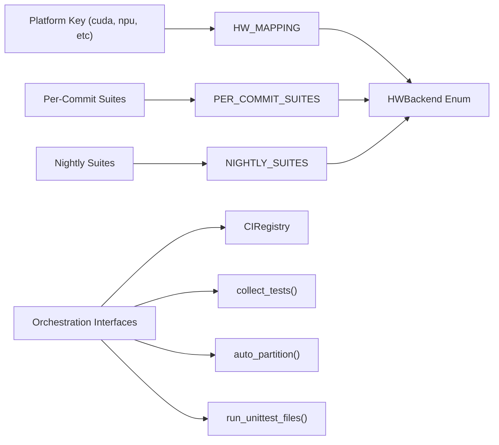
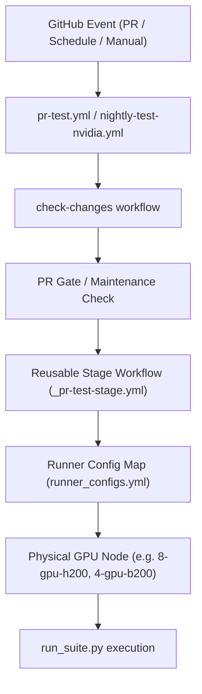

<!-- source: DeepWiki mcp.deepwiki.com · repo sgl-project/sglang · page 15.1 Test Infrastructure and CI/CD · fetched 2026-10-30 -->

# Test Infrastructure and CI/CD

Relevant source files

The following files were used as context for generating this wiki page:

- [.agents/skills/ci-workflow-guide/SKILL.md](.agents/skills/ci-workflow-guide/SKILL.md)
- [.claude/rules/comment-style.md](.claude/rules/comment-style.md)
- [.codespellrc](.codespellrc)
- [.github/CI_PERMISSIONS.json](.github/CI_PERMISSIONS.json)
- [.github/CODEOWNERS](.github/CODEOWNERS)
- [.github/FOLDER_README.md](.github/FOLDER_README.md)
- [.github/actions/check-pr-test-health/action.test.cjs](.github/actions/check-pr-test-health/action.test.cjs)
- [.github/actions/check-pr-test-health/action.yml](.github/actions/check-pr-test-health/action.yml)
- [.github/actions/download-rust-ext/action.yml](.github/actions/download-rust-ext/action.yml)
- [.github/actions/wait-for-jobs/action.yml](.github/actions/wait-for-jobs/action.yml)
- [.github/scripts/ci-labels.cjs](.github/scripts/ci-labels.cjs)
- [.github/update_ci_permission.py](.github/update_ci_permission.py)
- [.github/workflows/_npu-pr-test-stage.yml](.github/workflows/_npu-pr-test-stage.yml)
- [.github/workflows/_npu-single-node-test-stage.yml](.github/workflows/_npu-single-node-test-stage.yml)
- [.github/workflows/_pr-test-check-changes.yml](.github/workflows/_pr-test-check-changes.yml)
- [.github/workflows/_pr-test-rust-ext-build.yml](.github/workflows/_pr-test-rust-ext-build.yml)
- [.github/workflows/_pr-test-sgl-kernel-build.yml](.github/workflows/_pr-test-sgl-kernel-build.yml)
- [.github/workflows/_pr-test-stage-cpu.yml](.github/workflows/_pr-test-stage-cpu.yml)
- [.github/workflows/_pr-test-stage.yml](.github/workflows/_pr-test-stage.yml)
- [.github/workflows/amd-aiter-scout.yml](.github/workflows/amd-aiter-scout.yml)
- [.github/workflows/amd-ci-job-monitor.yml](.github/workflows/amd-ci-job-monitor.yml)
- [.github/workflows/bot-bump-sglang-version.yml](.github/workflows/bot-bump-sglang-version.yml)
- [.github/workflows/ci-failure-monitor.yml](.github/workflows/ci-failure-monitor.yml)
- [.github/workflows/ci-lark-notify.yml](.github/workflows/ci-lark-notify.yml)
- [.github/workflows/close-inactive-issues.yml](.github/workflows/close-inactive-issues.yml)
- [.github/workflows/coverage-collection-npu.yml](.github/workflows/coverage-collection-npu.yml)
- [.github/workflows/diffusion-ci-gt-gen-npu.yml](.github/workflows/diffusion-ci-gt-gen-npu.yml)
- [.github/workflows/full-test-npu.yml](.github/workflows/full-test-npu.yml)
- [.github/workflows/nightly-amd-mi355x-disagg.yml](.github/workflows/nightly-amd-mi355x-disagg.yml)
- [.github/workflows/nightly-test-npu.yml](.github/workflows/nightly-test-npu.yml)
- [.github/workflows/nightly-test-nvidia.yml](.github/workflows/nightly-test-nvidia.yml)
- [.github/workflows/pr-gate.yml](.github/workflows/pr-gate.yml)
- [.github/workflows/pr-states.yml](.github/workflows/pr-states.yml)
- [.github/workflows/pr-test-amd-extra.yml](.github/workflows/pr-test-amd-extra.yml)
- [.github/workflows/pr-test-extra.yml](.github/workflows/pr-test-extra.yml)
- [.github/workflows/pr-test-jit-kernel.yml](.github/workflows/pr-test-jit-kernel.yml)
- [.github/workflows/pr-test-multimodal-gen.yml](.github/workflows/pr-test-multimodal-gen.yml)
- [.github/workflows/pr-test-npu.yml](.github/workflows/pr-test-npu.yml)
- [.github/workflows/pr-test-sgl-kernel.yml](.github/workflows/pr-test-sgl-kernel.yml)
- [.github/workflows/pr-test.yml](.github/workflows/pr-test.yml)
- [.github/workflows/release-branch-cut.yml](.github/workflows/release-branch-cut.yml)
- [.github/workflows/release-docker-npu-nightly.yml](.github/workflows/release-docker-npu-nightly.yml)
- [.github/workflows/release-docker-npu.yml](.github/workflows/release-docker-npu.yml)
- [.github/workflows/release-whl-deepgemm.yml](.github/workflows/release-whl-deepgemm.yml)
- [.github/workflows/rerun-test.yml](.github/workflows/rerun-test.yml)
- [.github/workflows/run-cpu-ci.yml](.github/workflows/run-cpu-ci.yml)
- [.github/workflows/runner-utilization.yml](.github/workflows/runner-utilization.yml)
- [.github/workflows/seed-rust-ext-cache.yml](.github/workflows/seed-rust-ext-cache.yml)
- [.github/workflows/slash-command-handler.yml](.github/workflows/slash-command-handler.yml)
- [docker/npu.Dockerfile](docker/npu.Dockerfile)
- [docker/sgl-deep-gemm.Dockerfile](docker/sgl-deep-gemm.Dockerfile)
- [docs/docs/developer_guide/contribution_guide.mdx](docs/docs/developer_guide/contribution_guide.mdx)
- [docs/docs/developer_guide/evaluating_new_models.mdx](docs/docs/developer_guide/evaluating_new_models.mdx)
- [docs/docs/hardware-platforms/ascend-npus/development/contribution_guide.mdx](docs/docs/hardware-platforms/ascend-npus/development/contribution_guide.mdx)
- [python/sglang/multimodal_gen/test/server/ascend/test_glm_image_distributed.py](python/sglang/multimodal_gen/test/server/ascend/test_glm_image_distributed.py)
- [python/sglang/srt/model_loader/ci_weight_validation.py](python/sglang/srt/model_loader/ci_weight_validation.py)
- [python/sglang/test/ascend/e2e/test_npu_performance_utils.py](python/sglang/test/ascend/e2e/test_npu_performance_utils.py)
- [python/sglang/test/gpt_oss_common.py](python/sglang/test/gpt_oss_common.py)
- [scripts/build_sgl_deep_gemm.sh](scripts/build_sgl_deep_gemm.sh)
- [scripts/ci/amd/ensure_vram_clear.sh](scripts/ci/amd/ensure_vram_clear.sh)
- [scripts/ci/cuda/ci_download_flashinfer_jit_cache.sh](scripts/ci/cuda/ci_download_flashinfer_jit_cache.sh)
- [scripts/ci/cuda/ci_install_dependency.sh](scripts/ci/cuda/ci_install_dependency.sh)
- [scripts/ci/npu/npu_ci_install_dependency.sh](scripts/ci/npu/npu_ci_install_dependency.sh)
- [scripts/ci/npu/precise-test/bucket_recommended_tests.py](scripts/ci/npu/precise-test/bucket_recommended_tests.py)
- [scripts/ci/npu/precise-test/coveragerc](scripts/ci/npu/precise-test/coveragerc)
- [scripts/ci/npu/precise-test/list_multimodal_tests.py](scripts/ci/npu/precise-test/list_multimodal_tests.py)
- [scripts/ci/npu/precise-test/precise_test_coverage_plugin.py](scripts/ci/npu/precise-test/precise_test_coverage_plugin.py)
- [scripts/ci/npu/precise-test/run_tests_with_coverage.sh](scripts/ci/npu/precise-test/run_tests_with_coverage.sh)
- [scripts/ci/npu/precise-test/test_selector.py](scripts/ci/npu/precise-test/test_selector.py)
- [scripts/ci/partition_rerun_tests.py](scripts/ci/partition_rerun_tests.py)
- [scripts/ci/slurm/launch_mi355x.sh](scripts/ci/slurm/launch_mi355x.sh)
- [scripts/ci/slurm/nightly-configs.yaml](scripts/ci/slurm/nightly-configs.yaml)
- [scripts/ci/slurm/recipes/mi355x-fp4/dsv4flash/1k1k/1p1d-dp8ep8-mtp.yaml](scripts/ci/slurm/recipes/mi355x-fp4/dsv4flash/1k1k/1p1d-dp8ep8-mtp.yaml)
- [scripts/ci/slurm/recipes/mi355x-fp4/dsv4flash/1k1k/1p1d-dp8ep8.yaml](scripts/ci/slurm/recipes/mi355x-fp4/dsv4flash/1k1k/1p1d-dp8ep8.yaml)
- [scripts/ci/slurm/recipes/mi355x-fp4/dsv4flash/1k1k/1p1d-mooncake.yaml](scripts/ci/slurm/recipes/mi355x-fp4/dsv4flash/1k1k/1p1d-mooncake.yaml)
- [scripts/ci/slurm/recipes/mi355x-fp4/dsv4flash/1k1k/1p1d-mtp.yaml](scripts/ci/slurm/recipes/mi355x-fp4/dsv4flash/1k1k/1p1d-mtp.yaml)
- [scripts/ci/slurm/recipes/mi355x-fp4/dsv4flash/1k1k/1p1d.yaml](scripts/ci/slurm/recipes/mi355x-fp4/dsv4flash/1k1k/1p1d.yaml)
- [scripts/ci/slurm/recipes/mi355x-fp4/dsv4pro/1k1k/1p1d-dp8ep8-mtp.yaml](scripts/ci/slurm/recipes/mi355x-fp4/dsv4pro/1k1k/1p1d-dp8ep8-mtp.yaml)
- [scripts/ci/slurm/recipes/mi355x-fp4/dsv4pro/1k1k/1p1d-dp8ep8.yaml](scripts/ci/slurm/recipes/mi355x-fp4/dsv4pro/1k1k/1p1d-dp8ep8.yaml)
- [scripts/ci/slurm/recipes/mi355x-fp4/dsv4pro/1k1k/1p1d-mtp.yaml](scripts/ci/slurm/recipes/mi355x-fp4/dsv4pro/1k1k/1p1d-mtp.yaml)
- [scripts/ci/slurm/recipes/mi355x-fp4/glm52/1k1k/2p1d-ep16-mtp.yaml](scripts/ci/slurm/recipes/mi355x-fp4/glm52/1k1k/2p1d-ep16-mtp.yaml)
- [scripts/ci/slurm/recipes/mi355x-fp4/glm52/1k1k/2p1d-ep16.yaml](scripts/ci/slurm/recipes/mi355x-fp4/glm52/1k1k/2p1d-ep16.yaml)
- [scripts/ci/slurm/recipes/mi355x-fp8/dsv4flash/1k1k/1p1d-dp8ep8-mtp.yaml](scripts/ci/slurm/recipes/mi355x-fp8/dsv4flash/1k1k/1p1d-dp8ep8-mtp.yaml)
- [scripts/ci/slurm/recipes/mi355x-fp8/dsv4flash/1k1k/1p1d-dp8ep8.yaml](scripts/ci/slurm/recipes/mi355x-fp8/dsv4flash/1k1k/1p1d-dp8ep8.yaml)
- [scripts/ci/slurm/recipes/mi355x-fp8/dsv4flash/1k1k/1p1d-mtp.yaml](scripts/ci/slurm/recipes/mi355x-fp8/dsv4flash/1k1k/1p1d-mtp.yaml)
- [scripts/ci/slurm/recipes/mi355x-fp8/dsv4flash/1k1k/1p1d.yaml](scripts/ci/slurm/recipes/mi355x-fp8/dsv4flash/1k1k/1p1d.yaml)
- [scripts/ci/slurm/recipes/mi355x-fp8/kimik26/1k1k/1p1d-mtp.yaml](scripts/ci/slurm/recipes/mi355x-fp8/kimik26/1k1k/1p1d-mtp.yaml)
- [scripts/ci/slurm/recipes/mi355x-fp8/kimik26/1k1k/1p1d.yaml](scripts/ci/slurm/recipes/mi355x-fp8/kimik26/1k1k/1p1d.yaml)
- [scripts/ci/slurm/recipes/mi355x-fp8/kimik26/1k1k/2p1d-ep16-mtp-mxfp4.yaml](scripts/ci/slurm/recipes/mi355x-fp8/kimik26/1k1k/2p1d-ep16-mtp-mxfp4.yaml)
- [scripts/ci/slurm/recipes/mi355x-fp8/kimik26/1k1k/2p1d-ep16-mxfp4.yaml](scripts/ci/slurm/recipes/mi355x-fp8/kimik26/1k1k/2p1d-ep16-mxfp4.yaml)
- [scripts/ci/utils/compute_partitions.py](scripts/ci/utils/compute_partitions.py)
- [scripts/ci/utils/install_rustup.sh](scripts/ci/utils/install_rustup.sh)
- [scripts/ci/utils/query_job_status.py](scripts/ci/utils/query_job_status.py)
- [scripts/ci/utils/runner_utilization_report.py](scripts/ci/utils/runner_utilization_report.py)
- [scripts/ci/utils/slash_command_handler.py](scripts/ci/utils/slash_command_handler.py)
- [scripts/ci/utils/stage_rust_ext_modules.sh](scripts/ci/utils/stage_rust_ext_modules.sh)
- [scripts/ci/utils/test_runner_utilization_report.py](scripts/ci/utils/test_runner_utilization_report.py)
- [scripts/ci_monitor/README.md](scripts/ci_monitor/README.md)
- [scripts/ci_monitor/ci_failures_analysis.py](scripts/ci_monitor/ci_failures_analysis.py)
- [scripts/ci_monitor/lark_notify.py](scripts/ci_monitor/lark_notify.py)
- [scripts/rename_sgl_deep_gemm_whl.sh](scripts/rename_sgl_deep_gemm_whl.sh)
- [scripts/update_deepgemm_whl_index.py](scripts/update_deepgemm_whl_index.py)
- [test/manual/test_weight_validation.py](test/manual/test_weight_validation.py)
- [test/registered/npu/accuracy/deepseek_v4_flash/test_npu_deepseek_v4_flash_fp8_4p_gpqa_a5.py](test/registered/npu/accuracy/deepseek_v4_flash/test_npu_deepseek_v4_flash_fp8_4p_gpqa_a5.py)
- [test/registered/npu/accuracy/deepseek_v4_flash/test_npu_deepseek_v4_flash_w8a8_8p_gpqa.py](test/registered/npu/accuracy/deepseek_v4_flash/test_npu_deepseek_v4_flash_w8a8_8p_gpqa.py)
- [test/registered/npu/performance/deepseek_v4_flash/test_npu_deepseek_v4_flash_w8a8_1p1d_16p_in8k_out1k_50ms.py](test/registered/npu/performance/deepseek_v4_flash/test_npu_deepseek_v4_flash_w8a8_1p1d_16p_in8k_out1k_50ms.py)
- [test/registered/npu/performance/deepseek_v4_flash/test_npu_deepseek_v4_flash_w8a8_8p_in8k_out1k_50ms.py](test/registered/npu/performance/deepseek_v4_flash/test_npu_deepseek_v4_flash_w8a8_8p_in8k_out1k_50ms.py)

## Purpose and Scope

This page details the SGLang test-suite registry and orchestration entry point (`test/run_suite.py`), the CI registry system, the platform-specific GitHub Actions workflows across NVIDIA CUDA, AMD ROCm, Huawei Ascend NPU, and multimodal-generation pipelines, repository permissions and `CODEOWNERS` rules, and CI monitoring/rerun infrastructure. 

Sources: [.github/workflows/pr-test.yml:1-88](), [.github/workflows/pr-test-npu.yml:3-47](), [.github/workflows/rerun-test.yml:1-63](), [scripts/ci/cuda/ci_install_dependency.sh:33-122]()

---

## 1. Test Suite Organization and Registration

### Test Registration System

The test infrastructure manages test suites across multiple hardware platforms and execution cadences. Test collection, partitioning, and execution are orchestrated via `test/run_suite.py`, which imports `CIRegistry`, `HWBackend`, `auto_partition`, and `collect_tests` from `sglang.test.ci.ci_register`, and `run_unittest_files` from `sglang.test.ci.ci_utils` [test/run_suite.py:11-17] (referencing codebase test registration modules).

The `HW_MAPPING` structure maps string identifiers used in CLI and workflow configurations to `HWBackend` members representing hardware targets such as CUDA, AMD, NPU, XPU, MLX, and CPU.

Sources: [test/run_suite.py:11-17]()

### Per-Commit and Nightly Suites

Suites are divided into per-commit checks (optimized for fast feedback and scoped coverage) and nightly/scheduled deep test runs (which execute comprehensive test matrices across multi-GPU topologies). For instance, NVIDIA CUDA workflows orchestrate suites like `base-a-test-1-gpu-small`, `base-b-test-1-gpu-large`, and `base-b-test-2-gpu-large` [.github/workflows/pr-test.yml:112-150](), while specialized pipelines handle diffusion workloads through suites like `base-b-test-diffusion-1-gpu-h100` [.github/workflows/pr-test-multimodal-gen.yml:120-123]().

Sources: [.github/workflows/pr-test.yml:112-150](), [.github/workflows/pr-test-multimodal-gen.yml:120-123]()

### Registry-to-Suite Relationships

Sources: [test/run_suite.py:11-17](), [.github/workflows/pr-test.yml:112-150]()

---

## 2. Test Orchestration (`run_suite.py`)

### Entry Point and Orchestration Interfaces

`test/run_suite.py` serves as the CLI entry point for running test suites. It parses hardware target arguments (`--hw`), suite names (`--suite`), timeouts (`--timeout-per-file`), and partition specifiers, translating them into concrete invocations of `run_unittest_files()` [.github/workflows/pr-test-multimodal-gen.yml:120-123]().

### Data Flow and Code-Entity Map

Sources: [.github/workflows/pr-test-multimodal-gen.yml:120-123](), [scripts/ci/cuda/ci_install_dependency.sh:33-122]()

---

## 3. CI/CD Workflow Architecture Across Platforms

SGLang utilizes an extensive GitHub Actions workflow matrix to validate code across NVIDIA CUDA, AMD ROCm, Huawei Ascend NPU, and CPU platforms.

### NVIDIA CUDA Workflows

The primary PR validation pipeline is defined in `.github/workflows/pr-test.yml` (`PR Test Base`), which triggers on pull requests, scheduled cron intervals (twice daily), and manual dispatches [.github/workflows/pr-test.yml:1-14](). It employs concurrency grouping to prevent race conditions across fork PRs and scheduled runs [.github/workflows/pr-test.yml:49-55]().
- **Change Detection**: Calls `_pr-test-check-changes.yml` to determine modified packages (`main_package`, `sgl_kernel`, etc.) [.github/workflows/pr-test.yml:74-80]().
- **Sequential Job Coordination**: Uses `wait-for-base-a` and `wait-for-base-b` jobs to synchronize test shards across multiple GPU configurations (e.g., `1-gpu-small`, `1-gpu-large`, `2-gpu-large`, `4-gpu-b200`) [.github/workflows/pr-test.yml:92-150]().

Nightly testing is handled by `.github/workflows/nightly-test-nvidia.yml`, which dispatches comprehensive test grids across high-end runners (`1-gpu-large`, `2-gpu-large`, `4-gpu-h100`, `4-gpu-b200`, `4-gpu-gb300`, `8-gpu-h200`, `8-gpu-b200`) via reusable stages [.github/workflows/nightly-test-nvidia.yml:10-173]().

### NPU and Multimodal Generation Workflows

Huawei Ascend NPU validation is orchestrated via `.github/workflows/pr-test-npu.yml`, supporting branch filters (`main`, `npu/**`), manual coverage modes, and path-filtered change detection [.github/workflows/pr-test.yml:3-34](). It installs Ascend toolkits and custom ops via `scripts/ci/npu/npu_ci_install_dependency.sh` [scripts/ci/npu/npu_ci_install_dependency.sh:1-120]().

Multimodal generation tests (such as diffusion workflows) are partitioned dynamically via python scripts and executed on specialized runners (`1-gpu-h100`, `1-gpu-5090`) through `.github/workflows/pr-test-multimodal-gen.yml` [.github/workflows/pr-test-multimodal-gen.yml:49-195]().

### Workflow-to-Runner Data Flow

Sources: [.github/workflows/pr-test.yml:1-159](), [.github/workflows/nightly-test-nvidia.yml:1-173](), [.github/workflows/pr-test-npu.yml:1-160](), [.github/workflows/pr-test-multimodal-gen.yml:1-195]()

---

## 4. CODEOWNERS, Permissions, and Gate Automation

### Code Ownership Control (`CODEOWNERS`)

Repository ownership and review requirements are governed by `.github/CODEOWNERS` [.github/CODEOWNERS:1-98](). It delegates domain-specific reviews to specialized maintainers:
- Root and GitHub configuration: `.github @merrymercy @Fridge003 @ispobock ...` [.github/CODEOWNERS:1-1]().
- Kernel implementations: `/python/sglang/kernels @DarkSharpness @HaiShaw @BBuf ...` [.github/CODEOWNERS:8-8]().
- SRT runtime subsystems (distributed, memory cache, attention, disaggregation): `/python/sglang/srt/distributed`, `/python/sglang/srt/mem_cache`, etc. [.github/CODEOWNERS:21-27]().
- Routers and gateways: `/sgl-router` and `/sgl-model-gateway` [.github/CODEOWNERS:86-98]().

### CI Permissions Registry (`CI_PERMISSIONS.json`)

`.github/CI_PERMISSIONS.json` manages user-level authorization for triggering and rerunning CI jobs [.github/CI_PERMISSIONS.json:1-219](). Entries define flags such as `can_tag_run_ci_label`, `can_rerun_failed_ci`, and `cooldown_interval_minutes` for contributors and maintainers [.github/CI_PERMISSIONS.json:2-12]().

### Maintenance and Rebase Gate

The slash-command handler (`scripts/ci/utils/slash_command_handler.py`) implements `_check_rebase_gate()` to inspect pull requests before dispatching workflow runs [scripts/ci/utils/slash_command_handler.py:41-59](). It checks issue `#21065` for global maintenance pauses or minimum base commit requirements (`MIN_BASE_SHA`), automatically blocking out-of-date PRs unless the `bypass-maintenance` label is applied [scripts/ci/utils/slash_command_handler.py:86-155]().

Sources: [.github/CODEOWNERS:1-98](), [.github/CI_PERMISSIONS.json:1-219](), [scripts/ci/utils/slash_command_handler.py:41-155]()

---

## 5. CI Monitoring and Rerun Infrastructure

### Rerun Workflow (`rerun-test.yml`)

The `.github/workflows/rerun-test.yml` workflow allows developers to rerun specific failed tests via comment commands or manual dispatches [._github/workflows/rerun-test.yml:1-63](). 
- **Partitioning**: The `prepare-partitions` job executes `scripts/ci/partition_rerun_tests.py` to break down test commands into parallel execution matrices [.github/workflows/rerun-test.yml:89-117]().
- **Execution**: Jobs check out the PR head commit, download prebuilt Rust extensions, configure dependencies, and post status updates back to PR comment threads [.github/workflows/rerun-test.yml:119-175]().

### CUDA CI Dependency Setup

Environment bootstrapping for CUDA CI is handled by `scripts/ci/cuda/ci_install_dependency.sh` [scripts/ci/cuda/ci_install_dependency.sh:1-165]().
- `configure_environment()` validates CUDA version constraints (targeting CUDA 13 configurations), upgrades `uv` and `pip`, establishes managed Python 3.12 virtual environments, and configures environment hooks [.github/cuda/ci_install_dependency.sh:33-122]().
- `detect_host()` inspects system architecture and queries `nvidia-smi` to detect Blackwell (SM100+) hardware capabilities [scripts/ci/cuda/ci_install_dependency.sh:124-156]().
- Process cleanup is enforced by invoking `python3 python/sglang/cli/killall.py` to reclaim GPU memory before suite execution [scripts/ci/cuda/ci_install_dependency.sh:158-165]().

Sources: [.github/workflows/rerun-test.yml:1-175](), [scripts/ci/cuda/ci_install_dependency.sh:1-165]()

---

## Appendix: Key Code Entities

| Entity | Role Established in Codebase |
|---|---|
| `CIRegistry` | Test suite registry interface imported by `test/run_suite.py` [test/run_suite.py:11-17](). |
| `HWBackend` | Hardware target enumeration (`HW_MAPPING`) [test/run_suite.py:19-29](). |
| `auto_partition()` | Partitioning utility for splitting test files by estimated duration [test/run_suite.py:11-17](). |
| `run_unittest_files()` | Core execution entry point for running test batches [test/run_suite.py:11-17](). |
| `_check_rebase_gate()` | Pre-dispatch validation for rebase status and maintenance mode [scripts/ci/utils/slash_command_handler.py:41-59](). |
| `configure_environment()` | Virtual environment and toolchain bootstrap for CUDA CI [scripts/ci/cuda/ci_install_dependency.sh:33-122](). |
| `detect_host()` | GPU architecture and Blackwell capability detector [scripts/ci/cuda/ci_install_dependency.sh:124-156](). |

Sources: [test/run_suite.py:11-29](), [scripts/ci/utils/slash_command_handler.py:41-59](), [scripts/ci/cuda/ci_install_dependency.sh:33-156]()

---

