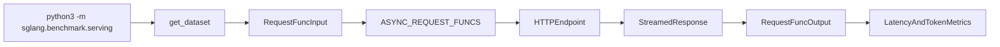
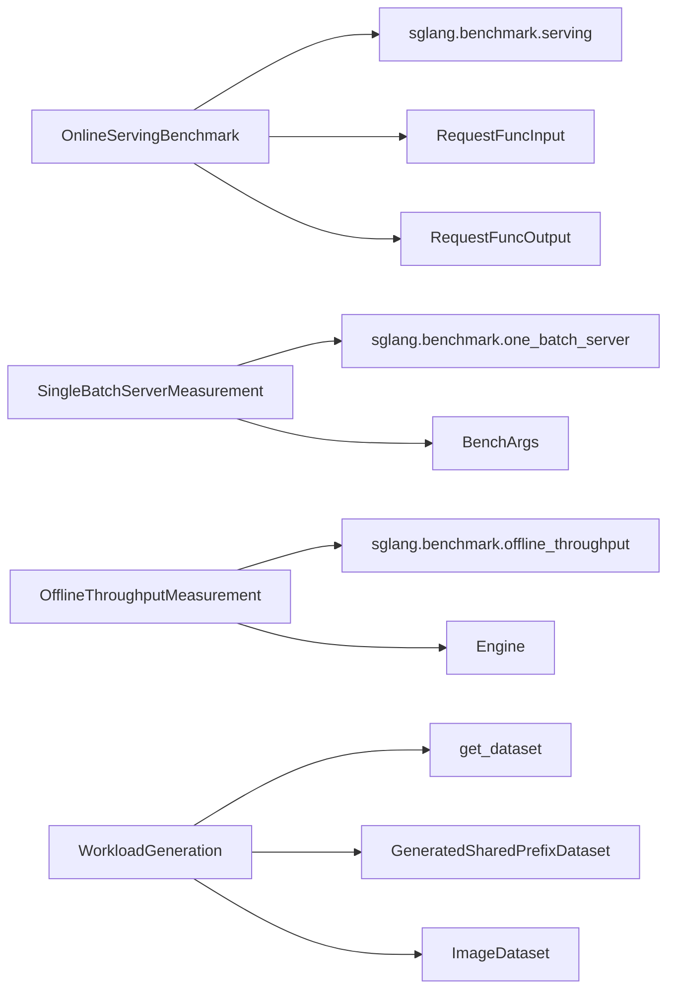
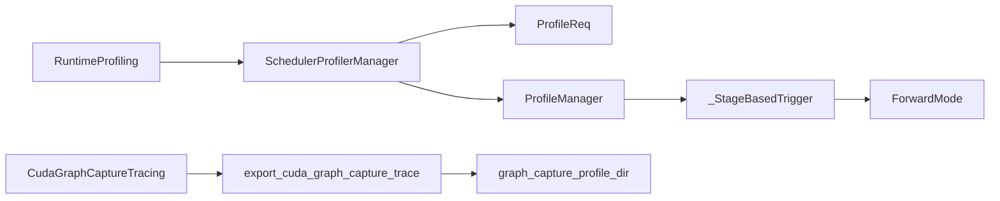

<!-- source: DeepWiki mcp.deepwiki.com · repo sgl-project/sglang · page 15.2 Benchmarking and Performance Measurement · fetched 2026-10-30 -->

# Benchmarking and Performance Measurement

<details>
<summary>Relevant source files</summary>

The following files were used as context for generating this wiki page:

- [benchmark/hicache/bench_multiturn.py](benchmark/hicache/bench_multiturn.py)
- [docs/docs/developer_guide/bench_serving.mdx](docs/docs/developer_guide/bench_serving.mdx)
- [docs/docs/developer_guide/benchmark_and_profiling.mdx](docs/docs/developer_guide/benchmark_and_profiling.mdx)
- [python/sglang/bench_one_batch_server.py](python/sglang/bench_one_batch_server.py)
- [python/sglang/bench_serving.py](python/sglang/bench_serving.py)
- [python/sglang/benchmark/datasets/__init__.py](python/sglang/benchmark/datasets/__init__.py)
- [python/sglang/benchmark/datasets/common.py](python/sglang/benchmark/datasets/common.py)
- [python/sglang/benchmark/datasets/generated_shared_prefix.py](python/sglang/benchmark/datasets/generated_shared_prefix.py)
- [python/sglang/benchmark/datasets/image.py](python/sglang/benchmark/datasets/image.py)
- [python/sglang/benchmark/datasets/openai_dataset.py](python/sglang/benchmark/datasets/openai_dataset.py)
- [python/sglang/benchmark/datasets/speed_bench.py](python/sglang/benchmark/datasets/speed_bench.py)
- [python/sglang/benchmark/endpoint.py](python/sglang/benchmark/endpoint.py)
- [python/sglang/benchmark/goodput.py](python/sglang/benchmark/goodput.py)
- [python/sglang/benchmark/offline_throughput.py](python/sglang/benchmark/offline_throughput.py)
- [python/sglang/benchmark/one_batch_server.py](python/sglang/benchmark/one_batch_server.py)
- [python/sglang/benchmark/serving.py](python/sglang/benchmark/serving.py)
- [python/sglang/benchmark/stream_metrics.py](python/sglang/benchmark/stream_metrics.py)
- [python/sglang/srt/entrypoints/ollama/serving.py](python/sglang/srt/entrypoints/ollama/serving.py)
- [python/sglang/srt/entrypoints/v1_loads.py](python/sglang/srt/entrypoints/v1_loads.py)
- [python/sglang/srt/managers/load_snapshot.py](python/sglang/srt/managers/load_snapshot.py)
- [python/sglang/srt/managers/scheduler_components/load_inquirer.py](python/sglang/srt/managers/scheduler_components/load_inquirer.py)
- [python/sglang/srt/managers/scheduler_components/profiler_manager.py](python/sglang/srt/managers/scheduler_components/profiler_manager.py)
- [python/sglang/srt/model_executor/step_span_utils.py](python/sglang/srt/model_executor/step_span_utils.py)
- [python/sglang/srt/models/voxtral.py](python/sglang/srt/models/voxtral.py)
- [python/sglang/srt/multimodal/processors/voxtral.py](python/sglang/srt/multimodal/processors/voxtral.py)
- [python/sglang/srt/utils/hf_transformers_utils.py](python/sglang/srt/utils/hf_transformers_utils.py)
- [python/sglang/srt/utils/network.py](python/sglang/srt/utils/network.py)
- [python/sglang/srt/utils/profile_utils.py](python/sglang/srt/utils/profile_utils.py)
- [python/sglang/test/ci/ci_stress_utils.py](python/sglang/test/ci/ci_stress_utils.py)
- [python/sglang/test/kits/cache_hit_kit.py](python/sglang/test/kits/cache_hit_kit.py)
- [python/sglang/test/kits/eval_accuracy_kit.py](python/sglang/test/kits/eval_accuracy_kit.py)
- [python/sglang/test/kits/spec_decoding_kit.py](python/sglang/test/kits/spec_decoding_kit.py)
- [python/sglang/test/mock_model/utils.py](python/sglang/test/mock_model/utils.py)
- [python/sglang/test/run_eval.py](python/sglang/test/run_eval.py)
- [python/sglang/test/send_one.py](python/sglang/test/send_one.py)
- [python/sglang/test/simple_eval_common.py](python/sglang/test/simple_eval_common.py)
- [python/sglang/test/simple_eval_mgsm.py](python/sglang/test/simple_eval_mgsm.py)
- [python/sglang/test/simple_eval_mixed_prefix_gsm8k.py](python/sglang/test/simple_eval_mixed_prefix_gsm8k.py)
- [python/sglang/test/vlm_utils.py](python/sglang/test/vlm_utils.py)
- [scripts/playground/replay_request_dump.py](scripts/playground/replay_request_dump.py)
- [test/manual/dsv4/test_dsv4_flash_mtp_tp8.py](test/manual/dsv4/test_dsv4_flash_mtp_tp8.py)
- [test/manual/dsv4/test_dsv4_pro_mtp.py](test/manual/dsv4/test_dsv4_pro_mtp.py)
- [test/manual/perf/test_bench_one_batch_1gpu.py](test/manual/perf/test_bench_one_batch_1gpu.py)
- [test/registered/bench_fn/test_bench_serving_reasoning_stream.py](test/registered/bench_fn/test_bench_serving_reasoning_stream.py)
- [test/registered/bench_fn/test_benchmark_datasets_api.py](test/registered/bench_fn/test_benchmark_datasets_api.py)
- [test/registered/core/test_srt_engine.py](test/registered/core/test_srt_engine.py)
- [test/registered/unit/bench/test_bench_serving_goodput.py](test/registered/unit/bench/test_bench_serving_goodput.py)
- [test/registered/unit/bench/test_benchmark_endpoint.py](test/registered/unit/bench/test_benchmark_endpoint.py)
- [test/registered/unit/bench/test_mixed_prefix_gsm8k.py](test/registered/unit/bench/test_mixed_prefix_gsm8k.py)
- [test/registered/unit/entrypoints/test_v1_loads_aggregate.py](test/registered/unit/entrypoints/test_v1_loads_aggregate.py)
- [test/registered/unit/managers/test_detailed_annotations.py](test/registered/unit/managers/test_detailed_annotations.py)
- [test/registered/unit/managers/test_load_inquirer.py](test/registered/unit/managers/test_load_inquirer.py)
- [test/registered/unit/managers/test_load_snapshot_backends.py](test/registered/unit/managers/test_load_snapshot_backends.py)
- [test/registered/unit/utils/test_network.py](test/registered/unit/utils/test_network.py)
- [test/registered/unit/utils/test_profile_merger.py](test/registered/unit/utils/test_profile_merger.py)

</details>


## Purpose and scope

This page describes the benchmark clients and workload components visible in the provided source: online serving measurement, single-batch server measurement, offline throughput benchmarking, runtime profiling, and evaluation utilities. It focuses on their interfaces and data flow; it does not infer implementation details beyond the cited source ranges.

Sources: [python/sglang/benchmark/serving.py:6-58](), [python/sglang/benchmark/one_batch_server.py:1-48](), [python/sglang/benchmark/offline_throughput.py:1-35]()

---

## 1. Overview of SGLang Benchmarking Architecture

The supplied code identifies three distinct performance measurement paths:

- `sglang.benchmark.serving` is an online benchmark client for dynamic HTTP requests. Its module documentation shows invocation through `python -m sglang.benchmark.serving`; the legacy `sglang.bench_serving` module re-exports the implementation and warns that the old import path is deprecated. [python/sglang/benchmark/serving.py:6-13](), [python/sglang/bench_serving.py:1-22]()
- `sglang.benchmark.one_batch_server` measures a single batch through a server’s HTTP interface. It accepts server arguments and benchmark arguments, and its documented options include profiling and report output. [python/sglang/benchmark/one_batch_server.py:1-12]()
- `sglang.benchmark.offline_throughput` measures throughput in offline mode. Its module documentation says it accepts server arguments and benchmark arguments; the displayed imports include `Engine` and `Runtime` backends. [python/sglang/benchmark/offline_throughput.py:1-35]()

The benchmarks have different measurement boundaries. The serving client exercises a running HTTP endpoint with dynamically issued requests; the one-batch tool also uses HTTP but centers on a controlled batch; offline throughput is an in-process benchmark path with an `Engine`/`Runtime` interface. [python/sglang/benchmark/serving.py:6-13](), [python/sglang/benchmark/one_batch_server.py:1-12](), [python/sglang/benchmark/offline_throughput.py:1-35]()

Sources: [python/sglang/benchmark/serving.py:6-13](), [python/sglang/bench_serving.py:1-22](), [python/sglang/benchmark/one_batch_server.py:1-12](), [python/sglang/benchmark/offline_throughput.py:1-35]()

---

## 2. The Benchmarking Tools Suite

| Tool or component | Implementation | Measurement boundary | Evidence in the supplied code |
|---|---|---|---|
| Online serving benchmark | `python/sglang/benchmark/serving.py` | Dynamic requests sent to an HTTP backend | Module documentation describes online serving with dynamic requests. [python/sglang/benchmark/serving.py:6-13]() |
| Legacy serving import | `python/sglang/bench_serving.py` | Compatibility wrapper | Re-exports `sglang.benchmark.serving`, emits a `FutureWarning`, and retains `cli_main()` execution. [python/sglang/bench_serving.py:1-22]() |
| Single-batch server benchmark | `python/sglang/benchmark/one_batch_server.py` | One batch through a server HTTP interface | Module documentation describes server launch and HTTP use; CLI examples include batch size, lengths, profiling, and results output. [python/sglang/benchmark/one_batch_server.py:1-12]() |
| Offline throughput benchmark | `python/sglang/benchmark/offline_throughput.py` | Offline engine/runtime path | Module documentation describes offline throughput; imports include `Engine` and `Runtime`. [python/sglang/benchmark/offline_throughput.py:1-35]() |
| Runtime profiling | `SchedulerProfilerManager`, `ProfileManager` | Scheduler forward steps and prefill/decode stages | The scheduler manager configures profiling; `ProfileManager` maps forward modes to stages and triggers profiling. [python/sglang/srt/managers/scheduler_components/profiler_manager.py:53-103](), [python/sglang/srt/utils/profile_utils.py:73-90]() |
| Evaluation driver | `run_eval` and accuracy kits | Task score and evaluation latency | `run_eval_once` times evaluation; accuracy kits select an evaluator and enforce score thresholds. [python/sglang/test/run_eval.py:29-88](), [python/sglang/test/kits/eval_accuracy_kit.py:42-83]() |

These tools answer different questions. A serving benchmark measures client-observed request behavior; a single-batch run measures a controlled server-side workload; offline throughput exercises an engine/runtime benchmark path; profiling adds execution traces; evaluation utilities primarily report task scores rather than serving capacity. [python/sglang/benchmark/serving.py:6-13](), [python/sglang/benchmark/one_batch_server.py:1-12](), [python/sglang/benchmark/offline_throughput.py:1-35](), [python/sglang/test/run_eval.py:83-88]()

Sources: [python/sglang/benchmark/serving.py:6-13](), [python/sglang/bench_serving.py:1-22](), [python/sglang/benchmark/one_batch_server.py:1-12](), [python/sglang/benchmark/offline_throughput.py:1-35](), [python/sglang/srt/managers/scheduler_components/profiler_manager.py:53-103](), [python/sglang/srt/utils/profile_utils.py:73-90](), [python/sglang/test/run_eval.py:29-88](), [python/sglang/test/kits/eval_accuracy_kit.py:42-83]()

---

## 3. Online Serving Benchmark (`bench_serving`)

`sglang.benchmark.serving` is the implementation module for the online benchmark CLI. It imports asynchronous HTTP support, dataset selection, goodput calculation, benchmark utilities, and endpoint-resolution helpers. The documented examples select a backend and dataset and configure prompt counts and token lengths. [python/sglang/benchmark/serving.py:6-58]()

The former `sglang.bench_serving` path remains as a compatibility shim: it imports the serving module’s public names and `cli_main`, emits a `FutureWarning` directing callers to `sglang.benchmark.serving`, and invokes `cli_main()` when run as a module. [python/sglang/bench_serving.py:1-22]()

### Request and result records

`RequestFuncInput` contains the prompt, API URL, prompt and output lengths, model and LoRA names, optional image data, extra request-body fields, and optional timestamp and routing key. Its prompt type permits a string, a list of strings, or a list of message dictionaries. [python/sglang/benchmark/serving.py:90-102]()

`RequestFuncOutput` is the per-request result record. It stores success and error state, generated text and chunks, total latency, TTFT, optional TPOT, inter-token latency samples, prompt and output lengths, start time, cached-token fields, and speculative-decoding acceptance statistics. `init_new()` initializes a result and copies the requested prompt length from the input record. [python/sglang/benchmark/serving.py:104-128]()

The serving client supports configurable authentication and custom request headers: `get_auth_headers()` checks `OPENAI_API_KEY` and then `API_KEY`; `get_request_headers()` adds parsed values from the CLI’s `header` argument when present. [python/sglang/benchmark/serving.py:131-147]()

### Serving benchmark data flow

Diagram: From dataset configuration to serving request results



Sources: [python/sglang/benchmark/serving.py:6-58](), [python/sglang/benchmark/serving.py:90-128]()

Backend behavior is tested through `ASYNC_REQUEST_FUNCS`: the dataset API test verifies that the `vllm-embedding` backend uses `async_request_openai_embeddings` and the `/v1/embeddings` API path. The same tests verify backend-specific cache-flush URLs, including `/flush_cache` for SGLang and `/reset_prefix_cache` for the tested vLLM embedding backend. [test/registered/bench_fn/test_benchmark_datasets_api.py:148-196]()

Sources: [python/sglang/benchmark/serving.py:6-58](), [python/sglang/benchmark/serving.py:90-147](), [test/registered/bench_fn/test_benchmark_datasets_api.py:148-196]()

---

## 4. Workload Datasets and Distribution Management

The serving and offline throughput modules import `get_dataset`, while the dataset API test imports dataset implementations and confirms a shared dataset interface through `DatasetRow` and `get_dataset`. The supplied test imports include random, ShareGPT, OpenAI, image, MMMU, Mooncake, custom, agentic trace, and generated shared-prefix workloads. [python/sglang/benchmark/serving.py:44-45](), [python/sglang/benchmark/offline_throughput.py:29-31](), [test/registered/bench_fn/test_benchmark_datasets_api.py:28-58]()

### Dataset and workload controls

- **Generated shared-prefix workload:** `GeneratedSharedPrefixDataset.from_args()` reads group counts, prompt lengths, seed, ordering, routing-key, turn-count, and distribution options. It validates the group distribution and requires a finite positive Zipf alpha when Zipf sampling is selected. [python/sglang/benchmark/datasets/generated_shared_prefix.py:40-106]()
- **Shared-prefix sampling:** `sample_generated_shared_prefix_requests()` receives the workload parameters and tokenizer, then returns `DatasetRow` items. The helper `_zipf_group_probs()` constructs a rank-based Zipf probability vector, with group zero representing the hottest group. [python/sglang/benchmark/datasets/generated_shared_prefix.py:24-37](), [python/sglang/benchmark/datasets/generated_shared_prefix.py:108-127]()
- **Generated shared-prefix cache:** `get_gen_prefix_cache_path()` places generated-prefix cache files under `~/.cache/sglang/benchmark`; its key incorporates workload parameters, tokenizer class, non-default distribution settings, and whether the payload contains token IDs. [python/sglang/benchmark/datasets/generated_shared_prefix.py:130-163]()
- **Image workload:** `ImageDataset.load()` obtains a processor, resets Python and NumPy random seeds, and calls `sample_image_requests()`. Image resolution parsing accepts named presets and positive `heightxwidth` values; random resolution ranges are parsed separately. [python/sglang/benchmark/datasets/image.py:22-70](), [python/sglang/benchmark/datasets/image.py:73-127]()

`one_batch_server.BenchArgs` exposes controls for batch size, input/output lengths, input-length variation, dataset selection and path, warmup, profiling, result files, seed, cache-hit-rate configuration, and optional multi-batch behavior. [python/sglang/benchmark/one_batch_server.py:113-158]()

Sources: [python/sglang/benchmark/serving.py:44-45](), [python/sglang/benchmark/offline_throughput.py:29-31](), [test/registered/bench_fn/test_benchmark_datasets_api.py:28-58](), [python/sglang/benchmark/datasets/generated_shared_prefix.py:24-37](), [python/sglang/benchmark/datasets/generated_shared_prefix.py:40-127](), [python/sglang/benchmark/datasets/generated_shared_prefix.py:130-163](), [python/sglang/benchmark/datasets/image.py:22-70](), [python/sglang/benchmark/datasets/image.py:73-127](), [python/sglang/benchmark/one_batch_server.py:113-158]()

---

## 5. Profiling Utilities and Server Diagnostics

### `SchedulerProfilerManager`

`SchedulerProfilerManager` is the scheduler-side profiling coordinator. Its constructor captures the CPU group associated with the DP/TP group. When `SGLANG_PROFILE_V2` is enabled, it creates a `ProfileManager`; otherwise it initializes fields for the profiler, output directory, activities, profile ID, forward-step targets, per-stage targets, and profile state. [python/sglang/srt/managers/scheduler_components/profiler_manager.py:53-88]()

`_init_profile()` delegates configuration to `ProfileManager.configure()` in v2 mode. In the other mode, it rejects a new profile while one is already in progress, records stage and merge settings, selects the output directory and default CPU/GPU activities, and configures start-step and target-step state. With `profile_by_stage`, it tracks prefill and decode counts separately. [python/sglang/srt/managers/scheduler_components/profiler_manager.py:89-162]()

Platform-specific profiler setup is applied at import time for NPU and MPS paths: the NPU path patches PyTorch profiler symbols with `torch_npu` equivalents, while the MPS path applies the MLX Metal profiler patches. [python/sglang/srt/managers/scheduler_components/profiler_manager.py:34-48]()

### `ProfileManager` and stage-based profiling

`ProfileManager` uses `_StageBasedTrigger` to start and stop profiling according to runtime stages. `step()` maps a `ForwardMode` to a stage and advances the trigger; `configure()` currently asserts that `start_step` is unset, `profile_by_stage` is enabled, and `merge_profiles` is disabled. Its default interesting stages are `prefill` and `decode`. [python/sglang/srt/utils/profile_utils.py:73-90](), [python/sglang/srt/utils/profile_utils.py:92-135]()

At trigger start, `_do_start()` creates and starts a profiler using the configured activities, output directory, profile ID, CPU group, and stage suffix. `_do_stop()` stops the profiler, clears the active profiler, and disables detailed annotations. `ForwardMode` values are mapped to `prefill`, `decode`, or no stage for idle mode. [python/sglang/srt/utils/profile_utils.py:143-183]()

### Single-batch profiling controls

`one_batch_server.BenchArgs` includes `profile`, `profile_activities`, `profile_start_step`, `profile_steps`, `profile_by_stage`, `profile_prefix`, and `profile_output_dir`. Its module examples show `--profile` and `--profile-by-stage`, including use with an externally hosted server via `--base-url`. [python/sglang/benchmark/one_batch_server.py:7-12](), [python/sglang/benchmark/one_batch_server.py:113-136]()

### CUDA graph capture traces

`graph_capture_profile_dir()` constructs the shared graph-capture profile directory from `SGLANG_TORCH_PROFILER_DIR` and the `graph_capture_profile` subdirectory. `export_cuda_graph_capture_trace()` is opt-in through `SGLANG_ENABLE_CUDA_GRAPH_CAPTURE_TRACE`; when enabled, it exports a Chrome trace whose filename includes the runner name and TP rank. [python/sglang/srt/utils/profile_utils.py:37-70]()

Diagram: Runtime profiling configuration and trace output

```mermaid
flowchart TD
    Request["ProfileReq"] --> SchedulerManager["SchedulerProfilerManager"]
    SchedulerManager --> VersionCheck["envs.SGLANG_PROFILE_V2"]
    VersionCheck -->| "enabled" | ProfileManager["ProfileManager"]
    VersionCheck -->| "disabled" | LegacyConfig["_init_profile"]
    ProfileManager --> StageStep["ProfileManager.step"]
    StageStep --> Stage["ForwardMode"]
    Stage --> Start["_do_start"]
    Start --> Profiler["torch.profiler.profile"]
    Profiler --> Stop["_do_stop"]
    Profiler --> Trace["ProfileOutputDir"]
    Capture["export_cuda_graph_capture_trace"] --> GraphTrace["graph_capture_profile"]
```

Sources: [python/sglang/srt/managers/scheduler_components/profiler_manager.py:53-103](), [python/sglang/srt/utils/profile_utils.py:73-90](), [python/sglang/srt/utils/profile_utils.py:92-183](), [python/sglang/srt/utils/profile_utils.py:37-70]()

---

## 6. Offline Throughput Benchmark

`sglang.benchmark.offline_throughput` is documented as an offline throughput benchmark. Its `BenchArgs` includes a backend defaulting to `engine`, dataset name and path, prompt count, random input/output lengths, shared-prefix workload settings, seed, warmup control, profiling options, and optional result output. The displayed CLI choices include `sharegpt`, `random`, and `generated-shared-prefix`. [python/sglang/benchmark/offline_throughput.py:1-66](), [python/sglang/benchmark/offline_throughput.py:68-88]()

The module imports dataset selection and tokenizer helpers, `Engine`, `Runtime`, and `ServerArgs`. Its profiling arguments include a boolean `profile`, activity list, and optional profile-step count; the CLI description says the endpoint must be launched with `SGLANG_TORCH_PROFILER_DIR` for profiling. [python/sglang/benchmark/offline_throughput.py:29-35](), [python/sglang/benchmark/offline_throughput.py:58-63](), [python/sglang/benchmark/offline_throughput.py:172-177]()

Sources: [python/sglang/benchmark/offline_throughput.py:1-66](), [python/sglang/benchmark/offline_throughput.py:68-88](), [python/sglang/benchmark/offline_throughput.py:172-177]()

---

## 7. Single-Batch Server Benchmark (`bench_one_batch_server`)

`python/sglang/benchmark/one_batch_server.py` documents a single-batch latency benchmark that launches a server and uses its HTTP interface. The documented CLI accepts server arguments and benchmark arguments, and examples show both launching a model and targeting an existing server with `--base-url`. [python/sglang/benchmark/one_batch_server.py:1-12]()

`BenchArgs` captures the core experimental parameters: `batch_size`, `input_len`, `output_len`, temperature, EOS handling, logprob behavior, warmup, report output, dataset selection, seed, and result filename. Profiling controls cover activities, step selection, stage-level profiling, prefix, and output directory. [python/sglang/benchmark/one_batch_server.py:113-158]()

The module imports `BatchStreamRecorder`, `SteadyStateWindow`, and `validate_finish_reason` from `stream_metrics`, plus `run_profile`, server launch support, and `ServerArgs`. These imports show the tool’s stream-measurement, profiling, and server-configuration dependencies. [python/sglang/benchmark/one_batch_server.py:33-48]()

The module also defines helpers for reading cached and prompt token totals from a Prometheus `/metrics` response and calculating cache-hit rate from before/after snapshots. [python/sglang/benchmark/one_batch_server.py:57-110]()

Sources: [python/sglang/benchmark/one_batch_server.py:1-12](), [python/sglang/benchmark/one_batch_server.py:33-48](), [python/sglang/benchmark/one_batch_server.py:57-110](), [python/sglang/benchmark/one_batch_server.py:113-158]()

---

## 8. Evaluation and Accuracy Measurement

Performance experiments may be accompanied by evaluation runs, but evaluation scores are distinct from serving-throughput metrics. `run_eval_once()` selects a sampler for completion, native generate, or chat APIs, runs an `Eval`, and measures wall-clock evaluation latency with `time.perf_counter()`. [python/sglang/test/run_eval.py:29-88]()

`run_eval()` is marked deprecated in favor of `sglang.test.sgl_eval_utils.run_sgl_eval` or `sgl-eval run`. It rejects certain evaluation names and API modes that must use `sgl-eval`, and it constructs evaluation objects for supported legacy tasks such as GSM8K, HumanEval, and MMMU. [python/sglang/test/run_eval.py:115-183]()

The accuracy kit routes registered benchmarks to `run_sgl_eval` and other evaluations to `run_eval`, prints metrics, optionally writes a CI step summary, checks speculative accept length when available, and asserts the configured score threshold. [python/sglang/test/kits/eval_accuracy_kit.py:25-83]()

Sources: [python/sglang/test/run_eval.py:29-88](), [python/sglang/test/run_eval.py:115-183](), [python/sglang/test/kits/eval_accuracy_kit.py:25-83]()

---

## 9. Benchmark Directory

The supplied files show the following organization under `python/sglang/benchmark/`:

| Path or component | Role evidenced by the supplied source |
|---|---|
| `serving.py` | Online serving benchmark CLI and request/result records. [python/sglang/benchmark/serving.py:6-13](), [python/sglang/benchmark/serving.py:90-128]() |
| `one_batch_server.py` | Single-batch server benchmark configuration, profiling options, and metrics helpers. [python/sglang/benchmark/one_batch_server.py:1-12](), [python/sglang/benchmark/one_batch_server.py:57-158]() |
| `offline_throughput.py` | Offline throughput benchmark configuration and engine/runtime dependencies. [python/sglang/benchmark/offline_throughput.py:1-66]() |
| `datasets/` | Dataset selection and workload implementations; the supplied tests import multiple dataset modules. [python/sglang/benchmark/serving.py:44-45](), [test/registered/bench_fn/test_benchmark_datasets_api.py:28-58]() |
| `stream_metrics` | Imported by the one-batch tool for stream recording, steady-state windows, and finish-reason validation. [python/sglang/benchmark/one_batch_server.py:33-39]() |
| `goodput` | Imported by the serving benchmark for SLO metric definitions and goodput calculation/printing. [python/sglang/benchmark/serving.py:46-50]() |
| `utils` | Shared tokenizer, processor, header parsing, prefix removal, and resource-limit helpers. [python/sglang/benchmark/serving.py:51-56](), [python/sglang/benchmark/one_batch_server.py:40-40]() |

Sources: [python/sglang/benchmark/serving.py:6-13](), [python/sglang/benchmark/serving.py:44-56](), [python/sglang/benchmark/serving.py:90-128](), [python/sglang/benchmark/one_batch_server.py:1-12](), [python/sglang/benchmark/one_batch_server.py:33-40](), [python/sglang/benchmark/one_batch_server.py:57-158](), [python/sglang/benchmark/offline_throughput.py:1-66](), [test/registered/bench_fn/test_benchmark_datasets_api.py:28-58](), [python/sglang/bench_serving.py:1-16]()

---

## 10. Natural-Language Tooling to Code Entities

Diagram: Benchmark concepts mapped to searchable code entities



Sources: [python/sglang/benchmark/serving.py:44-45](), [python/sglang/benchmark/serving.py:90-128](), [python/sglang/benchmark/one_batch_server.py:113-158](), [python/sglang/benchmark/offline_throughput.py:29-35](), [python/sglang/benchmark/datasets/generated_shared_prefix.py:40-58](), [python/sglang/benchmark/datasets/image.py:22-37]()

Diagram: Runtime profiling concepts mapped to code entities



Sources: [python/sglang/srt/managers/scheduler_components/profiler_manager.py:19-28](), [python/sglang/srt/managers/scheduler_components/profiler_manager.py:53-103](), [python/sglang/srt/utils/profile_utils.py:37-48](), [python/sglang/srt/utils/profile_utils.py:73-90](), [python/sglang/srt/utils/profile_utils.py:175-183]()

---

## Summary

The supplied benchmark code provides online HTTP load generation, single-batch server measurement, offline throughput configuration, workload dataset construction, and scheduler-integrated profiling. `RequestFuncInput` and `RequestFuncOutput` define the online request/result records; `BenchArgs` exposes controlled batch and profiling parameters; `SchedulerProfilerManager` and `ProfileManager` manage runtime profiling by forward stage. Evaluation tools add task-score checks, but their output should be interpreted separately from serving performance measurements. [python/sglang/benchmark/serving.py:90-128](), [python/sglang/benchmark/one_batch_server.py:113-158](), [python/sglang/benchmark/offline_throughput.py:38-66](), [python/sglang/srt/managers/scheduler_components/profiler_manager.py:53-103](), [python/sglang/srt/utils/profile_utils.py:73-90](), [python/sglang/test/kits/eval_accuracy_kit.py:42-83]()

Sources: [python/sglang/benchmark/serving.py:90-128](), [python/sglang/benchmark/one_batch_server.py:113-158](), [python/sglang/benchmark/offline_throughput.py:38-66](), [python/sglang/srt/managers/scheduler_components/profiler_manager.py:53-103](), [python/sglang/srt/utils/profile_utils.py:73-90](), [python/sglang/test/kits/eval_accuracy_kit.py:42-83]()

---

