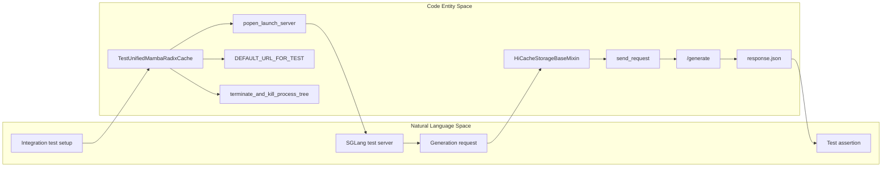
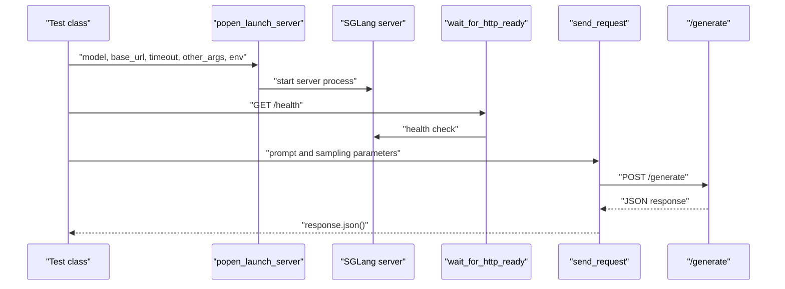
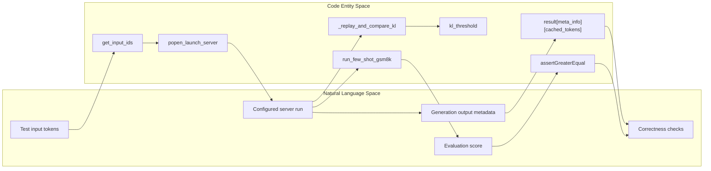
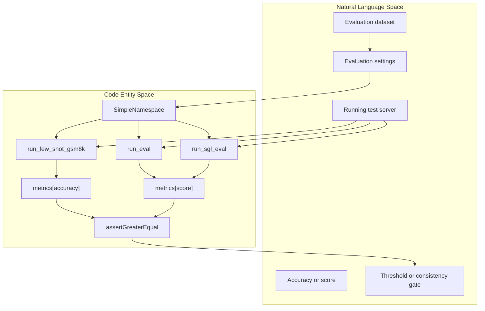

<!-- source: DeepWiki mcp.deepwiki.com · repo sgl-project/sglang · page 15.3 Test Runners and Model Comparison · fetched 2026-10-30 -->

# Test Runners and Model Comparison

Relevant source files

The following files were used as context for generating this wiki page:

- [.github/workflows/nightly-test-amd.yml](.github/workflows/nightly-test-amd.yml)
- [.github/workflows/pr-test-amd.yml](.github/workflows/pr-test-amd.yml)
- [.github/workflows/release-docker-amd-gfx1151-nightly.yml](.github/workflows/release-docker-amd-gfx1151-nightly.yml)
- [.github/workflows/release-docker-amd-rocm10.yml](.github/workflows/release-docker-amd-rocm10.yml)
- [.github/workflows/release-docker-amd-rocm720-nightly.yml](.github/workflows/release-docker-amd-rocm720-nightly.yml)
- [.github/workflows/release-docker-amd.yml](.github/workflows/release-docker-amd.yml)
- [.github/workflows/release-whl-kernel-xpu.yml](.github/workflows/release-whl-kernel-xpu.yml)
- [.github/workflows/release-whl-kernel.yml](.github/workflows/release-whl-kernel.yml)
- [3rdparty/amd/wheel/README.md](3rdparty/amd/wheel/README.md)
- [3rdparty/amd/wheel/sgl-kernel/build_rocm.sh](3rdparty/amd/wheel/sgl-kernel/build_rocm.sh)
- [3rdparty/amd/wheel/sgl-kernel/rename_wheels_rocm.sh](3rdparty/amd/wheel/sgl-kernel/rename_wheels_rocm.sh)
- [benchmark/kernels/bench_fused_gate_sigmoid_mul_add.py](benchmark/kernels/bench_fused_gate_sigmoid_mul_add.py)
- [benchmark/kernels/bench_fused_sigmoid_mul.py](benchmark/kernels/bench_fused_sigmoid_mul.py)
- [docker/patches/sgl-kernel-gfx1151.sh](docker/patches/sgl-kernel-gfx1151.sh)
- [docker/rocm-gfx1151.Dockerfile](docker/rocm-gfx1151.Dockerfile)
- [docker/rocm.Dockerfile](docker/rocm.Dockerfile)
- [python/sglang/kernels/aot/csrc/elementwise/pos_enc.cu](python/sglang/kernels/aot/csrc/elementwise/pos_enc.cu)
- [python/sglang/multimodal_gen/test/unit/test_diffusion_import_isolation.py](python/sglang/multimodal_gen/test/unit/test_diffusion_import_isolation.py)
- [python/sglang/srt/debug_utils/dumper.py](python/sglang/srt/debug_utils/dumper.py)
- [python/sglang/test/accuracy_test_runner.py](python/sglang/test/accuracy_test_runner.py)
- [python/sglang/test/kits/lm_eval_kit.py](python/sglang/test/kits/lm_eval_kit.py)
- [python/sglang/test/kits/mmmu_vlm_kit.py](python/sglang/test/kits/mmmu_vlm_kit.py)
- [python/sglang/test/run_combined_tests.py](python/sglang/test/run_combined_tests.py)
- [scripts/ci/amd/amd_ci_install_dependency.sh](scripts/ci/amd/amd_ci_install_dependency.sh)
- [scripts/ci/amd/amd_ci_start_container.sh](scripts/ci/amd/amd_ci_start_container.sh)
- [scripts/ci/amd/amd_ci_start_container_disagg.sh](scripts/ci/amd/amd_ci_start_container_disagg.sh)
- [scripts/ci/utils/git_clone_with_retry.sh](scripts/ci/utils/git_clone_with_retry.sh)
- [scripts/release/get_version_tag.py](scripts/release/get_version_tag.py)
- [scripts/update_kernel_whl_index.py](scripts/update_kernel_whl_index.py)
- [test/manual/layers/test_fused_gate_sigmoid_mul_add.py](test/manual/layers/test_fused_gate_sigmoid_mul_add.py)
- [test/manual/layers/test_fused_sigmoid_mul.py](test/manual/layers/test_fused_sigmoid_mul.py)
- [test/registered/amd/perf/mi35x/test_qwen35_fp8_ar_fusion_mi35x.py](test/registered/amd/perf/mi35x/test_qwen35_fp8_ar_fusion_mi35x.py)
- [test/registered/amd/test_deepseek_v32_basic.py](test/registered/amd/test_deepseek_v32_basic.py)
- [test/registered/amd/test_kimi_k2_instruct.py](test/registered/amd/test_kimi_k2_instruct.py)
- [test/registered/amd/test_moriep_small.py](test/registered/amd/test_moriep_small.py)
- [test/registered/amd/test_moriep_small_extra.py](test/registered/amd/test_moriep_small_extra.py)
- [test/registered/amd/test_qwen3_coder_next_8gpu.py](test/registered/amd/test_qwen3_coder_next_8gpu.py)
- [test/registered/basic_perf/test_vlm_serving_aiter.py](test/registered/basic_perf/test_vlm_serving_aiter.py)
- [test/registered/debug_utils/test_dumper.py](test/registered/debug_utils/test_dumper.py)
- [test/registered/dllm/test_llada2_mini_amd.py](test/registered/dllm/test_llada2_mini_amd.py)
- [test/registered/model_loading/test_runai_model_loader.py](test/registered/model_loading/test_runai_model_loader.py)
- [test/registered/rotary/test_rope_rocm.py](test/registered/rotary/test_rope_rocm.py)
- [test/registered/vlm/test_encoder_dp.py](test/registered/vlm/test_encoder_dp.py)
- [test/run_suite.py](test/run_suite.py)

## Purpose and Scope

This page documents the testing infrastructure, model comparison utilities, accuracy test runners, test kits, and evaluation scripts used across the SGLang codebase to validate server correctness, regression behavior, and end-to-end task accuracy [python/sglang/test/test_utils.py:38-52](), [python/sglang/test/accuracy_test_runner.py:1-50](). It covers the architectural distinction between reference execution backends (such as HuggingFace `HFRunner`) and serving execution backends (`SRTRunner`), along with structured evaluation pipelines like `run_eval`, `run_sgl_eval`, and modular test kits (`mmmu_vlm_kit.py`, `lm_eval_kit.py`) [test/registered/radix_cache/unified_radix_tree/test_unified_radix_cache_kl_mamba.py:32-74](), [test/registered/disaggregation/test_disaggregation_decode_offload.py:126-161]().

Sources: [python/sglang/test/test_utils.py:38-52](), [python/sglang/test/accuracy_test_runner.py:1-50](), [test/registered/radix_cache/unified_radix_tree/test_unified_radix_cache_kl_mamba.py:32-74](), [test/registered/disaggregation/test_disaggregation_decode_offload.py:126-161]()

---

## 1. Test Runner Architecture (`HFRunner` vs `SRTRunner`)

Integration and correctness test suites rely on specialized test runner wrappers to standardize model execution across native HuggingFace transformers and the SGLang Runtime (SRT) engine. 

- **`HFRunner`**: Acts as the gold-standard reference execution runner using HuggingFace `transformers` or vLLM directly without serving optimizations. It loads the model weights into standard PyTorch modules, executing baseline token generation and log-probability computations sequentially to establish ground-truth outputs.
- **`SRTRunner`**: Wraps the SGLang server engine (`popen_launch_server`, engine client APIs) to exercise actual serving paths, including RadixCache prefix sharing, chunked prefill, tensor/pipeline parallelism, and CUDA graph execution.

Integration tests use `CustomTestCase` classes, configure base URLs and model arguments, launch server processes via `popen_launch_server`, and terminate them during teardown [test/registered/radix_cache/unified_radix_tree/test_unified_radix_cache_kl_mamba.py:32-74](), [test/registered/hicache/test_hicache_storage_file_backend.py:36-64]().

### Runner Process Model and Communication

The visible test harness launches a server process, waits for readiness via health endpoints, and communicates via HTTP requests (e.g., posting to `/generate` or `/flush_cache`) [test/registered/hicache/test_hicache_storage_file_backend.py:99-140](), [test/registered/hicache/test_hicache_storage_file_backend.py:142-178]().

**Diagram: Integration-test concepts mapped to code entities**

Sources: [test/registered/radix_cache/unified_radix_tree/test_unified_radix_cache_kl_mamba.py:32-74](), [test/registered/hicache/test_hicache_storage_file_backend.py:36-64](), [test/registered/hicache/test_hicache_storage_file_backend.py:142-178]()

### Test Server Lifecycle and Configuration

| Phase | Observable behavior | Example code |
|---|---|---|
| Configure | Select a model, base URL, server arguments, and environment. | `TestUnifiedMambaRadixCache.setUpClass` sets the model and URL and builds `other_args`. [test/registered/radix_cache/unified_radix_tree/test_unified_radix_cache_kl_mamba.py:44-70]() |
| Launch | Start the server with `popen_launch_server`. | The Mamba test passes its model, base URL, timeout, arguments, and environment to the launcher. [test/registered/radix_cache/unified_radix_tree/test_unified_radix_cache_kl_mamba.py:44-69]() |
| Wait for readiness | Where explicitly used, poll `/health` using `wait_for_http_ready`. | `HiCacheStorageBaseMixin._wait_for_server_ready` calls `wait_for_http_ready` with the health URL. [test/registered/hicache/test_hicache_storage_file_backend.py:132-140]() |
| Exercise | Send HTTP requests to the server and inspect responses. | `send_request` posts to `/generate` and returns the decoded JSON. [test/registered/hicache/test_hicache_storage_file_backend.py:142-164]() |
| Clean up | Terminate the process and remove temporary storage when applicable. | The storage mixin terminates the process and removes its temporary directory. [test/registered/hicache/test_hicache_storage_file_backend.py:60-69]() |

**Diagram: Server setup-to-test flow**

Sources: [test/registered/hicache/test_hicache_storage_file_backend.py:99-140](), [test/registered/hicache/test_hicache_storage_file_backend.py:142-164]()

---

## 2. Model Comparison Utilities and Output Comparison

Model comparison tests evaluate whether SGLang's serving optimizations (such as RadixCache, chunked prefill, and HiCache tiers) preserve output fidelity compared to reference runners or historical baselines.

### Metrics and Comparison Functions

| Metric or check | What the test does | Code reference |
|---|---|---|
| KL-divergence threshold | Configures a threshold for cache-related tests. The hybrid bit-exact test documents a `1e-9` floor and explains why exact zero cannot be used with strict float comparisons. | [test/registered/radix_cache/unified_radix_tree/test_unified_radix_cache_kl_hybrid_bitexact.py:93-97]() |
| Log-probability comparison | Imports helper functions for comparing input/output log probabilities and cache-hit cases between runner instances. | [test/registered/radix_cache/unified_radix_tree/test_unified_radix_cache_kl_hybrid_bitexact.py:55-78]() |
| Cached-token assertion | Reads `result["meta_info"]["cached_tokens"]` and checks it against expected ranges derived from history and output token lengths. | [test/registered/radix_cache/unified_radix_tree/test_unified_radix_cache_kl_dsv4.py:31-35](), [test/registered/radix_cache/unified_radix_tree/test_unified_radix_cache_hicache_pp_kl.py:27-33]() |
| Benchmark score threshold | Runs an evaluation suite (e.g., GSM8K) and asserts that accuracy meets or exceeds a configured threshold. | [test/registered/radix_cache/unified_radix_tree/test_unified_radix_cache_hicache_pp_kl.py:47-65]() |
| Cross-run score consistency | Evaluates MMLU before and after restarting prefill/decode disaggregation servers, checking both absolute scores and consistency delta. | [test/registered/disaggregation/test_disaggregation_decode_offload.py:126-161]() |

**Diagram: Comparison concepts mapped to code entities**

Sources: [test/registered/radix_cache/unified_radix_tree/test_unified_radix_cache_kl_dsv4.py:31-53](), [test/registered/radix_cache/unified_radix_tree/test_unified_radix_cache_kl_hybrid_bitexact.py:55-103](), [test/registered/radix_cache/unified_radix_tree/test_unified_radix_cache_hicache_pp_kl.py:47-65]()

---

## 3. Accuracy Test Runner and Evaluation Scripts

The accuracy testing framework (`python/sglang/test/accuracy_test_runner.py`) provides standardized evaluation runners for benchmarks like GSM8K, MMLU, MGSM, and MMMU [python/sglang/test/accuracy_test_runner.py:1-50]().

### Evaluation Call Sites and Parameters

- **Few-shot GSM8K**: Invokes `run_few_shot_gsm8k` with host, port, question count, shot count (e.g. 10 shots), token limits, and concurrency settings, verifying that returned accuracy meets the threshold [test/registered/radix_cache/unified_radix_tree/test_unified_radix_cache_hicache_pp_kl.py:47-65]().
- **GSM8K Completion**: Uses `run_eval` with `eval_name="gsm8k"`, completion APIs, thread settings, zero temperature, and token caps [test/registered/amd/test_deepseek_r1_hicache_mi35x.py:136-162]().
- **MMLU via SGL Eval**: Calls `run_sgl_eval` with `eval_name="mmlu"` to validate cross-run consistency across disaggregated or multi-tier storage configurations [test/registered/disaggregation/test_disaggregation_decode_offload.py:126-161]().

**Diagram: Evaluation concepts mapped to code entities**

Sources: [python/sglang/test/accuracy_test_runner.py:1-50](), [test/registered/radix_cache/unified_radix_tree/test_unified_radix_cache_hicache_pp_kl.py:47-65](), [test/registered/amd/test_deepseek_r1_hicache_mi35x.py:136-162](), [test/registered/disaggregation/test_disaggregation_decode_offload.py:126-161]()

---

## 4. Test Kits and Specialized Evaluation Mixins

Modular test kits (`python/sglang/test/kits/`) encapsulate domain-specific evaluation logic, datasets, and preprocessing functions.
- **`lm_eval_kit.py`**: Integrates standard language model evaluation benchmarks (such as MMLU and GSM8K) into SGLang test harnesses [python/sglang/test/kits/lm_eval_kit.py:1-30]().
- **`mmmu_vlm_kit.py`**: Provides vision-language model evaluation datasets and validation logic for multimodal test suites [python/sglang/test/kits/mmmu_vlm_kit.py:1-30]().

Test classes compose these kits using mixins (`UnifiedRadixTreeTestMixin`, `AccuracyTwoPassMixin`, `MMLUMixin`, `MGSMEnMixin`) to configure thresholds, dataset sizes, and assertion logic cleanly [test/registered/radix_cache/unified_radix_tree/test_unified_radix_cache_kl_mamba.py:6-10](), [test/registered/hicache/test_hicache_variants.py:12-15]().

Sources: [python/sglang/test/kits/lm_eval_kit.py:1-30](), [python/sglang/test/kits/mmmu_vlm_kit.py:1-30](), [test/registered/radix_cache/unified_radix_tree/test_unified_radix_cache_kl_mamba.py:6-10](), [test/registered/hicache/test_hicache_variants.py:12-15]()

---

