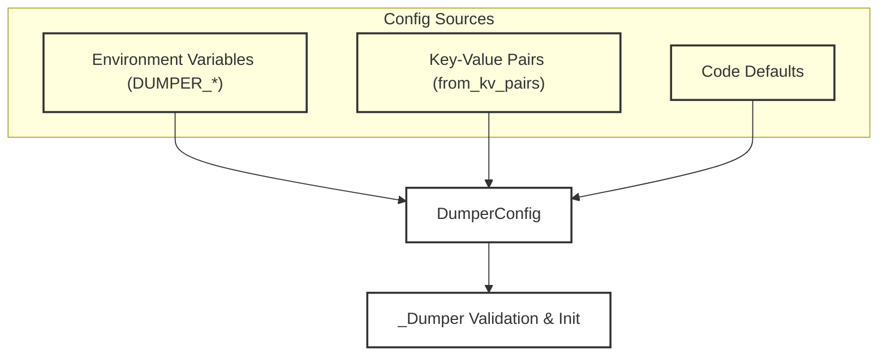

<!-- source: DeepWiki mcp.deepwiki.com · repo sgl-project/sglang · page 15.4 Development Tools and Debugging · fetched 2026-10-30 -->

# Development Tools and Debugging

<details>
<summary>Relevant source files</summary>

The following files were used as context for generating this wiki page:

- [.agents/skills/ci-workflow-guide/SKILL.md](.agents/skills/ci-workflow-guide/SKILL.md)
- [.codespellrc](.codespellrc)
- [.github/CI_PERMISSIONS.json](.github/CI_PERMISSIONS.json)
- [.github/CODEOWNERS](.github/CODEOWNERS)
- [.github/FOLDER_README.md](.github/FOLDER_README.md)
- [.github/actions/check-pr-test-health/action.test.cjs](.github/actions/check-pr-test-health/action.test.cjs)
- [.github/actions/check-pr-test-health/action.yml](.github/actions/check-pr-test-health/action.yml)
- [.github/actions/wait-for-jobs/action.yml](.github/actions/wait-for-jobs/action.yml)
- [.github/scripts/ci-labels.cjs](.github/scripts/ci-labels.cjs)
- [.github/update_ci_permission.py](.github/update_ci_permission.py)
- [.github/workflows/_pr-test-check-changes.yml](.github/workflows/_pr-test-check-changes.yml)
- [.github/workflows/_pr-test-stage-cpu.yml](.github/workflows/_pr-test-stage-cpu.yml)
- [.github/workflows/close-inactive-issues.yml](.github/workflows/close-inactive-issues.yml)
- [.github/workflows/pr-gate.yml](.github/workflows/pr-gate.yml)
- [.github/workflows/run-cpu-ci.yml](.github/workflows/run-cpu-ci.yml)
- [.github/workflows/slash-command-handler.yml](.github/workflows/slash-command-handler.yml)
- [benchmark/kernels/bench_fused_gate_sigmoid_mul_add.py](benchmark/kernels/bench_fused_gate_sigmoid_mul_add.py)
- [benchmark/kernels/bench_fused_sigmoid_mul.py](benchmark/kernels/bench_fused_sigmoid_mul.py)
- [docs/docs/developer_guide/contribution_guide.mdx](docs/docs/developer_guide/contribution_guide.mdx)
- [docs/docs/developer_guide/evaluating_new_models.mdx](docs/docs/developer_guide/evaluating_new_models.mdx)
- [docs/docs/hardware-platforms/ascend-npus/development/contribution_guide.mdx](docs/docs/hardware-platforms/ascend-npus/development/contribution_guide.mdx)
- [python/sglang/srt/debug_utils/dumper.py](python/sglang/srt/debug_utils/dumper.py)
- [python/sglang/test/accuracy_test_runner.py](python/sglang/test/accuracy_test_runner.py)
- [python/sglang/test/gpt_oss_common.py](python/sglang/test/gpt_oss_common.py)
- [python/sglang/test/kits/lm_eval_kit.py](python/sglang/test/kits/lm_eval_kit.py)
- [python/sglang/test/kits/mmmu_vlm_kit.py](python/sglang/test/kits/mmmu_vlm_kit.py)
- [python/sglang/test/run_combined_tests.py](python/sglang/test/run_combined_tests.py)
- [scripts/ci/amd/ensure_vram_clear.sh](scripts/ci/amd/ensure_vram_clear.sh)
- [scripts/ci/utils/compute_partitions.py](scripts/ci/utils/compute_partitions.py)
- [test/manual/layers/test_fused_gate_sigmoid_mul_add.py](test/manual/layers/test_fused_gate_sigmoid_mul_add.py)
- [test/manual/layers/test_fused_sigmoid_mul.py](test/manual/layers/test_fused_sigmoid_mul.py)
- [test/registered/debug_utils/test_dumper.py](test/registered/debug_utils/test_dumper.py)
- [test/registered/model_loading/test_runai_model_loader.py](test/registered/model_loading/test_runai_model_loader.py)
- [test/registered/vlm/test_encoder_dp.py](test/registered/vlm/test_encoder_dp.py)

</details>


## Purpose and Scope

This page covers the tensor dumper and dump-comparison workflow, request-time diagnostics, and server crash-dump handling within SGLang. It also identifies the limits of available implementation details regarding comparator internals, CUDA coredump configuration, and internal playbooks [python/sglang/srt/debug_utils/dumper.py:33-70]()[test/registered/debug_utils/test_engine_dumper_comparator_e2e.py:1-14]()[test/registered/debug_utils/test_crash_dump.py:24-45]().

Sources: `python/sglang/srt/debug_utils/dumper.py`, `test/registered/debug_utils/test_engine_dumper_comparator_e2e.py`, `test/registered/debug_utils/test_crash_dump.py`

---

## Tensor Dumper System

The tensor dumper is exposed through `DumperConfig` and `_Dumper` in `python/sglang/srt/debug_utils/dumper.py`. Configuration parsing and validation are handled via environment variables and key-value pairs [python/sglang/srt/debug_utils/dumper.py:33-70]()[python/sglang/srt/debug_utils/dumper.py:136-190]()[test/registered/debug_utils/test_dumper.py:17-40]().

### Dumper Configuration (`DumperConfig`)

`DumperConfig` is a frozen dataclass whose fields control enablement, filtering, output directories, values/gradients capture, experiment naming, collective timeout, server port, source patching, grafting, and parallel-rank filename tagging [python/sglang/srt/debug_utils/dumper.py:136-169]().



Sources: `python/sglang/srt/debug_utils/dumper.py:36-70`, `python/sglang/srt/debug_utils/dumper.py:136-190`

Configuration types are verified by `_BaseConfig._verify_types`. `from_env()` maps fields using the `DUMPER_` prefix, while `from_kv_pairs()` parses `key=value` strings [python/sglang/srt/debug_utils/dumper.py:36-70]()[python/sglang/srt/debug_utils/dumper.py:81-130]()[python/sglang/srt/debug_utils/dumper.py:171-175]().

| Configuration Area | Fields in `DumperConfig` |
|---|---|
| Enablement & Selection | `enable`, `filter` |
| Output Destinations | `dir`, `enable_output_file`, `enable_output_console`, `exp_name`, `cleanup_previous` |
| Captured Data | `enable_value`, `enable_grad`, `enable_model_value`, `enable_model_grad` |
| Distributed Operation | `collective_timeout`, `include_parallel_rank_in_filename` |
| Runtime & Grafting | `server_port`, `grafter_enable`, `grafter_role`, `grafter_master_address` |

Sources: `python/sglang/srt/debug_utils/dumper.py:136-169`

---

## Dump Comparator and Token Aligner

### Comparator Workflow

The end-to-end test workflow executes server inference, captures tensors via source patches, verifies dump fields, and invokes numerical comparators across baseline and target configurations (e.g., TP=2 vs. TP=4, or TP=2 with DP attention) [test/registered/debug_utils/test_engine_dumper_comparator_e2e.py:1-14]()[test/registered/debug_utils/test_engine_dumper_comparator_e2e.py:159-171]().

```mermaid
flowchart LR
    "TP=2 Baseline" --> "SGLang Server Inference"
    "TP=4 Target" --> "SGLang Server Inference"
    "PATCH_CONFIG_YAML" --> "dumper.dump() Capture Points"
    "SGLang Server Inference" --> "Dumped Tensors"
    "Dumped Tensors" --> "Field Verification"
    "Field Verification" --> "Comparator Invocation"
    "Comparator Invocation" --> "Numerical Consistency Check"

    classDef default fill:none,stroke:#333,stroke-width:2px;
```

Sources: `test/registered/debug_utils/test_engine_dumper_comparator_e2e.py:1-14`, `test/registered/debug_utils/test_engine_dumper_comparator_e2e.py:46-63`

---

## Debug Utilities and CUDA Coredump Handling

### Request-Time Instrumentation

`req_time_stats.py` defines request-stage metrics, wall-clock/performance-counter offsets, and conversion utilities for timestamps across threads [python/sglang/srt/observability/req_time_stats.py:56-85]()[python/sglang/srt/observability/req_time_stats.py:88-104](). Unstamped timestamps (`0.0`) maintain their sentinel value across serialization to prevent distortion of first-token latency histograms [test/registered/unit/observability/test_req_time_stats.py:1-46]().

### Server Crash-Dump Testing

`test_crash_dump.py` exercises server crash handling via the `--crash-dump-folder` option. Upon simulated server crashes, it serializes state into `crash_dump_*.pkl` containing `server_args` and request records [test/registered/debug_utils/test_crash_dump.py:24-115]().

```mermaid
flowchart TD
    "popen_launch_server()" --> "--crash-dump-folder"
    "Server Failure Condition" --> "Crash Event Triggered"
    "Crash Event Triggered" --> "crash_dump_*.pkl Generated"
    "crash_dump_*.pkl Generated" --> "pickle.load()"
    "pickle.load()" --> "server_args & requests Inspection"

    classDef default fill:none,stroke:#333,stroke-width:2px;
```

Sources: `test/registered/debug_utils/test_crash_dump.py:24-46`, `test/registered/debug_utils/test_crash_dump.py:52-115`

---

## Internal Playbooks and Knowledge Base

Internal development tools, workflow playbooks, and agent skills reside across `scripts/`, `.claude/`, and `.agents/skills/`. Specific CI workflow guidelines and script runners orchestrate testing suites and permission checks [.github/workflows/slash-command-handler.yml:1-37]()[scripts/ci/utils/compute_partitions.py:1-52]().

Sources: `.github/workflows/slash-command-handler.yml`, `scripts/ci/utils/compute_partitions.py`

---

## Summary: Mapping Tool Names to Code Entities

```mermaid
flowchart TD
    "Tensor Dumping" --> "DumperConfig"
    "Tensor Dumping" --> "_Dumper"
    "Runtime Configuration" --> "DumperConfig.from_env()"
    "Source-Patched Capture" --> "PATCH_CONFIG_YAML"
    "Source-Patched Capture" --> "dumper.dump()"
    "Dump Comparison Test" --> "test_patch_dump_and_compare"
    "Server Crash Dump" --> "--crash-dump-folder"
    "Server Crash Dump" --> "crash_dump_*.pkl"
    "Request Timing" --> "RequestStageConfig"
    "Request Timing" --> "convert_time_to_realtime()"

    classDef default fill:none,stroke:#333,stroke-width:2px;
```

Sources: `python/sglang/srt/debug_utils/dumper.py:136-175`, `test/registered/debug_utils/test_engine_dumper_comparator_e2e.py:1-14`, `test/registered/debug_utils/test_crash_dump.py:75-115`, `python/sglang/srt/observability/req_time_stats.py:56-104`

---

# End of 15.4 Development Tools and Debugging

---

