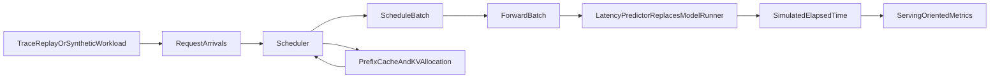
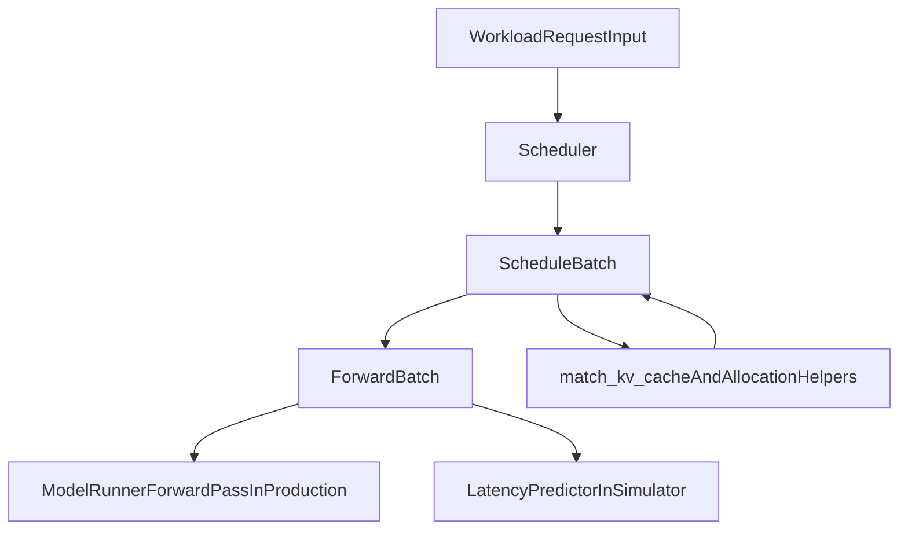
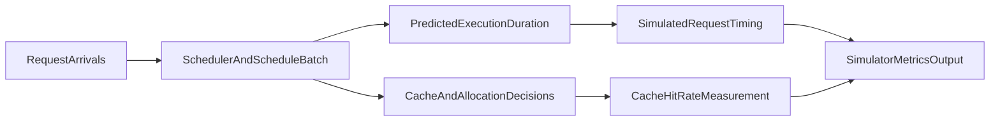

<!-- source: DeepWiki mcp.deepwiki.com · repo sgl-project/sglang · page 15.5 SGLang Simulator (tools/sglang-simulator) · fetched 2026-10-30 -->

# SGLang Simulator (tools/sglang-simulator)

Relevant source files

The following files were used as context for generating this wiki page:

- [benchmark/hicache/bench_multiturn.py](benchmark/hicache/bench_multiturn.py)
- [docs/docs/developer_guide/bench_serving.mdx](docs/docs/developer_guide/bench_serving.mdx)
- [docs/docs/references/environment_variables.mdx](docs/docs/references/environment_variables.mdx)
- [python/sglang/bench_serving.py](python/sglang/bench_serving.py)
- [python/sglang/benchmark/datasets/__init__.py](python/sglang/benchmark/datasets/__init__.py)
- [python/sglang/benchmark/datasets/common.py](python/sglang/benchmark/datasets/common.py)
- [python/sglang/benchmark/datasets/generated_shared_prefix.py](python/sglang/benchmark/datasets/generated_shared_prefix.py)
- [python/sglang/benchmark/datasets/image.py](python/sglang/benchmark/datasets/image.py)
- [python/sglang/benchmark/datasets/speed_bench.py](python/sglang/benchmark/datasets/speed_bench.py)
- [python/sglang/benchmark/endpoint.py](python/sglang/benchmark/endpoint.py)
- [python/sglang/benchmark/goodput.py](python/sglang/benchmark/goodput.py)
- [python/sglang/benchmark/one_batch.py](python/sglang/benchmark/one_batch.py)
- [python/sglang/benchmark/serving.py](python/sglang/benchmark/serving.py)
- [python/sglang/srt/arg_groups/attention_hook.py](python/sglang/srt/arg_groups/attention_hook.py)
- [python/sglang/srt/arg_groups/overrides.py](python/sglang/srt/arg_groups/overrides.py)
- [python/sglang/srt/arg_groups/pd_disaggregation_hook.py](python/sglang/srt/arg_groups/pd_disaggregation_hook.py)
- [python/sglang/srt/disaggregation/role_switch.py](python/sglang/srt/disaggregation/role_switch.py)
- [python/sglang/srt/distributed/bootstrap.py](python/sglang/srt/distributed/bootstrap.py)
- [python/sglang/srt/distributed/parallel_state.py](python/sglang/srt/distributed/parallel_state.py)
- [python/sglang/srt/entrypoints/ollama/serving.py](python/sglang/srt/entrypoints/ollama/serving.py)
- [python/sglang/srt/entrypoints/v1_loads.py](python/sglang/srt/entrypoints/v1_loads.py)
- [python/sglang/srt/environ.py](python/sglang/srt/environ.py)
- [python/sglang/srt/layers/dp_attention.py](python/sglang/srt/layers/dp_attention.py)
- [python/sglang/srt/managers/load_snapshot.py](python/sglang/srt/managers/load_snapshot.py)
- [python/sglang/srt/managers/schedule_batch.py](python/sglang/srt/managers/schedule_batch.py)
- [python/sglang/srt/managers/scheduler.py](python/sglang/srt/managers/scheduler.py)
- [python/sglang/srt/managers/scheduler_components/load_inquirer.py](python/sglang/srt/managers/scheduler_components/load_inquirer.py)
- [python/sglang/srt/mem_cache/common.py](python/sglang/srt/mem_cache/common.py)
- [python/sglang/srt/model_executor/model_runner.py](python/sglang/srt/model_executor/model_runner.py)
- [python/sglang/srt/models/voxtral.py](python/sglang/srt/models/voxtral.py)
- [python/sglang/srt/multimodal/processors/voxtral.py](python/sglang/srt/multimodal/processors/voxtral.py)
- [python/sglang/srt/runtime_context.py](python/sglang/srt/runtime_context.py)
- [python/sglang/srt/server_args.py](python/sglang/srt/server_args.py)
- [python/sglang/srt/utils/hf_transformers_utils.py](python/sglang/srt/utils/hf_transformers_utils.py)
- [python/sglang/srt/utils/network.py](python/sglang/srt/utils/network.py)
- [python/sglang/test/ci/ci_stress_utils.py](python/sglang/test/ci/ci_stress_utils.py)
- [python/sglang/test/kits/cache_hit_kit.py](python/sglang/test/kits/cache_hit_kit.py)
- [python/sglang/test/kits/spec_decoding_kit.py](python/sglang/test/kits/spec_decoding_kit.py)
- [python/sglang/test/mock_model/utils.py](python/sglang/test/mock_model/utils.py)
- [python/sglang/test/send_one.py](python/sglang/test/send_one.py)
- [scripts/playground/replay_request_dump.py](scripts/playground/replay_request_dump.py)
- [test/manual/dsv4/test_dsv4_flash_mtp_tp8.py](test/manual/dsv4/test_dsv4_flash_mtp_tp8.py)
- [test/manual/dsv4/test_dsv4_pro_mtp.py](test/manual/dsv4/test_dsv4_pro_mtp.py)
- [test/manual/test_forward_split_prefill.py](test/manual/test_forward_split_prefill.py)
- [test/manual/test_vlm_accuracy.py](test/manual/test_vlm_accuracy.py)
- [test/registered/bench_fn/test_bench_serving_reasoning_stream.py](test/registered/bench_fn/test_bench_serving_reasoning_stream.py)
- [test/registered/bench_fn/test_benchmark_datasets_api.py](test/registered/bench_fn/test_benchmark_datasets_api.py)
- [test/registered/unit/bench/test_bench_serving_goodput.py](test/registered/unit/bench/test_bench_serving_goodput.py)
- [test/registered/unit/bench/test_benchmark_endpoint.py](test/registered/unit/bench/test_benchmark_endpoint.py)
- [test/registered/unit/disaggregation/test_pd_role_switch.py](test/registered/unit/disaggregation/test_pd_role_switch.py)
- [test/registered/unit/entrypoints/test_v1_loads_aggregate.py](test/registered/unit/entrypoints/test_v1_loads_aggregate.py)
- [test/registered/unit/managers/test_load_inquirer.py](test/registered/unit/managers/test_load_inquirer.py)
- [test/registered/unit/managers/test_load_snapshot_backends.py](test/registered/unit/managers/test_load_snapshot_backends.py)
- [test/registered/unit/server_args/test_server_args.py](test/registered/unit/server_args/test_server_args.py)
- [test/registered/unit/test_model_overrides.py](test/registered/unit/test_model_overrides.py)
- [test/registered/unit/test_runtime_context.py](test/registered/unit/test_runtime_context.py)
- [test/registered/unit/utils/test_network.py](test/registered/unit/utils/test_network.py)

## Purpose and Scope

The simulator located in `tools/sglang-simulator` evaluates LLM and VLM serving performance and scheduling policies without executing physical model forward passes. It achieves this by reusing SGLang's production scheduler, memory manager, and cache infrastructure while substituting actual model execution with a latency predictor. Its core capabilities include trace replay, synthetic workload generation, configurable predictor modes, and the generation of serving-compatible performance metrics [python/sglang/srt/managers/scheduler.py:14-50](); [python/sglang/srt/managers/schedule_batch.py:42-54](); [python/sglang/srt/model_executor/forward_batch_info.py:14-26]().

Sources: `python/sglang/srt/managers/scheduler.py`, `python/sglang/srt/managers/schedule_batch.py`, `python/sglang/srt/model_executor/forward_batch_info.py`

## Architecture and Component Integration

At a high level, the simulator translates workload arrivals into scheduler-visible requests, drives state transitions through the production scheduler and prefix cache, estimates execution duration via a latency predictor, and aggregates serving metrics. The production architecture maintains a strict separation between high-level scheduling structures (`ScheduleBatch`) and low-level execution tensors (`ForwardBatch`). The simulator harnesses this boundary to preserve exact scheduling semantics while bypassing GPU-bound model execution [python/sglang/srt/managers/schedule_batch.py:42-54](); [python/sglang/srt/model_executor/forward_batch_info.py:14-26]().

### Component Overview

- **Workload Input:** Handles trace replay (e.g., ShareGPT logs or production serving logs) and synthetic workload generators.
- **Scheduling and Batching:** Reuses `Scheduler` to manage request queues, prioritize workloads, and form batches [python/sglang/srt/managers/scheduler.py:14-14](); [python/sglang/srt/managers/schedule_batch.py:45-53]().
- **Forward Boundary:** Intercepts the transition from `ScheduleBatch` to `ForwardBatch`, replacing `ModelRunner` forward passes with predicted elapsed times [python/sglang/srt/managers/schedule_batch.py:49-54](); [python/sglang/srt/model_executor/forward_batch_info.py:19-25]().
- **Cache Behavior:** Reuses prefix cache matching (`match_kv_cache`), token allocation, and KV cache eviction policies [python/sglang/srt/managers/schedule_batch.py:106-121](); [python/sglang/srt/mem_cache/common.py:16-27]().
- **Latency Prediction and Metrics:** Estimates prefill and decode latencies based on batch size and sequence length, accumulating serving statistics.

Sources: `python/sglang/srt/managers/scheduler.py`, `python/sglang/srt/managers/schedule_batch.py`, `python/sglang/srt/model_executor/forward_batch_info.py`, `python/sglang/srt/mem_cache/common.py`

### High-Level Dataflow

**Diagram 1: Workload-to-simulation flow and production runtime boundary**

This diagram illustrates how workload traces flow through the scheduling and caching engine while replacing model execution with a predictor. `ScheduleBatch` represents CPU-side scheduling entities, while `ForwardBatch` represents execution payloads [python/sglang/srt/managers/schedule_batch.py:45-54](); [python/sglang/srt/model_executor/forward_batch_info.py:17-25]().

Sources: `python/sglang/srt/managers/schedule_batch.py`, `python/sglang/srt/model_executor/forward_batch_info.py`, `python/sglang/srt/mem_cache/common.py`

## Core Components and Data Structures

### Scheduler and ScheduleBatch

The simulator relies on `Scheduler` defined in `scheduler.py` and batch descriptions in `ScheduleBatch` located in `schedule_batch.py`. `ScheduleBatch` maintains high-level metadata (request states, prompt lengths, output token counts, and KV allocation references) entirely on the CPU, allowing rapid simulation ticks without GPU synchronization [python/sglang/srt/managers/schedule_batch.py:45-53](); [python/sglang/srt/managers/scheduler.py:14-14]().

### ForwardBatch and ModelRunner

In a live server, `ForwardBatch` is constructed via `ForwardBatch.init_new` to drive `ModelRunner` forward passes on GPU devices [python/sglang/srt/model_executor/forward_batch_info.py:19-25](); [python/sglang/srt/model_executor/model_runner.py:14-14](). The simulator mocks or intercepts this phase, extracting batch dimensions (number of prefill tokens, number of decode requests) to feed into the latency predictor.

### Memory and Prefix Caches

Cache operations such as `match_kv_cache`, `release_kv_cache`, and sliding window eviction helpers (`free_swa_out_of_window_slots`) execute normally in the simulator. This ensures that cache hit rates, prefix sharing benefits, and memory pressure closely mirror real serving behavior [python/sglang/srt/managers/schedule_batch.py:106-121](); [python/sglang/srt/mem_cache/common.py:38-47](); [python/sglang/srt/mem_cache/common.py:74-87]().

### Runtime Dataflow & Code Mapping

**Diagram 2: Natural-language simulator roles mapped to runtime code entities**

This diagram maps conceptual simulator operations to the underlying classes (`Scheduler`, `ScheduleBatch`, `ForwardBatch`, `ModelRunner`) and helper functions (`match_kv_cache`) defined across the SGLang runtime [python/sglang/srt/managers/schedule_batch.py:45-54](); [python/sglang/srt/model_executor/forward_batch_info.py:19-25](); [python/sglang/srt/model_executor/model_runner.py:14-14]().

Sources: `python/sglang/srt/managers/schedule_batch.py`, `python/sglang/srt/model_executor/forward_batch_info.py`, `python/sglang/srt/model_executor/model_runner.py`

## Predictor Modes and Workload Generation

The simulator supports multiple execution and prediction configurations:

- **Trace Replay:** Reads recorded request timestamps, prompt token lengths, and generation lengths from datasets.
- **Synthetic Workloads:** Generates Poisson arrival processes with configurable request rate distributions, prompt length curves, and output length bounds.
- **Predictor Modes:** Analytical models (linear regression based on token counts) or lookup-table predictors derived from offline profiling benchmarks.

Sources: `python/sglang/srt/managers/schedule_batch.py`, `python/sglang/srt/model_executor/forward_batch_info.py`

## Serving-Compatible Metrics

The simulator generates outputs matching production serving metrics to evaluate scheduling policies (e.g., RadixAttention vs. FCFS). It leverages metric collection structures analogous to `SchedulerMetricsCollector`, `APIServerReqTimeStats`, and `SchedulerReqTimeStats` to track Time to First Token (TTFT), Time per Output Token (TPOT), request end-to-end latency, and system throughput [python/sglang/srt/managers/schedule_batch.py:135-143]().

**Diagram 3: Metrics boundary for a predicted execution**

This conceptual metrics flow shows how scheduler decisions and predicted execution durations are collected into performance reports. The underlying components utilize time statistics collectors from `schedule_batch.py` [python/sglang/srt/managers/schedule_batch.py:135-143]().

Sources: `python/sglang/srt/managers/schedule_batch.py`

## References

- `python/sglang/srt/managers/scheduler.py` — scheduler module overview. [python/sglang/srt/managers/scheduler.py:14-14]()
- `python/sglang/srt/managers/schedule_batch.py` — scheduling and batch data-flow description; cache and metrics-related imports. [python/sglang/srt/managers/schedule_batch.py:42-54](); [python/sglang/srt/managers/schedule_batch.py:106-143]()
- `python/sglang/srt/model_executor/forward_batch_info.py` — forward-batch data-flow description. [python/sglang/srt/model_executor/forward_batch_info.py:14-26]()
- `python/sglang/srt/model_executor/model_runner.py` — model runner module overview. [python/sglang/srt/model_executor/model_runner.py:14-14]()
- `python/sglang/srt/mem_cache/common.py` — cache-related utilities and sliding-window slot management. [python/sglang/srt/mem_cache/common.py:38-47](); [python/sglang/srt/mem_cache/common.py:74-87]()

Sources: `python/sglang/srt/managers/scheduler.py`, `python/sglang/srt/managers/schedule_batch.py`, `python/sglang/srt/model_executor/forward_batch_info.py`, `python/sglang/srt/model_executor/model_runner.py`, `python/sglang/srt/mem_cache/common.py`

---

