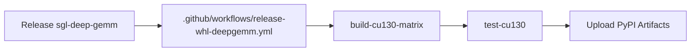
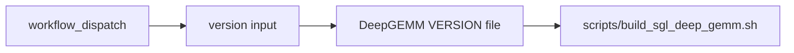

<!-- source: DeepWiki mcp.deepwiki.com · repo sgl-project/sglang · page 16 Release and Deployment Automation · fetched 2026-10-30 -->

# Release and Deployment Automation

Relevant source files

The following files were used as context for generating this wiki page:

- [.claude/rules/comment-style.md](.claude/rules/comment-style.md)
- [.github/actions/download-rust-ext/action.yml](.github/actions/download-rust-ext/action.yml)
- [.github/workflows/_pr-test-rust-ext-build.yml](.github/workflows/_pr-test-rust-ext-build.yml)
- [.github/workflows/_pr-test-sgl-kernel-build.yml](.github/workflows/_pr-test-sgl-kernel-build.yml)
- [.github/workflows/_pr-test-stage.yml](.github/workflows/_pr-test-stage.yml)
- [.github/workflows/nightly-test-nvidia.yml](.github/workflows/nightly-test-nvidia.yml)
- [.github/workflows/pr-test-extra.yml](.github/workflows/pr-test-extra.yml)
- [.github/workflows/pr-test-jit-kernel.yml](.github/workflows/pr-test-jit-kernel.yml)
- [.github/workflows/pr-test-multimodal-gen.yml](.github/workflows/pr-test-multimodal-gen.yml)
- [.github/workflows/pr-test-sgl-kernel.yml](.github/workflows/pr-test-sgl-kernel.yml)
- [.github/workflows/pr-test.yml](.github/workflows/pr-test.yml)
- [.github/workflows/release-whl-deepgemm.yml](.github/workflows/release-whl-deepgemm.yml)
- [.github/workflows/rerun-test.yml](.github/workflows/rerun-test.yml)
- [.github/workflows/seed-rust-ext-cache.yml](.github/workflows/seed-rust-ext-cache.yml)
- [docker/sgl-deep-gemm.Dockerfile](docker/sgl-deep-gemm.Dockerfile)
- [python/sglang/srt/model_loader/ci_weight_validation.py](python/sglang/srt/model_loader/ci_weight_validation.py)
- [scripts/build_sgl_deep_gemm.sh](scripts/build_sgl_deep_gemm.sh)
- [scripts/ci/cuda/ci_download_flashinfer_jit_cache.sh](scripts/ci/cuda/ci_download_flashinfer_jit_cache.sh)
- [scripts/ci/cuda/ci_install_dependency.sh](scripts/ci/cuda/ci_install_dependency.sh)
- [scripts/ci/partition_rerun_tests.py](scripts/ci/partition_rerun_tests.py)
- [scripts/ci/utils/install_rustup.sh](scripts/ci/utils/install_rustup.sh)
- [scripts/ci/utils/slash_command_handler.py](scripts/ci/utils/slash_command_handler.py)
- [scripts/ci/utils/stage_rust_ext_modules.sh](scripts/ci/utils/stage_rust_ext_modules.sh)
- [scripts/rename_sgl_deep_gemm_whl.sh](scripts/rename_sgl_deep_gemm_whl.sh)
- [scripts/update_deepgemm_whl_index.py](scripts/update_deepgemm_whl_index.py)
- [test/manual/test_weight_validation.py](test/manual/test_weight_validation.py)

## Purpose and Scope

This parent page provides a high-level overview of release and deployment automation for SGLang, covering Python wheel builds, Docker image pipelines, and version management strategies. Detailed technical implementations, platform matrices, multi-stage build scripts, and version coordination logic are delegated to the dedicated child pages. For general installation instructions and runtime platform configurations, see [Installation and Deployment](#2).

Sources: [.github/workflows/release-whl-deepgemm.yml:1-36](), [.github/workflows/pr-test.yml:1-30]()

---

## Overview

Release automation in SGLang decouples artifact generation from publication. Build pipelines orchestrate multi-architecture and multi-Python environment matrix jobs, producing distribution artifacts that are subsequently verified in GPU test suites before publication to package repositories or container registries.

**Release automation components mapped to code entities**

*Figure 1: DeepGEMM wheel build and validation release pipeline.*

Sources: [.github/workflows/release-whl-deepgemm.yml:1-36](), [.github/workflows/release-whl-deepgemm.yml:45-60](), [.github/workflows/release-whl-deepgemm.yml:104-128]()

---

## Wheel Build and Release Pipeline

Wheel build workflows generate pre-compiled binaries for custom extensions and supporting CUDA libraries, such as DeepGEMM and DeepEP, across distinct hardware architectures (`x86_64`, `aarch64`) and CUDA versions (e.g., `cu130`) [.github/workflows/release-whl-deepgemm.yml:45-60](). These workflows execute cross-platform matrix jobs that compile C++/CUDA extensions against specific PyTorch ABIs, run validation test suites on specialized GPU runners (such as `8-gpu-h200` or `8-gpu-b200`), and upload validated artifacts [.github/workflows/release-whl-deepgemm.yml:104-128]().

For a complete breakdown of the sgl-kernel wheel builds, platform support matrices, and PyPI/GitHub release workflows, see [Wheel Build and Release Pipeline](#16.1).

Sources: [.github/workflows/release-whl-deepgemm.yml:1-36](), [.github/workflows/release-whl-deepgemm.yml:45-60](), [.github/workflows/release-whl-deepgemm.yml:104-128]()

---

## Docker Build and Release Pipeline

Container image deployments utilize multi-stage build processes to package the SGLang runtime, custom kernels, and Python dependencies into production-ready container images across various hardware backends. These images support diverse accelerator variants and ensure consistent deployment environments from development clusters to Kubernetes-native orchestration layers.

For details on multi-stage Dockerfile configurations, image variants, and container deployment best practices, see [Docker Build and Release Pipeline](#16.2).

Sources: [.github/workflows/pr-test.yml:1-15]()

---

## Version Management

Version management governs version numbering conventions, update scripts, and release branch lifecycles. Workflows dynamically inject version strings into build scripts and metadata files (such as package version identifiers and configuration files) to ensure traceability across distributed packages and container images.

For details on version numbering schemes, automated update scripts, and release branch cutting policies, see [Version Management](#16.3).

**Version flow mapped to workflow inputs**

*Figure 2: Version injection flow for wheel releases.*

Sources: [.github/workflows/release-whl-deepgemm.yml:4-33](), [.github/workflows/release-whl-deepgemm.yml:81-90]()

---

## Summary

Release and deployment automation bridges code development and production consumption via structured wheel build pipelines, container image generation, and version tracking workflows. 

For detailed technical guidance, refer to the child pages:

- [Wheel Build and Release Pipeline](#16.1)
- [Docker Build and Release Pipeline](#16.2)
- [Version Management](#16.3)

Sources: [.github/workflows/release-whl-deepgemm.yml:1-36](), [.github/workflows/pr-test.yml:1-30]()

---

