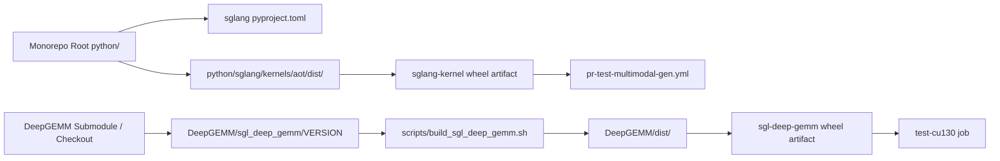
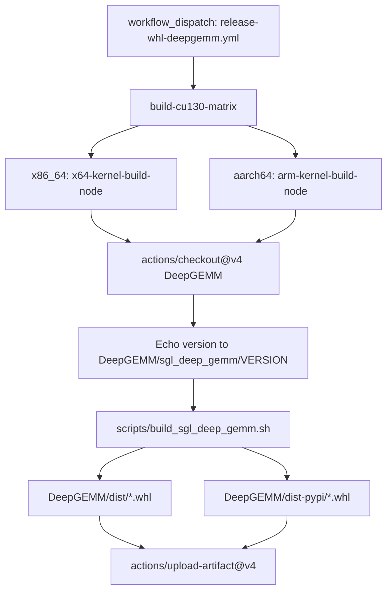
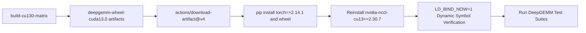
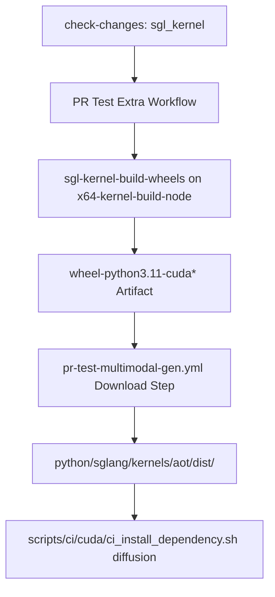
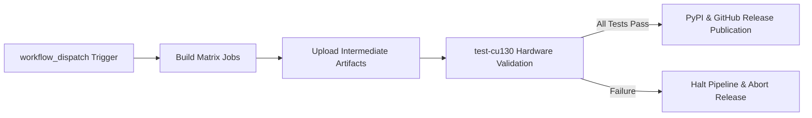

<!-- source: DeepWiki mcp.deepwiki.com · repo sgl-project/sglang · page 16.1 Wheel Build and Release Pipeline · fetched 2026-10-30 -->

# Wheel Build and Release Pipeline

Relevant source files

The following files were used as context for generating this wiki page:

- [.claude/rules/comment-style.md](.claude/rules/comment-style.md)
- [.github/actions/download-rust-ext/action.yml](.github/actions/download-rust-ext/action.yml)
- [.github/workflows/_pr-test-rust-ext-build.yml](.github/workflows/_pr-test-rust-ext-build.yml)
- [.github/workflows/_pr-test-sgl-kernel-build.yml](.github/workflows/_pr-test-sgl-kernel-build.yml)
- [.github/workflows/_pr-test-stage.yml](.github/workflows/_pr-test-stage.yml)
- [.github/workflows/nightly-test-nvidia.yml](.github/workflows/nightly-test-nvidia.yml)
- [.github/workflows/pr-test-extra.yml](.github/workflows/pr-test-extra.yml)
- [.github/workflows/pr-test-jit-kernel.yml](.github/workflows/pr-test-jit-kernel.yml)
- [.github/workflows/pr-test-multimodal-gen.yml](.github/workflows/pr-test-multimodal-gen.yml)
- [.github/workflows/pr-test-sgl-kernel.yml](.github/workflows/pr-test-sgl-kernel.yml)
- [.github/workflows/pr-test.yml](.github/workflows/pr-test.yml)
- [.github/workflows/release-pypi-nightly.yml](.github/workflows/release-pypi-nightly.yml)
- [.github/workflows/release-pypi-pr.yml](.github/workflows/release-pypi-pr.yml)
- [.github/workflows/release-whl-deepgemm.yml](.github/workflows/release-whl-deepgemm.yml)
- [.github/workflows/rerun-test.yml](.github/workflows/rerun-test.yml)
- [.github/workflows/seed-rust-ext-cache.yml](.github/workflows/seed-rust-ext-cache.yml)
- [3rdparty/amd/wheel/sglang/pyproject.toml](3rdparty/amd/wheel/sglang/pyproject.toml)
- [docker/Dockerfile](docker/Dockerfile)
- [docker/sgl-deep-gemm.Dockerfile](docker/sgl-deep-gemm.Dockerfile)
- [python/pyproject.toml](python/pyproject.toml)
- [python/pyproject_cpu.toml](python/pyproject_cpu.toml)
- [python/pyproject_npu.toml](python/pyproject_npu.toml)
- [python/pyproject_other.toml](python/pyproject_other.toml)
- [python/pyproject_xpu.toml](python/pyproject_xpu.toml)
- [python/sglang/srt/entrypoints/engine.py](python/sglang/srt/entrypoints/engine.py)
- [python/sglang/srt/function_call/deepseekv32_detector.py](python/sglang/srt/function_call/deepseekv32_detector.py)
- [python/sglang/srt/function_call/kimik2_detector.py](python/sglang/srt/function_call/kimik2_detector.py)
- [python/sglang/srt/model_loader/ci_weight_validation.py](python/sglang/srt/model_loader/ci_weight_validation.py)
- [python/sglang/srt/utils/common.py](python/sglang/srt/utils/common.py)
- [python/sglang/srt/utils/json_response.py](python/sglang/srt/utils/json_response.py)
- [scripts/build_sgl_deep_gemm.sh](scripts/build_sgl_deep_gemm.sh)
- [scripts/ci/cuda/ci_download_flashinfer_jit_cache.sh](scripts/ci/cuda/ci_download_flashinfer_jit_cache.sh)
- [scripts/ci/cuda/ci_install_dependency.sh](scripts/ci/cuda/ci_install_dependency.sh)
- [scripts/ci/partition_rerun_tests.py](scripts/ci/partition_rerun_tests.py)
- [scripts/ci/utils/install_rustup.sh](scripts/ci/utils/install_rustup.sh)
- [scripts/ci/utils/slash_command_handler.py](scripts/ci/utils/slash_command_handler.py)
- [scripts/ci/utils/stage_rust_ext_modules.sh](scripts/ci/utils/stage_rust_ext_modules.sh)
- [scripts/rename_sgl_deep_gemm_whl.sh](scripts/rename_sgl_deep_gemm_whl.sh)
- [scripts/update_deepgemm_whl_index.py](scripts/update_deepgemm_whl_index.py)
- [scripts/update_nightly_whl_index.py](scripts/update_nightly_whl_index.py)
- [test/manual/test_weight_validation.py](test/manual/test_weight_validation.py)
- [test/registered/function_call/test_kimik2_detector.py](test/registered/function_call/test_kimik2_detector.py)
- [test/registered/moe/test_cutedsl_moe.py](test/registered/moe/test_cutedsl_moe.py)
- [test/registered/unit/function_call/test_deepseekv4_detector.py](test/registered/unit/function_call/test_deepseekv4_detector.py)
- [test/registered/unit/function_call/test_json_schema_constraint.py](test/registered/unit/function_call/test_json_schema_constraint.py)
- [test/registered/unit/function_call/test_structural_tag_excludes.py](test/registered/unit/function_call/test_structural_tag_excludes.py)
- [test/registered/unit/function_call/test_unknown_tool_name.py](test/registered/unit/function_call/test_unknown_tool_name.py)
- [test/registered/unit/utils/test_common.py](test/registered/unit/utils/test_common.py)
- [test/registered/unit/utils/test_json_response.py](test/registered/unit/utils/test_json_response.py)

## Purpose and Scope

This page details the wheel build, validation, and release automation workflows used across the SGLang codebase. It explains how custom extensions and auxiliary packages—specifically `sgl-kernel` and `sgl-deep-gemm`—are compiled across platform matrices, integrated into CI artifact consumption pipelines, and staged for release publication on PyPI and GitHub [.github/workflows/release-whl-deepgemm.yml:1-180]().

Sources: [.github/workflows/release-whl-deepgemm.yml:1-180]()

---

## Package Ecosystem and Distribution Mapping

The SGLang release infrastructure manages several distinct packages and compilation targets: the primary `sglang` library, the hardware-specific `sgl-kernel` library (referenced as `sglang-kernel` in dependency specs), and the independently versioned `sgl-deep-gemm` hardware acceleration package [python/pyproject.toml:82](), [.github/workflows/release-whl-deepgemm.yml:68-103]().

| Distribution / Component | Source or Artifact Location | Role and Distribution Channel |
|---|---|---|
| `sglang` | Root monorepo python sources (`python/`) | Main framework package supporting multiple runtime backends [python/pyproject.toml:12-103]() |
| `sgl-kernel` (`sglang-kernel`) | `python/sglang/kernels/aot/dist/` or PyPI index | Custom CUDA/ROCm operator kernels required for high-throughput decoding and attention [python/pyproject.toml:82](), [.github/workflows/pr-test-multimodal-gen.yml:98-110]() |
| `sgl-deep-gemm` (`DeepGEMM`) | `DeepGEMM/sgl_deep_gemm/` and `DeepGEMM/dist/` | Specialized low-precision GEMM kernels for DeepSeek MoE architectures [.github/workflows/release-whl-deepgemm.yml:68-103]() |

**Diagram: Package Ecosystem Code Mapping**

Sources: [python/pyproject.toml:82](), [.github/workflows/pr-test-multimodal-gen.yml:98-110](), [.github/workflows/release-whl-deepgemm.yml:68-103]()

---

## sgl-deep-gemm Build and Release Automation

The `Release sgl-deep-gemm` workflow (`.github/workflows/release-whl-deepgemm.yml`) handles compiling, packaging, and validating low-precision GEMM acceleration wheels [.github/workflows/release-whl-deepgemm.yml:1-42]().

### Build Matrix and Execution Environment

The build job (`build-cu130-matrix`) executes under strict repository guards and target filters (`all` or `cu130`). It spans architectures (`x86_64`, `aarch64`) mapped onto specific build runner pools (`x64-kernel-build-node`, `arm-kernel-build-node`) [.github/workflows/release-whl-deepgemm.yml:45-59](). 

The workflow assigns the version string by writing directly to `DeepGEMM/sgl_deep_gemm/VERSION` and invoking `scripts/build_sgl_deep_gemm.sh` [.github/workflows/release-whl-deepgemm.yml:81-89](). Artifacts are subsequently staged into `DeepGEMM/dist/*.whl` and `DeepGEMM/dist-pypi/*.whl` [.github/workflows/release-whl-deepgemm.yml:92-102]().

| Matrix Dimension | Target Value | Implementation Reference |
|---|---|---|
| Python Version | `3.12` | [.github/workflows/release-whl-deepgemm.yml:51](); `python-version` matrix parameter |
| CUDA Version | `13.0` (`cu130`) | [.github/workflows/release-whl-deepgemm.yml:52](); PyTorch ABI binding target |
| CPU Architecture | `x86_64`, `aarch64` | [.github/workflows/release-whl-deepgemm.yml:53](); Hardware runner mapping |

**Diagram: DeepGEMM Build Execution Flow**

Sources: [.github/workflows/release-whl-deepgemm.yml:45-102]()

### Post-Build Hardware Validation

Following artifact generation, the `test-cu130` job executes hardware-specific integration tests unless bypassed by `skip_tests` [.github/workflows/release-whl-deepgemm.yml:104-106](). The test suite validates compatibility across distinct NVIDIA GPU architectures (`sm90`, `sm100`, and `sm100-aarch64`) [.github/workflows/release-whl-deepgemm.yml:107-126]().

During test setup, the runner pins the PyTorch binary to `TORCH_VER` (`2.14.1`), installs dependent packages (`sgl-deep-ep`, `tilelang`), force-reinstalls the target wheel with `--no-deps`, and forces synchronization of `nvidia-nccl-cu13` [.github/workflows/release-whl-deepgemm.yml:147-162](). Symbol binding is verified eagerly using `LD_BIND_NOW=1` to catch unresolved dynamic links prior to test execution [.github/workflows/release-whl-deepgemm.yml:169-180]().

| Architecture Label | Runner Node | Wheel Architecture | Timeout (Minutes) |
|---|---|---|---|
| `sm90` | `8-gpu-h200` | `x86_64` | 60 [.github/workflows/release-whl-deepgemm.yml:111-114]() |
| `sm100` | `8-gpu-b200` | `x86_64` | 180 [.github/workflows/release-whl-deepgemm.yml:115-118]() |
| `sm100-aarch64` | `4-gpu-gb300` | `aarch64` | 180 [.github/workflows/release-whl-deepgemm.yml:123-126]() |

**Diagram: Hardware Validation Pipeline**

Sources: [.github/workflows/release-whl-deepgemm.yml:104-180]()

---

## sgl-kernel Wheel Build Pipeline and Platform Matrix

The `sgl-kernel` (`sglang-kernel`) library provides optimized custom CUDA operators compiled against specific PyTorch and CUDA versions [python/pyproject.toml:82](). 

### CI Integration and Artifact Consumption

In continuous integration workflows such as `.github/workflows/pr-test-multimodal-gen.yml`, conditional triggers check for changes in kernel directories and download pre-built `wheel-python3.11-cuda*` artifacts [.github/workflows/pr-test-multimodal-gen.yml:98-110](). These wheels are placed into the AOT build directory (`python/sglang/kernels/aot/dist/`), where `scripts/ci/cuda/ci_install_dependency.sh` consumes them during environment setup [scripts/ci/cuda/ci_install_dependency.sh:44-52]().

Similarly, `.github/workflows/pr-test-extra.yml` coordinates specialized kernel build jobs on dedicated nodes (`x64-kernel-build-node`) when modifications are detected in kernel source files [.github/workflows/pr-test-extra.yml:109-122]().

**Diagram: sgl-kernel Artifact Flow**

Sources: [.github/workflows/pr-test-extra.yml:109-122](), [.github/workflows/pr-test-multimodal-gen.yml:98-110](), [scripts/ci/cuda/ci_install_dependency.sh:44-52]()

---

## GitHub Release and PyPI Publication Workflow

Release pipelines are governed by concurrency controls and event triggers that serialize deployments and prevent conflicting pushes [.github/workflows/release-whl-deepgemm.yml:34-36]().

### Concurrency and Publication Gating

The release workflows utilize concurrency groups keyed by the target branch and ref to ensure that concurrent dispatches cancel obsolete builds [.github/workflows/release-whl-deepgemm.yml:34-36](). Publication steps (such as uploading to PyPI) are strictly gated behind downstream hardware test jobs (e.g., `test-cu130`), ensuring that unverified binaries are never published [.github/workflows/release-whl-deepgemm.yml:91-106]().

**Diagram: Release Gate Logic**

Sources: [.github/workflows/release-whl-deepgemm.yml:1-106]()

---

## Sources

- [.github/workflows/release-whl-deepgemm.yml:1-180]()
- [python/pyproject.toml:12-103]()
- [.github/workflows/pr-test-multimodal-gen.yml:98-110]()
- [.github/workflows/pr-test-extra.yml:109-122]()
- [scripts/ci/cuda/ci_install_dependency.sh:44-52]()

---

