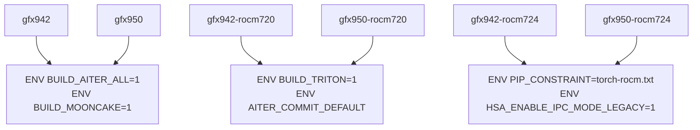
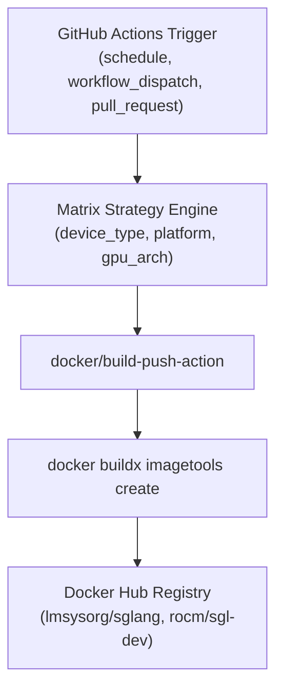

<!-- source: DeepWiki mcp.deepwiki.com · repo sgl-project/sglang · page 16.2 Docker Build and Release Pipeline · fetched 2026-10-30 -->

# Docker Build and Release Pipeline

Relevant source files

The following files were used as context for generating this wiki page:

- [.github/workflows/_npu-pr-test-stage.yml](.github/workflows/_npu-pr-test-stage.yml)
- [.github/workflows/_npu-single-node-test-stage.yml](.github/workflows/_npu-single-node-test-stage.yml)
- [.github/workflows/coverage-collection-npu.yml](.github/workflows/coverage-collection-npu.yml)
- [.github/workflows/diffusion-ci-gt-gen-npu.yml](.github/workflows/diffusion-ci-gt-gen-npu.yml)
- [.github/workflows/full-test-npu.yml](.github/workflows/full-test-npu.yml)
- [.github/workflows/nightly-test-amd.yml](.github/workflows/nightly-test-amd.yml)
- [.github/workflows/nightly-test-intel-wheel.yml](.github/workflows/nightly-test-intel-wheel.yml)
- [.github/workflows/nightly-test-intel.yml](.github/workflows/nightly-test-intel.yml)
- [.github/workflows/nightly-test-npu.yml](.github/workflows/nightly-test-npu.yml)
- [.github/workflows/pr-test-amd.yml](.github/workflows/pr-test-amd.yml)
- [.github/workflows/pr-test-npu.yml](.github/workflows/pr-test-npu.yml)
- [.github/workflows/pr-test-xpu.yml](.github/workflows/pr-test-xpu.yml)
- [.github/workflows/release-docker-amd-gfx1151-nightly.yml](.github/workflows/release-docker-amd-gfx1151-nightly.yml)
- [.github/workflows/release-docker-amd-rocm10.yml](.github/workflows/release-docker-amd-rocm10.yml)
- [.github/workflows/release-docker-amd-rocm720-nightly.yml](.github/workflows/release-docker-amd-rocm720-nightly.yml)
- [.github/workflows/release-docker-amd.yml](.github/workflows/release-docker-amd.yml)
- [.github/workflows/release-docker-intel-xpu-nightly.yml](.github/workflows/release-docker-intel-xpu-nightly.yml)
- [.github/workflows/release-docker-npu-nightly.yml](.github/workflows/release-docker-npu-nightly.yml)
- [.github/workflows/release-docker-npu.yml](.github/workflows/release-docker-npu.yml)
- [.github/workflows/release-whl-kernel-xpu.yml](.github/workflows/release-whl-kernel-xpu.yml)
- [.github/workflows/release-whl-kernel.yml](.github/workflows/release-whl-kernel.yml)
- [.github/workflows/xpu-ci-job-monitor.yml](.github/workflows/xpu-ci-job-monitor.yml)
- [3rdparty/amd/wheel/README.md](3rdparty/amd/wheel/README.md)
- [3rdparty/amd/wheel/sgl-kernel/build_rocm.sh](3rdparty/amd/wheel/sgl-kernel/build_rocm.sh)
- [3rdparty/amd/wheel/sgl-kernel/rename_wheels_rocm.sh](3rdparty/amd/wheel/sgl-kernel/rename_wheels_rocm.sh)
- [docker/npu.Dockerfile](docker/npu.Dockerfile)
- [docker/patches/sgl-kernel-gfx1151.sh](docker/patches/sgl-kernel-gfx1151.sh)
- [docker/rocm-gfx1151.Dockerfile](docker/rocm-gfx1151.Dockerfile)
- [docker/rocm.Dockerfile](docker/rocm.Dockerfile)
- [docker/xpu.Dockerfile](docker/xpu.Dockerfile)
- [docs/docs/hardware-platforms/xpu.mdx](docs/docs/hardware-platforms/xpu.mdx)
- [python/sglang/kernels/aot/csrc/elementwise/pos_enc.cu](python/sglang/kernels/aot/csrc/elementwise/pos_enc.cu)
- [python/sglang/multimodal_gen/test/server/ascend/test_glm_image_distributed.py](python/sglang/multimodal_gen/test/server/ascend/test_glm_image_distributed.py)
- [python/sglang/multimodal_gen/test/unit/test_diffusion_import_isolation.py](python/sglang/multimodal_gen/test/unit/test_diffusion_import_isolation.py)
- [python/sglang/srt/utils/torch_memory_saver_adapter.py](python/sglang/srt/utils/torch_memory_saver_adapter.py)
- [python/sglang/test/ascend/e2e/test_npu_performance_utils.py](python/sglang/test/ascend/e2e/test_npu_performance_utils.py)
- [python/sglang/test/ci/ci_utils.py](python/sglang/test/ci/ci_utils.py)
- [python/sglang/test/xpu/__init__.py](python/sglang/test/xpu/__init__.py)
- [python/sglang/test/xpu/simple_eval_gsm8k_xpu_mixin.py](python/sglang/test/xpu/simple_eval_gsm8k_xpu_mixin.py)
- [python/sglang/test/xpu/test_xpu_utils.py](python/sglang/test/xpu/test_xpu_utils.py)
- [scripts/ci/amd/amd_ci_install_dependency.sh](scripts/ci/amd/amd_ci_install_dependency.sh)
- [scripts/ci/amd/amd_ci_start_container.sh](scripts/ci/amd/amd_ci_start_container.sh)
- [scripts/ci/amd/amd_ci_start_container_disagg.sh](scripts/ci/amd/amd_ci_start_container_disagg.sh)
- [scripts/ci/npu/npu_ci_install_dependency.sh](scripts/ci/npu/npu_ci_install_dependency.sh)
- [scripts/ci/npu/precise-test/bucket_recommended_tests.py](scripts/ci/npu/precise-test/bucket_recommended_tests.py)
- [scripts/ci/npu/precise-test/coveragerc](scripts/ci/npu/precise-test/coveragerc)
- [scripts/ci/npu/precise-test/list_multimodal_tests.py](scripts/ci/npu/precise-test/list_multimodal_tests.py)
- [scripts/ci/npu/precise-test/precise_test_coverage_plugin.py](scripts/ci/npu/precise-test/precise_test_coverage_plugin.py)
- [scripts/ci/npu/precise-test/run_tests_with_coverage.sh](scripts/ci/npu/precise-test/run_tests_with_coverage.sh)
- [scripts/ci/npu/precise-test/test_selector.py](scripts/ci/npu/precise-test/test_selector.py)
- [scripts/ci/utils/git_clone_with_retry.sh](scripts/ci/utils/git_clone_with_retry.sh)
- [scripts/ci/utils/xpu_job_monitor.py](scripts/ci/utils/xpu_job_monitor.py)
- [scripts/ci/xpu/xpu_ci_start_container.sh](scripts/ci/xpu/xpu_ci_start_container.sh)
- [scripts/release/get_version_tag.py](scripts/release/get_version_tag.py)
- [scripts/update_kernel_whl_index.py](scripts/update_kernel_whl_index.py)
- [test/registered/amd/perf/mi35x/test_qwen35_fp8_ar_fusion_mi35x.py](test/registered/amd/perf/mi35x/test_qwen35_fp8_ar_fusion_mi35x.py)
- [test/registered/amd/test_deepseek_v32_basic.py](test/registered/amd/test_deepseek_v32_basic.py)
- [test/registered/amd/test_kimi_k2_instruct.py](test/registered/amd/test_kimi_k2_instruct.py)
- [test/registered/amd/test_moriep_small.py](test/registered/amd/test_moriep_small.py)
- [test/registered/amd/test_moriep_small_extra.py](test/registered/amd/test_moriep_small_extra.py)
- [test/registered/amd/test_qwen3_coder_next_8gpu.py](test/registered/amd/test_qwen3_coder_next_8gpu.py)
- [test/registered/basic_perf/test_vlm_serving_aiter.py](test/registered/basic_perf/test_vlm_serving_aiter.py)
- [test/registered/dllm/test_llada2_mini_amd.py](test/registered/dllm/test_llada2_mini_amd.py)
- [test/registered/npu/accuracy/deepseek_v4_flash/test_npu_deepseek_v4_flash_fp8_4p_gpqa_a5.py](test/registered/npu/accuracy/deepseek_v4_flash/test_npu_deepseek_v4_flash_fp8_4p_gpqa_a5.py)
- [test/registered/npu/accuracy/deepseek_v4_flash/test_npu_deepseek_v4_flash_w8a8_8p_gpqa.py](test/registered/npu/accuracy/deepseek_v4_flash/test_npu_deepseek_v4_flash_w8a8_8p_gpqa.py)
- [test/registered/npu/performance/deepseek_v4_flash/test_npu_deepseek_v4_flash_w8a8_1p1d_16p_in8k_out1k_50ms.py](test/registered/npu/performance/deepseek_v4_flash/test_npu_deepseek_v4_flash_w8a8_1p1d_16p_in8k_out1k_50ms.py)
- [test/registered/npu/performance/deepseek_v4_flash/test_npu_deepseek_v4_flash_w8a8_8p_in8k_out1k_50ms.py](test/registered/npu/performance/deepseek_v4_flash/test_npu_deepseek_v4_flash_w8a8_8p_in8k_out1k_50ms.py)
- [test/registered/rotary/test_rope_rocm.py](test/registered/rotary/test_rope_rocm.py)
- [test/registered/xpu/llm_models/test_xpu_gemma_4_26b_a4b.py](test/registered/xpu/llm_models/test_xpu_gemma_4_26b_a4b.py)
- [test/registered/xpu/llm_models/test_xpu_llama_3_1_8b.py](test/registered/xpu/llm_models/test_xpu_llama_3_1_8b.py)
- [test/registered/xpu/llm_models/test_xpu_nemotron_3_nano_30b_a3b.py](test/registered/xpu/llm_models/test_xpu_nemotron_3_nano_30b_a3b.py)
- [test/registered/xpu/llm_models/test_xpu_qwen3_30b_a3b.py](test/registered/xpu/llm_models/test_xpu_qwen3_30b_a3b.py)
- [test/registered/xpu/llm_models/test_xpu_qwen3_5_35b_a3b.py](test/registered/xpu/llm_models/test_xpu_qwen3_5_35b_a3b.py)
- [test/registered/xpu/llm_models/test_xpu_qwen3_5_9b.py](test/registered/xpu/llm_models/test_xpu_qwen3_5_9b.py)
- [test/registered/xpu/test_deepseek_ocr_2_olmbench.py](test/registered/xpu/test_deepseek_ocr_2_olmbench.py)
- [test/registered/xpu/test_triton_attention_backend.py](test/registered/xpu/test_triton_attention_backend.py)
- [test/registered/xpu/test_xpu_flux2_dev.py](test/registered/xpu/test_xpu_flux2_dev.py)
- [test/registered/xpu/test_xpu_memory_saver.py](test/registered/xpu/test_xpu_memory_saver.py)
- [test/registered/xpu/test_xpu_zimage_turbo.py](test/registered/xpu/test_xpu_zimage_turbo.py)
- [test/run_suite.py](test/run_suite.py)

## Purpose and Scope

This page documents the Docker image build process, multi-stage builds, and multi-platform image variants (including AMD ROCm, Ascend NPU, and Intel XPU) across the SGLang codebase. It covers the Dockerfile architectures, build arguments, platform-specific runtime dependencies, and automated GitHub Actions release/nightly workflows.

Sources: [docker/rocm.Dockerfile:1-42](), [docker/npu.Dockerfile:1-24](), [docker/xpu.Dockerfile:1-20](), [.github/workflows/release-docker-amd-rocm720-nightly.yml:1-54](), [.github/workflows/release-docker-npu-nightly.yml:1-40]()

---

## Docker Image Architecture and Multi-Platform Variants

SGLang maintains platform-specific Dockerfiles tailored to heterogeneous hardware accelerators (AMD GPUs via ROCm, Huawei Ascend NPUs, and Intel XPUs). Each Dockerfile manages specialized driver runtimes, custom kernel bindings (such as `sgl-kernel`, `triton-ascend`, and `AITER`), and python execution environments.

| Platform / Variant | Base Image / Target | Key Build Arguments & Features |
|---|---|---|
| **AMD ROCm** (`docker/rocm.Dockerfile`) | `rocm/sgl-dev` or `rocm/pytorch` base images | `GPU_ARCH` (`gfx942`, `gfx950`, `gfx1250`), `ENABLE_MORI`, `ENABLE_NIXL`, `BUILD_AITER_ALL`, `BUILD_MOONCAKE` [docker/rocm.Dockerfile:1-42](), [docker/rocm.Dockerfile:62-89]() |
| **Ascend NPU** (`docker/npu.Dockerfile`) | `quay.io/ascend/cann:$CANN_VERSION-$DEVICE_TYPE-$OS-$PYTHON_VERSION` | `CANN_VERSION`, `DEVICE_TYPE` (`a3`, `950`), `PYTORCH_VERSION`, `SGLANG_TAG`, `SGLANG_KERNEL_NPU_TAG` [docker/npu.Dockerfile:1-24]() |
| **Intel XPU** (`docker/xpu.Dockerfile`) | `intel/deep-learning-essentials:2026.1.2-devel-ubuntu24.04` | `PYTHON_VERSION`, `SG_LANG_KERNEL_SOURCE`, `COMPUTE_RUNTIME_VERSION`, `IGC_VERSION`, `TORCH_MEMORY_SAVER_REF` [docker/xpu.Dockerfile:1-28](), [docker/xpu.Dockerfile:105-109]() |

Sources: [docker/rocm.Dockerfile:1-42](), [docker/npu.Dockerfile:1-24](), [docker/xpu.Dockerfile:1-28]()

---

## AMD ROCm Image Build Pipeline (`docker/rocm.Dockerfile`)

The ROCm Dockerfile (`docker/rocm.Dockerfile`) builds images across multiple AMD GPU architectures (such as `gfx942` for MI300X and `gfx950` for MI350X) and software stack flavors (`rocm700`, `rocm720`, `rocm724`, `rocm1000`, `rocm1010`) [docker/rocm.Dockerfile:1-24](). It provisions custom compile-time parameters such as `BUILD_AITER_ALL="1"` and `BUILD_MOONCAKE="1"`, and supports optional disaggregation and multi-node networking flags like `ENABLE_MORI` and `ENABLE_NIXL` [docker/rocm.Dockerfile:26-41](), [docker/rocm.Dockerfile:62-79]().

### Diagram: ROCm Build Targets and Stage Space

Sources: [docker/rocm.Dockerfile:62-104]()

---

## Ascend NPU Image Construction (`docker/npu.Dockerfile`)

The Ascend NPU image (`docker/npu.Dockerfile`) is built on top of Huawei's CANN toolkit base images [docker/npu.Dockerfile:1-7](). 

### Build Steps and Component Integration
1. **System & Tooling Setup**: Updates system packages, configures locales, and installs development tools (`cmake`, `clang`, etc.) [docker/npu.Dockerfile:43-75]().
2. **MemFabric & MemCache**: Installs `memfabric-hybrid`, executes `mfcli kernel install` with the appropriate SoC version (`A5` for device type `950`, `A3` for `a3`), and sets up `memfabric-zbal` [docker/npu.Dockerfile:77-92]().
3. **PyTorch & Triton-Ascend**: Installs CPU PyTorch followed by `torch-npu`, then fetches architecture-specific `triton-ascend` wheels for `arm64` or `amd64` [docker/npu.Dockerfile:97-124]().
4. **SGLang & Custom Operators**: Clones SGLang at `SGLANG_TAG`, installs Python dependencies using `pyproject_npu.toml`, and overlays custom operator packages from `sgl-kernel-npu` release assets [docker/npu.Dockerfile:21-24](), [docker/npu.Dockerfile:126-151]().

Sources: [docker/npu.Dockerfile:1-151]()

---

## Intel XPU Image Construction (`docker/xpu.Dockerfile`)

The Intel XPU image (`docker/xpu.Dockerfile`) uses an Intel deep learning essentials base image running Ubuntu 24.04 [docker/xpu.Dockerfile:1-5](). 

### Key Implementation Details
- **Level-Zero and IGC Pinning**: Pins compute runtime versions (`COMPUTE_RUNTIME_VERSION`), graphics compiler versions (`IGC_VERSION`), and graphics memory management versions (`GMM_VERSION`) to align with host kernel drivers [docker/xpu.Dockerfile:23-58]().
- **PyTorch XPU**: Installs PyTorch XPU wheels (`+xpu`) from the Intel extension index alongside message serialization and utility libraries [docker/xpu.Dockerfile:78-80]().
- **Torch Memory Saver**: Clones and installs `torch_memory_saver` from source targeting the XPU platform to support memory preservation features [docker/xpu.Dockerfile:98-109]().

Sources: [docker/xpu.Dockerfile:1-111]()

---

## Release Automation and Workflow Pipelines

Automated GitHub Actions workflows handle nightly builds, multi-architecture manifests, and tagged releases for the various hardware variants.

### Workflow Pipeline Architecture

Sources: [.github/workflows/release-docker-amd-rocm720-nightly.yml:45-54](), [.github/workflows/release-docker-npu-nightly.yml:18-40](), [.github/workflows/release-docker-npu-nightly.yml:113-118]()

### Key Release Workflows
- **AMD ROCm Nightly/Release**: Managed by workflows such as [.github/workflows/release-docker-amd-rocm720-nightly.yml](), which builds specified `gpu_arch` targets (`gfx942-rocm720`, `gfx950-rocm724`, etc.), pushes to `rocm/sgl-dev` and `lmsysorg/sglang-rocm`, and uploads image tag artifacts [.github/workflows/release-docker-amd-rocm720-nightly.yml:45-146]().
- **Ascend NPU Nightly/Release**: Managed by [.github/workflows/release-docker-npu-nightly.yml]() and [.github/workflows/release-docker-npu.yml](), which execute multi-arch builds (`amd64` and `arm64`) across different device types (`a3`, `950`) and combine them using multi-arch container manifests [.github/workflows/release-docker-npu-nightly.yml:18-118]().

Sources: [.github/workflows/release-docker-amd-rocm720-nightly.yml:45-146](), [.github/workflows/release-docker-npu-nightly.yml:18-118](), [.github/workflows/release-docker-npu.yml:1-93]()

---

