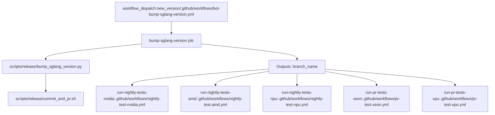
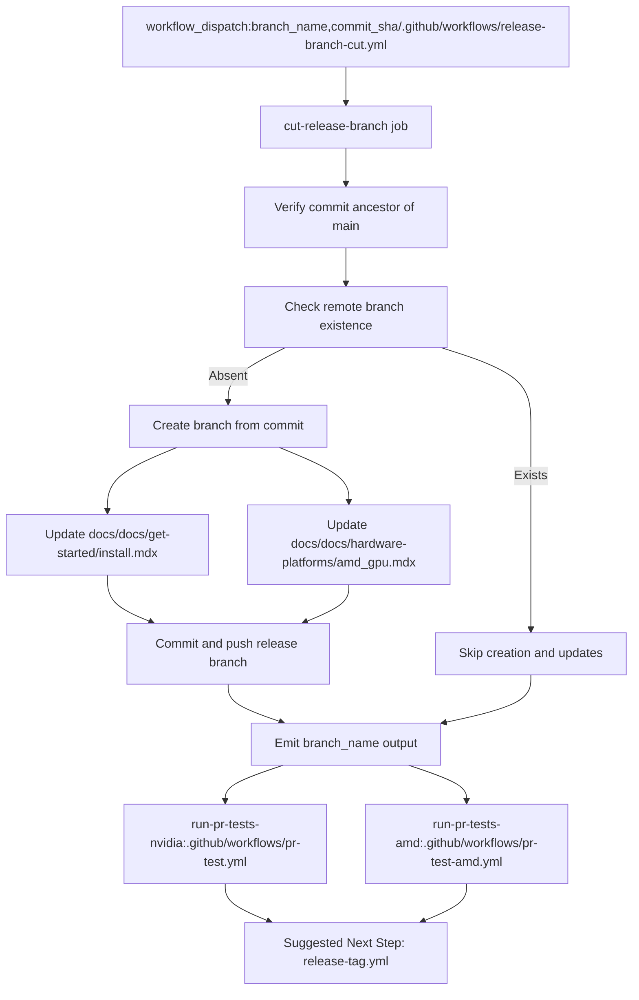

<!-- source: DeepWiki mcp.deepwiki.com · repo sgl-project/sglang · page 16.3 Version Management · fetched 2026-10-30 -->

# Version Management

Relevant source files

The following files were used as context for generating this wiki page:

- [.github/workflows/amd-aiter-scout.yml](.github/workflows/amd-aiter-scout.yml)
- [.github/workflows/amd-ci-job-monitor.yml](.github/workflows/amd-ci-job-monitor.yml)
- [.github/workflows/bot-bump-sglang-version.yml](.github/workflows/bot-bump-sglang-version.yml)
- [.github/workflows/ci-failure-monitor.yml](.github/workflows/ci-failure-monitor.yml)
- [.github/workflows/ci-lark-notify.yml](.github/workflows/ci-lark-notify.yml)
- [.github/workflows/pr-states.yml](.github/workflows/pr-states.yml)
- [.github/workflows/pr-test-amd-extra.yml](.github/workflows/pr-test-amd-extra.yml)
- [.github/workflows/release-branch-cut.yml](.github/workflows/release-branch-cut.yml)
- [.github/workflows/runner-utilization.yml](.github/workflows/runner-utilization.yml)
- [scripts/ci/utils/query_job_status.py](scripts/ci/utils/query_job_status.py)
- [scripts/ci/utils/runner_utilization_report.py](scripts/ci/utils/runner_utilization_report.py)
- [scripts/ci/utils/test_runner_utilization_report.py](scripts/ci/utils/test_runner_utilization_report.py)
- [scripts/ci_monitor/README.md](scripts/ci_monitor/README.md)
- [scripts/ci_monitor/ci_failures_analysis.py](scripts/ci_monitor/ci_failures_analysis.py)
- [scripts/ci_monitor/lark_notify.py](scripts/ci_monitor/lark_notify.py)

## Purpose and Scope

This page describes the version-management and release-coordination mechanisms implemented in the SGLang repository workflows and utility scripts. Specifically, it covers the manually dispatched SGLang version-bump workflow (`Bot Bump SGLang Version`), release-branch creation (`Release Branch Cut`), documentation-reference update automation, and the downstream platform test workflows coordinated around those lifecycle operations. 

Sources: [`.github/workflows/bot-bump-sglang-version.yml:1-87`](), [`.github/workflows/release-branch-cut.yml:1-176`]()

---

## 1. Version Inputs and Workflow Execution

The version-bump process is managed via the workflow defined in [`.github/workflows/bot-bump-sglang-version.yml`]() [__sgl-project/sglang__]. It is triggered manually via `workflow_dispatch` and requires a `new_version` input string [`.github/workflows/bot-bump-sglang-version.yml:1-9`]().

### Version Input Specification

| Input Parameter | Type | Default / Example | Description |
|---|---|---|---|
| `new_version` | String | `0.5.3`, `0.5.3rc0` [`.github/workflows/bot-bump-sglang-version.yml:6-9`]() | The target SGLang version string to apply across the repository. |

Upon dispatch, the workflow executes the following steps:
1. **Checkout**: Checks out the repository using `actions/checkout@v4` [`.github/workflows/bot-bump-sglang-version.yml:21-25`]().
2. **Setup Python**: Configures Python 3.12 via `actions/setup-python@v5` [`.github/workflows/bot-bump-sglang-version.yml:26-30`]().
3. **Branch Generation**: Configures Git with the `sglang-bot` identity (`sglang-bot@users.noreply.github.com`), generates a unique random suffix using shell utilities, and checks out a new branch named `bot/bump-sglang-version-<new_version>-<RANDOM_SUFFIX>` [`.github/workflows/bot-bump-sglang-version.yml:31-41`]().
4. **Script Invocation**: Executes `scripts/release/bump_sglang_version.py` passing the requested version string [`.github/workflows/bot-bump-sglang-version.yml:42-45`]().
5. **Commit and PR**: Invokes `scripts/release/commit_and_pr.sh` with product name `"SGLang"`, the requested version, and the generated branch name, authenticated via `GH_PAT_FOR_PULL_REQUEST` [`.github/workflows/bot-bump-sglang-version.yml:46-51`]().

Sources: [`.github/workflows/bot-bump-sglang-version.yml:1-51`]()

---

## 2. Automated Version Bump and Test Coordination

Once the version bump branch is successfully created and committed, the workflow automatically fans out to execute a comprehensive suite of nightly and PR platform test pipelines to validate the version state prior to merging or tagging [`.github/workflows/bot-bump-sglang-version.yml:52-87`]().

**Diagram: Version Bump Workflow Mapped to Code Entities**

Sources: [`.github/workflows/bot-bump-sglang-version.yml:1-87`]()

### Downstream Test Matrix Handoff

| Downstream Job | Target Reusable Workflow | Passed Ref | Platform-Specific Inputs |
|---|---|---|---|
| `run-nightly-tests-nvidia` | [`.github/workflows/nightly-test-nvidia.yml`]() | Generated `branch_name` [`.github/workflows/bot-bump-sglang-version.yml:52-57`]() | None |
| `run-nightly-tests-amd` | [`.github/workflows/nightly-test-amd.yml`]() | Generated `branch_name` [`.github/workflows/bot-bump-sglang-version.yml:59-65`]() | `rocm_version: rocm10` |
| `run-nightly-tests-npu` | [`.github/workflows/nightly-test-npu.yml`]() | Generated `branch_name` [`.github/workflows/bot-bump-sglang-version.yml:67-72`]() | None |
| `run-pr-tests-xeon` | [`.github/workflows/pr-test-xeon.yml`]() | Generated `branch_name` [`.github/workflows/bot-bump-sglang-version.yml:74-79`]() | None |
| `run-pr-tests-xpu` | [`.github/workflows/pr-test-xpu.yml`]() | Generated `branch_name` [`.github/workflows/bot-bump-sglang-version.yml:81-87`]() | None |

Sources: [`.github/workflows/bot-bump-sglang-version.yml:52-87`]()

---

## 3. Release Branch Cutting

Release branches are cut via the `Release Branch Cut` workflow (`.github/workflows/release-branch-cut.yml`) [__sgl-project/sglang__]. This workflow is restricted to the canonical repository (`sgl-project/sglang`) under the `prod` GitHub environment [`.github/workflows/release-branch-cut.yml:22-26`]() and requires manual dispatch [`.github/workflows/release-branch-cut.yml:4-14`]().

### Inputs and Validation Logic

1. **`branch_name`**: Required string (e.g., `release/v0.5.7`). Must start with `release/` per convention; otherwise, a warning is emitted [`.github/workflows/release-branch-cut.yml:6-9](), [`.github/workflows/release-branch-cut.yml:38-52`]()].
2. **`commit_sha`**: Optional commit SHA from `main`. If omitted, the workflow defaults to the head commit of `main` (`git rev-parse HEAD`) [`.github/workflows/release-branch-cut.yml:10-14](), [`.github/workflows/release-branch-cut.yml:57-63`]()].
3. **Ancestor Verification**: The workflow verifies that the target commit exists via `git cat-file -t` and is an ancestor of `main` via `git merge-base --is-ancestor` [`.github/workflows/release-branch-cut.yml:64-75`]().

Sources: [`.github/workflows/release-branch-cut.yml:1-78`]()

---

## 4. Documentation Updates and Test Handoff

When cutting a new release branch, the workflow checks if the branch already exists remotely (`git ls-remote --heads origin`) [`.github/workflows/release-branch-cut.yml:80-91`]()]. If it does not exist, it performs the following automated maintenance:

1. **Branch Creation**: Checks out a new branch from the validated commit using the `sglang-bot` Git configuration [`.github/workflows/release-branch-cut.yml:93-105`]().
2. **Documentation Version Reference Updates**: Extracts the version string from the branch name (e.g., `release/v0.5.8` $\rightarrow$ `v0.5.8`) and uses `sed` to update Git clone instructions in documentation files [`.github/workflows/release-branch-cut.yml:107-117]()`:
   - `docs/docs/get-started/install.mdx`
   - `docs/docs/hardware-platforms/amd_gpu.mdx`
3. **Commit & Push**: Commits changes with message `docs: update version references to <VERSION>` and pushes the branch to `origin` [`.github/workflows/release-branch-cut.yml:119-133`]().

**Diagram: Release Branch Cutting and Test Coordination Mapped to Code Entities**

Sources: [`.github/workflows/release-branch-cut.yml:1-176`]()

### Downstream Release Verification

Once the release branch is cut or verified, the workflow dispatches full test suites against the release branch:
- **NVIDIA Tests**: Invokes [`.github/workflows/pr-test.yml`]() via `run-pr-tests-nvidia`, setting `git_ref` to the release branch, `run_all_tests: true`, and `skip_pr_test_health_check: true` [`.github/workflows/release-branch-cut.yml:166-174`]().
- **AMD Tests**: Invokes [`.github/workflows/pr-test-amd.yml`]() via `run-pr-tests-amd`, setting `git_ref` to the release branch and `run_all_tests: true` [`.github/workflows/release-branch-cut.yml:175-176`]().

Sources: [`.github/workflows/release-branch-cut.yml:140-176`]()

---

## 5. Release Coordination and Operational Boundaries

The version management system separates routine development bumps from formal release branch cutting:

| Workflow File | Purpose | Key Automation Scripts / Actions |
|---|---|---|
| [`.github/workflows/bot-bump-sglang-version.yml`]() | Automated dependency and package version increments across nightly channels. | `scripts/release/bump_sglang_version.py`, `scripts/release/commit_and_pr.sh` [`.github/workflows/bot-bump-sglang-version.yml:42-50`]() |
| [`.github/workflows/release-branch-cut.yml`]() | Production release branch cutting, documentation synchronization, and gate testing. | `git` ancestry validation, `sed` documentation updates, `pr-test.yml` / `pr-test-amd.yml` dispatches [`.github/workflows/release-branch-cut.yml:54-176`]() |

Sources: [`.github/workflows/bot-bump-sglang-version.yml:1-87`](), [`.github/workflows/release-branch-cut.yml:1-176`]()

---

