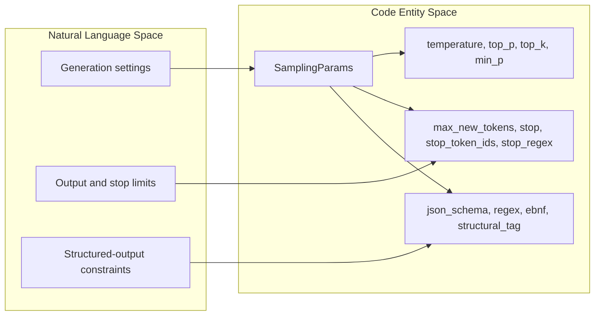
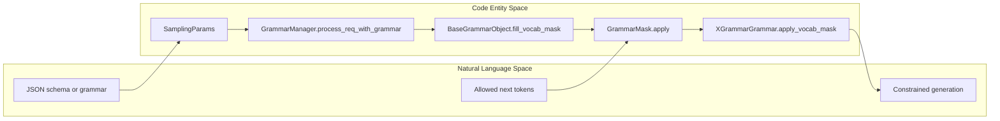

<!-- source: DeepWiki mcp.deepwiki.com · repo sgl-project/sglang · page 17 Output Generation and Sampling · fetched 2026-10-30 -->

# Output Generation and Sampling

Relevant source files

The following files were used as context for generating this wiki page:

- [python/sglang/srt/layers/sampler.py](python/sglang/srt/layers/sampler.py)
- [python/sglang/srt/sampling/custom_logit_processor.py](python/sglang/srt/sampling/custom_logit_processor.py)
- [python/sglang/srt/sampling/sampling_batch_info.py](python/sglang/srt/sampling/sampling_batch_info.py)
- [test/registered/kernels/ops/sampling/test_apply_custom_logit_processor.py](test/registered/kernels/ops/sampling/test_apply_custom_logit_processor.py)
- [test/registered/sampling/test_sampling_mask.py](test/registered/sampling/test_sampling_mask.py)
- [test/registered/unit/managers/test_sampling_mask_validation.py](test/registered/unit/managers/test_sampling_mask_validation.py)
- [test/registered/unit/sampling/test_ascend_sampler.py](test/registered/unit/sampling/test_ascend_sampler.py)
- [test/registered/unit/sampling/test_custom_logit_processor.py](test/registered/unit/sampling/test_custom_logit_processor.py)
- [test/registered/unit/sampling/test_sampling_batch_info.py](test/registered/unit/sampling/test_sampling_batch_info.py)

## Purpose and Scope

This page introduces how SGLang represents generation settings and how those settings relate to token selection, output limits, stopping behavior, and constrained decoding. It is a parent-page overview: detailed parameter semantics, logits processing, algorithms, and penalties are covered in the child pages. The request-level `SamplingParams` definition includes distribution settings, stop conditions, penalties, output limits, grammar constraints, and related options [python/sglang/srt/sampling/sampling_params.py:117-165]().

Sources: [python/sglang/srt/sampling/sampling_params.py:117-165]()

---

## Overview

At a high level, generation settings travel with a request and guide how the runtime selects and stops output tokens. `SamplingParams` carries both sampling-distribution controls—such as `temperature`, `top_p`, `top_k`, and `min_p`—and controls for output length, stop conditions, penalties, and structured constraints [python/sglang/srt/sampling/sampling_params.py:125-158](). Runtime batch metadata is organized via `SamplingBatchInfo` [python/sglang/srt/sampling/sampling_batch_info.py:50-95](), and output token selection is executed by the `Sampler` module [python/sglang/srt/layers/sampler.py:116-146](). This page does not specify the complete runtime execution order or individual sampling kernels; see [Logits Processing Pipeline](#17.2) and [Sampling Algorithms](#17.3) for those details.

Structured generation settings such as `json_schema`, `regex`, `ebnf`, and `structural_tag` connect request configuration to grammar-guided decoding. `GrammarManager` checks for these settings and obtains a grammar backend when one is configured [python/sglang/srt/constrained/grammar_manager.py:30-44](), [python/sglang/srt/constrained/grammar_manager.py:145-171](). The grammar backend represents token constraints using vocabulary masks that can be applied to logits [python/sglang/srt/constrained/base_grammar_backend.py:79-106](), [python/sglang/srt/constrained/xgrammar_backend.py:118-145]().

Sources: [python/sglang/srt/sampling/sampling_params.py:125-158](), [python/sglang/srt/sampling/sampling_batch_info.py:50-95](), [python/sglang/srt/layers/sampler.py:116-146](), [python/sglang/srt/constrained/grammar_manager.py:30-44](), [python/sglang/srt/constrained/grammar_manager.py:145-171](), [python/sglang/srt/constrained/base_grammar_backend.py:79-106](), [python/sglang/srt/constrained/xgrammar_backend.py:118-145]()

### Request Settings to Sampling Entities

This diagram maps request-facing concepts to the code entities that represent them. It is an orientation map, not a complete execution-order trace.

Sources: [python/sglang/srt/sampling/sampling_params.py:117-165]()

### Structured Constraints to Runtime Entities

The diagram associates grammar-guided output concepts with their implementation entities. `GrammarManager` selects a grammar key from the configured constraint fields, while grammar objects expose vocabulary-mask operations used to constrain logits [python/sglang/srt/constrained/grammar_manager.py:145-171](), [python/sglang/srt/constrained/base_grammar_backend.py:79-106]().

Sources: [python/sglang/srt/sampling/sampling_params.py:117-158](), [python/sglang/srt/constrained/grammar_manager.py:145-171](), [python/sglang/srt/constrained/base_grammar_backend.py:79-106](), [python/sglang/srt/constrained/base_grammar_backend.py:148-158](), [python/sglang/srt/constrained/xgrammar_backend.py:118-145]()

---

## Subtopic Overviews and Links

### 17.1 Sampling Parameters and Configuration

`SamplingParams` is the request-level structure for controls including `temperature`, `top_p`, `top_k`, `min_p`, `max_new_tokens`, stop criteria, `n`, and `beam_width`. It also carries penalty fields, grammar constraint fields, logit bias, a sampling seed, custom parameters, and watermark configuration [python/sglang/srt/sampling/sampling_params.py:117-165](). For parameter normalization, validation, and configuration details, see [Sampling Parameters and Configuration](#17.1).

Sources: [python/sglang/srt/sampling/sampling_params.py:117-165]()

### 17.2 Logits Processing Pipeline

Logits processing is the bridge between model scores and the request’s sampling and constraint settings. The `Sampler` class coordinates custom logit processors and sanitization via methods like `_preprocess_logits` [python/sglang/srt/layers/sampler.py:139-146](), while `CustomLogitProcessor` provides abstract interfaces for custom tensor modifications [python/sglang/srt/sampling/custom_logit_processor.py:24-38](). Grammar objects provide vocabulary-mask interfaces, and `XGrammarGrammar` applies a filled mask to logits [python/sglang/srt/constrained/base_grammar_backend.py:79-106](), [python/sglang/srt/constrained/base_grammar_backend.py:148-158](), [python/sglang/srt/constrained/xgrammar_backend.py:118-145](). For the processing stages, custom processors, and logprob computation, see [Logits Processing Pipeline](#17.2).

Sources: [python/sglang/srt/layers/sampler.py:139-146](), [python/sglang/srt/sampling/custom_logit_processor.py:24-38](), [python/sglang/srt/constrained/base_grammar_backend.py:79-106](), [python/sglang/srt/constrained/base_grammar_backend.py:148-158](), [python/sglang/srt/constrained/xgrammar_backend.py:118-145]()

### 17.3 Sampling Algorithms

The request structure exposes distribution controls such as temperature, top-p, top-k, and min-p [python/sglang/srt/sampling/sampling_params.py:134-138](), which are orchestrated batched via `SamplingBatchInfo` [python/sglang/srt/sampling/sampling_batch_info.py:50-95]() and executed in the `Sampler` module [python/sglang/srt/layers/sampler.py:116-146](). Their algorithmic behavior—including greedy decoding, filtering, and fused implementations—is intentionally left to the child page. For details, see [Sampling Algorithms](#17.3).

Sources: [python/sglang/srt/sampling/sampling_params.py:134-138](), [python/sglang/srt/sampling/sampling_batch_info.py:50-95](), [python/sglang/srt/layers/sampler.py:116-146]()

### 17.4 Penalties and Constraints

`SamplingParams` includes frequency, presence, and repetition penalties, as well as `min_new_tokens` and stop-related fields [python/sglang/srt/sampling/sampling_params.py:125-141](). Grammar constraints are represented separately in the same request structure and are handled through `GrammarManager` and grammar backends [python/sglang/srt/sampling/sampling_params.py:146-149](), [python/sglang/srt/constrained/grammar_manager.py:145-171](). For penalty behavior and length constraints, see [Penalties and Constraints](#17.4).

Sources: [python/sglang/srt/sampling/sampling_params.py:125-149](), [python/sglang/srt/constrained/grammar_manager.py:145-171]()

---

