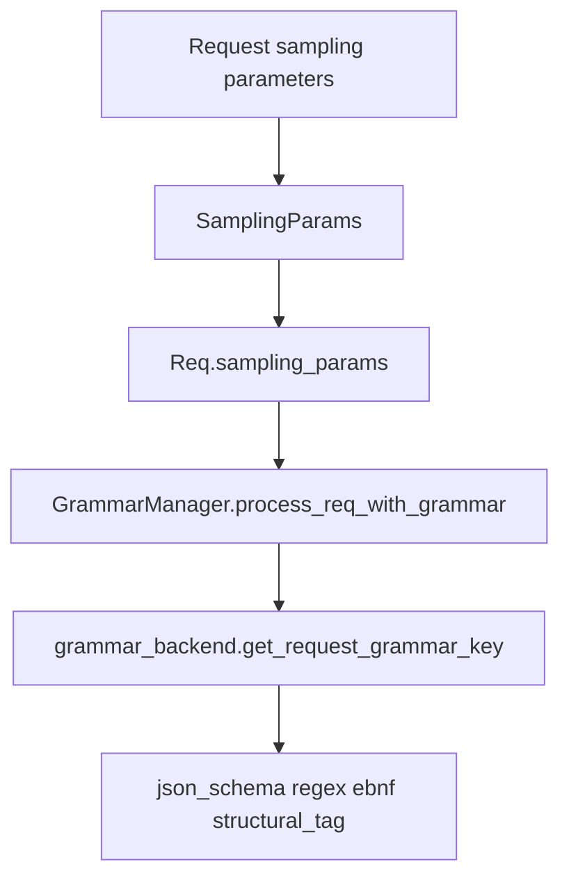
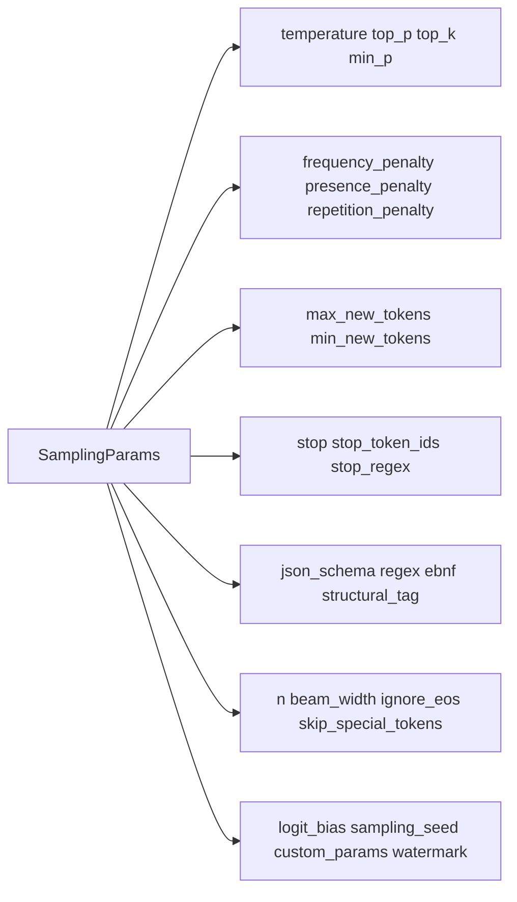
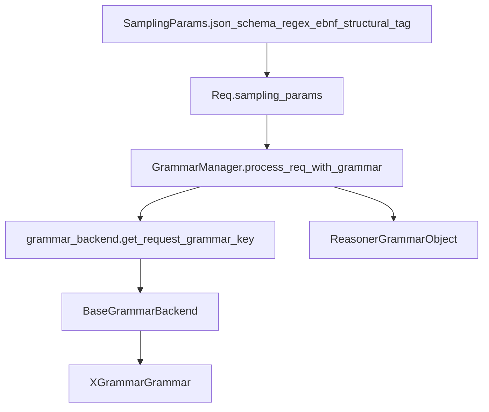

<!-- source: DeepWiki mcp.deepwiki.com · repo sgl-project/sglang · page 17.1 Sampling Parameters and Configuration · fetched 2026-10-30 -->

# Sampling Parameters and Configuration

Relevant source files

The following files were used as context for generating this wiki page:

- [python/sglang/srt/constrained/base_grammar_backend.py](python/sglang/srt/constrained/base_grammar_backend.py)
- [python/sglang/srt/constrained/grammar_manager.py](python/sglang/srt/constrained/grammar_manager.py)
- [python/sglang/srt/constrained/reasoner_grammar_backend.py](python/sglang/srt/constrained/reasoner_grammar_backend.py)
- [python/sglang/srt/sampling/sampling_params.py](python/sglang/srt/sampling/sampling_params.py)
- [rust/sglang-server/src/api_server.rs](rust/sglang-server/src/api_server.rs)
- [rust/sglang-server/src/api_server/disaggregation.rs](rust/sglang-server/src/api_server/disaggregation.rs)
- [rust/sglang-server/src/api_server/disaggregation/bootstrap.rs](rust/sglang-server/src/api_server/disaggregation/bootstrap.rs)
- [rust/sglang-server/src/message/sampling.rs](rust/sglang-server/src/message/sampling.rs)
- [rust/sglang-server/src/utils.rs](rust/sglang-server/src/utils.rs)
- [rust/sglang-server/src/utils/environ.rs](rust/sglang-server/src/utils/environ.rs)
- [rust/sglang-server/src/utils/regex.rs](rust/sglang-server/src/utils/regex.rs)
- [rust/sglang-server/src/utils/response.rs](rust/sglang-server/src/utils/response.rs)
- [rust/sglang-server/src/utils/serialize.rs](rust/sglang-server/src/utils/serialize.rs)
- [rust/sglang-server/src/utils/sock.rs](rust/sglang-server/src/utils/sock.rs)
- [test/registered/e2e/xpu/test_dspark_intel_xpu.py](test/registered/e2e/xpu/test_dspark_intel_xpu.py)
- [test/registered/unit/constrained/test_base_grammar_backend.py](test/registered/unit/constrained/test_base_grammar_backend.py)
- [test/registered/unit/constrained/test_grammar_manager.py](test/registered/unit/constrained/test_grammar_manager.py)
- [test/registered/unit/constrained/test_reasoner_grammar_backend.py](test/registered/unit/constrained/test_reasoner_grammar_backend.py)
- [test/registered/unit/managers/test_io_struct.py](test/registered/unit/managers/test_io_struct.py)
- [test/registered/unit/managers/test_stop_str_speculative.py](test/registered/unit/managers/test_stop_str_speculative.py)
- [test/registered/unit/managers/test_trim_matched_stop.py](test/registered/unit/managers/test_trim_matched_stop.py)
- [test/registered/unit/sampling/test_sampling_params.py](test/registered/unit/sampling/test_sampling_params.py)

## Purpose and Scope

This page documents the request-level `SamplingParams` schema, the visible initialization behavior, parameter validation evidence, and how grammar-related settings connect to constrained decoding. It focuses on configuration and transport; sampling algorithms and logits processing are covered on their respective pages. [python/sglang/srt/sampling/sampling_params.py:117-183]()

Sources: [python/sglang/srt/sampling/sampling_params.py:117-183]()

---

## Overview: Sampling Parameter Flow

`SamplingParams` is a typed request object. Its fields cover token selection, output limits, stopping, penalties, structured-output constraints, and related request options. The request schema also includes internal fields used to hold stop-condition aliases and normalization state. [python/sglang/srt/sampling/sampling_params.py:117-166]()

The available code shows a grammar-specific path from request sampling parameters to `GrammarManager`: when a request has a non-`None` grammar constraint, the manager selects a grammar key and uses its configured backend. The diagram shows this path and the typed parameter object; it does not imply an unshown path to sampler kernels. [python/sglang/srt/constrained/grammar_manager.py:148-172]()

**Diagram: Sampling Parameters and Grammar Request Path**

Sources: [python/sglang/srt/sampling/sampling_params.py:117-166](), [python/sglang/srt/constrained/grammar_manager.py:148-172]()

### Code Entities at a Glance

| System concept | Code entity | Role |
|---|---|---|
| Sampling configuration | `SamplingParams` | Typed request-level sampling and generation settings. [python/sglang/srt/sampling/sampling_params.py:117-166]() |
| Scheduler-side grammar coordination | `GrammarManager` | Creates a grammar backend when tokenizer initialization is enabled and processes requests with grammar constraints. [python/sglang/srt/constrained/grammar_manager.py:31-44](), [python/sglang/srt/constrained/grammar_manager.py:148-172]() |
| Grammar implementation interface | `BaseGrammarBackend` | Base class for grammar-guided decoding backends. [python/sglang/srt/constrained/base_grammar_backend.py:201-213]() |
| XGrammar request grammar | `XGrammarGrammar` | Holds a matcher and applies a vocabulary mask to logits. [python/sglang/srt/constrained/xgrammar_backend.py:78-95](), [python/sglang/srt/constrained/xgrammar_backend.py:118-147]() |
| Reasoning-aware grammar wrapper | `ReasonerGrammarObject` | Wraps grammar behavior and tracks a reasoning terminator sequence. [python/sglang/srt/constrained/reasoner_grammar_backend.py:43-75](), [python/sglang/srt/constrained/reasoner_grammar_backend.py:140-164]() |

Sources: [python/sglang/srt/sampling/sampling_params.py:117-166](), [python/sglang/srt/constrained/grammar_manager.py:31-44](), [python/sglang/srt/constrained/grammar_manager.py:148-172](), [python/sglang/srt/constrained/base_grammar_backend.py:201-213](), [python/sglang/srt/constrained/xgrammar_backend.py:78-95](), [python/sglang/srt/constrained/reasoner_grammar_backend.py:43-75]()

---

## SamplingParams Class Structure

`SamplingParams` is defined as a `msgspec.Struct` with keyword-only construction and an array-like representation. Its fields are divided in the source into API parameters and internal fields populated during initialization or normalization. [python/sglang/srt/sampling/sampling_params.py:117-166]()

### Parameter Categories

**Diagram: SamplingParams Field Groups**

Sources: [python/sglang/srt/sampling/sampling_params.py:148-182]()

### Key Parameters

| Parameter | Type | Default | Meaning and notes |
|---|---|---:|---|
| `max_new_tokens` | `Optional[int]` | `128` | Output token limit; `None` is permitted by the type. [python/sglang/srt/sampling/sampling_params.py:149]() |
| `min_new_tokens` | `int` | `0` | Minimum generated-token setting. [python/sglang/srt/sampling/sampling_params.py:164]() |
| `temperature` | `float` | `1.0` | Temperature setting. Values below the initialization epsilon are converted to a greedy configuration, as described below. [python/sglang/srt/sampling/sampling_params.py:42-43](), [python/sglang/srt/sampling/sampling_params.py:157](), [test/registered/unit/sampling/test_sampling_params.py:31-49]() |
| `top_p` | `float` | `1.0` | Nucleus-sampling threshold field. [python/sglang/srt/sampling/sampling_params.py:158]() |
| `top_k` | `int` | `TOP_K_ALL` (`1 << 30`) | Top-k setting; `-1` is tested as an alias for the whole-vocabulary sentinel. [python/sglang/srt/sampling/sampling_params.py:42-43](), [python/sglang/srt/sampling/sampling_params.py:159](), [test/registered/unit/sampling/test_sampling_params.py:56-64]() |
| `min_p` | `float` | `0.0` | Minimum-probability sampling setting. [python/sglang/srt/sampling/sampling_params.py:160]() |
| `frequency_penalty` | `float` | `0.0` | Frequency penalty setting. [python/sglang/srt/sampling/sampling_params.py:161]() |
| `presence_penalty` | `float` | `0.0` | Presence penalty setting. [python/sglang/srt/sampling/sampling_params.py:162]() |
| `repetition_penalty` | `float` | `1.0` | Repetition penalty setting. [python/sglang/srt/sampling/sampling_params.py:163]() |
| `stop` | `Optional[Union[str, List[str]]]` | `None` | API alias copied to `stop_strs` and cleared during normalization, according to the field comment. [python/sglang/srt/sampling/sampling_params.py:150-152]() |
| `stop_token_ids` | `Optional[Set[int]]` | `None` | Token-ID stop condition. Initialization filters `None` values and converts a nonempty input to a set. [python/sglang/srt/sampling/sampling_params.py:153]() |
| `stop_regex` | `Optional[Union[str, List[str]]]` | `None` | API alias copied to `stop_regex_strs` and cleared during normalization, according to the field comment. [python/sglang/srt/sampling/sampling_params.py:154-156]() |
| `n` | `int` | `1` | Number of requested sequences. With `beam_width > 1`, the field comment states that `n` means returned sequences and must not exceed the beam width. [python/sglang/srt/sampling/sampling_params.py:165-168]() |
| `beam_width` | `Optional[int]` | `None` | A value greater than one turns the request into beam search, according to the field comment. [python/sglang/srt/sampling/sampling_params.py:168]() |
| `json_schema`, `regex`, `ebnf`, `structural_tag` | `Optional[str]` | `None` | Structured-output constraint fields. Empty strings are treated as unset by initialization tests. [python/sglang/srt/sampling/sampling_params.py:169-172](), [test/registered/unit/sampling/test_sampling_params.py:82-90]() |
| `ignore_eos` | `bool` | `False` | EOS-handling option. [python/sglang/srt/sampling/sampling_params.py:173]() |
| `skip_special_tokens` | `bool` | `True` | Special-token output option. [python/sglang/srt/sampling/sampling_params.py:174]() |
| `spaces_between_special_tokens` | `bool` | `True` | Special-token spacing option. [python/sglang/srt/sampling/sampling_params.py:175]() |
| `no_stop_trim` | `bool` | `False` | Stop-output trimming option. [python/sglang/srt/sampling/sampling_params.py:176]() |
| `stream_interval` | `Optional[int]` | `None` | Streaming interval setting. [python/sglang/srt/sampling/sampling_params.py:177]() |
| `logit_bias` | `Optional[Dict[str, float]]` | `None` | Logit-bias mapping. [python/sglang/srt/sampling/sampling_params.py:178]() |
| `sampling_seed` | `Optional[int]` | `None` | Sampling seed setting. [python/sglang/srt/sampling/sampling_params.py:179]() |
| `custom_params` | `Optional[Dict[str, CustomParamValue]]` | `None` | JSON-safe extension data intended to survive msgpack IPC without a pickle wrapper. [python/sglang/srt/sampling/sampling_params.py:33-40](), [python/sglang/srt/sampling/sampling_params.py:180]() |
| `watermark` | `Optional[WatermarkRequestConfig]` | `None` | Optional watermark configuration. [python/sglang/srt/sampling/sampling_params.py:22-25](), [python/sglang/srt/sampling/sampling_params.py:181]() |

Sources: [python/sglang/srt/sampling/sampling_params.py:22-25](), [python/sglang/srt/sampling/sampling_params.py:33-43](), [python/sglang/srt/sampling/sampling_params.py:149-182](), [test/registered/unit/sampling/test_sampling_params.py:31-90]()

---

## Core Sampling Parameters and Initialization Logic

The initialization tests document these specific conversions:

- **Near-zero temperature:** A temperature strictly less than `_SAMPLING_EPS` (`1e-6`) is converted to `top_k = 1` and `temperature = 1.0`. A value exactly equal to `1e-6` does not trigger that conversion. [python/sglang/srt/sampling/sampling_params.py:42-43](), [test/registered/unit/sampling/test_sampling_params.py:31-49]()
- **Top-k sentinel:** `top_k = -1` becomes `TOP_K_ALL`; an explicit positive top-k value is preserved. [python/sglang/srt/sampling/sampling_params.py:42-43](), [test/registered/unit/sampling/test_sampling_params.py:56-64]()
- **Stop token IDs:** A nonempty input is converted to a set of integer values, filtering `None`; an empty or absent input becomes `None`. [python/sglang/srt/sampling/sampling_params.py:153](), [test/registered/unit/sampling/test_sampling_params.py:66-80]()
- **Empty grammar strings:** Tests verify that empty values for `json_schema`, `regex`, `ebnf`, and `structural_tag` become `None`. [test/registered/unit/sampling/test_sampling_params.py:82-90]()

The tests also show that negative temperature is retained at construction and rejected by `verify()`; they separately check that NaN and infinity are rejected. For `top_p`, the tests establish that zero, negative values, and values above one are rejected, while `1.0` and a small positive value are valid. [test/registered/unit/sampling/test_sampling_params.py:51-54](), [test/registered/unit/sampling/test_sampling_params.py:135-175]()

Sources: [python/sglang/srt/sampling/sampling_params.py:42-43](), [test/registered/unit/sampling/test_sampling_params.py:31-90](), [test/registered/unit/sampling/test_sampling_params.py:135-175]()

---

## Structured Output Configuration and Grammar Management

`json_schema`, `regex`, `ebnf`, and `structural_tag` are request fields used by `GrammarManager.process_req_with_grammar()`. The manager checks whether any of them is non-`None`; if so, it either aborts the request when no grammar backend is configured or selects a grammar key for the specified constraint. [python/sglang/srt/sampling/sampling_params.py:169-172](), [python/sglang/srt/constrained/grammar_manager.py:148-172]()

**Diagram: Grammar Constraint Mapping to Code Entities**

Sources: [python/sglang/srt/sampling/sampling_params.py:169-172](), [python/sglang/srt/constrained/grammar_manager.py:148-172](), [python/sglang/srt/constrained/base_grammar_backend.py:58-109](), [python/sglang/srt/constrained/xgrammar_backend.py:78-95](), [python/sglang/srt/constrained/reasoner_grammar_backend.py:43-75]()

`GrammarManager` creates a grammar backend from scheduler configuration, tokenizer, vocabulary size, EOS token ID, and model reasoning terminator IDs when tokenizer initialization is enabled. If tokenizer initialization is skipped, it sets the backend to `None`. [python/sglang/srt/constrained/grammar_manager.py:31-44]()

`XGrammarGrammar` stores its matcher and compiled grammar context. It fills a vocabulary mask from the matcher and applies that mask to logits using device-specific paths. The base grammar interfaces define corresponding mask operations and token acceptance/rollback hooks. [python/sglang/srt/constrained/xgrammar_backend.py:78-95](), [python/sglang/srt/constrained/xgrammar_backend.py:118-147](), [python/sglang/srt/constrained/base_grammar_backend.py:58-105]()

Sources: [python/sglang/srt/sampling/sampling_params.py:169-172](), [python/sglang/srt/constrained/grammar_manager.py:31-44](), [python/sglang/srt/constrained/grammar_manager.py:148-172](), [python/sglang/srt/constrained/base_grammar_backend.py:58-105](), [python/sglang/srt/constrained/xgrammar_backend.py:78-95](), [python/sglang/srt/constrained/xgrammar_backend.py:118-147]()

### Reasoning End Token IDs and Thinking Budget

The private key `__sglang_reasoning_end_token_ids` transports a request-selected reasoning terminator through `custom_params`. `set_request_reasoning_end_token_ids()` adds a nonempty list of nonnegative integer IDs to that mapping. `get_request_reasoning_end_token_ids()` checks the value’s type, length, nonnegative IDs, optional vocabulary bound, and—when supplied—membership in the allowed sequences. [python/sglang/srt/sampling/sampling_params.py:51-65](), [python/sglang/srt/sampling/sampling_params.py:67-98](), [python/sglang/srt/sampling/sampling_params.py:101-115]()

`GrammarManager._apply_request_reasoning_config()` applies an allowed request-selected terminator to a `ReasonerGrammarObject` and reads an integer `thinking_budget` from `custom_params` to set `max_think_tokens`. [python/sglang/srt/constrained/grammar_manager.py:122-147]()

`ReasonerGrammarObject` tracks the configured end-token sequence and reasoning state. Its `accept_token()` delegates accepted tokens to the wrapped grammar only after the reasoning terminator has moved it into generation state. [python/sglang/srt/constrained/reasoner_grammar_backend.py:43-75](), [python/sglang/srt/constrained/reasoner_grammar_backend.py:104-122](), [python/sglang/srt/constrained/reasoner_grammar_backend.py:140-164]()

Sources: [python/sglang/srt/sampling/sampling_params.py:51-65](), [python/sglang/srt/sampling/sampling_params.py:67-115](), [python/sglang/srt/constrained/grammar_manager.py:122-147](), [python/sglang/srt/constrained/reasoner_grammar_backend.py:43-75](), [python/sglang/srt/constrained/reasoner_grammar_backend.py:104-122](), [python/sglang/srt/constrained/reasoner_grammar_backend.py:140-164]()

---

## Stop Conditions, Custom Parameters, and Serialization

- **Stop strings and regexes:** The public `stop` and `stop_regex` fields are documented as API aliases copied to `stop_strs` and `stop_regex_strs` and cleared during normalization. The parameter module defines limits of 32 stop strings, 256 characters per stop regex, and 32 stop regexes. [python/sglang/srt/sampling/sampling_params.py:42-46](), [python/sglang/srt/sampling/sampling_params.py:150-156](), [python/sglang/srt/sampling/sampling_params.py:184-185]()
- **Stop token IDs:** Initialization filters `None` values, converts the remaining IDs to integers, and stores the result as a set; an empty result is represented as `None`. [python/sglang/srt/sampling/sampling_params.py:153]()
- **Custom parameters:** `CustomParamValue` permits JSON-safe scalar values, lists of scalars, or string-keyed dictionaries of scalars. The source comment states these values must survive msgpack IPC without `PickleWrapper`. [python/sglang/srt/sampling/sampling_params.py:33-40]()
- **Rust representation:** The Rust `SamplingParams` is described as a typed port of the Python class. Its visible declaration uses serde deserialization, rejects unknown fields, and defines sampling defaults including temperature and top-p at `1.0`, top-k at the all-vocabulary sentinel, and min-p and penalties at `0.0`. [rust/sglang-server/src/message/sampling.rs:1-4](), [rust/sglang-server/src/message/sampling.rs:115-120](), [rust/sglang-server/src/message/sampling.rs:136-176]()

Sources: [python/sglang/srt/sampling/sampling_params.py:33-46](), [python/sglang/srt/sampling/sampling_params.py:150-156](), [python/sglang/srt/sampling/sampling_params.py:184-185](), [rust/sglang-server/src/message/sampling.rs:1-4](), [rust/sglang-server/src/message/sampling.rs:115-120](), [rust/sglang-server/src/message/sampling.rs:136-176]()

---

## Summary

`SamplingParams` is the typed request configuration for sampling, output limits, stop conditions, penalties, structured-output constraints, and related generation options. Its initialization normalizes selected inputs, including near-zero temperature, `top_k = -1`, stop token IDs, and empty grammar strings. Tests cover important validation boundaries for temperature and `top_p`. [python/sglang/srt/sampling/sampling_params.py:117-183](), [test/registered/unit/sampling/test_sampling_params.py:31-90](), [test/registered/unit/sampling/test_sampling_params.py:135-175]()

Grammar constraints flow from `SamplingParams` into `GrammarManager`, which dispatches constraint types to its grammar backend. Request-selected reasoning terminators and thinking budgets are conveyed through `custom_params` and applied to reasoning-aware grammar objects. [python/sglang/srt/constrained/grammar_manager.py:122-172](), [python/sglang/srt/sampling/sampling_params.py:51-115]()

Sources: [python/sglang/srt/sampling/sampling_params.py:117-183](), [test/registered/unit/sampling/test_sampling_params.py:31-90](), [test/registered/unit/sampling/test_sampling_params.py:135-175](), [python/sglang/srt/constrained/grammar_manager.py:122-172]()

---

