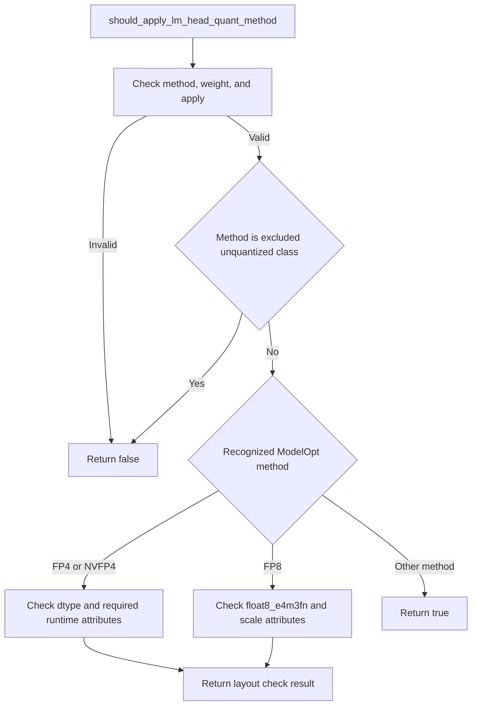
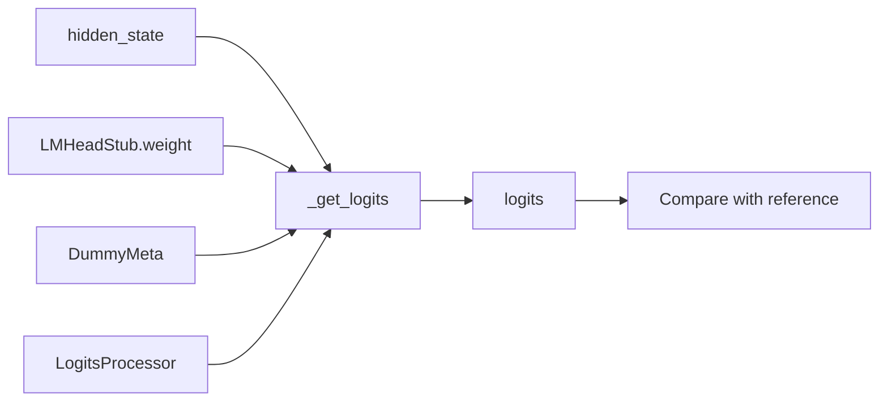
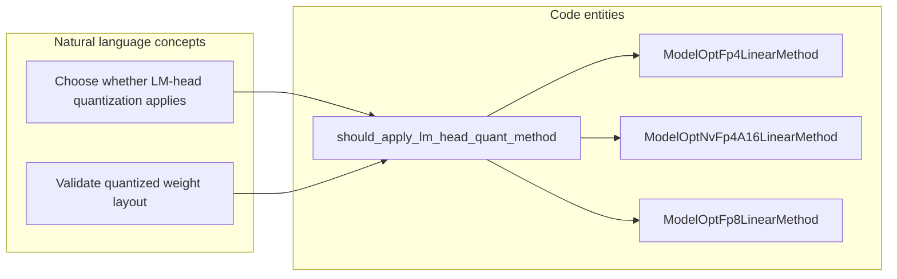
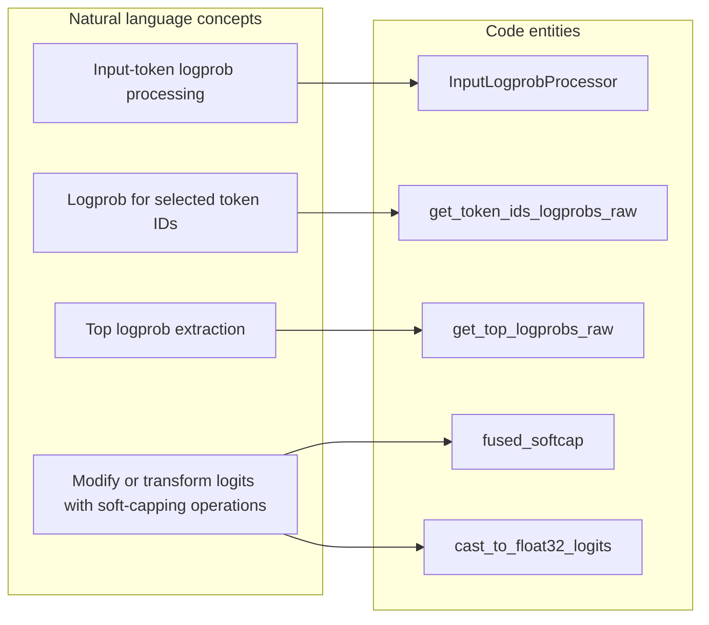

<!-- source: DeepWiki mcp.deepwiki.com · repo sgl-project/sglang · page 17.2 Logits Processing Pipeline · fetched 2026-10-30 -->

# Logits Processing Pipeline

Relevant source files

The following files were used as context for generating this wiki page:

- [python/sglang/kernels/ops/gemm/muse_spark_router_gemv_cutedsl.py](python/sglang/kernels/ops/gemm/muse_spark_router_gemv_cutedsl.py)
- [python/sglang/srt/distributed/device_communicators/shm_broadcast.py](python/sglang/srt/distributed/device_communicators/shm_broadcast.py)
- [python/sglang/srt/hardware_backend/xpu/graph_runner/xpu_graph_runner.py](python/sglang/srt/hardware_backend/xpu/graph_runner/xpu_graph_runner.py)
- [python/sglang/srt/layers/logits_processor.py](python/sglang/srt/layers/logits_processor.py)
- [python/sglang/srt/layers/logprob_processor.py](python/sglang/srt/layers/logprob_processor.py)
- [python/sglang/srt/layers/logsumexp.py](python/sglang/srt/layers/logsumexp.py)
- [python/sglang/srt/model_executor/cuda_graph_config.py](python/sglang/srt/model_executor/cuda_graph_config.py)
- [python/sglang/srt/model_executor/model_runner_components/startup_weight_load.py](python/sglang/srt/model_executor/model_runner_components/startup_weight_load.py)
- [python/sglang/srt/model_executor/runner_backend/base_cuda_graph_backend.py](python/sglang/srt/model_executor/runner_backend/base_cuda_graph_backend.py)
- [python/sglang/srt/model_executor/runner_backend/breakable_cuda_graph_backend.py](python/sglang/srt/model_executor/runner_backend/breakable_cuda_graph_backend.py)
- [python/sglang/srt/model_executor/runner_backend/full_cuda_graph_backend.py](python/sglang/srt/model_executor/runner_backend/full_cuda_graph_backend.py)
- [python/sglang/srt/model_executor/runner_backend/tc_piecewise_cuda_graph_backend.py](python/sglang/srt/model_executor/runner_backend/tc_piecewise_cuda_graph_backend.py)
- [python/sglang/srt/model_executor/runner_backend/utils.py](python/sglang/srt/model_executor/runner_backend/utils.py)
- [python/sglang/srt/model_executor/runner_backend_utils/breakable_cuda_graph/breakable_cuda_graph.py](python/sglang/srt/model_executor/runner_backend_utils/breakable_cuda_graph/breakable_cuda_graph.py)
- [python/sglang/srt/model_executor/runner_backend_utils/breakable_cuda_graph/context.py](python/sglang/srt/model_executor/runner_backend_utils/breakable_cuda_graph/context.py)
- [python/sglang/srt/model_executor/runner_backend_utils/breakable_cuda_graph/cuda_utils.py](python/sglang/srt/model_executor/runner_backend_utils/breakable_cuda_graph/cuda_utils.py)
- [python/sglang/srt/model_executor/runner_utils/pool.py](python/sglang/srt/model_executor/runner_utils/pool.py)
- [python/sglang/srt/models/muse_spark.py](python/sglang/srt/models/muse_spark.py)
- [python/sglang/srt/utils/stale_shm_cleanup.py](python/sglang/srt/utils/stale_shm_cleanup.py)
- [test/registered/cuda_graph/full_prefill/test_full_cuda_graph_prefill.py](test/registered/cuda_graph/full_prefill/test_full_cuda_graph_prefill.py)
- [test/registered/kernels/ops/gemm/test_muse_spark_router_gemv_cutedsl.py](test/registered/kernels/ops/gemm/test_muse_spark_router_gemv_cutedsl.py)
- [test/registered/rl/test_fp32_lm_head.py](test/registered/rl/test_fp32_lm_head.py)
- [test/registered/unit/batch_overlap/test_tbo_cuda_graph_num_token_device.py](test/registered/unit/batch_overlap/test_tbo_cuda_graph_num_token_device.py)
- [test/registered/unit/batch_overlap/test_tbo_filter_batch_marker.py](test/registered/unit/batch_overlap/test_tbo_filter_batch_marker.py)
- [test/registered/unit/disaggregation/test_register_to_bootstrap.py](test/registered/unit/disaggregation/test_register_to_bootstrap.py)
- [test/registered/unit/layers/test_logprob_chunk_stitching.py](test/registered/unit/layers/test_logprob_chunk_stitching.py)
- [test/registered/unit/layers/test_logprob_fast_input.py](test/registered/unit/layers/test_logprob_fast_input.py)
- [test/registered/unit/layers/test_mamba_prefill_track_metadata.py](test/registered/unit/layers/test_mamba_prefill_track_metadata.py)
- [test/registered/unit/model_executor/model_runner_components/test_startup_weight_load.py](test/registered/unit/model_executor/model_runner_components/test_startup_weight_load.py)
- [test/registered/unit/model_executor/runner/test_decode_cuda_graph_runner.py](test/registered/unit/model_executor/runner/test_decode_cuda_graph_runner.py)
- [test/registered/unit/model_executor/runner_backend/test_backend_resolution.py](test/registered/unit/model_executor/runner_backend/test_backend_resolution.py)
- [test/registered/unit/model_executor/runner_backend/test_full_cuda_graph_backend.py](test/registered/unit/model_executor/runner_backend/test_full_cuda_graph_backend.py)
- [test/registered/unit/model_executor/runner_utils/test_graph_pool_borrow.py](test/registered/unit/model_executor/runner_utils/test_graph_pool_borrow.py)
- [test/registered/unit/model_loader/test_runai_model_streamer_loader.py](test/registered/unit/model_loader/test_runai_model_streamer_loader.py)
- [test/registered/unit/model_loader/test_weight_utils.py](test/registered/unit/model_loader/test_weight_utils.py)
- [test/registered/unit/models/test_deepseek_v4_shared_expert_fusion.py](test/registered/unit/models/test_deepseek_v4_shared_expert_fusion.py)
- [test/registered/utils/test_stale_shm_cleanup.py](test/registered/utils/test_stale_shm_cleanup.py)

## Purpose and Scope

This page describes the visible logits-processing interfaces in the SGLang codebase: the LM-head quantization-method gate, the `LogitsProcessor` entry point exercised by tests, and the logprob helpers imported by that module [python/sglang/srt/layers/logits_processor.py:14-58](), [test/registered/rl/test_fp32_lm_head.py:9-10](). It covers how logits are computed from hidden states, how quantization compatibility is determined for the LM head, how logprobs are computed via `InputLogprobProcessor` and associated utilities, and how logit modifications such as soft-capping are integrated [python/sglang/srt/layers/logits_processor.py:26-57](), [python/sglang/srt/layers/logprob_processor.py:31-76]().

Sources: [python/sglang/srt/layers/logits_processor.py:14-58](), [python/sglang/srt/layers/logprob_processor.py:31-76](), [test/registered/rl/test_fp32_lm_head.py:9-10]()

---

## LogitsProcessor and LM Head

The `logits_processor.py` module imports PyTorch, logit soft-capping operations, `ForwardBatch` and `ForwardMode`, runtime-context accessors, and logprob-processing helpers [python/sglang/srt/layers/logits_processor.py:16-75](). The `LogitsProcessor` class acts as the bridge between model hidden states and the final token probability distribution.

The visible helper `should_apply_lm_head_quant_method(lm_head, quant_method)` decides whether a quantization method’s `apply` method should be used for an LM head [python/sglang/srt/layers/logits_processor.py:83-153](). It returns false if the method is absent, the head has no `weight`, or the method lacks a callable `apply`; it also rejects methods named `UnquantizedEmbeddingMethod`, `UnquantizedLinearMethod`, and `PackWeightMethod` [python/sglang/srt/layers/logits_processor.py:83-153]().

For several ModelOpt methods, the helper additionally checks the weight dtype and required runtime attributes before accepting the method. The checks cover `ModelOptFp4LinearMethod`, `ModelOptNvFp4A16LinearMethod`, and `ModelOptFp8LinearMethod`; other methods that pass the initial checks are accepted by the final default return [python/sglang/srt/layers/logits_processor.py:155-196]().

The `TestLMHeadFP32` test constructs a `LogitsProcessor` with a small configuration object, then calls `_get_logits(hidden_state, head, meta)` [test/registered/rl/test_fp32_lm_head.py:34-59](). It verifies that the resulting logits match a reference and checks which matrix operation and input dtypes were used [test/registered/rl/test_fp32_lm_head.py:61-149]().

| Code entity | Role and behavior |
|---|---|
| `should_apply_lm_head_quant_method` | Applies eligibility checks to an LM-head quantization method. [python/sglang/srt/layers/logits_processor.py:143-196]() |
| `LogitsProcessor` | Manages the logits computation and post-processing pipeline. [test/registered/rl/test_fp32_lm_head.py:42-59]() |
| `_get_logits` | Computes logits given hidden states, an LM-head weight tensor, and metadata. [test/registered/rl/test_fp32_lm_head.py:122-128]() |

Sources: [python/sglang/srt/layers/logits_processor.py:83-196](), [test/registered/rl/test_fp32_lm_head.py:34-59](), [test/registered/rl/test_fp32_lm_head.py:61-149]()

---

## LM-Head Quantization Eligibility

The helper first performs general checks: a usable method must be non-null, the LM head must expose `weight`, and the method must provide callable `apply` [python/sglang/srt/layers/logits_processor.py:143-153](). Unquantized method classes are explicitly excluded [python/sglang/srt/layers/logits_processor.py:143-153]().

ModelOpt methods receive extra layout checks because a shared target LM head can retain a stale draft-model quantization method [python/sglang/srt/layers/logits_processor.py:155-194](). For FP4 and NVFP4 cases, eligibility depends on weight dtype and attributes such as `weight_scale`, `weight_global_scale`, and `workspace`, or alternate FP4 layout attributes [python/sglang/srt/layers/logits_processor.py:155-194](). FP8 eligibility requires `torch.float8_e4m3fn` weights plus `weight_scale` and `input_scale` [python/sglang/srt/layers/logits_processor.py:155-194]().

### Quantization-method decision path

Sources: [python/sglang/srt/layers/logits_processor.py:143-196]()

---

## Logprob Computation

Logprob computation is handled in conjunction with `InputLogprobProcessor`, `LogprobStage`, and raw extraction helpers [python/sglang/srt/layers/logits_processor.py:52-57](), [python/sglang/srt/layers/logprob_processor.py:31-76](). The `LogprobResult` dataclass manages token logprobs, top logprobs values and indices, and specific token ID logprobs for both prefill and decode stages [python/sglang/srt/layers/logprob_processor.py:37-76]().

Functions like `compute_row_log_normalizer` calculate per-row maximums and log-sum-exps in `fp32` to ensure numerical stability during logprob evaluation [python/sglang/srt/layers/logprob_processor.py:78-96](). Top logprobs and token ID logprobs are extracted via `get_top_logprobs_raw` and `get_token_ids_logprobs_raw` [python/sglang/srt/layers/logprob_processor.py:98-183]().

| Entity | Role in Logprob Pipeline |
|---|---|
| `LogprobResult` | Encapsulates token logprobs, top-k values/indices, and target token ID logprobs. [python/sglang/srt/layers/logprob_processor.py:37-76]() |
| `LogprobStage` | Differentiates between `PREFILL` and `DECODE` stages for logprob extraction. [python/sglang/srt/layers/logprob_processor.py:31-35]() |
| `compute_row_log_normalizer` | Computes shift-invariant per-row `(max, logsumexp - max)` in fp32. [python/sglang/srt/layers/logprob_processor.py:78-96]() |
| `get_top_logprobs_raw` | Extracts top-k logprob values and indices across batch rows. [python/sglang/srt/layers/logprob_processor.py:98-130]() |

Sources: [python/sglang/srt/layers/logits_processor.py:52-57](), [python/sglang/srt/layers/logprob_processor.py:31-183]()

---

## Logit Modification and Custom Processors

The logits pipeline supports in-place soft-capping operations (`softcap_inplace_logits` or `fused_softcap`), as well as casting or converting soft-capped logits via functions like `cast_to_float32_logits` and `gathered_softcap_logits` [python/sglang/srt/layers/logits_processor.py:26-36](). These ensure that logits exceeding threshold bounds are smoothly capped before sampling or logprob calculations.

Custom logit processors can be integrated to modify logits according to user-defined constraints, penalties, or custom filtering logic prior to the sampling phase.

### Logits-related symbols visible in the source

| Symbol | Role / Description |
|---|---|
| `softcap_inplace_logits` / `fused_softcap` | Performs in-place logits soft-capping. [python/sglang/srt/layers/logits_processor.py:30-32]() |
| `cast_to_float32_logits` | Casts logits to single-precision float for numerical stability. [python/sglang/srt/layers/logits_processor.py:26-29]() |
| `gathered_softcap_logits` | Applies soft-capping on gathered token logits. [python/sglang/srt/layers/logits_processor.py:26-29]() |
| `softcap_row_argmax` | Computes row-wise argmax with soft-cap awareness. [python/sglang/srt/layers/logits_processor.py:36-36]() |

Sources: [python/sglang/srt/layers/logits_processor.py:26-36]()

---

## Dataflow: Model Output to Tested LM-Head Call

The test demonstrates a narrow path: it creates hidden states and an LM-head stub, constructs `LogitsProcessor`, invokes `_get_logits`, and compares the result with a reference [test/registered/rl/test_fp32_lm_head.py:73-80](), [test/registered/rl/test_fp32_lm_head.py:122-149]().

### Tested LM-head path

Sources: [test/registered/rl/test_fp32_lm_head.py:19-32](), [test/registered/rl/test_fp32_lm_head.py:73-80](), [test/registered/rl/test_fp32_lm_head.py:122-149]()

---

## Natural Language and Code Entity Bridges

The following diagrams map concepts discussed on this page to symbols explicitly present in the source [python/sglang/srt/layers/logits_processor.py:26-57](), [python/sglang/srt/layers/logits_processor.py:143-196](), [test/registered/rl/test_fp32_lm_head.py:42-59]().

### LM-head method eligibility: concept to code

Sources: [python/sglang/srt/layers/logits_processor.py:143-196]()

### Logprob and logits concepts: imported code entities

Sources: [python/sglang/srt/layers/logits_processor.py:26-35](), [python/sglang/srt/layers/logprob_processor.py:52-57]()

---

## Summary of Visible Entities

| Entity | Role supported by evidence | Source |
|---|---|---|
| `LogitsProcessor` | Instantiated by the FP32 LM-head test. [test/registered/rl/test_fp32_lm_head.py:42-59]() | [test/registered/rl/test_fp32_lm_head.py:42-59]() |
| `_get_logits` | Test entry point receiving hidden states, LM head, and metadata. [test/registered/rl/test_fp32_lm_head.py:122-128]() | [test/registered/rl/test_fp32_lm_head.py:122-128]() |
| `should_apply_lm_head_quant_method` | Validates whether a quantization method is eligible for the LM head. [python/sglang/srt/layers/logits_processor.py:143-196]() | [python/sglang/srt/layers/logits_processor.py:143-196]() |
| `InputLogprobProcessor` | Handles input token logprob calculations. [python/sglang/srt/layers/logprob_processor.py:37-76]() | [python/sglang/srt/layers/logits_processor.py:52-57]() |
| `get_token_ids_logprobs_raw` | Extracts logprobs for specific token IDs. [python/sglang/srt/layers/logprob_processor.py:146-183]() | [python/sglang/srt/layers/logits_processor.py:52-57]() |
| `get_top_logprobs_raw` | Extracts top-k logprobs and indices. [python/sglang/srt/layers/logprob_processor.py:98-130]() | [python/sglang/srt/layers/logits_processor.py:52-57]() |

Sources: [python/sglang/srt/layers/logits_processor.py:52-57](), [python/sglang/srt/layers/logits_processor.py:143-196](), [python/sglang/srt/layers/logprob_processor.py:37-183](), [test/registered/rl/test_fp32_lm_head.py:42-59]()

---

## Conclusion

The logits processing pipeline connects model outputs to sampling through normalization, soft-capping, logprob extraction, and quantization-aware LM-head execution [python/sglang/srt/layers/logits_processor.py:26-57](), [python/sglang/srt/layers/logprob_processor.py:78-183](). By employing modular processors and helper utilities, SGLang supports efficient execution across both prefill and decode stages.

Sources: [python/sglang/srt/layers/logits_processor.py:26-57](), [python/sglang/srt/layers/logprob_processor.py:78-183]()

---

