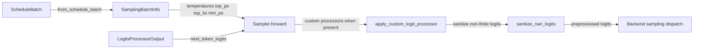
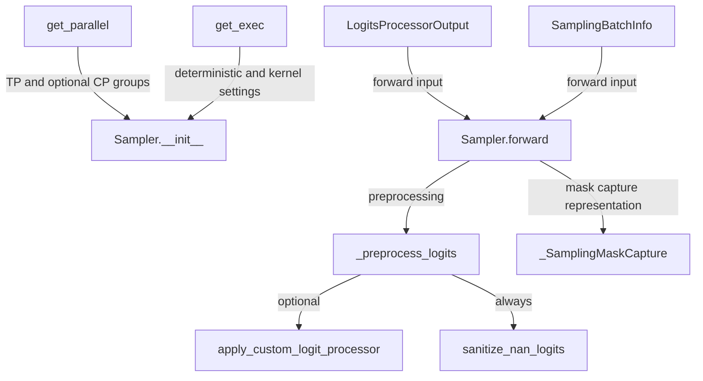
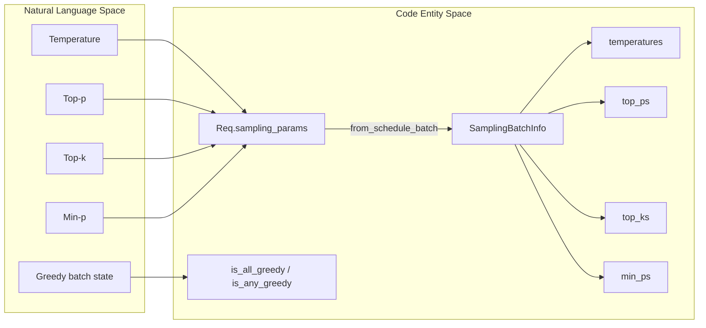
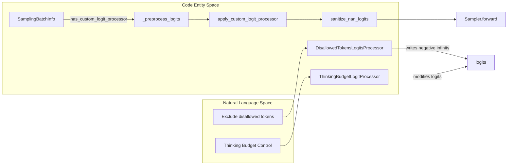

<!-- source: DeepWiki mcp.deepwiki.com · repo sgl-project/sglang · page 17.3 Sampling Algorithms · fetched 2026-10-30 -->

# Sampling Algorithms

Relevant source files

The following files were used as context for generating this wiki page:

- [python/sglang/srt/layers/sampler.py](python/sglang/srt/layers/sampler.py)
- [python/sglang/srt/sampling/custom_logit_processor.py](python/sglang/srt/sampling/custom_logit_processor.py)
- [python/sglang/srt/sampling/sampling_batch_info.py](python/sglang/srt/sampling/sampling_batch_info.py)
- [test/registered/kernels/ops/sampling/test_apply_custom_logit_processor.py](test/registered/kernels/ops/sampling/test_apply_custom_logit_processor.py)
- [test/registered/sampling/test_sampling_mask.py](test/registered/sampling/test_sampling_mask.py)
- [test/registered/unit/managers/test_sampling_mask_validation.py](test/registered/unit/managers/test_sampling_mask_validation.py)
- [test/registered/unit/sampling/test_ascend_sampler.py](test/registered/unit/sampling/test_ascend_sampler.py)
- [test/registered/unit/sampling/test_custom_logit_processor.py](test/registered/unit/sampling/test_custom_logit_processor.py)
- [test/registered/unit/sampling/test_sampling_batch_info.py](test/registered/unit/sampling/test_sampling_batch_info.py)

## Purpose and Scope

This page documents the sampling algorithms and code entities implemented in the SGLang runtime: batched sampling parameters, sampler preprocessing, backend-related imports, greedy decoding, top-k, top-p, min-p, temperature sampling, fused temperature softmax, custom logit processors, and sampling-mask capture mechanisms [python/sglang/srt/layers/sampler.py:1-177](), [python/sglang/srt/sampling/sampling_batch_info.py:50-125]().

Sources: [python/sglang/srt/layers/sampler.py:1-177](), [python/sglang/srt/sampling/sampling_batch_info.py:50-125]()

## Architecture Overview

`SamplingBatchInfo` stores per-request temperature, top-p, top-k, and min-p values as batched tensors, together with flags indicating whether a batch needs particular filters or contains greedy requests. Its `from_schedule_batch()` constructor reads these values from each request’s `sampling_params` and moves the tensors to the batch device [python/sglang/srt/sampling/sampling_batch_info.py:50-70](), [python/sglang/srt/sampling/sampling_batch_info.py:126-156]().

`Sampler` is a PyTorch module. Its `forward()` interface accepts `LogitsProcessorOutput`, `SamplingBatchInfo`, logprob options, token positions, and optional `logprob_logits`. Before the sampling flow, `_preprocess_logits()` applies custom logit processors when present and sanitizes NaN logits [python/sglang/srt/layers/sampler.py:116-146](), [python/sglang/srt/layers/sampler.py:148-173]().

### Diagram: Sampling Inputs and Visible Sampler Preprocessing

Sources: [python/sglang/srt/sampling/sampling_batch_info.py:50-70](), [python/sglang/srt/sampling/sampling_batch_info.py:126-156](), [python/sglang/srt/layers/sampler.py:139-146](), [python/sglang/srt/layers/sampler.py:148-175]()

## The `Sampler` Class and Execution Flow

`Sampler` is defined as an `nn.Module`. During initialization it obtains a tensor-parallel synchronization group; when data-parallel attention is enabled, it instead uses the attention tensor-parallel group and may also configure a context-parallel group. It reads deterministic-inference and sampling-backend settings from runtime context and constructs an `OutputLogprobProcessor` [python/sglang/srt/layers/sampler.py:116-137]().

The `forward()` method obtains `next_token_logits` from `LogitsProcessorOutput`, optionally checks for NaNs, emits sampler tracing, and invokes `_preprocess_logits()` [python/sglang/srt/layers/sampler.py:148-177](), [python/sglang/srt/layers/sampler.py:139-146]().

`_SamplingMaskCapture` is a `NamedTuple` holding compact post-filter weights, optional token IDs, an optional selected weight, and original batch-row indices. `_select_sampling_mask_rows()` returns the original tensor if all rows are selected; otherwise it uses `index_select` to extract the requested rows [python/sglang/srt/layers/sampler.py:98-114]().

### Diagram: Sampler and Runtime Configuration Entities

Sources: [python/sglang/srt/layers/sampler.py:98-146](), [python/sglang/srt/layers/sampler.py:148-175]()

## Sampling Backends

The sampler module imports the `softmax` operation as `sampler_softmax` [python/sglang/srt/layers/sampler.py:9-10](). On CUDA, it imports `top_k_renorm_prob` and `top_p_renorm_prob` from `sgl_kernel`, and defines lazy imports for FlashInfer’s min-p and combined top-k/top-p probability samplers [python/sglang/srt/layers/sampler.py:39-53](). On MUSA or XPU, the corresponding sampling functions are imported from `sgl_kernel` [python/sglang/srt/layers/sampler.py:54-60]().

The module conditionally imports AITER’s `greedy_sample` for HIP when `SGLANG_USE_AITER` is enabled [python/sglang/srt/layers/sampler.py:62-66](). Comments document potential invalid token IDs for all-NaN or all-negative-infinity rows and conditions under which the implementation can disable that kernel [python/sglang/srt/layers/sampler.py:67-74]().

| Backend-related entity | What the codebase establishes |
|---|---|
| `sampler_softmax` | `softmax` imported from `sglang.kernels.ops.sampling`. [python/sglang/srt/layers/sampler.py:9-10]() |
| `top_k_renorm_prob`, `top_p_renorm_prob` | Imported from `sgl_kernel` in the CUDA path. [python/sglang/srt/layers/sampler.py:39-44]() |
| `min_p_sampling_from_probs`, `top_k_top_p_sampling_from_probs` | Lazy FlashInfer imports on CUDA; direct `sgl_kernel` imports for MUSA and XPU. [python/sglang/srt/layers/sampler.py:45-60]() |
| `torch_npu` | Imported when `is_npu()` is true for Ascend NPU backend support. [python/sglang/srt/layers/sampler.py:76-77]() |
| `_aiter_greedy_sample` | Imported conditionally for HIP when AITER use is enabled. [python/sglang/srt/layers/sampler.py:62-66]() |

Sources: [python/sglang/srt/layers/sampler.py:9-10](), [python/sglang/srt/layers/sampler.py:39-77]()

## Sampling Algorithms

### Greedy Decoding

`SamplingBatchInfo` carries `is_all_greedy` and `is_any_greedy` flags indicating whether all requests, or any requests, in the batch use greedy sampling [python/sglang/srt/sampling/sampling_batch_info.py:58-62](). On HIP, AITER's `greedy_sample` kernel can be utilized unless disabled via `SGLANG_DISABLE_AITER_GREEDY_SAMPLE` or device compatibility checks (`is_gfx1250_supported`), which falls back to `torch.argmax` [python/sglang/srt/layers/sampler.py:62-74]().

Sources: [python/sglang/srt/sampling/sampling_batch_info.py:58-62](), [python/sglang/srt/layers/sampler.py:62-74]()

### Top-k, Top-p, and Min-p Sampling

`SamplingBatchInfo` stores `top_ks`, `top_ps`, and `min_ps` as batched tensors, with flags `need_top_k_sampling`, `need_top_p_sampling`, and `need_min_p_sampling` indicating whether the corresponding sampling operation is needed [python/sglang/srt/sampling/sampling_batch_info.py:50-70](), [python/sglang/srt/sampling/sampling_batch_info.py:142-156](). `from_schedule_batch()` constructs these values from each request’s sampling parameters.

The sampler module exposes backend symbols for top-k renormalization, top-p renormalization, min-p sampling from probabilities, and combined top-k/top-p sampling from probabilities [python/sglang/srt/layers/sampler.py:39-60](). Sampling-mask tests verify that min-p filtering retains valid support tokens and correct support logprobs [test/registered/sampling/test_sampling_mask.py:135-158]().

| Algorithm | Batched metadata | Backend-related symbols visible in codebase |
|---|---|---|
| Top-k | `top_ks`, `need_top_k_sampling` [python/sglang/srt/sampling/sampling_batch_info.py:54-68]() | `top_k_renorm_prob`, `top_k_top_p_sampling_from_probs` [python/sglang/srt/layers/sampler.py:39-60]() |
| Top-p | `top_ps`, `need_top_p_sampling` [python/sglang/srt/sampling/sampling_batch_info.py:53-64]() | `top_p_renorm_prob`, `top_k_top_p_sampling_from_probs` [python/sglang/srt/layers/sampler.py:39-60]() |
| Min-p | `min_ps`, `need_min_p_sampling` [python/sglang/srt/sampling/sampling_batch_info.py:55-70]() | `min_p_sampling_from_probs` [python/sglang/srt/layers/sampler.py:45-60]() |

Sources: [python/sglang/srt/sampling/sampling_batch_info.py:50-70](), [python/sglang/srt/sampling/sampling_batch_info.py:142-156](), [python/sglang/srt/layers/sampler.py:39-60](), [test/registered/sampling/test_sampling_mask.py:135-158]()

### Temperature Sampling

`SamplingBatchInfo` represents temperature as a tensor with shape `(-1, 1)`, populated from each request’s `sampling_params.temperature` [python/sglang/srt/sampling/sampling_batch_info.py:50-56](), [python/sglang/srt/sampling/sampling_batch_info.py:126-141]().

Sources: [python/sglang/srt/sampling/sampling_batch_info.py:50-56](), [python/sglang/srt/sampling/sampling_batch_info.py:126-141]()

### Fused Temperature Softmax

`softmax` is imported from `sglang.kernels.ops.sampling` as `sampler_softmax` [python/sglang/srt/layers/sampler.py:9-10](), supporting kernel-level acceleration during probability normalization steps.

Sources: [python/sglang/srt/layers/sampler.py:9-10]()

## Natural Language Space to Code Entity Space Mappings

### Sampling Concepts and Batch Metadata

Sources: [python/sglang/srt/sampling/sampling_batch_info.py:50-70](), [python/sglang/srt/sampling/sampling_batch_info.py:126-156]()

### Logit Constraints and Sampling Preprocessing

Sources: [python/sglang/srt/sampling/custom_logit_processor.py:24-168](), [python/sglang/srt/sampling/sampling_batch_info.py:41-91](), [python/sglang/srt/layers/sampler.py:139-146]()

## Sampling Masks and Test Coverage

Sampling-mask capture is optional: unit tests verify that a sampling call without requested masks returns no capture object and bypasses capture allocations [test/registered/sampling/test_sampling_mask.py:65-78](). `SamplingBatchInfo` tracks rows opting in to sampling-mask capture and support-logprob capture, including device indices and per-row top-k bounds [python/sglang/srt/sampling/sampling_batch_info.py:96-103]().

Sources: [python/sglang/srt/layers/sampler.py:98-114](), [python/sglang/srt/sampling/sampling_batch_info.py:96-103](), [test/registered/sampling/test_sampling_mask.py:65-78]()

---

