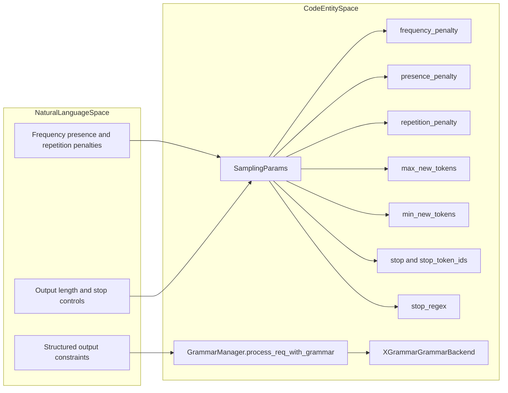
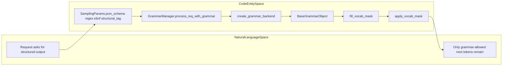

<!-- source: DeepWiki mcp.deepwiki.com · repo sgl-project/sglang · page 17.4 Penalties and Constraints · fetched 2026-10-30 -->

# Penalties and Constraints

Relevant source files

The following files were used as context for generating this wiki page:

- [python/sglang/srt/constrained/base_grammar_backend.py](python/sglang/srt/constrained/base_grammar_backend.py)
- [python/sglang/srt/constrained/grammar_manager.py](python/sglang/srt/constrained/grammar_manager.py)
- [python/sglang/srt/constrained/reasoner_grammar_backend.py](python/sglang/srt/constrained/reasoner_grammar_backend.py)
- [python/sglang/srt/sampling/sampling_params.py](python/sglang/srt/sampling/sampling_params.py)
- [rust/sglang-server/src/api_server.rs](rust/sglang-server/src/api_server.rs)
- [rust/sglang-server/src/api_server/disaggregation.rs](rust/sglang-server/src/api_server/disaggregation.rs)
- [rust/sglang-server/src/api_server/disaggregation/bootstrap.rs](rust/sglang-server/src/api_server/disaggregation/bootstrap.rs)
- [rust/sglang-server/src/message/sampling.rs](rust/sglang-server/src/message/sampling.rs)
- [rust/sglang-server/src/utils.rs](rust/sglang-server/src/utils.rs)
- [rust/sglang-server/src/utils/environ.rs](rust/sglang-server/src/utils/environ.rs)
- [rust/sglang-server/src/utils/regex.rs](rust/sglang-server/src/utils/regex.rs)
- [rust/sglang-server/src/utils/response.rs](rust/sglang-server/src/utils/response.rs)
- [rust/sglang-server/src/utils/serialize.rs](rust/sglang-server/src/utils/serialize.rs)
- [rust/sglang-server/src/utils/sock.rs](rust/sglang-server/src/utils/sock.rs)
- [test/registered/e2e/xpu/test_dspark_intel_xpu.py](test/registered/e2e/xpu/test_dspark_intel_xpu.py)
- [test/registered/unit/constrained/test_base_grammar_backend.py](test/registered/unit/constrained/test_base_grammar_backend.py)
- [test/registered/unit/constrained/test_grammar_manager.py](test/registered/unit/constrained/test_grammar_manager.py)
- [test/registered/unit/constrained/test_reasoner_grammar_backend.py](test/registered/unit/constrained/test_reasoner_grammar_backend.py)
- [test/registered/unit/managers/test_io_struct.py](test/registered/unit/managers/test_io_struct.py)
- [test/registered/unit/managers/test_stop_str_speculative.py](test/registered/unit/managers/test_stop_str_speculative.py)
- [test/registered/unit/managers/test_trim_matched_stop.py](test/registered/unit/managers/test_trim_matched_stop.py)
- [test/registered/unit/sampling/test_sampling_params.py](test/registered/unit/sampling/test_sampling_params.py)

## Purpose and Scope

This page describes the request fields for frequency, presence, and repetition penalties; generation-length and stop controls; and grammar-based constraints. It focuses on the definitions and flows visible in the supplied source excerpts. The excerpts do not include the penalty application path or the complete request-finish implementation, so those details are not inferred here. [python/sglang/srt/sampling/sampling_params.py:117-165]()

Sources: [python/sglang/srt/sampling/sampling_params.py:117-165]()

---

## System Overview

`SamplingParams` defines the request-facing penalty fields `frequency_penalty`, `presence_penalty`, and `repetition_penalty`, along with length, stop, and structured-output fields. Their declared defaults are `0.0`, `0.0`, and `1.0`, respectively; `max_new_tokens` defaults to `128`, while `min_new_tokens` defaults to `0`. [python/sglang/srt/sampling/sampling_params.py:117-158]()

For structured output, `GrammarManager.process_req_with_grammar` checks for `json_schema`, `regex`, `ebnf`, or `structural_tag`, selects a grammar key, and either aborts when no backend is available or proceeds with the configured backend. [python/sglang/srt/constrained/grammar_manager.py:148-172]()

### Natural Language to Code Entity Mapping

This diagram maps request concepts to the code entities shown in the supplied files. The penalty fields are defined by `SamplingParams`; the diagram does not imply a penalty application function that is not present in the excerpts. [python/sglang/srt/sampling/sampling_params.py:117-165]() [python/sglang/srt/constrained/grammar_manager.py:31-46]()

**Diagram: Request controls and their code entities**

Sources: [python/sglang/srt/sampling/sampling_params.py:117-165]() [python/sglang/srt/constrained/grammar_manager.py:31-46]() [python/sglang/srt/constrained/grammar_manager.py:148-172]()

### Request-to-Constraint Code Flow

The request fields are carried by `SamplingParams`. `GrammarManager` uses the structured-output fields to choose a grammar key. `BaseGrammarObject` and its subclasses expose operations for accepting tokens, filling a vocabulary mask, and applying that mask to logits. [python/sglang/srt/sampling/sampling_params.py:146-165]() [python/sglang/srt/constrained/grammar_manager.py:148-172]() [python/sglang/srt/constrained/base_grammar_backend.py:58-106]()

**Diagram: Structured constraint path from request field to logits mask**

Sources: [python/sglang/srt/sampling/sampling_params.py:146-165]() [python/sglang/srt/constrained/grammar_manager.py:31-46]() [python/sglang/srt/constrained/grammar_manager.py:148-172]() [python/sglang/srt/constrained/base_grammar_backend.py:58-106]()

---

## Penalty Types

### Frequency and Presence Penalties

`SamplingParams.frequency_penalty` and `SamplingParams.presence_penalty` are floating-point request fields with defaults of `0.0`. The supplied excerpts establish their configuration fields, but do not show how token counts are tracked or how either value modifies logits. [python/sglang/srt/sampling/sampling_params.py:134-165]()

### Repetition Penalty

`SamplingParams.repetition_penalty` is a floating-point request field with a default of `1.0`. The supplied excerpts do not show the runtime calculation, the tokens to which it applies, or validation rules for its value; those behaviors should not be inferred from the field declaration alone. [python/sglang/srt/sampling/sampling_params.py:134-165]()

### Penalty Field Reference

| Field | Type and default | What the supplied source establishes |
|---|---|---|
| `frequency_penalty` | `float`, `0.0` | Request field is declared. [python/sglang/srt/sampling/sampling_params.py:134-165]() |
| `presence_penalty` | `float`, `0.0` | Request field is declared. [python/sglang/srt/sampling/sampling_params.py:134-165]() |
| `repetition_penalty` | `float`, `1.0` | Request field is declared. [python/sglang/srt/sampling/sampling_params.py:134-165]() |

Sources: [python/sglang/srt/sampling/sampling_params.py:134-165]()

---

## Grammar Constraints

### Request Fields and Grammar Selection

The structured-output request fields are `json_schema`, `regex`, `ebnf`, and `structural_tag`. `GrammarManager.process_req_with_grammar` checks these fields in that order, selects a corresponding key, and passes the key through `grammar_backend.get_request_grammar_key`. If a constraint is present while `grammar_backend` is `None`, the manager marks the request as aborted with an unsupported-generation message. [python/sglang/srt/sampling/sampling_params.py:146-172]() [python/sglang/srt/constrained/grammar_manager.py:148-172]()

`GrammarManager` creates a backend using the scheduler’s server arguments, tokenizer, vocabulary size, EOS token ID, and think-end IDs when tokenizer initialization has not been skipped. If tokenizer initialization is skipped, it stores no grammar backend. [python/sglang/srt/constrained/grammar_manager.py:31-50]()

### Grammar Masking and Backends

`BaseGrammarObject` defines the common operations for accepting and rolling back tokens, checking termination, filling and applying vocabulary masks, and attempting grammar jump-forward. `GrammarMask.apply` delegates mask application to the grammar object associated with the mask. Specialized backends like `ReasonerGrammarObject` and `XGrammarGrammarBackend` implement structured parsing and token filtering. [python/sglang/srt/constrained/base_grammar_backend.py:58-158]() [python/sglang/srt/constrained/reasoner_grammar_backend.py:43-86]()

Sources: [python/sglang/srt/sampling/sampling_params.py:146-172]() [python/sglang/srt/constrained/grammar_manager.py:31-50]() [python/sglang/srt/constrained/grammar_manager.py:148-172]() [python/sglang/srt/constrained/base_grammar_backend.py:58-158]() [python/sglang/srt/constrained/reasoner_grammar_backend.py:43-86]()

---

## Length and Stop Constraints

### Output-Length Fields

`SamplingParams.max_new_tokens` is declared as `Optional[int]` with a default of `128`; `SamplingParams.min_new_tokens` is an integer with a default of `0`. These declarations establish the request fields and defaults. The provided source excerpts do not show where generation length is counted or how minimum and maximum lengths interact with EOS or grammar termination. [python/sglang/srt/sampling/sampling_params.py:125-165]()

The Rust `SamplingParams` port also declares `max_new_tokens` as optional, with an absent field defaulting to `128`; its documentation distinguishes an absent field from explicit `null`, which means no limit. It declares `min_new_tokens` with a default of zero. [rust/sglang-server/src/message/sampling.rs:87-92]() [rust/sglang-server/src/message/sampling.rs:115-124]() [rust/sglang-server/src/message/sampling.rs:172-176]()

### Stop Tokens, Strings, and Regular Expressions

The Python request fields include `stop_token_ids`, `stop`, and `stop_regex`. The source describes `stop` and `stop_regex` as API aliases that are copied to the internal `stop_strs` and `stop_regex_strs` fields during normalization; the excerpts provided show the field declarations and aliases, but not the full normalization or request-finish implementation. [python/sglang/srt/sampling/sampling_params.py:125-185]()

The unit tests for `Req.update_finish_state` verify that stop strings and stop regexes can finish a request after multiple tokens are accepted in a step. They also verify that `finished_len` records the stopping position so tokens committed after a matched stop can be excluded, and that a stop string takes precedence over EOS in the tested same-step case. [test/registered/unit/managers/test_stop_str_speculative.py:1-6]() [test/registered/unit/managers/test_stop_str_speculative.py:75-147]()

`stop_token_ids` is declared as a set of integers. In `SamplingParams.__post_init__`, truthy values are converted to a filtered set of integers, and an empty or absent value becomes `None`. [python/sglang/srt/sampling/sampling_params.py:125-165]()

Sources: [python/sglang/srt/sampling/sampling_params.py:125-185]() [rust/sglang-server/src/message/sampling.rs:87-92]() [rust/sglang-server/src/message/sampling.rs:115-124]() [rust/sglang-server/src/message/sampling.rs:172-176]() [test/registered/unit/managers/test_stop_str_speculative.py:1-147]()

---

## Summary

- The declared penalty controls are `frequency_penalty` and `presence_penalty` (both default `0.0`) and `repetition_penalty` (default `1.0`). The provided excerpts do not include their runtime application path. [python/sglang/srt/sampling/sampling_params.py:134-165]()
- Length and stop controls are represented by `max_new_tokens`, `min_new_tokens`, `stop_token_ids`, `stop`, and `stop_regex`. Stop-string tests exercise finishing and output trimming, including multi-token acceptance. [python/sglang/srt/sampling/sampling_params.py:125-165]() [test/registered/unit/managers/test_stop_str_speculative.py:1-147]()
- Structured-output fields are dispatched by `GrammarManager`; grammar backends fill and apply vocabulary masks to restrict allowed tokens. [python/sglang/srt/constrained/grammar_manager.py:148-172]() [python/sglang/srt/constrained/base_grammar_backend.py:58-158]()

Sources: [python/sglang/srt/sampling/sampling_params.py:125-165]() [python/sglang/srt/constrained/grammar_manager.py:148-172]() [python/sglang/srt/constrained/base_grammar_backend.py:58-158]() [test/registered/unit/managers/test_stop_str_speculative.py:1-147]()

---

