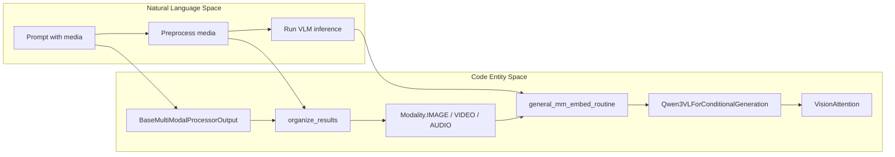
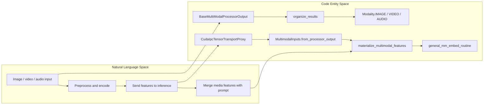

<!-- source: DeepWiki mcp.deepwiki.com · repo sgl-project/sglang · page 18 Multimodal and Vision-Language Models · fetched 2026-10-30 -->

# Multimodal and Vision-Language Models

Relevant source files

The following files were used as context for generating this wiki page:

- [python/sglang/srt/models/gigachat35.py](python/sglang/srt/models/gigachat35.py)
- [python/sglang/srt/models/interns2_mobius.py](python/sglang/srt/models/interns2_mobius.py)
- [python/sglang/srt/models/kimi_k25.py](python/sglang/srt/models/kimi_k25.py)
- [python/sglang/srt/models/qwen3_vl.py](python/sglang/srt/models/qwen3_vl.py)
- [python/sglang/srt/models/qwen3_vl_moe.py](python/sglang/srt/models/qwen3_vl_moe.py)
- [python/sglang/srt/models/step3_vl.py](python/sglang/srt/models/step3_vl.py)
- [python/sglang/srt/models/xllm.py](python/sglang/srt/models/xllm.py)
- [python/sglang/srt/multimodal/processors/base_processor.py](python/sglang/srt/multimodal/processors/base_processor.py)
- [python/sglang/srt/multimodal/processors/kimi_k25.py](python/sglang/srt/multimodal/processors/kimi_k25.py)
- [python/sglang/srt/multimodal/processors/kimi_k3.py](python/sglang/srt/multimodal/processors/kimi_k3.py)
- [python/sglang/srt/multimodal/processors/qwen_vl.py](python/sglang/srt/multimodal/processors/qwen_vl.py)
- [python/sglang/srt/multimodal/transport/cuda_ipc.py](python/sglang/srt/multimodal/transport/cuda_ipc.py)
- [python/sglang/srt/multimodal/transport/memory_pool.py](python/sglang/srt/multimodal/transport/memory_pool.py)
- [python/sglang/srt/utils/cuda_ipc_transport_utils.py](python/sglang/srt/utils/cuda_ipc_transport_utils.py)
- [python/sglang/srt/utils/cuda_vmm_transport_utils.py](python/sglang/srt/utils/cuda_vmm_transport_utils.py)
- [test/registered/unit/managers/test_mm_process_config.py](test/registered/unit/managers/test_mm_process_config.py)
- [test/registered/unit/models/test_kimi_k25.py](test/registered/unit/models/test_kimi_k25.py)
- [test/registered/unit/models/test_qwen3_vl_feature_materialization.py](test/registered/unit/models/test_qwen3_vl_feature_materialization.py)
- [test/registered/unit/multimodal/test_cuda_ipc_pool_budget.py](test/registered/unit/multimodal/test_cuda_ipc_pool_budget.py)
- [test/registered/unit/multimodal/test_cuda_ipc_transport.py](test/registered/unit/multimodal/test_cuda_ipc_transport.py)
- [test/registered/unit/multimodal/test_cuda_vmm_transport.py](test/registered/unit/multimodal/test_cuda_vmm_transport.py)
- [test/registered/unit/multimodal/test_gpu_feature_transport.py](test/registered/unit/multimodal/test_gpu_feature_transport.py)

## Purpose and scope

This parent page gives a high-level overview of SGLang’s vision-language model (VLM) support and multimodal request path. It connects model-side vision components to media preprocessing and feature transport, and points to child pages for implementation details. The processor output types include image, video, and audio data, while model implementations connect vision components to multimodal embedding utilities [python/sglang/srt/multimodal/processors/base_processor.py:73-107](), [python/sglang/srt/models/qwen3_vl.py:62-89]().

For details, see [Vision-Language Model Architecture](#18.1), [Multimodal Input Processing](#18.2), and [Supported Vision-Language Models](#18.3).

Sources: [python/sglang/srt/multimodal/processors/base_processor.py:73-107](), [python/sglang/srt/models/qwen3_vl.py:62-89]()

## Overview and high-level architecture

Multimodal requests add media preprocessing and model-specific visual processing to the language-model serving path. `BaseMultiModalProcessor` represents normalized processor output with text, optional token IDs, and image, video, and audio collections [python/sglang/srt/multimodal/processors/base_processor.py:73-107](). Model-side utilities such as `general_mm_embed_routine` and `materialize_multimodal_features` connect those inputs to model execution [python/sglang/srt/models/qwen3_vl.py:62-89]().

The diagram links user-facing concepts to concrete code entities. It is a high-level map, not a complete request-lifecycle trace.

### Multimodal request: concepts mapped to code

Sources: [python/sglang/srt/multimodal/processors/base_processor.py:73-107](), [python/sglang/srt/models/qwen3_vl.py:32-39](), [python/sglang/srt/models/qwen3_vl.py:62-89]()

For the model structure and vision attention, see [Vision-Language Model Architecture](#18.1). For media preprocessing and feature flow, see [Multimodal Input Processing](#18.2).

Sources: [python/sglang/srt/multimodal/processors/base_processor.py:73-107](), [python/sglang/srt/models/qwen3_vl.py:32-39]()

## Vision-language model architecture

VLM implementations combine a vision encoder with model-specific components and a language model. For example, Qwen3-VL imports `VisionAttention`, defines vision patch embedding components, and uses multimodal embedding utilities [python/sglang/srt/models/qwen3_vl.py:32-39](), [python/sglang/srt/models/qwen3_vl.py:184-188](); Kimi-K2.5 also uses `VisionAttention` in its `MoonViTEncoderLayer` [python/sglang/srt/models/kimi_k25.py:89-130]().

The shared names in these implementations are useful entry points, but individual models may differ in vision tower, positional processing, and feature integration. For details, see [Vision-Language Model Architecture](#18.1).

Sources: [python/sglang/srt/models/qwen3_vl.py:32-39](), [python/sglang/srt/models/qwen3_vl.py:184-188](), [python/sglang/srt/models/kimi_k25.py:89-130]()

## Multimodal input processing

`BaseMultiModalProcessorOutput` groups text and optional media collections, and `organize_results()` labels image, video, and audio values with their corresponding `Modality` [python/sglang/srt/multimodal/processors/base_processor.py:73-107](). Processor configuration can be provided by modality: tests cover `image`, `video`, and `audio` entries in `mm_process_config` and verify extraction into processor configuration [test/registered/unit/managers/test_mm_process_config.py:38-45](), [test/registered/unit/managers/test_mm_process_config.py:125-140]().

Feature transport is a separate concern from media decoding and model execution. The model path includes `materialize_multimodal_features`, and the transport tests exercise `CudaIpcTensorTransportProxy` reconstruction and cleanup through `MultimodalInputs.from_processor_output` [python/sglang/srt/models/qwen3_vl.py:79-89](), [test/registered/unit/multimodal/test_gpu_feature_transport.py:17-81](). EVS and the details of encoding, transport, embedding merging, and image/video/audio handling belong in [Multimodal Input Processing](#18.2) [python/sglang/srt/multimodal/processors/base_processor.py:73-107](), [python/sglang/srt/models/qwen3_vl.py:62-89]().

### Media processing and feature handoff

Sources: [python/sglang/srt/multimodal/processors/base_processor.py:73-107](), [python/sglang/srt/models/qwen3_vl.py:62-89](), [test/registered/unit/multimodal/test_gpu_feature_transport.py:17-81]()

For details, see [Multimodal Input Processing](#18.2).

Sources: [python/sglang/srt/multimodal/processors/base_processor.py:73-107](), [python/sglang/srt/models/qwen3_vl.py:62-89]()

## Supported vision-language models

The provided code shows implementations and processor integrations for several VLM families. Qwen-VL processor code imports Qwen2-VL, Qwen2.5-VL, Qwen3-VL, and additional conditional-generation model classes; Qwen3-VL and Qwen3-VL-MoE have dedicated model implementations [python/sglang/srt/multimodal/processors/qwen_vl.py:24-46](), [python/sglang/srt/models/qwen3_vl.py:15-16](), [python/sglang/srt/models/qwen3_vl_moe.py:15-37](). Kimi-K2.5 and Kimi-K3 are also represented in model and processor code [python/sglang/srt/models/kimi_k25.py:17-22](), [test/registered/unit/models/test_kimi_k25.py:28-33]().

The available file excerpts also identify InternS2-Mobius as a model implementation and show it referenced by the Qwen-VL processor module [python/sglang/srt/models/interns2_mobius.py:1-2](), [python/sglang/srt/multimodal/processors/qwen_vl.py:24-28](). This parent page does not attempt to provide a complete support matrix; see [Supported Vision-Language Models](#18.3) for the model-by-model reference [python/sglang/srt/models/interns2_mobius.py:1-2](), [python/sglang/srt/multimodal/processors/qwen_vl.py:24-28]().

Sources: [python/sglang/srt/multimodal/processors/qwen_vl.py:24-46](), [python/sglang/srt/models/qwen3_vl.py:15-16](), [python/sglang/srt/models/qwen3_vl_moe.py:15-37](), [python/sglang/srt/models/kimi_k25.py:17-22](), [test/registered/unit/models/test_kimi_k25.py:28-33](), [python/sglang/srt/models/interns2_mobius.py:1-2]()

## Further reading

- [Vision-Language Model Architecture](#18.1) — VLM architecture, vision towers, multimodal projectors, and vision attention backends.
- [Multimodal Input Processing](#18.2) — `base_processor`, media encoding, feature transport, embedding merging, and EVS.
- [Supported Vision-Language Models](#18.3) — Supported multimodal model families and their integrations.

Sources: [python/sglang/srt/multimodal/processors/base_processor.py:73-107](), [python/sglang/srt/models/qwen3_vl.py:32-39](), [python/sglang/srt/multimodal/processors/qwen_vl.py:24-46]()

---

