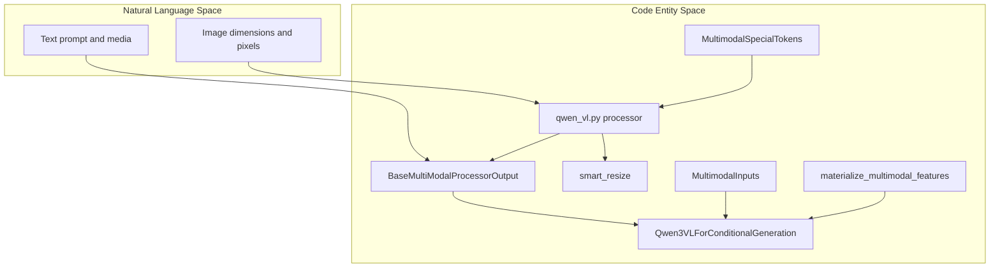
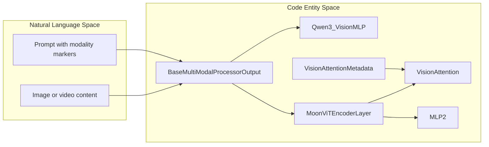
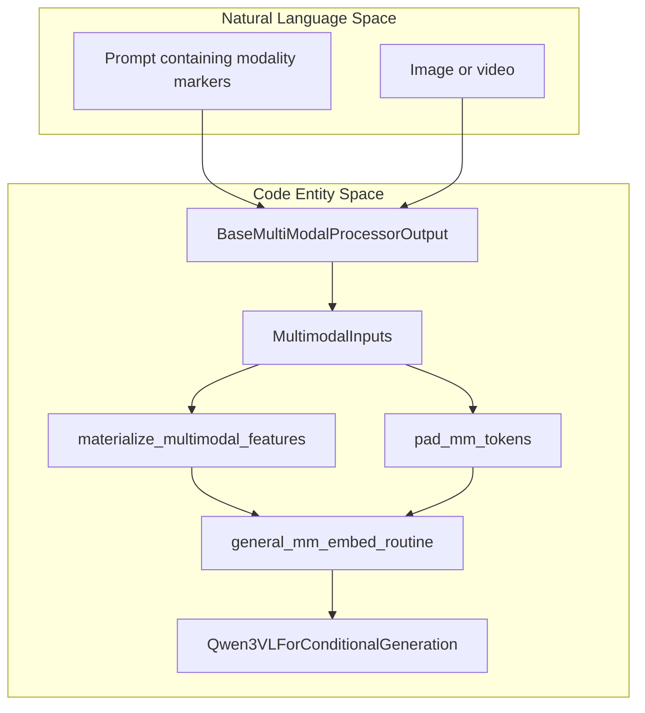

<!-- source: DeepWiki mcp.deepwiki.com · repo sgl-project/sglang · page 18.1 Vision-Language Model Architecture · fetched 2026-10-30 -->

# Vision-Language Model Architecture

Relevant source files

The following files were used as context for generating this wiki page:

- [benchmark/kernels/attention/bench_flash_attention_tmem_red_max.py](benchmark/kernels/attention/bench_flash_attention_tmem_red_max.py)
- [python/sglang/kernels/ops/attention/flash_attn/cute/flash_fwd_sm100.py](python/sglang/kernels/ops/attention/flash_attn/cute/flash_fwd_sm100.py)
- [python/sglang/kernels/ops/attention/flash_attn/cute/softmax.py](python/sglang/kernels/ops/attention/flash_attn/cute/softmax.py)
- [python/sglang/srt/hardware_backend/npu/graph_runner/vit_npu_graph_runner.py](python/sglang/srt/hardware_backend/npu/graph_runner/vit_npu_graph_runner.py)
- [python/sglang/srt/layers/attention/vision.py](python/sglang/srt/layers/attention/vision.py)
- [python/sglang/srt/layers/moe/moe_runner/flashinfer_cutedsl.py](python/sglang/srt/layers/moe/moe_runner/flashinfer_cutedsl.py)
- [python/sglang/srt/layers/moe/moe_runner/flashinfer_cutlass.py](python/sglang/srt/layers/moe/moe_runner/flashinfer_cutlass.py)
- [python/sglang/srt/layers/moe/token_dispatcher/flashinfer.py](python/sglang/srt/layers/moe/token_dispatcher/flashinfer.py)
- [python/sglang/srt/layers/quantization/mxfp4.py](python/sglang/srt/layers/quantization/mxfp4.py)
- [python/sglang/srt/layers/quantization/mxfp4_flashinfer_cutlass_moe.py](python/sglang/srt/layers/quantization/mxfp4_flashinfer_cutlass_moe.py)
- [python/sglang/srt/models/gigachat35.py](python/sglang/srt/models/gigachat35.py)
- [python/sglang/srt/models/interns2_mobius.py](python/sglang/srt/models/interns2_mobius.py)
- [python/sglang/srt/models/kimi_k25.py](python/sglang/srt/models/kimi_k25.py)
- [python/sglang/srt/models/qwen3_vl.py](python/sglang/srt/models/qwen3_vl.py)
- [python/sglang/srt/models/qwen3_vl_moe.py](python/sglang/srt/models/qwen3_vl_moe.py)
- [python/sglang/srt/models/step3_vl.py](python/sglang/srt/models/step3_vl.py)
- [python/sglang/srt/models/xllm.py](python/sglang/srt/models/xllm.py)
- [python/sglang/srt/multimodal/internvl_vit_cuda_graph_runner.py](python/sglang/srt/multimodal/internvl_vit_cuda_graph_runner.py)
- [python/sglang/srt/multimodal/processors/base_processor.py](python/sglang/srt/multimodal/processors/base_processor.py)
- [python/sglang/srt/multimodal/processors/kimi_k25.py](python/sglang/srt/multimodal/processors/kimi_k25.py)
- [python/sglang/srt/multimodal/processors/kimi_k3.py](python/sglang/srt/multimodal/processors/kimi_k3.py)
- [python/sglang/srt/multimodal/processors/qwen_vl.py](python/sglang/srt/multimodal/processors/qwen_vl.py)
- [python/sglang/srt/multimodal/transport/cuda_ipc.py](python/sglang/srt/multimodal/transport/cuda_ipc.py)
- [python/sglang/srt/multimodal/transport/memory_pool.py](python/sglang/srt/multimodal/transport/memory_pool.py)
- [python/sglang/srt/multimodal/vit_cuda_graph_runner.py](python/sglang/srt/multimodal/vit_cuda_graph_runner.py)
- [python/sglang/srt/utils/cuda_ipc_transport_utils.py](python/sglang/srt/utils/cuda_ipc_transport_utils.py)
- [python/sglang/srt/utils/cuda_vmm_transport_utils.py](python/sglang/srt/utils/cuda_vmm_transport_utils.py)
- [test/registered/e2e/models_large/test_deepseek_v3_cutedsl_4gpu.py](test/registered/e2e/models_large/test_deepseek_v3_cutedsl_4gpu.py)
- [test/registered/ep/test_flashinfer_a2a.py](test/registered/ep/test_flashinfer_a2a.py)
- [test/registered/kernels/ops/attention/test_flash_attention_4_sm103.py](test/registered/kernels/ops/attention/test_flash_attention_4_sm103.py)
- [test/registered/unit/layers/attention/test_vision_backend_selection.py](test/registered/unit/layers/attention/test_vision_backend_selection.py)
- [test/registered/unit/layers/attention/test_vision_max_seqlen.py](test/registered/unit/layers/attention/test_vision_max_seqlen.py)
- [test/registered/unit/layers/moe/test_flashinfer_cutlass_swiglu_params.py](test/registered/unit/layers/moe/test_flashinfer_cutlass_swiglu_params.py)
- [test/registered/unit/layers/moe/test_flashinfer_dispatcher.py](test/registered/unit/layers/moe/test_flashinfer_dispatcher.py)
- [test/registered/unit/layers/moe/test_moe_runner_config_placement.py](test/registered/unit/layers/moe/test_moe_runner_config_placement.py)
- [test/registered/unit/layers/quantization/test_mxfp4_flashinfer_activation_prep.py](test/registered/unit/layers/quantization/test_mxfp4_flashinfer_activation_prep.py)
- [test/registered/unit/layers/quantization/test_mxfp4_sm120_cutlass.py](test/registered/unit/layers/quantization/test_mxfp4_sm120_cutlass.py)
- [test/registered/unit/layers/quantization/test_mxfp4_sm90_cutlass.py](test/registered/unit/layers/quantization/test_mxfp4_sm90_cutlass.py)
- [test/registered/unit/managers/test_mm_process_config.py](test/registered/unit/managers/test_mm_process_config.py)
- [test/registered/unit/models/test_kimi_k25.py](test/registered/unit/models/test_kimi_k25.py)
- [test/registered/unit/models/test_qwen3_vl_feature_materialization.py](test/registered/unit/models/test_qwen3_vl_feature_materialization.py)
- [test/registered/unit/multimodal/test_cuda_ipc_pool_budget.py](test/registered/unit/multimodal/test_cuda_ipc_pool_budget.py)
- [test/registered/unit/multimodal/test_cuda_ipc_transport.py](test/registered/unit/multimodal/test_cuda_ipc_transport.py)
- [test/registered/unit/multimodal/test_cuda_vmm_transport.py](test/registered/unit/multimodal/test_cuda_vmm_transport.py)
- [test/registered/unit/multimodal/test_gpu_feature_transport.py](test/registered/unit/multimodal/test_gpu_feature_transport.py)
- [test/registered/unit/multimodal/test_vit_cuda_graph_metadata_cuda.py](test/registered/unit/multimodal/test_vit_cuda_graph_metadata_cuda.py)
- [test/registered/unit/multimodal/test_vit_cuda_graph_runner.py](test/registered/unit/multimodal/test_vit_cuda_graph_runner.py)
- [test/registered/unit/multimodal/test_vit_npu_graph_runner.py](test/registered/unit/multimodal/test_vit_npu_graph_runner.py)

## Purpose and Scope

This page describes the Vision-Language Model (VLM) architecture represented within SGLang: multimodal processor outputs, model-side vision components, `VisionAttention` metadata preparation, and the mechanisms by which multimodal inputs associate with runtime model execution. Qwen3-VL and Kimi K2.5 serve as concrete architectural examples. The available source excerpts focus on shared data structures, vision tower layers, attention metadata helpers, and tensor transport mechanisms [python/sglang/srt/multimodal/processors/base_processor.py:73-106](), [python/sglang/srt/models/qwen3_vl.py:30-89](), [python/sglang/srt/models/kimi_k25.py:17-53]().

Sources: [python/sglang/srt/multimodal/processors/base_processor.py:73-106](), [python/sglang/srt/models/qwen3_vl.py:30-89](), [python/sglang/srt/models/kimi_k25.py:17-53]()

---

## Multimodal Data Structures and Transport

### Multimodal Processor Output

`BaseMultiModalProcessorOutput` records expanded `input_text`, optional pre-tokenized `input_ids`, and modality-specific `images`, `videos`, and `audios`. Its `organize_results()` method produces a sequence of `(Modality, data)` pairs, ordered as images, videos, then audio. `MultimodalSpecialTokens` holds modality token strings and IDs, builds regular expressions for identifying those tokens, and maps recognized token strings back to a modality [python/sglang/srt/multimodal/processors/base_processor.py:73-106](), [python/sglang/srt/multimodal/processors/base_processor.py:109-173](), [python/sglang/srt/multimodal/processors/base_processor.py:175-202]().

The Qwen-VL processor module imports several model implementations, including `Qwen3VLForConditionalGeneration`, and derives its processor class from the shared `BaseMultimodalProcessor`. Its image preprocessing configuration includes an image-size factor, pixel limits, and a resize function that rounds dimensions to a factor and constrains the resulting pixel count [python/sglang/srt/multimodal/processors/qwen_vl.py:24-56](), [python/sglang/srt/multimodal/processors/qwen_vl.py:59-78](), [python/sglang/srt/multimodal/processors/qwen_vl.py:151-181]().

### Feature Transport

The Qwen3-VL model imports multimodal feature materialization and CUDA IPC transport components, including `materialize_multimodal_features` and `CudaIpcTensorTransportProxy`. These imports indicate that feature materialization and transport are integrated with the model's multimodal execution path [python/sglang/srt/models/qwen3_vl.py:79-89]().

Sources: [python/sglang/srt/multimodal/processors/base_processor.py:73-106](), [python/sglang/srt/multimodal/processors/base_processor.py:109-202](), [python/sglang/srt/multimodal/processors/qwen_vl.py:24-78](), [python/sglang/srt/multimodal/processors/qwen_vl.py:151-181](), [python/sglang/srt/models/qwen3_vl.py:79-89]()

---

## Multimodal Processing Pipeline

The code excerpts establish boundaries between multimodal processor outputs containing text and media data, model modules importing multimodal input structures and helpers, and model-specific vision components utilizing attention layers and metadata [python/sglang/srt/multimodal/processors/base_processor.py:73-106](), [python/sglang/srt/models/qwen3_vl.py:62-89](), [python/sglang/srt/models/kimi_k25.py:30-53]().

### Pipeline Dataflow: Natural Language Space → Code Entity Space

Sources: [python/sglang/srt/multimodal/processors/base_processor.py:73-106](), [python/sglang/srt/multimodal/processors/base_processor.py:109-202](), [python/sglang/srt/multimodal/processors/qwen_vl.py:24-56](), [python/sglang/srt/multimodal/processors/qwen_vl.py:151-181](), [python/sglang/srt/models/qwen3_vl.py:62-89]()

---

## Top-Level VLM Architecture

The Qwen3-VL source imports `Qwen3Model` as well as multimodal input structures, embedding helpers, vision-attention components, and multimodal feature utilities [python/sglang/srt/models/qwen3_vl.py:30-89]().

The Kimi K2.5 model imports `DeepseekV3ForCausalLM`, `VisionAttention`, and `MLP2`, and defines `MoonViTEncoderLayer` using `VisionAttention` and `MLP2` [python/sglang/srt/models/kimi_k25.py:17-53](), [python/sglang/srt/models/kimi_k25.py:89-160]().

| Example | Evidence visible in source excerpt | What the excerpt establishes |
|---|---|---|
| Qwen3-VL | `Qwen3Model`, `VisionAttention`, `MultimodalInputs`, `general_mm_embed_routine`, and multimodal feature helpers are imported. | The module connects language-model, vision-attention, and multimodal-input components. [python/sglang/srt/models/qwen3_vl.py:30-89]() |
| Kimi K2.5 | `DeepseekV3ForCausalLM`, `VisionAttention`, and `MLP2` are imported; `MoonViTEncoderLayer` constructs attention and an MLP. | The encoder layer includes self-attention, normalization, residual additions, and an MLP. [python/sglang/srt/models/kimi_k25.py:17-53](), [python/sglang/srt/models/kimi_k25.py:89-160]() |

Sources: [python/sglang/srt/models/qwen3_vl.py:30-89](), [python/sglang/srt/models/kimi_k25.py:17-53](), [python/sglang/srt/models/kimi_k25.py:89-160]()

---

## Vision Encoder Architecture and Encoder Layers

### Qwen3-VL Vision Components

The Qwen3-VL module defines `Qwen3_VisionMLP`. It resolves a linear parallel group, creates a `ColumnParallelLinear` layer followed by an activation, and applies a `RowParallelLinear` layer. Its `forward()` method returns the second linear layer's output [python/sglang/srt/models/qwen3_vl.py:30-41](), [python/sglang/srt/models/qwen3_vl.py:131-181]().

### Kimi K2.5 `MoonViTEncoderLayer`

`MoonViTEncoderLayer` initializes `norm0`, `norm1`, an `MLP2`, and a `VisionAttention` configured with QKV parallelism and a custom position-embedding applier. During `forward()`, it normalizes hidden states, applies attention with cumulative sequence lengths and optional position/forward metadata, adds a residual, normalizes again, applies the MLP, and adds a second residual [python/sglang/srt/models/kimi_k25.py:89-160]().

### Architecture: Natural Language Space → Code Entity Space

Sources: [python/sglang/srt/multimodal/processors/base_processor.py:73-106](), [python/sglang/srt/models/qwen3_vl.py:131-181](), [python/sglang/srt/models/kimi_k25.py:89-160](), [python/sglang/srt/layers/attention/vision.py:144-178]()

---

## `VisionAttention` Module and Backend Selection

### Attention Metadata

`VisionAttentionMetadata` holds cumulative sequence lengths, per-sequence lengths, and a maximum sequence length. It can also carry optional packed-indptr, sequence-length, and FlashInfer maximum-sequence-length fields. `prepare_vision_attention_metadata()` moves `cu_seqlens` to the requested device as `int32`, computes each sequence length from adjacent cumulative offsets, and derives the maximum when one is not provided [python/sglang/srt/layers/attention/vision.py:144-178]().

`prepare_flashinfer_cudnn_vision_attention_metadata()` prepares metadata for a FlashInfer/cuDNN path. It pads the batch size to a configured bucket, computes element-based packed indptrs, selects a maximum-sequence-length bucket, and delegates to `prepare_vision_attention_metadata()`. The shown batch buckets are 8, 16, 32, and 64; sequence-length buckets range from 4K through 128K [python/sglang/srt/layers/attention/vision.py:112-125](), [python/sglang/srt/layers/attention/vision.py:181-216]().

### Backend Context

The `vision.py` module conditionally imports platform-specific attention functions. CUDA paths use a FlashAttention wrapper and lazy import of a FlashInfer cuDNN prefill function; CPU with AMX, MUSA, and XPU have separate imports alongside shared prefill attention support [python/sglang/srt/layers/attention/vision.py:45-100]().

Sources: [python/sglang/srt/layers/attention/vision.py:45-100](), [python/sglang/srt/layers/attention/vision.py:112-125](), [python/sglang/srt/layers/attention/vision.py:144-216]()

---

## Vision Transformer Graph Runners

The Qwen3-VL module imports `ViTCudaGraphRunner` and selects it through a `graph_runners_dict` default. When NPU is detected, it imports `ViTNpuGraphRunner` and assigns it for the `"npu"` key [python/sglang/srt/models/qwen3_vl.py:89-107]().

Sources: [python/sglang/srt/models/qwen3_vl.py:89-107]()

---

## Feature Integration and Embedding Helpers

The Qwen3-VL and Kimi K2.5 modules import `general_mm_embed_routine`, `pad_mm_tokens`, and `materialize_multimodal_features`. These dependencies place multimodal embedding utilities in the model integration layer [python/sglang/srt/models/qwen3_vl.py:62-89](), [python/sglang/srt/models/kimi_k25.py:30-48]().

### Feature Integration Dataflow

Sources: [python/sglang/srt/multimodal/processors/base_processor.py:73-106](), [python/sglang/srt/models/qwen3_vl.py:62-89]()

---

## Data-Parallel Vision Encoding and Feature Transport

The Qwen3-VL and Kimi K2.5 modules import `run_dp_sharded_mrope_vision_model`, `materialize_multimodal_features`, and CUDA IPC transport symbols, identifying data-parallel vision and feature materialization as model-integrated mechanisms [python/sglang/srt/models/qwen3_vl.py:79-89](), [python/sglang/srt/models/kimi_k25.py:44-48]().

Sources: [python/sglang/srt/models/qwen3_vl.py:79-89](), [python/sglang/srt/models/kimi_k25.py:44-48]()

---

## Summary

The available implementation excerpts show three architectural layers: shared processor outputs and modality-token handling; model-side vision components such as `Qwen3_VisionMLP` and `MoonViTEncoderLayer`; and `VisionAttention` metadata plus platform-dependent attention imports. Qwen3-VL and Kimi K2.5 both import multimodal feature utilities [python/sglang/srt/multimodal/processors/base_processor.py:73-202](), [python/sglang/srt/models/qwen3_vl.py:62-89](), [python/sglang/srt/models/qwen3_vl.py:131-181](), [python/sglang/srt/models/kimi_k25.py:89-160](), [python/sglang/srt/layers/attention/vision.py:144-216]().

Sources: [python/sglang/srt/multimodal/processors/base_processor.py:73-202](), [python/sglang/srt/models/qwen3_vl.py:62-89](), [python/sglang/srt/models/qwen3_vl.py:131-181](), [python/sglang/srt/models/kimi_k25.py:89-160](), [python/sglang/srt/layers/attention/vision.py:144-216]()

---

