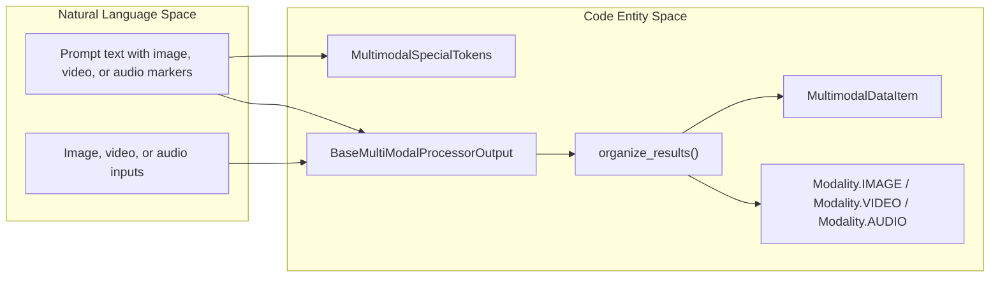
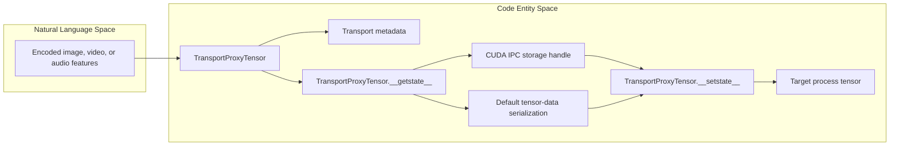
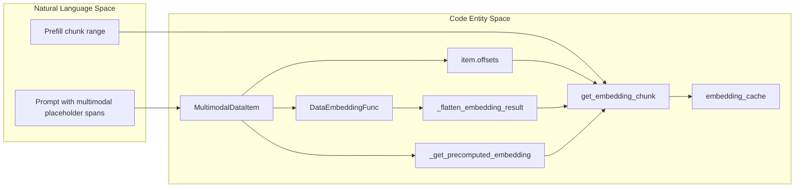
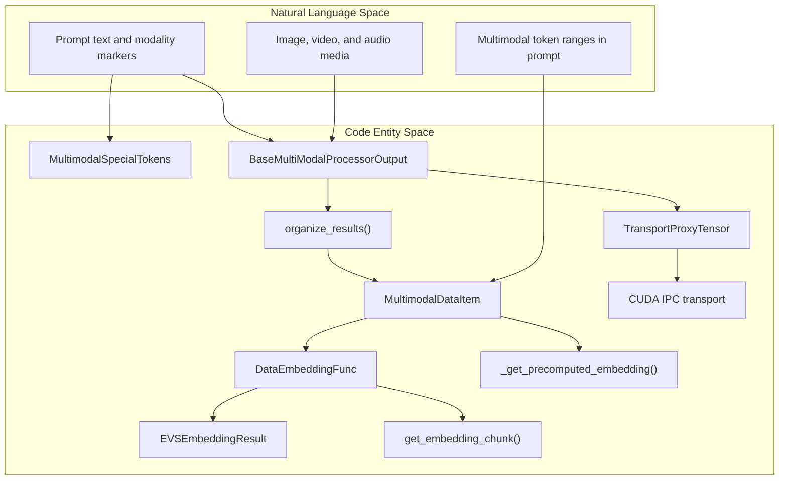

<!-- source: DeepWiki mcp.deepwiki.com · repo sgl-project/sglang · page 18.2 Multimodal Input Processing · fetched 2026-10-30 -->

# Multimodal Input Processing

Relevant source files

The following files were used as context for generating this wiki page:

- [python/sglang/srt/layers/vocab_parallel_embedding.py](python/sglang/srt/layers/vocab_parallel_embedding.py)
- [python/sglang/srt/managers/mm_schedule.py](python/sglang/srt/managers/mm_schedule.py)
- [python/sglang/srt/managers/mm_utils.py](python/sglang/srt/managers/mm_utils.py)
- [python/sglang/srt/mem_cache/multimodal_cache.py](python/sglang/srt/mem_cache/multimodal_cache.py)
- [python/sglang/srt/models/deepseek_vl2.py](python/sglang/srt/models/deepseek_vl2.py)
- [python/sglang/srt/models/gigachat35.py](python/sglang/srt/models/gigachat35.py)
- [python/sglang/srt/models/interns2_mobius.py](python/sglang/srt/models/interns2_mobius.py)
- [python/sglang/srt/models/kimi_k25.py](python/sglang/srt/models/kimi_k25.py)
- [python/sglang/srt/models/phi4mm.py](python/sglang/srt/models/phi4mm.py)
- [python/sglang/srt/models/qwen3_vl.py](python/sglang/srt/models/qwen3_vl.py)
- [python/sglang/srt/models/qwen3_vl_moe.py](python/sglang/srt/models/qwen3_vl_moe.py)
- [python/sglang/srt/models/step3_vl.py](python/sglang/srt/models/step3_vl.py)
- [python/sglang/srt/models/step3_vl_10b.py](python/sglang/srt/models/step3_vl_10b.py)
- [python/sglang/srt/models/xllm.py](python/sglang/srt/models/xllm.py)
- [python/sglang/srt/multimodal/processors/base_processor.py](python/sglang/srt/multimodal/processors/base_processor.py)
- [python/sglang/srt/multimodal/processors/kimi_k25.py](python/sglang/srt/multimodal/processors/kimi_k25.py)
- [python/sglang/srt/multimodal/processors/kimi_k3.py](python/sglang/srt/multimodal/processors/kimi_k3.py)
- [python/sglang/srt/multimodal/processors/qwen_vl.py](python/sglang/srt/multimodal/processors/qwen_vl.py)
- [python/sglang/srt/multimodal/transport/cuda_ipc.py](python/sglang/srt/multimodal/transport/cuda_ipc.py)
- [python/sglang/srt/multimodal/transport/memory_pool.py](python/sglang/srt/multimodal/transport/memory_pool.py)
- [python/sglang/srt/utils/async_probe.py](python/sglang/srt/utils/async_probe.py)
- [python/sglang/srt/utils/cuda_ipc_transport_utils.py](python/sglang/srt/utils/cuda_ipc_transport_utils.py)
- [python/sglang/srt/utils/cuda_vmm_transport_utils.py](python/sglang/srt/utils/cuda_vmm_transport_utils.py)
- [python/sglang/srt/utils/invariants.py](python/sglang/srt/utils/invariants.py)
- [python/sglang/test/kits/radix_cache_server_kit.py](python/sglang/test/kits/radix_cache_server_kit.py)
- [test/registered/chunked_prefill/test_mm_chunked_embedding_unit.py](test/registered/chunked_prefill/test_mm_chunked_embedding_unit.py)
- [test/registered/kernels/ops/moe/test_fp4_allgather_moe_reduction.py](test/registered/kernels/ops/moe/test_fp4_allgather_moe_reduction.py)
- [test/registered/unit/dllm/test_gemma4_cuda_graph.py](test/registered/unit/dllm/test_gemma4_cuda_graph.py)
- [test/registered/unit/hardware_backend/mlx/test_attn_dp_request_capacity.py](test/registered/unit/hardware_backend/mlx/test_attn_dp_request_capacity.py)
- [test/registered/unit/layer_boundary/test_moe_output_reduction.py](test/registered/unit/layer_boundary/test_moe_output_reduction.py)
- [test/registered/unit/layer_boundary/test_reduction_fusion.py](test/registered/unit/layer_boundary/test_reduction_fusion.py)
- [test/registered/unit/managers/test_mm_embedding_length.py](test/registered/unit/managers/test_mm_embedding_length.py)
- [test/registered/unit/managers/test_mm_process_config.py](test/registered/unit/managers/test_mm_process_config.py)
- [test/registered/unit/models/test_kimi_k25.py](test/registered/unit/models/test_kimi_k25.py)
- [test/registered/unit/models/test_qwen3_vl_feature_materialization.py](test/registered/unit/models/test_qwen3_vl_feature_materialization.py)
- [test/registered/unit/multimodal/test_cuda_ipc_pool_budget.py](test/registered/unit/multimodal/test_cuda_ipc_pool_budget.py)
- [test/registered/unit/multimodal/test_cuda_ipc_transport.py](test/registered/unit/multimodal/test_cuda_ipc_transport.py)
- [test/registered/unit/multimodal/test_cuda_vmm_transport.py](test/registered/unit/multimodal/test_cuda_vmm_transport.py)
- [test/registered/unit/multimodal/test_gpu_feature_transport.py](test/registered/unit/multimodal/test_gpu_feature_transport.py)
- [test/registered/unit/utils/test_invariants.py](test/registered/unit/utils/test_invariants.py)

## Purpose and scope

This page describes the multimodal input path represented in the codebase: modality-aware processor output, special-token handling, Qwen-VL and Kimi K2.5 preprocessing examples, feature transport between processes (such as CUDA IPC and VMM transport), embedding alignment and caching, and the EVS result type used by embedding scheduling. The available implementation excerpts establish the data structures and interfaces for these paths [python/sglang/srt/multimodal/processors/base_processor.py:73-105]() [python/sglang/srt/multimodal/processors/qwen_vl.py:81-99]() [python/sglang/srt/managers/mm_schedule.py:149-159]().

Sources: [python/sglang/srt/multimodal/processors/base_processor.py:73-105]() [python/sglang/srt/multimodal/processors/qwen_vl.py:81-99]() [python/sglang/srt/managers/mm_schedule.py:149-159]()

---

## Overview

The multimodal data structures connect prompt text and media inputs to model-side features. `BaseMultiModalProcessorOutput` holds expanded input text, optional input IDs, and modality-specific media lists; `MultimodalDataItem` is used by the embedding-scheduling path; and `DataEmbeddingFunc` describes encoder outputs consumed by that path [python/sglang/srt/multimodal/processors/base_processor.py:73-105]() [python/sglang/srt/managers/mm_schedule.py:149-159]().

The wider processing path includes media-loading utilities, processor and cache interfaces, transport support, and embedding scheduling. `base_processor.py` imports media loaders like `load_image`, `load_video`, and `load_audio`, as well as processor executors, preprocess-cache components, and CUDA IPC transport types [python/sglang/srt/multimodal/processors/base_processor.py:34-66]().

Sources: [python/sglang/srt/multimodal/processors/base_processor.py:34-66]() [python/sglang/srt/multimodal/processors/base_processor.py:73-105]() [python/sglang/srt/managers/mm_schedule.py:149-159]()

### Data structures and modality tokens

`BaseMultiModalProcessorOutput` stores `input_text`, optional pre-tokenized `input_ids`, and lists for `images`, `videos`, and `audios`. Its `organize_results()` method returns the media as `(Modality, data)` pairs, with image items first, followed by video and audio items [python/sglang/srt/multimodal/processors/base_processor.py:73-106]().

`MultimodalSpecialTokens` holds token strings or IDs for image, video, and audio, plus modality-specific and combined regular expressions. `build()` converts configured IDs to token strings, parses the modality regexes, and builds the combined regex used to split text around multimodal special tokens. `get_modality_of_token()` resolves exact token strings first and then checks the modality regexes [python/sglang/srt/multimodal/processors/base_processor.py:109-166]() [python/sglang/srt/multimodal/processors/base_processor.py:168-202]().

A `MultimodalDataItem` is the unit passed to the embedding-scheduling path. The scheduling code uses its `precomputed_embeddings`, `offsets`, and `hash` fields; the type is also used as the input item to a `DataEmbeddingFunc` [python/sglang/srt/managers/mm_schedule.py:75-118]() [python/sglang/srt/managers/mm_schedule.py:149-159]().

Sources: [python/sglang/srt/multimodal/processors/base_processor.py:73-106]() [python/sglang/srt/multimodal/processors/base_processor.py:109-202]() [python/sglang/srt/managers/mm_schedule.py:75-118]() [python/sglang/srt/managers/mm_schedule.py:149-159]()

### Prompt-to-code mapping

This diagram maps prompt-level concepts to the corresponding data structures and functions visible in the codebase.

**Diagram: Prompt media and multimodal processor data structures**

Sources: [python/sglang/srt/multimodal/processors/base_processor.py:73-106]() [python/sglang/srt/multimodal/processors/base_processor.py:109-202]() [python/sglang/srt/managers/mm_schedule.py:75-118]() [python/sglang/srt/managers/mm_schedule.py:149-159]()

---

## Processor architecture and configuration

### `BaseMultimodalProcessor`

`BaseMultimodalProcessor` is imported by model-specific processors under the alias `SGLangBaseProcessor` (for example, in the Kimi K2.5 processor) [python/sglang/srt/multimodal/processors/kimi_k25.py:15-24]().

The base-processor module imports `MultimodalProcessorExecutor`, `MultimodalHashExecutor`, preprocess-cache utilities, runtime-context accessors, and media-loading helpers [python/sglang/srt/multimodal/processors/base_processor.py:34-66]().

### Modality-specific processing configuration

Unit tests exercise `BaseMultimodalProcessor` initialization with `mm_process_config`. They verify that `image`, `video`, and `audio` dictionaries are extracted as `image_config`, `video_config`, and `audio_config`, and that an empty configuration yields empty dictionaries [test/registered/unit/managers/test_mm_process_config.py:20-46]() [test/registered/unit/managers/test_mm_process_config.py:48-140]().

Tests also cover worker configuration: a model-specific worker count can enable the processor executor when concurrency is supported, an explicitly configured single worker leaves the executor unset, and the test suite validates processor support before enabling parallel workers [test/registered/unit/managers/test_mm_process_config.py:142-177]().

Sources: [python/sglang/srt/multimodal/processors/base_processor.py:34-66]() [python/sglang/srt/multimodal/processors/kimi_k25.py:15-24]() [test/registered/unit/managers/test_mm_process_config.py:20-46]() [test/registered/unit/managers/test_mm_process_config.py:48-177]()

---

## Image, video, and audio preprocessing

### Shared input representation

`BaseMultiModalProcessorOutput` represents loaded media inputs as modality-specific lists [python/sglang/srt/multimodal/processors/base_processor.py:73-105](). Media loading helpers like `load_image`, `load_video`, `load_audio`, and `smart_to_rgb` handle input ingestion [python/sglang/srt/multimodal/processors/base_processor.py:54-66]().

### Qwen-VL image resizing

The Qwen-VL processor defines `smart_resize(height, width, factor, min_pixels, max_pixels)`. It rejects images whose aspect ratio exceeds `MAX_RATIO`, rounds dimensions to a multiple of the factor, and adjusts dimensions when the pixel count is outside `[min_pixels, max_pixels]`. `IMAGE_FACTOR` is set to 28 [python/sglang/srt/multimodal/processors/qwen_vl.py:59-67]() [python/sglang/srt/multimodal/processors/qwen_vl.py:151-181]().

Video preprocessing uses configuration keys and video metadata handling via `_get_processor_video_config()` [python/sglang/srt/multimodal/processors/qwen_vl.py:69-79]() [python/sglang/srt/multimodal/processors/qwen_vl.py:111-134]().

### Kimi K2.5 image preprocessing example

The Kimi K2.5 processor includes GPU-oriented preprocessing helpers. `navit_resize_config()` computes resized dimensions, padding, and token counts [python/sglang/srt/multimodal/processors/kimi_k25.py:34-74](). `_expand_image_token_ids()` expands placeholders efficiently in the array domain [python/sglang/srt/multimodal/processors/kimi_k25.py:85-110]().

Image conversion helpers convert PIL images to CUDA CHW tensors and normalize tensor channel dimensions (`_ensure_chw_rgb`), while `_resize_bicubic_if_needed()` handles bicubic interpolation with antialiasing [python/sglang/srt/multimodal/processors/kimi_k25.py:113-149]() [python/sglang/srt/multimodal/processors/kimi_k25.py:151-179]().

Sources: [python/sglang/srt/multimodal/processors/base_processor.py:54-66]() [python/sglang/srt/multimodal/processors/base_processor.py:73-105]() [python/sglang/srt/multimodal/processors/qwen_vl.py:59-79]() [python/sglang/srt/multimodal/processors/qwen_vl.py:111-181]() [python/sglang/srt/multimodal/processors/kimi_k25.py:34-74]() [python/sglang/srt/multimodal/processors/kimi_k25.py:85-179]()

---

## Feature transport and CUDA IPC

### Transport-related components

`BaseMultimodalProcessor` integrates with `CudaIpcTensorTransportProxy`, `MmItemMemoryPool`, and transport utility functions [python/sglang/srt/multimodal/processors/base_processor.py:41-48]().

In `mm_utils.py`, `TransportProxyTensor` subclasses `torch.Tensor` to attach metadata (such as name, fields, and `transport_mode`). During pickling (`__getstate__`), CUDA IPC storage handles are shared when possible, falling back to default tensor serialization otherwise [python/sglang/srt/managers/mm_utils.py:122-188](). Unpickling (`__setstate__`) reconstructs shared CUDA storage on the target device [python/sglang/srt/managers/mm_utils.py:190-212]().

Transport unit tests verify cleanup on reconstruction failures and model opt-in rules for CUDA VMM feature transport [test/registered/unit/multimodal/test_gpu_feature_transport.py:17-81]() [test/registered/unit/multimodal/test_gpu_feature_transport.py:127-156]().

Sources: [python/sglang/srt/multimodal/processors/base_processor.py:41-48]() [python/sglang/srt/managers/mm_utils.py:122-188]() [python/sglang/srt/managers/mm_utils.py:190-212]() [test/registered/unit/multimodal/test_gpu_feature_transport.py:17-81]() [test/registered/unit/multimodal/test_gpu_feature_transport.py:127-156]()

### Feature transport mapping

**Diagram: Tensor metadata and transport entities**

Sources: [python/sglang/srt/managers/mm_utils.py:122-188]() [python/sglang/srt/managers/mm_utils.py:190-212]() [python/sglang/srt/multimodal/processors/base_processor.py:41-48]()

---

## Multimodal embedding merging and scheduling

### Embedding inputs and encoder outputs

`DataEmbeddingFunc` accepts a list of `MultimodalDataItem` objects and returns a tensor, a list of per-item tensors, or an `EVSEmbeddingResult` [python/sglang/srt/managers/mm_schedule.py:149-159](). `_flatten_embedding_result()` normalizes per-item lists into a single concatenated tensor [python/sglang/srt/managers/mm_schedule.py:162-175]().

### Offset-based chunk extraction

`get_embedding_chunk()` maps requested input ranges (`extend_prefix_len` and `extend_seq_len`) onto item offset ranges [python/sglang/srt/managers/mm_schedule.py:30-72](). `_get_precomputed_embedding()` retrieves precomputed features from items, normalizes devices, and concatenates them [python/sglang/srt/managers/mm_schedule.py:75-146]().

### Chunked processing and cache behavior

`mm_schedule.py` manages an `embedding_cache` backed by `MultiModalStaticCache` [python/sglang/srt/managers/mm_schedule.py:21-28](). Chunked embedding tests verify that per-item cache entries own their storage [test/registered/chunked_prefill/test_mm_chunked_embedding_unit.py:1-8]() [test/registered/chunked_prefill/test_mm_chunked_embedding_unit.py:142-168]().

**Diagram: Prompt offsets to scheduled embedding chunks**

Sources: [python/sglang/srt/managers/mm_schedule.py:21-28]() [python/sglang/srt/managers/mm_schedule.py:30-72]() [python/sglang/srt/managers/mm_schedule.py:75-175]() [test/registered/chunked_prefill/test_mm_chunked_embedding_unit.py:142-168]()

---

## Efficient Video Sampling (EVS)

`EVSEmbeddingResult` is supported as a valid return type for `DataEmbeddingFunc` in the scheduling interface [python/sglang/srt/managers/mm_schedule.py:8-15]() [python/sglang/srt/managers/mm_schedule.py:149-159](). It integrates video sampling outputs directly into the embedding scheduling pipeline.

Sources: [python/sglang/srt/managers/mm_schedule.py:8-15]() [python/sglang/srt/managers/mm_schedule.py:149-159]()

---

## Caching and feature buffering

`MultimodalPreprocessCache`, `PreprocessFingerprintProvider`, and `build_processor_fingerprint` provide caching and fingerprinting for multimodal preprocessing [python/sglang/srt/multimodal/processors/base_processor.py:34-39]().

`mm_utils.py` implements a GPU feature buffer via `init_feature_buffer(device)` and `try_add_to_buffer(tensor)` to optimize memory reuse during feature transport [python/sglang/srt/managers/mm_utils.py:67-119]().

| Component | Role in the codebase |
|---|---|
| `MultimodalPreprocessCache` | Preprocess cache component imported by `base_processor.py` [python/sglang/srt/multimodal/processors/base_processor.py:34-38]() |
| `PreprocessFingerprintProvider` | Fingerprint provider for caching inputs [python/sglang/srt/multimodal/processors/base_processor.py:34-38]() |
| `build_processor_fingerprint` | Computes fingerprints for processors [python/sglang/srt/multimodal/processors/base_processor.py:34-38]() |
| `init_feature_buffer()` | Allocates optional GPU feature buffer [python/sglang/srt/managers/mm_utils.py:67-90]() |
| `try_add_to_buffer()` | Copies tensors into preallocated buffer space [python/sglang/srt/managers/mm_utils.py:104-119]() |
| `init_mm_embedding_cache()` | Initializes embedding cache for scheduling [python/sglang/srt/managers/mm_schedule.py:21-28]() |

Sources: [python/sglang/srt/multimodal/processors/base_processor.py:34-39]() [python/sglang/srt/managers/mm_utils.py:67-119]() [python/sglang/srt/managers/mm_schedule.py:21-28]()

---

## End-to-end code entity map

**Diagram: Multimodal input concepts and implementation symbols**

Sources: [python/sglang/srt/multimodal/processors/base_processor.py:73-106]() [python/sglang/srt/multimodal/processors/base_processor.py:109-202]() [python/sglang/srt/managers/mm_schedule.py:75-175]() [python/sglang/srt/managers/mm_schedule.py:149-159]() [python/sglang/srt/managers/mm_utils.py:122-188]()

---

