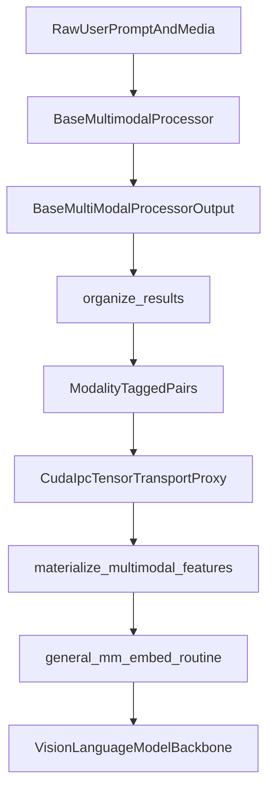
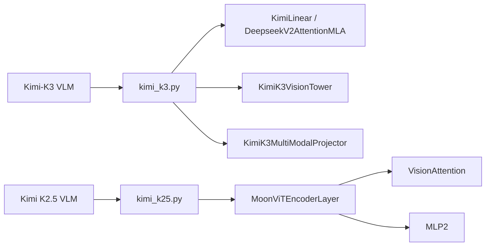
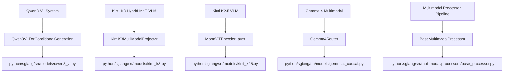

<!-- source: DeepWiki mcp.deepwiki.com · repo sgl-project/sglang · page 18.3 Supported Vision-Language Models · fetched 2026-10-30 -->

# Supported Vision-Language Models

Relevant source files

The following files were used as context for generating this wiki page:

- [docs/cookbook/autoregressive/Moonshotai/Kimi-K3.mdx](docs/cookbook/autoregressive/Moonshotai/Kimi-K3.mdx)
- [docs/docs/hardware-platforms/ascend-npus/development/operator_performance_optimizing.mdx](docs/docs/hardware-platforms/ascend-npus/development/operator_performance_optimizing.mdx)
- [docs/docs/hardware-platforms/ascend-npus/optimization/profiling.mdx](docs/docs/hardware-platforms/ascend-npus/optimization/profiling.mdx)
- [docs/docs/hardware-platforms/ascend-npus/reference/support_features.mdx](docs/docs/hardware-platforms/ascend-npus/reference/support_features.mdx)
- [docs/docs/hardware-platforms/ascend-npus/reference/support_models.mdx](docs/docs/hardware-platforms/ascend-npus/reference/support_models.mdx)
- [docs/src/snippets/_kimi_k3_mamba_ratio_calculator.jsx](docs/src/snippets/_kimi_k3_mamba_ratio_calculator.jsx)
- [docs/src/snippets/configs/moonshotai/kimi-k3-benchmarks.jsx](docs/src/snippets/configs/moonshotai/kimi-k3-benchmarks.jsx)
- [docs/src/snippets/configs/moonshotai/kimi-k3.jsx](docs/src/snippets/configs/moonshotai/kimi-k3.jsx)
- [python/sglang/srt/hardware_backend/npu/attention/ascend_backend.py](python/sglang/srt/hardware_backend/npu/attention/ascend_backend.py)
- [python/sglang/srt/hardware_backend/npu/graph_runner/eagle_draft_extend_npu_graph_runner.py](python/sglang/srt/hardware_backend/npu/graph_runner/eagle_draft_extend_npu_graph_runner.py)
- [python/sglang/srt/hardware_backend/npu/graph_runner/eagle_draft_npu_graph_runner.py](python/sglang/srt/hardware_backend/npu/graph_runner/eagle_draft_npu_graph_runner.py)
- [python/sglang/srt/hardware_backend/npu/graph_runner/npu_graph_runner.py](python/sglang/srt/hardware_backend/npu/graph_runner/npu_graph_runner.py)
- [python/sglang/srt/layers/attention/xpu_backend.py](python/sglang/srt/layers/attention/xpu_backend.py)
- [python/sglang/srt/layers/layernorm.py](python/sglang/srt/layers/layernorm.py)
- [python/sglang/srt/models/gemma3_causal.py](python/sglang/srt/models/gemma3_causal.py)
- [python/sglang/srt/models/gemma3_mm.py](python/sglang/srt/models/gemma3_mm.py)
- [python/sglang/srt/models/gemma4_causal.py](python/sglang/srt/models/gemma4_causal.py)
- [python/sglang/srt/models/gemma4_mm.py](python/sglang/srt/models/gemma4_mm.py)
- [python/sglang/srt/models/gemma4_mtp.py](python/sglang/srt/models/gemma4_mtp.py)
- [python/sglang/srt/models/gemma4_unified.py](python/sglang/srt/models/gemma4_unified.py)
- [python/sglang/srt/models/gigachat35.py](python/sglang/srt/models/gigachat35.py)
- [python/sglang/srt/models/interns2_mobius.py](python/sglang/srt/models/interns2_mobius.py)
- [python/sglang/srt/models/kimi_k25.py](python/sglang/srt/models/kimi_k25.py)
- [python/sglang/srt/models/kimi_k3.py](python/sglang/srt/models/kimi_k3.py)
- [python/sglang/srt/models/qwen3_vl.py](python/sglang/srt/models/qwen3_vl.py)
- [python/sglang/srt/models/qwen3_vl_moe.py](python/sglang/srt/models/qwen3_vl_moe.py)
- [python/sglang/srt/models/step3_vl.py](python/sglang/srt/models/step3_vl.py)
- [python/sglang/srt/models/xllm.py](python/sglang/srt/models/xllm.py)
- [python/sglang/srt/multimodal/processors/base_processor.py](python/sglang/srt/multimodal/processors/base_processor.py)
- [python/sglang/srt/multimodal/processors/gemma4_unified.py](python/sglang/srt/multimodal/processors/gemma4_unified.py)
- [python/sglang/srt/multimodal/processors/kimi_k25.py](python/sglang/srt/multimodal/processors/kimi_k25.py)
- [python/sglang/srt/multimodal/processors/kimi_k3.py](python/sglang/srt/multimodal/processors/kimi_k3.py)
- [python/sglang/srt/multimodal/processors/qwen_vl.py](python/sglang/srt/multimodal/processors/qwen_vl.py)
- [python/sglang/srt/multimodal/transport/cuda_ipc.py](python/sglang/srt/multimodal/transport/cuda_ipc.py)
- [python/sglang/srt/multimodal/transport/memory_pool.py](python/sglang/srt/multimodal/transport/memory_pool.py)
- [python/sglang/srt/utils/cuda_ipc_transport_utils.py](python/sglang/srt/utils/cuda_ipc_transport_utils.py)
- [python/sglang/srt/utils/cuda_vmm_transport_utils.py](python/sglang/srt/utils/cuda_vmm_transport_utils.py)
- [test/manual/ascend/llm_models/test_npu_glm_5_1_w4a8_draft_prefetch.py](test/manual/ascend/llm_models/test_npu_glm_5_1_w4a8_draft_prefetch.py)
- [test/registered/e2e/xpu/test_dflash_intel_xpu.py](test/registered/e2e/xpu/test_dflash_intel_xpu.py)
- [test/registered/e2e/xpu/test_spec_eagle_intel_xpu.py](test/registered/e2e/xpu/test_spec_eagle_intel_xpu.py)
- [test/registered/spec/test_gemma4_dflash_31b_extra.py](test/registered/spec/test_gemma4_dflash_31b_extra.py)
- [test/registered/unit/layers/attention/test_encoder_decoder_varlen_gather.py](test/registered/unit/layers/attention/test_encoder_decoder_varlen_gather.py)
- [test/registered/unit/layers/test_kimi_attention_parallel_groups.py](test/registered/unit/layers/test_kimi_attention_parallel_groups.py)
- [test/registered/unit/layers/test_kimi_mlp_parallel_groups.py](test/registered/unit/layers/test_kimi_mlp_parallel_groups.py)
- [test/registered/unit/managers/test_mm_process_config.py](test/registered/unit/managers/test_mm_process_config.py)
- [test/registered/unit/models/test_kimi_k25.py](test/registered/unit/models/test_kimi_k25.py)
- [test/registered/unit/models/test_qwen3_vl_feature_materialization.py](test/registered/unit/models/test_qwen3_vl_feature_materialization.py)
- [test/registered/unit/multimodal/test_cuda_ipc_pool_budget.py](test/registered/unit/multimodal/test_cuda_ipc_pool_budget.py)
- [test/registered/unit/multimodal/test_cuda_ipc_transport.py](test/registered/unit/multimodal/test_cuda_ipc_transport.py)
- [test/registered/unit/multimodal/test_cuda_vmm_transport.py](test/registered/unit/multimodal/test_cuda_vmm_transport.py)
- [test/registered/unit/multimodal/test_gpu_feature_transport.py](test/registered/unit/multimodal/test_gpu_feature_transport.py)
- [test/registered/xpu/test_xpu_encoder_decoder_varlen.py](test/registered/xpu/test_xpu_encoder_decoder_varlen.py)
- [test/registered/xpu/test_xpu_gemma3_bidirectional_attn.py](test/registered/xpu/test_xpu_gemma3_bidirectional_attn.py)

## Purpose and Scope

This page provides technical documentation on the supported vision-language models (VLMs) and multimodal model architectures within SGLang. It details how multimodal model families—such as Qwen-VL, Kimi-VL/K2.5/K3, InternVL, GLM-4V, Gemma 3/4, Llama 4, MiniCPM-V, and Voxtral—map to underlying SGLang runtime components, including multimodal processors (`BaseMultimodalProcessor`), tensor transport proxies (`CudaIpcTensorTransportProxy`), and model-specific execution classes [python/sglang/srt/models/qwen3_vl.py:30-98](), [python/sglang/srt/multimodal/processors/qwen_vl.py:24-57](), [python/sglang/srt/models/kimi_k25.py:17-53](), [python/sglang/srt/models/kimi_k3.py:1-8]()

Sources: [python/sglang/srt/models/qwen3_vl.py:30-98](), [python/sglang/srt/multimodal/processors/qwen_vl.py:24-57](), [python/sglang/srt/models/kimi_k25.py:17-53](), [python/sglang/srt/models/kimi_k3.py:1-8]()

---

## Overview of Multimodal Processing and Runtime Architecture

SGLang manages multimodal inputs by passing raw media items through modality-specific processors which output structured data containers. `BaseMultiModalProcessorOutput` stores the expanded prompt text (`input_text`), pre-tokenized or raw `input_ids`, and collections of images, videos, and audios [python/sglang/srt/multimodal/processors/base_processor.py:73-107]().

The `organize_results()` method flattens these artifact containers into `(Modality, data)` pairs, aligning media elements with placeholder tokens inside the request sequence [python/sglang/srt/multimodal/processors/base_processor.py:97-107](). Feature extraction, dimension padding (`pad_mm_tokens`), and tensor embedding materialization (`materialize_multimodal_features`) occur prior to feeding hidden states into the transformer backbone [python/sglang/srt/models/qwen3_vl.py:62-65](), [python/sglang/srt/multimodal/mm_utils.py:1-15]().

**Diagram: Multimodal Request Dataflow to Model Execution**

Sources: [python/sglang/srt/multimodal/processors/base_processor.py:73-107](), [python/sglang/srt/models/qwen3_vl.py:62-89](), [python/sglang/srt/multimodal/mm_utils.py:1-20]()

---

## Supported Vision-Language Model Families

### Qwen-VL Family (Qwen2-VL, Qwen2.5-VL, Qwen3-VL, and MoE Variants)

The Qwen-VL family integrates directly with `Qwen2VLForConditionalGeneration`, `Qwen2_5_VLForConditionalGeneration`, `Qwen3VLForConditionalGeneration`, and `Qwen3VLMoeForConditionalGeneration` [python/sglang/srt/multimodal/processors/qwen_vl.py:24-38](). 

- **Vision Processing**: The processor module handles dynamic image sizing via `smart_resize()`, ensuring dimensions conform to `IMAGE_FACTOR` (28) and pixel boundaries while maintaining aspect ratios [python/sglang/srt/multimodal/processors/qwen_vl.py:59-181]().
- **Vision Components**: `Qwen3_VisionMLP` encapsulates `ColumnParallelLinear` and `RowParallelLinear` layers, applying activation functions over vision tokens [python/sglang/srt/models/qwen3_vl.py:131-181](). `Qwen3VLVisionPatchEmbed` chunks images into temporal and spatial patches [python/sglang/srt/models/qwen3_vl.py:184-188]().
- **Execution Acceleration**: Vision blocks utilize `VisionAttention`, coordinate metadata via `prepare_vision_attention_metadata()`, and accelerate inference using `ViTCudaGraphRunner` [python/sglang/srt/models/qwen3_vl.py:32-39](), [python/sglang/srt/models/qwen3_vl.py:89]().

Sources: [python/sglang/srt/multimodal/processors/qwen_vl.py:24-181](), [python/sglang/srt/models/qwen3_vl.py:32-188]()

---

### Kimi-VL / K2.5 / K3 Family

- **Kimi K2.5**: Implemented via `KimiK25ForConditionalGeneration` [python/sglang/srt/models/kimi_k25.py:41](). Its vision encoder is structured around `MoonViTEncoderLayer`, which combines `VisionAttention` with customized complex RoPE application (`apply_rope`) and an MLP block (`MLP2`) [python/sglang/srt/models/kimi_k25.py:61-160]().
- **Kimi K3**: A hybrid Mixture-of-Experts VLM combining a KimiLinear text backbone with the MoonViT3d vision tower (`KimiK3VisionTower`, `KimiK3MultiModalProjector`) [python/sglang/srt/models/kimi_k3.py:1-8](), [python/sglang/srt/models/kimi_k3.py:125-128](). It supports Attention Residuals (`attn_res_block_size`), Latent MoE (`routed_expert_hidden_size`), SiTU activation, MLA output gates, and full-rank KDA gates [python/sglang/srt/models/kimi_k3.py:1-8]().

**Diagram: Kimi-K3 and K2.5 Code Mapping**

Sources: [python/sglang/srt/models/kimi_k3.py:1-128](), [python/sglang/srt/models/kimi_k25.py:41-160]()

---

### InternVL Family

InternVL models are integrated via bindings such as `InternS2MobiusForConditionalGeneration` and `InternS2PreviewForConditionalGeneration` imported within the multimodal processor routing logic [python/sglang/srt/multimodal/processors/qwen_vl.py:25-28](). These models coordinate tile-based image partitioning and projection layers that map visual features into the LLM embedding space.

Sources: [python/sglang/srt/multimodal/processors/qwen_vl.py:25-28]()

---

### Gemma Family (Gemma 3 / Gemma 4)

Gemma 3 and Gemma 4 multimodal models utilize dedicated multi-modal architectures (`gemma3_mm.py`, `gemma4_mm.py`) paired with causal text backbones (`gemma4_causal.py`) [python/sglang/srt/models/gemma4_causal.py:1-76](). The text layers leverage `Gemma3MLP`, `Gemma3TextScaledWordEmbedding`, and `RadixAttention` blocks integrated with `FusedMoE` routing structures [python/sglang/srt/models/gemma4_causal.py:55-194]().

Sources: [python/sglang/srt/models/gemma4_causal.py:55-194]()

---

### GLM-4V, MiniCPM-V, Llama 4, and Voxtral

- **GLM-4V**: Supported through model path configurations and runtime runner dispatch rules for chat and vision tasks.
- **MiniCPM-V**: Integrated via specialized multi-modal processor and vision tower implementations (`minicpmv.py`, `minicpmv4_6.py`).
- **Llama 4**: Configured via integration fixtures (e.g., Scout weight paths) supporting advanced multimodal transformer blocks.
- **Voxtral**: Multimodal architectures handling audio-visual or text modalities within the SGLang request processor pipeline.

Sources: [python/sglang/test/ascend/test_ascend_utils.py:84-142]()

---

## Model Support Mapping: Vision-Language Systems to Code Entities

The following diagram bridges natural language family names to their concrete codebase identifiers, classes, and file paths.

**Diagram: System-to-Code Mapping for Vision-Language Models**

Sources: [python/sglang/srt/models/qwen3_vl.py:30-39](), [python/sglang/srt/models/kimi_k3.py:1-128](), [python/sglang/srt/models/kimi_k25.py:89-160](), [python/sglang/srt/models/gemma4_causal.py:87-88](), [python/sglang/srt/multimodal/processors/base_processor.py:73-107]()

---

## References

- Multimodal Processor Base Class: [python/sglang/srt/multimodal/processors/base_processor.py:73-107]()
- Qwen3-VL Model Implementation: [python/sglang/srt/models/qwen3_vl.py:30-188]()
- Kimi K3 Hybrid MoE Model: [python/sglang/srt/models/kimi_k3.py:1-128]()
- Kimi K2.5 Vision Encoder: [python/sglang/srt/models/kimi_k25.py:41-160]()
- Gemma 4 Causal Backbones: [python/sglang/srt/models/gemma4_causal.py:55-194]()

Sources: [python/sglang/srt/multimodal/processors/base_processor.py:73-107](), [python/sglang/srt/models/qwen3_vl.py:30-188](), [python/sglang/srt/models/kimi_k3.py:1-128](), [python/sglang/srt/models/kimi_k25.py:41-160](), [python/sglang/srt/models/gemma4_causal.py:55-194]()

---

