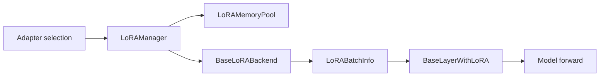
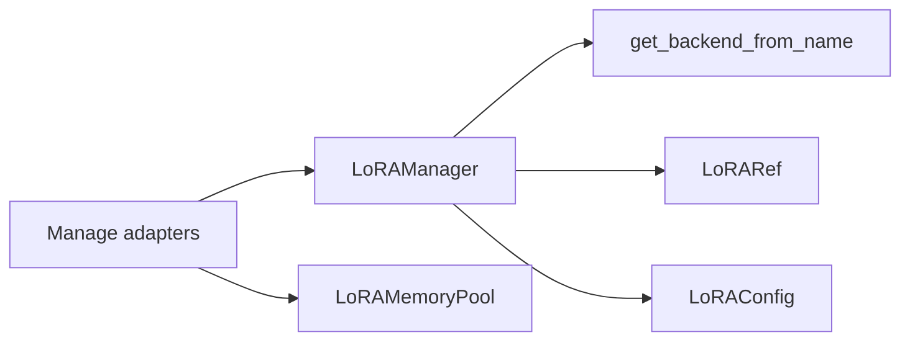
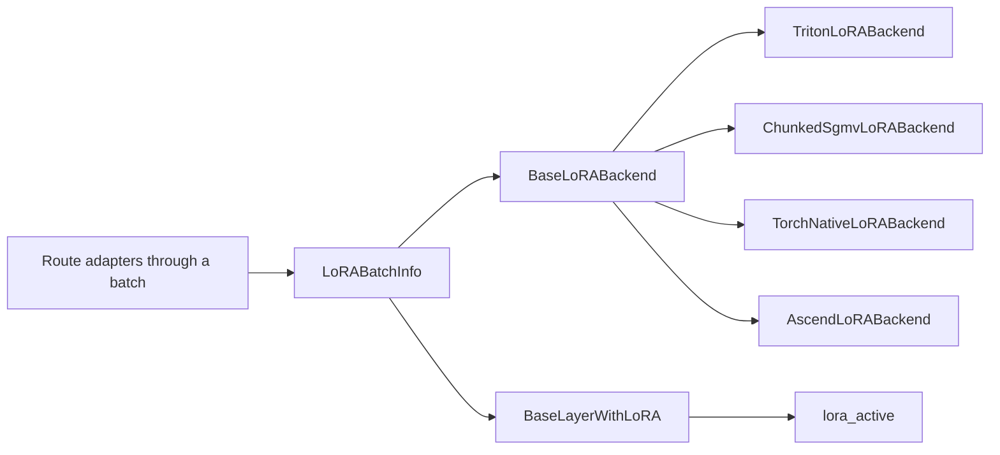

<!-- source: DeepWiki mcp.deepwiki.com · repo sgl-project/sglang · page 19 Advanced Features · fetched 2026-10-30 -->

# Advanced Features

Relevant source files

The following files were used as context for generating this wiki page:

- [python/sglang/srt/layers/moe/moe_runner/__init__.py](python/sglang/srt/layers/moe/moe_runner/__init__.py)
- [python/sglang/srt/layers/moe/token_dispatcher/standard.py](python/sglang/srt/layers/moe/token_dispatcher/standard.py)
- [python/sglang/srt/lora/backend/ascend_backend.py](python/sglang/srt/lora/backend/ascend_backend.py)
- [python/sglang/srt/lora/backend/base_backend.py](python/sglang/srt/lora/backend/base_backend.py)
- [python/sglang/srt/lora/backend/chunked_backend.py](python/sglang/srt/lora/backend/chunked_backend.py)
- [python/sglang/srt/lora/backend/torch_backend.py](python/sglang/srt/lora/backend/torch_backend.py)
- [python/sglang/srt/lora/backend/triton_backend.py](python/sglang/srt/lora/backend/triton_backend.py)
- [python/sglang/srt/lora/layers.py](python/sglang/srt/lora/layers.py)
- [python/sglang/srt/lora/lora.py](python/sglang/srt/lora/lora.py)
- [python/sglang/srt/lora/lora_config.py](python/sglang/srt/lora/lora_config.py)
- [python/sglang/srt/lora/lora_manager.py](python/sglang/srt/lora/lora_manager.py)
- [python/sglang/srt/lora/lora_moe_runners.py](python/sglang/srt/lora/lora_moe_runners.py)
- [python/sglang/srt/lora/mem_pool.py](python/sglang/srt/lora/mem_pool.py)
- [python/sglang/srt/lora/utils.py](python/sglang/srt/lora/utils.py)
- [test/registered/lora/test_moe_lora_info.py](test/registered/lora/test_moe_lora_info.py)
- [test/registered/unit/layers/moe/test_standard_dispatcher.py](test/registered/unit/layers/moe/test_standard_dispatcher.py)
- [test/registered/unit/layers/moe/test_standard_dispatcher_runner_backend.py](test/registered/unit/layers/moe/test_standard_dispatcher_runner_backend.py)
- [test/registered/unit/lora/test_lora_moe_inplace_unit.py](test/registered/unit/lora/test_lora_moe_inplace_unit.py)
- [test/registered/unit/lora/test_mem_pool_ep_unit.py](test/registered/unit/lora/test_mem_pool_ep_unit.py)

## Purpose and Scope

This page introduces SGLang’s advanced capabilities and shows how they relate to one another at a high level. It is a parent page: consult the child pages for implementation details and configuration. The supplied code excerpts document LoRA internals; the other topics below are scoped by their child pages.

Sources: [python/sglang/srt/lora/lora_manager.py:68-81]()

## Overview

The child pages cover adapter serving, constrained generation, observability, stateful sessions, function calling, discrete diffusion LLMs, and RL-oriented engine features. Together, these topics extend generation beyond a basic request-and-response flow. For details, see the relevant child page.

| Feature | Focus | Details |
|---|---|---|
| LoRA Adapter Support | Adapter management, multi-adapter execution, memory pools, backends, and MoE LoRA | [LoRA Adapter Support](#19.1) |
| Constrained and Structured Output | Grammar constraints, JSON schema, and structured output backends | [Constrained and Structured Output](#19.2) |
| Observability and Monitoring | Metrics, tracing, request timing, and dashboards | [Observability and Monitoring](#19.3) |
| Session Management | Stateful and streaming interactions across turns | [Session Management](#19.4) |
| Function Calling and Tool Use | Parsing model tool-call formats and reasoning output | [Function Calling and Tool Use](#19.5) |
| Diffusion LLM (DLLM) Support | Discrete diffusion models and denoising-oriented generation | [Diffusion LLM (DLLM) Support](#19.6) |
| RL Integration and Advanced Engine Features | Engine lifecycle, weight updates, rollouts, and post-training integrations | [RL Integration and Advanced Engine Features](#19.7) |

Sources: [python/sglang/srt/lora/lora_manager.py:68-81]()

## Architecture Integration

The diagram traces the LoRA path represented in the provided code: `LoRAManager` selects a backend and initializes state; LoRA layers use backend batch metadata during forward execution. It is an example of how an advanced feature plugs into model execution, not a complete architecture diagram for every feature.

**Diagram: LoRA Feature Integration**

Sources: [python/sglang/srt/lora/lora_manager.py:68-81](), [python/sglang/srt/lora/mem_pool.py:131-149](), [python/sglang/srt/lora/backend/base_backend.py:18-45](), [python/sglang/srt/lora/utils.py:51-105](), [python/sglang/srt/lora/layers.py:45-88]()

## Feature-Specific Overviews

### LoRA Adapter Support

`LoRAManager` is initialized with a base model, a maximum number of adapters per batch, server arguments, and a backend name. It creates the selected backend through `get_backend_from_name` and initializes its state. `LoRAMemoryPool` manages adapter-module memory, while `BaseLayerWithLoRA` provides a wrapper layer that consults backend batch metadata to determine whether LoRA execution is active. For details, see [LoRA Adapter Support](#19.1).

Sources: [python/sglang/srt/lora/lora_manager.py:68-81](), [python/sglang/srt/lora/lora_manager.py:132-150](), [python/sglang/srt/lora/mem_pool.py:131-149](), [python/sglang/srt/lora/layers.py:45-88]()

### Constrained and Structured Output

This child page covers grammar constraints, JSON schema, and structured output generation with `xgrammar`, `outlines`, and `llguidance`. See [Constrained and Structured Output](#19.2) for details.

Sources: [python/sglang/srt/lora/lora_manager.py:68-81]()

### Observability and Monitoring

This child page covers metrics collection, Prometheus integration, OpenTelemetry tracing, request-time statistics, production metrics, and the Grafana stack. See [Observability and Monitoring](#19.3) for details.

Sources: [python/sglang/srt/lora/lora_manager.py:68-81]()

### Session Management

This child page covers session-based APIs, streaming sessions, context persistence, and multi-turn conversations. See [Session Management](#19.4) for details.

Sources: [python/sglang/srt/lora/lora_manager.py:68-81]()

### Function Calling and Tool Use

This child page covers function-call parsing, model-specific detectors, tool-call formats, and reasoning parsers. See [Function Calling and Tool Use](#19.5) for details.

Sources: [python/sglang/srt/lora/lora_manager.py:68-81]()

### Diffusion LLM (DLLM) Support

This child page covers discrete diffusion LLM support, including LLaDA2 and SDAR, `DllmConfig`, `SchedulerDllmMixin`, and denoising algorithms for masked language models. See [Diffusion LLM (DLLM) Support](#19.6) for details.

Sources: [python/sglang/srt/lora/lora_manager.py:68-81]()

### RL Integration and Advanced Engine Features

This child page covers engine sleep and wake, weight refit, partial rollout, deterministic inference, checkpointing, state capturers, and post-training framework integrations. See [RL Integration and Advanced Engine Features](#19.7) for details.

Sources: [python/sglang/srt/lora/lora_manager.py:68-81]()

## Natural-Language and Code-Entity Mapping

The following diagrams connect adapter-serving concepts to code symbols visible in the supplied files, bridging natural-language descriptions to code entity names.

**Diagram: Adapter Management Entities**

Sources: [python/sglang/srt/lora/lora_manager.py:32-38](), [python/sglang/srt/lora/lora_manager.py:68-81](), [python/sglang/srt/lora/mem_pool.py:131-149]()

**Diagram: Multi-Adapter Forward Execution**

Sources: [python/sglang/srt/lora/utils.py:51-105](), [python/sglang/srt/lora/backend/base_backend.py:18-45](), [python/sglang/srt/lora/backend/triton_backend.py:29-40](), [python/sglang/srt/lora/backend/chunked_backend.py:27-41](), [python/sglang/srt/lora/backend/torch_backend.py:16-35](), [python/sglang/srt/lora/backend/ascend_backend.py:13-22](), [python/sglang/srt/lora/layers.py:45-88]()

## LoRA Backend Notes

The supplied implementation includes Triton, chunked SGMV, Torch-native, and Ascend backend classes. `BaseLoRABackend` defines common backend state and capabilities, including per-batch metadata and support flags. Backend-specific behavior and limitations are documented on [LoRA Adapter Support](#19.1).

Sources: [python/sglang/srt/lora/backend/base_backend.py:18-45](), [python/sglang/srt/lora/backend/triton_backend.py:29-40](), [python/sglang/srt/lora/backend/chunked_backend.py:27-41](), [python/sglang/srt/lora/backend/torch_backend.py:16-45](), [python/sglang/srt/lora/backend/ascend_backend.py:13-22]()

## LoRA and MoE

The LoRA manager records MoE-related settings, including the MoE runner backend and whether virtual experts are enabled. `LoRAMemoryPool` determines whether expert IDs are local or global based on the MoE parallel context and runner behavior. `StandardDispatcher` checks for compatible expert-ID conventions when LoRA is used with expert parallelism. See [LoRA Adapter Support](#19.1) for MoE LoRA details.

Sources: [python/sglang/srt/lora/lora_manager.py:121-130](), [python/sglang/srt/lora/mem_pool.py:92-128](), [python/sglang/srt/lora/mem_pool.py:165-188](), [python/sglang/srt/layers/moe/token_dispatcher/standard.py:117-145]()

---

