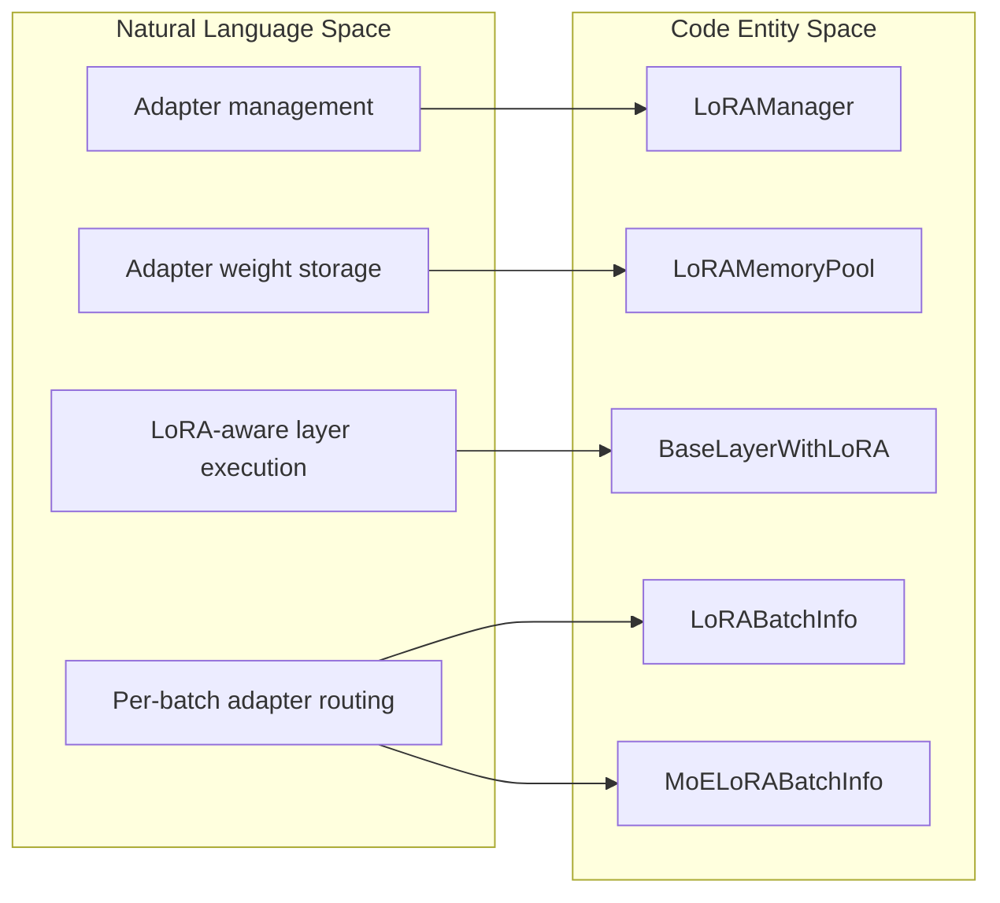
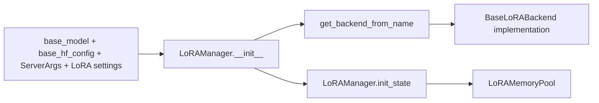
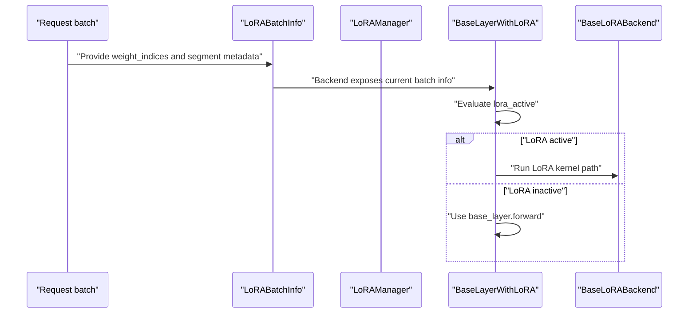
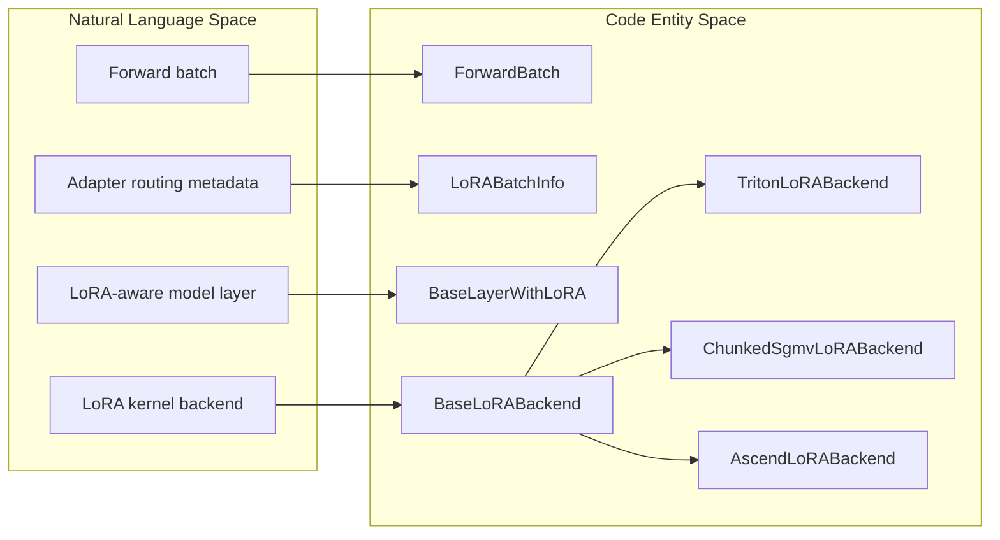

<!-- source: DeepWiki mcp.deepwiki.com · repo sgl-project/sglang · page 19.1 LoRA Adapter Support · fetched 2026-10-30 -->

# LoRA Adapter Support

Relevant source files

The following files were used as context for generating this wiki page:

- [python/sglang/srt/layers/moe/moe_runner/__init__.py](python/sglang/srt/layers/moe/moe_runner/__init__.py)
- [python/sglang/srt/layers/moe/token_dispatcher/standard.py](python/sglang/srt/layers/moe/token_dispatcher/standard.py)
- [python/sglang/srt/lora/backend/ascend_backend.py](python/sglang/srt/lora/backend/ascend_backend.py)
- [python/sglang/srt/lora/backend/base_backend.py](python/sglang/srt/lora/backend/base_backend.py)
- [python/sglang/srt/lora/backend/chunked_backend.py](python/sglang/srt/lora/backend/chunked_backend.py)
- [python/sglang/srt/lora/backend/torch_backend.py](python/sglang/srt/lora/backend/torch_backend.py)
- [python/sglang/srt/lora/backend/triton_backend.py](python/sglang/srt/lora/backend/triton_backend.py)
- [python/sglang/srt/lora/layers.py](python/sglang/srt/lora/layers.py)
- [python/sglang/srt/lora/lora.py](python/sglang/srt/lora/lora.py)
- [python/sglang/srt/lora/lora_config.py](python/sglang/srt/lora/lora_config.py)
- [python/sglang/srt/lora/lora_manager.py](python/sglang/srt/lora/lora_manager.py)
- [python/sglang/srt/lora/lora_moe_runners.py](python/sglang/srt/lora/lora_moe_runners.py)
- [python/sglang/srt/lora/mem_pool.py](python/sglang/srt/lora/mem_pool.py)
- [python/sglang/srt/lora/utils.py](python/sglang/srt/lora/utils.py)
- [test/registered/lora/test_moe_lora_info.py](test/registered/lora/test_moe_lora_info.py)
- [test/registered/unit/layers/moe/test_standard_dispatcher.py](test/registered/unit/layers/moe/test_standard_dispatcher.py)
- [test/registered/unit/layers/moe/test_standard_dispatcher_runner_backend.py](test/registered/unit/layers/moe/test_standard_dispatcher_runner_backend.py)
- [test/registered/unit/lora/test_lora_moe_inplace_unit.py](test/registered/unit/lora/test_lora_moe_inplace_unit.py)
- [test/registered/unit/lora/test_mem_pool_ep_unit.py](test/registered/unit/lora/test_mem_pool_ep_unit.py)

## Purpose and scope

This page documents SGLang’s LoRA adapter support: adapter management, memory-pool responsibilities, per-batch routing metadata, execution backends, eviction-policy selection, and MoE LoRA integration. The implementation identifies S-LoRA and Punica as inspirations for the serving design. [python/sglang/srt/lora/lora_manager.py:15-16]()

Sources: [python/sglang/srt/lora/lora_manager.py:15-16]()

---

## 1. Architecture and component overview

The LoRA path connects adapter management to model layers and kernels. `LoRAManager` is initialized with the base model, model configuration, batch capacity, loading configuration, server arguments, backend name, and optional rank, target-module, and adapter-path settings. It selects a backend through `get_backend_from_name`, constructs it, and initializes manager state. [python/sglang/srt/lora/lora_manager.py:68-81]()[python/sglang/srt/lora/lora_manager.py:132-150]()

`LoRAMemoryPool` owns adapter-buffer management and records model, rank, target-module, parallelism, eviction-policy, and loading-related configuration. `BaseLayerWithLoRA` wraps a base layer and holds the selected backend; its `lora_active` property uses backend batch metadata and capture state to decide whether LoRA kernels should run. [python/sglang/srt/lora/mem_pool.py:131-163]()[python/sglang/srt/lora/layers.py:45-86]()

| Responsibility | Code entity | Role |
|---|---|---|
| Coordinate LoRA setup and backend selection | `LoRAManager` | Receives model and LoRA configuration, selects a backend, and initializes its state. [python/sglang/srt/lora/lora_manager.py:68-81]()[python/sglang/srt/lora/lora_manager.py:132-150]() |
| Manage adapter weight storage | `LoRAMemoryPool` | Holds pool configuration, including capacity, target modules, rank, eviction policy, and overlap-loading configuration. [python/sglang/srt/lora/mem_pool.py:131-163]() |
| Wrap a model layer | `BaseLayerWithLoRA` | Keeps the base layer and backend; determines whether the current batch should execute LoRA kernels. [python/sglang/srt/lora/layers.py:45-86]() |
| Represent dense-LoRA batch routing | `LoRABatchInfo` | Carries segment boundaries, adapter indices, ranks, scaling values, and activity metadata. [python/sglang/srt/lora/utils.py:51-104]() |
| Represent MoE-LoRA routing | `MoELoRABatchInfo` | Carries request segments, per-request adapter indices, enabled-adapter mask, and token-to-adapter mapping. [python/sglang/srt/lora/utils.py:35-49]() |

### Natural-language-to-code map

This diagram maps the serving concepts used on this page to the implementation entities that implement them.

Sources: [python/sglang/srt/lora/lora_manager.py:68-81]()[python/sglang/srt/lora/mem_pool.py:131-163]()[python/sglang/srt/lora/layers.py:45-86]()[python/sglang/srt/lora/utils.py:35-104]()

### Initialization and component wiring

`LoRAManager` chooses its dense LoRA backend by name and passes the configured maximum adapters per batch, device, and server arguments to the backend constructor. It also reads LoRA runtime settings such as eviction policy, overlap loading, strict loading, and virtual-expert behavior from runtime configuration. [python/sglang/srt/lora/lora_manager.py:95-130]()[python/sglang/srt/lora/lora_manager.py:132-150]()

Sources: [python/sglang/srt/lora/lora_manager.py:68-81]()[python/sglang/srt/lora/lora_manager.py:95-150]()

---

## 2. Memory management and LoRA memory pool

`LoRAMemoryPool` is constructed with the base model and configuration, maximum adapters per batch, dtype, maximum LoRA rank, target modules, eviction policy, added-token capacity, and flags for shared outer MoE LoRAs, strict loading, and overlap loading. It records tensor-parallel context and queries MoE expert-parallel and MoE tensor-parallel context for MoE weight handling. [python/sglang/srt/lora/mem_pool.py:131-163]()[python/sglang/srt/lora/mem_pool.py:165-188]()

The pool’s EP handling distinguishes runner backends that retain global expert IDs from paths that use local expert IDs. The pool detects whether the MoE runner preserves global IDs and, when applicable, determines whether LoRA buffers should use local expert IDs. It also obtains `moe_tp_size` and `moe_tp_rank` separately from the outer TP context because MoE expert weights can be sharded differently from attention weights. [python/sglang/srt/lora/mem_pool.py:92-129]()[python/sglang/srt/lora/mem_pool.py:165-188]()

| Pool concern | Implementation detail |
|---|---|
| Capacity and layout configuration | The constructor accepts `max_loras_per_batch`, `max_lora_rank`, `target_modules`, and dtype. [python/sglang/srt/lora/mem_pool.py:136-163]() |
| Parallel layout | The pool records TP size and rank, then obtains separate MoE EP and MoE TP context. [python/sglang/srt/lora/mem_pool.py:154-163]()[python/sglang/srt/lora/mem_pool.py:165-188]() |
| Expert-ID convention | `_moe_runner_keeps_global_expert_ids()` recognizes selected FlashInfer and HPC runner variants; the result informs `moe_use_local_expert_ids`. [python/sglang/srt/lora/mem_pool.py:113-129]()[python/sglang/srt/lora/mem_pool.py:172-178]() |
| Eviction policy | The pool constructor receives an `eviction_policy`; `LoRAManager` reads the configured policy from LoRA runtime settings. [python/sglang/srt/lora/mem_pool.py:136-149]()[python/sglang/srt/lora/lora_manager.py:119-123]() |
| Overlap-loading compatibility | The pool records `enable_lora_overlap_loading`; the manager rejects the configuration when DP attention is enabled and the pool class does not advertise overlap-loading support. [python/sglang/srt/lora/mem_pool.py:134-149]()[python/sglang/srt/lora/lora_manager.py:95-108]() |

Sources: [python/sglang/srt/lora/mem_pool.py:92-149]()[python/sglang/srt/lora/mem_pool.py:154-188]()[python/sglang/srt/lora/lora_manager.py:95-123]()

---

## 3. Multi-LoRA serving lifecycle and overlap loading

### Adapter configuration and batch routing

The manager accepts optional `lora_paths`, target modules, and maximum rank as initialization inputs, then calls `init_state` with those values. [python/sglang/srt/lora/lora_manager.py:68-81]()[python/sglang/srt/lora/lora_manager.py:145-150]()

At execution time, dense-LoRA routing is represented by `LoRABatchInfo`. It includes segment boundaries (`seg_indptr`), adapter indices (`weight_indices`), per-adapter ranks and scalings, optional segment lengths, and a `has_active_lora` flag. Separate request-level segment pointers and adapter indices are available for MoE virtual-expert routing. [python/sglang/srt/lora/utils.py:51-104]()

The Triton backend includes helpers for constructing routing metadata for an explicit token order. `build_token_lora_batch_info` creates one-token segments from `weight_indices`; if MoE LoRA metadata is required, it constructs `MoELoRABatchInfo` with corresponding request and token adapter mappings. [python/sglang/srt/lora/backend/triton_backend.py:33-70]()

### Overlap-loading constraints

The manager reads `enable_lora_overlap_loading` from runtime context. When DP attention is enabled, initialization raises an error if overlap loading is enabled but the selected `LoRAMemoryPool` class does not support DP-attention overlap loading. The pool base class shown here declares `supports_dp_attention_overlap_loading = False`. [python/sglang/srt/lora/lora_manager.py:95-108]()[python/sglang/srt/lora/mem_pool.py:131-135]()

Sources: [python/sglang/srt/lora/lora_manager.py:68-81]()[python/sglang/srt/lora/lora_manager.py:95-108]()[python/sglang/srt/lora/mem_pool.py:131-135]()[python/sglang/srt/lora/utils.py:51-104]()[python/sglang/srt/lora/backend/triton_backend.py:33-70]()

### Routing and execution flow

Sources: [python/sglang/srt/lora/utils.py:51-104]()[python/sglang/srt/lora/layers.py:66-86]()[python/sglang/srt/lora/layers.py:88-97]()

---

## 4. Model execution, backends, and kernels

### LoRA layer abstraction

`BaseLayerWithLoRA` stores a reference to the wrapped base layer and a `BaseLoRABackend`. Its default `forward` delegates to the base layer. The `lora_active` property checks whether LoRA has been enabled on the wrapper and whether the backend has batch metadata; it then accounts for backend skip-inactive settings and CUDA graph capture. [python/sglang/srt/lora/layers.py:45-86]()

Layer-specific wrappers and methods use the backend to compute LoRA contributions. For example, `VocabParallelEmbeddingWithLoRA` stores embedding buffers and uses the backend’s LoRA-B operation after producing LoRA-A embedding outputs. [python/sglang/srt/lora/layers.py:99-158]()[python/sglang/srt/lora/layers.py:160-173]()

Sources: [python/sglang/srt/lora/layers.py:45-86]()[python/sglang/srt/lora/layers.py:99-173]()

### Execution entities and dataflow

Sources: [python/sglang/srt/lora/utils.py:51-104]()[python/sglang/srt/lora/layers.py:45-86]()[python/sglang/srt/lora/backend/triton_backend.py:17-30]()[python/sglang/srt/lora/backend/chunked_backend.py:15-41]()[python/sglang/srt/lora/backend/ascend_backend.py:1-14]()

### Execution backends

`LoRAManager` resolves the configured backend name through `get_backend_from_name` and creates the backend with the batch-capacity, device, and server-argument context. [python/sglang/srt/lora/lora_manager.py:132-143]()[python/sglang/srt/lora/backend/triton_backend.py:17-30]()[python/sglang/srt/lora/backend/chunked_backend.py:15-41]()[python/sglang/srt/lora/backend/ascend_backend.py:1-22]()

| Backend | Implementation and behavior shown |
|---|---|
| Triton | Imports dense LoRA kernels for embedding, SGEMM, QKV, and gate-up operations and provides token-routing helpers. [python/sglang/srt/lora/backend/triton_backend.py:1-30]()[python/sglang/srt/lora/backend/triton_backend.py:33-70]() |
| Chunked SGMV (`csgmv`) | `ChunkedSgmvLoRABackend` uses segmented matrix-vector multiplication and chunks sequences to reduce excessive kernel launches when adapter distribution is skewed. It declares prefill CUDA graph support. [python/sglang/srt/lora/backend/chunked_backend.py:27-41]() |
| Ascend | `AscendLoRABackend` implements embedding, shrink, and expand operations; its shown methods call NPU operations for dense LoRA computation. [python/sglang/srt/lora/backend/ascend_backend.py:13-22]()[python/sglang/srt/lora/backend/ascend_backend.py:24-85]()[python/sglang/srt/lora/backend/ascend_backend.py:87-116]() |

The Triton backend also contains DP-attention routing helpers. They gather DP-local adapter indices into a global token layout and construct global batch metadata for TP-global model sections. [python/sglang/srt/lora/backend/triton_backend.py:73-104]()[python/sglang/srt/lora/backend/triton_backend.py:107-159]()

Sources: [python/sglang/srt/lora/lora_manager.py:132-143]()[python/sglang/srt/lora/backend/triton_backend.py:1-159]()[python/sglang/srt/lora/backend/chunked_backend.py:27-41]()[python/sglang/srt/lora/backend/ascend_backend.py:13-116]()

---

## 5. Special LoRA types

### Embedding LoRA

`VocabParallelEmbeddingWithLoRA` implements embedding-specific LoRA handling. It stores embedding dimensions and vocabulary information, accepts embedding buffers through `set_lora_info`, and describes the embedding delta as an LoRA-A lookup followed by an LoRA-B projection. [python/sglang/srt/lora/layers.py:99-158]()[python/sglang/srt/lora/layers.py:160-173]()

The wrapper documents that, with TP greater than one, embedding LoRA weights are replicated rather than sharded. It also asserts against the combination of TP greater than one and input-scattered attention context. [python/sglang/srt/lora/layers.py:118-133]()

The Ascend backend’s embedding implementation rejects extra embeddings (added tokens). The chunked SGMV backend likewise asserts that extra embeddings are absent in its LoRA-A embedding path. [python/sglang/srt/lora/backend/ascend_backend.py:24-30]()[python/sglang/srt/lora/backend/chunked_backend.py:52-69]()

Sources: [python/sglang/srt/lora/layers.py:99-173]()[python/sglang/srt/lora/backend/ascend_backend.py:24-30]()[python/sglang/srt/lora/backend/chunked_backend.py:52-69]()

### MoE LoRA

The MoE LoRA implementation injects LoRA deltas at two stages: after the gate-up projection and before activation, and after the down projection and before the final reduction. It uses hook closures so MoE backends can call into LoRA without requiring a separate LoRA runner subclass for every backend. [python/sglang/srt/lora/lora_moe_runners.py:15-23]()

`LoRAInfo` carries the MoE LoRA weights, segment pointers, request-to-adapter mapping, rank and enabled-adapter metadata, token-to-adapter mapping, expert count, and options such as shared outer LoRAs and virtual experts. [python/sglang/srt/lora/lora_moe_runners.py:149-188]()

For small batches, `_naive_moe_lora_align_block_size` constructs token/expert alignment on CPU and transfers the resulting tensors to the target device. The module also imports `moe_lora_align_block_size` for supported accelerator platforms. [python/sglang/srt/lora/lora_moe_runners.py:39-42]()[python/sglang/srt/lora/lora_moe_runners.py:66-84]()[python/sglang/srt/lora/lora_moe_runners.py:85-146]()

`StandardDispatcher` records the runner’s expert-ID convention. It rejects an EP configuration where the dispatcher’s global-versus-local expert-ID convention disagrees with the MoE runner convention while LoRA is enabled or adapter paths are configured. [python/sglang/srt/layers/moe/token_dispatcher/standard.py:105-145]()

`LoRAMemoryPool` uses the MoE EP context, runner convention, and MoE TP context to decide how per-expert LoRA buffers are represented and sized. [python/sglang/srt/lora/mem_pool.py:165-188]()[test/registered/unit/lora/test_mem_pool_ep_unit.py:1-10]()

```mermaid
flowchart LR
    RequestSegments["MoE request segments"]
    BatchRouting["MoELoRABatchInfo"]
    Dispatcher["StandardDispatcher"]
    ExpertRouting["topk expert routing"]
    Hooks["LoRAHooks"]
    GateUp["LoRA delta after gate_up projection"]
    Down["LoRA delta after down projection"]
    Reduction["Final expert reduction"]

    RequestSegments --> BatchRouting
    BatchRouting --> Dispatcher
    Dispatcher --> ExpertRouting
    ExpertRouting --> Hooks
    Hooks --> GateUp
    GateUp --> Down
    Down --> Reduction
```

Sources: [python/sglang/srt/lora/lora_moe_runners.py:15-23]()[python/sglang/srt/lora/lora_moe_runners.py:149-188]()[python/sglang/srt/layers/moe/token_dispatcher/standard.py:105-145]()[python/sglang/srt/lora/utils.py:35-49]()

---

