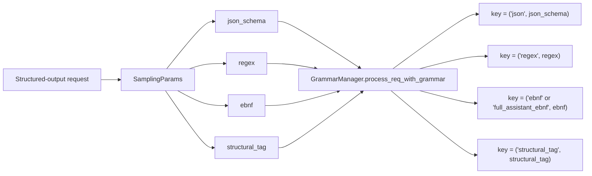
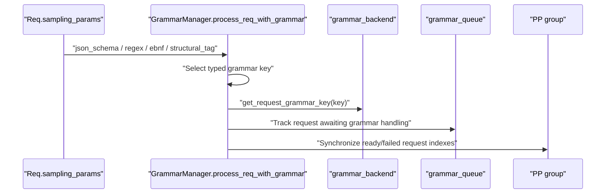
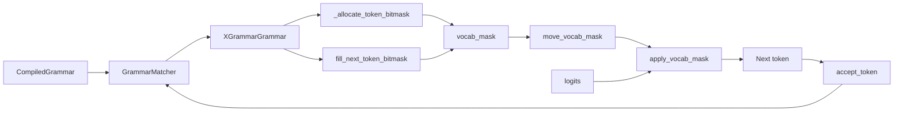

<!-- source: DeepWiki mcp.deepwiki.com · repo sgl-project/sglang · page 19.2 Constrained and Structured Output · fetched 2026-10-30 -->

# Constrained and Structured Output

Relevant source files

The following files were used as context for generating this wiki page:

- [python/sglang/srt/constrained/base_grammar_backend.py](python/sglang/srt/constrained/base_grammar_backend.py)
- [python/sglang/srt/constrained/grammar_manager.py](python/sglang/srt/constrained/grammar_manager.py)
- [python/sglang/srt/constrained/reasoner_grammar_backend.py](python/sglang/srt/constrained/reasoner_grammar_backend.py)
- [python/sglang/srt/managers/scheduler_components/invariant_checker.py](python/sglang/srt/managers/scheduler_components/invariant_checker.py)
- [python/sglang/srt/managers/scheduler_components/pool_stats_observer.py](python/sglang/srt/managers/scheduler_components/pool_stats_observer.py)
- [python/sglang/srt/sampling/sampling_params.py](python/sglang/srt/sampling/sampling_params.py)
- [python/sglang/test/kits/anthropic_messages_kit.py](python/sglang/test/kits/anthropic_messages_kit.py)
- [python/sglang/test/kits/json_mode_kit.py](python/sglang/test/kits/json_mode_kit.py)
- [rust/sglang-server/src/api_server.rs](rust/sglang-server/src/api_server.rs)
- [rust/sglang-server/src/api_server/disaggregation.rs](rust/sglang-server/src/api_server/disaggregation.rs)
- [rust/sglang-server/src/api_server/disaggregation/bootstrap.rs](rust/sglang-server/src/api_server/disaggregation/bootstrap.rs)
- [rust/sglang-server/src/message/sampling.rs](rust/sglang-server/src/message/sampling.rs)
- [rust/sglang-server/src/utils.rs](rust/sglang-server/src/utils.rs)
- [rust/sglang-server/src/utils/environ.rs](rust/sglang-server/src/utils/environ.rs)
- [rust/sglang-server/src/utils/regex.rs](rust/sglang-server/src/utils/regex.rs)
- [rust/sglang-server/src/utils/response.rs](rust/sglang-server/src/utils/response.rs)
- [rust/sglang-server/src/utils/serialize.rs](rust/sglang-server/src/utils/serialize.rs)
- [rust/sglang-server/src/utils/sock.rs](rust/sglang-server/src/utils/sock.rs)
- [test/registered/constrained_decoding/test_constrained_decoding.py](test/registered/constrained_decoding/test_constrained_decoding.py)
- [test/registered/e2e/xpu/test_dspark_intel_xpu.py](test/registered/e2e/xpu/test_dspark_intel_xpu.py)
- [test/registered/scheduler/test_retract_decode.py](test/registered/scheduler/test_retract_decode.py)
- [test/registered/tokenizer/test_skip_tokenizer_init.py](test/registered/tokenizer/test_skip_tokenizer_init.py)
- [test/registered/unit/constrained/test_base_grammar_backend.py](test/registered/unit/constrained/test_base_grammar_backend.py)
- [test/registered/unit/constrained/test_grammar_manager.py](test/registered/unit/constrained/test_grammar_manager.py)
- [test/registered/unit/constrained/test_reasoner_grammar_backend.py](test/registered/unit/constrained/test_reasoner_grammar_backend.py)
- [test/registered/unit/layers/test_minicpm_sparse_cache.py](test/registered/unit/layers/test_minicpm_sparse_cache.py)
- [test/registered/unit/managers/scheduler_components/test_invariant_checker.py](test/registered/unit/managers/scheduler_components/test_invariant_checker.py)
- [test/registered/unit/managers/test_io_struct.py](test/registered/unit/managers/test_io_struct.py)
- [test/registered/unit/managers/test_kv_page_invariants.py](test/registered/unit/managers/test_kv_page_invariants.py)
- [test/registered/unit/managers/test_stop_str_speculative.py](test/registered/unit/managers/test_stop_str_speculative.py)
- [test/registered/unit/managers/test_trim_matched_stop.py](test/registered/unit/managers/test_trim_matched_stop.py)
- [test/registered/unit/sampling/test_sampling_params.py](test/registered/unit/sampling/test_sampling_params.py)

## Purpose and scope

SGLang accepts per-request grammar constraints for structured generation, including JSON Schema, regular expressions, EBNF, and structural tags. The scheduler’s `GrammarManager` connects these request settings to a grammar backend; the backend tracks grammar state and produces vocabulary masks that exclude disallowed next tokens. This page describes the request fields, grammar-management path, backend contract, and the xgrammar mask flow [python/sglang/srt/sampling/sampling_params.py:169-172](), [python/sglang/srt/constrained/grammar_manager.py:31-65](), [python/sglang/srt/constrained/base_grammar_backend.py:58-106]().

The provided implementation details are strongest for xgrammar. The supplied files identify outlines and llguidance as related backend implementations, but do not include their contents; consequently, this page does not infer their internal classes, mask operations, or selection behavior [python/sglang/srt/constrained/base_grammar_backend.py:36-37]().

Sources: [python/sglang/srt/sampling/sampling_params.py:169-172](), [python/sglang/srt/constrained/grammar_manager.py:31-65](), [python/sglang/srt/constrained/base_grammar_backend.py:58-106](), [python/sglang/srt/constrained/base_grammar_backend.py:36-37]()

---

## Request constraints and supported forms

`SamplingParams` carries the structured-output fields `json_schema`, `regex`, `ebnf`, and `structural_tag`. These fields are separate from stopping controls such as `stop` and `stop_regex`: a grammar constraint shapes which tokens may be generated, whereas a stop condition controls when generation ends [python/sglang/srt/sampling/sampling_params.py:169-172]().

| Field | Constraint representation | Grammar-manager dispatch key |
|---|---|---|
| `json_schema` | JSON Schema string | `"json"` |
| `regex` | Regular-expression string | `"regex"` |
| `ebnf` | EBNF string | `"ebnf"` or `"full_assistant_ebnf"` when `ebnf_full_assistant` is true |
| `structural_tag` | Structural-tag string | `"structural_tag"` |

The dispatch keys and the full-assistant EBNF variant are selected in `GrammarManager.process_req_with_grammar` [python/sglang/srt/constrained/grammar_manager.py:148-172]().

The sampling-parameter tests treat an empty string for any of these four grammar fields as unset (`None`), rather than as a constraint that accepts no output [test/registered/unit/sampling/test_sampling_params.py:82-91]().

Sources: [python/sglang/srt/sampling/sampling_params.py:169-172](), [python/sglang/srt/constrained/grammar_manager.py:148-172](), [test/registered/unit/sampling/test_sampling_params.py:82-91]()

---

## Request-to-code map

This diagram connects the user-facing concept of a structured-output request to the concrete parameter fields and scheduler entry point. `GrammarManager` inspects the fields and constructs a backend key from the selected constraint [python/sglang/srt/sampling/sampling_params.py:169-172](), [python/sglang/srt/constrained/grammar_manager.py:148-172]().

**Diagram: Structured-output request mapped to code entities**

Sources: [python/sglang/srt/sampling/sampling_params.py:169-172](), [python/sglang/srt/constrained/grammar_manager.py:148-172]()

---

## GrammarManager lifecycle

`GrammarManager` is initialized with a scheduler, retains the scheduler’s `ServerArgs`, and creates a grammar backend using the scheduler tokenizer, vocabulary size, EOS token ID, and thinking-end IDs unless tokenizer initialization is skipped. It also holds a `grammar_queue` for requests awaiting grammar handling [python/sglang/srt/constrained/grammar_manager.py:31-45]().

When a request has a grammar field set, `process_req_with_grammar` checks whether a backend exists. If the backend is absent, it aborts the request with an error explaining that grammar-based generation is unsupported when the server is launched with `--grammar-backend none`. Otherwise, it chooses a typed key and passes the key through `get_request_grammar_key` [python/sglang/srt/constrained/grammar_manager.py:148-172]().

The manager also configures distributed grammar synchronization state: it records the DP/TP CPU group and rank information, plus PP rank, size, and group. Its PP synchronization path forwards ready and failed request-index sets through the pipeline [python/sglang/srt/constrained/grammar_manager.py:53-61](), [python/sglang/srt/constrained/grammar_manager.py:82-112]().

**Diagram: Request grammar handling and scheduler synchronization**

Sources: [python/sglang/srt/constrained/grammar_manager.py:31-45](), [python/sglang/srt/constrained/grammar_manager.py:53-61](), [python/sglang/srt/constrained/grammar_manager.py:82-112](), [python/sglang/srt/constrained/grammar_manager.py:148-172]()

---

## Backend contract, cache, and asynchronous compilation

`BaseGrammarObject` defines the per-grammar interface used for constrained decoding. Its operations include accepting or rolling back tokens, reporting termination, allocating and filling vocabulary masks, moving masks to a device, applying masks to logits, and attempting jump-forward generation. `GrammarRow` associates a grammar object with a row in a batched vocabulary-mask fill [python/sglang/srt/constrained/base_grammar_backend.py:51-106](), [python/sglang/srt/constrained/base_grammar_backend.py:119-145]().

`BaseGrammarBackend` provides a thread-pool executor and a cache keyed by `(grammar_type, grammar_value)`. The backend abstraction also defines `GrammarStats` for compilation and dispatch information, including compilation time, cache-hit status, traversal timings, and timeout count [python/sglang/srt/constrained/base_grammar_backend.py:39-49](), [python/sglang/srt/constrained/base_grammar_backend.py:201-213]().

The supplied backend unit tests verify that cache hits return a copy of the cached grammar object, while a cache miss returns a `Future`. They also verify dispatch routing for JSON, regex, EBNF, and structural-tag keys [test/registered/unit/constrained/test_base_grammar_backend.py:44-75](), [test/registered/unit/constrained/test_base_grammar_backend.py:81-96]().

| Contract element | Role |
|---|---|
| `accept_token(token)` | Advance grammar state with a generated token. |
| `rollback(k)` | Revert grammar state by a number of tokens. |
| `fill_vocab_mask(mask, row)` | Populate a vocabulary-mask row with allowed tokens. |
| `apply_vocab_mask(logits, mask)` | Apply the constraint to logits before selection. |
| `copy()` | Provide a request-specific grammar object from a cached object. |
| `try_jump_forward(tokenizer)` | Offer a possible deterministic string jump. |

The contract methods are declared on `BaseGrammarObject`; the xgrammar implementation supplies corresponding matcher-backed behavior [python/sglang/srt/constrained/base_grammar_backend.py:58-145]().

Sources: [python/sglang/srt/constrained/base_grammar_backend.py:39-49](), [python/sglang/srt/constrained/base_grammar_backend.py:51-145](), [python/sglang/srt/constrained/base_grammar_backend.py:201-213](), [test/registered/unit/constrained/test_base_grammar_backend.py:44-96]()

---

## xgrammar implementation

### Grammar object and token-state updates

`XGrammarGrammar` stores a `GrammarMatcher`, vocabulary size, compiled grammar context, optional stop-token override, accepted-token history, and optional grammar statistics. Its `accept_token` delegates token acceptance to the matcher and raises `ValueError` if the matcher rejects the token. `rollback` rolls back the matcher and truncates the accepted-token history; `is_terminated` delegates to the matcher.

The object’s `copy` method creates a fresh `GrammarMatcher` from the compiled context, preserving the rollback limit and stop-token override. When statistics are present, the copy marks them as a cache hit and resets its tree-traversal timing list.

### Vocabulary masks and logits

The xgrammar path represents allowed tokens as a bitmask. `_allocate_token_bitmask` allocates a tensor sized for the vocabulary and batch; it requests pinned memory when pin memory is available. `fill_vocab_mask` asks the matcher to fill the next-token bitmask for a row. `move_vocab_mask` transfers that mask to the target device using a non-blocking copy.

`apply_vocab_mask` selects an implementation based on the logits device: CUDA, XPU, and MUSA use a Triton operation except on HIP, which uses the `sgl_kernel` CUDA-named operation; NPU uses `torch.ops.npu.apply_token_bitmask`; CPU uses xgrammar’s CPU implementation. Other device types raise `RuntimeError`.

**Diagram: xgrammar matcher state to constrained logits**

Sources: [python/sglang/srt/constrained/base_grammar_backend.py:58-146]()

### Jump-forward support

`try_jump_forward` asks the matcher for a jump-forward string and returns it when available. `jump_and_retokenize` reconciles old and new output token IDs: it finds their shared prefix, rolls back the matcher for the changed suffix, and accepts replacement tokens [python/sglang/srt/constrained/base_grammar_backend.py:119-146]().

Sources: [python/sglang/srt/constrained/base_grammar_backend.py:119-146]()

---

## Reasoning-aware constraints

`ReasonerGrammarObject` wraps an optional grammar and tracks a reasoning phase separately from the constrained generation phase. It stores the reasoning terminator token sequence, a token-sequence matcher, optional excluded tokens, and a maximum thinking-token budget [python/sglang/srt/constrained/reasoner_grammar_backend.py:43-75]().

`maybe_init_reasoning` initializes the wrapper either for a request that uses reasoning or for one that begins directly in generation. During thinking, `transfer_state` tracks progress toward the terminator and counts thinking tokens; after the complete terminator is matched, it switches to the generation phase. `accept_token` forwards tokens to the wrapped grammar only during generation, then updates the wrapper’s phase state [python/sglang/srt/constrained/reasoner_grammar_backend.py:87-96](), [python/sglang/srt/constrained/reasoner_grammar_backend.py:154-167]().

`GrammarManager` can apply request-level reasoning configuration to a `ReasonerGrammarObject`. It validates a request-selected reasoning terminator against model-configured allowed sequences and can set `max_think_tokens` from the request’s `custom_params["thinking_budget"]` [python/sglang/srt/constrained/grammar_manager.py:129-147]().

**Diagram: Reasoning phase before constrained answer generation**

```mermaid
stateDiagram-v2
    [*] --> Thinking: "maybe_init_reasoning(True)"
    Thinking --> Thinking: "accept token; update terminator match"
    Thinking --> ConstrainedGeneration: "think_end_ids fully matched"
    ConstrainedGeneration --> ConstrainedGeneration: "grammar.accept_token(token)"
    ConstrainedGeneration --> [*]: "grammar termination"
```

Sources: [python/sglang/srt/constrained/reasoner_grammar_backend.py:43-75](), [python/sglang/srt/constrained/reasoner_grammar_backend.py:87-96](), [python/sglang/srt/constrained/reasoner_grammar_backend.py:154-167](), [python/sglang/srt/constrained/grammar_manager.py:129-147]()

---

## outlines and llguidance

The provided file inventory includes outlines and llguidance references or potential integration layers, but the contents of those backend files are not included in the supplied excerpts. Their internal class names, grammar compilation paths, supported features, and device-specific mask operations therefore cannot be documented reliably here [python/sglang/srt/constrained/base_grammar_backend.py:36-37]().

The common abstraction available in the supplied source is `BaseGrammarObject` and `BaseGrammarBackend`. Backend-specific claims should be grounded in the corresponding implementation before extending this section [python/sglang/srt/constrained/base_grammar_backend.py:58-106](), [python/sglang/srt/constrained/base_grammar_backend.py:201-213]().

Sources: [python/sglang/srt/constrained/base_grammar_backend.py:36-37](), [python/sglang/srt/constrained/base_grammar_backend.py:58-106](), [python/sglang/srt/constrained/base_grammar_backend.py:201-213]()

---

## Validation and request behavior

The grammar manager recognizes the four constraint fields and selects a grammar key according to the first matching field in its dispatch branch. If no grammar constraint is set, the request does not enter that constrained branch. If a constraint is set but no grammar backend is configured, the manager marks the request aborted with an explanatory error [python/sglang/srt/constrained/grammar_manager.py:148-172]().

Tests cover the accepted constraint field names and verify that empty grammar strings are normalized to `None`. The tests also exercise grammar-manager dispatch and no-backend behavior [test/registered/unit/sampling/test_sampling_params.py:82-91]().

Sources: [python/sglang/srt/constrained/grammar_manager.py:148-172](), [test/registered/unit/sampling/test_sampling_params.py:82-91]()

---

## Grammar statistics

`GrammarStats` defines optional fields for compilation time, schema count, EBNF size, cache-hit status, grammar-aborted status, tree-traversal timings, dispatch type, and timeout count. These fields provide a backend-level record of grammar compilation and mask traversal activity [python/sglang/srt/constrained/base_grammar_backend.py:39-49]().

Sources: [python/sglang/srt/constrained/base_grammar_backend.py:39-49]()

---

## Summary

Structured generation is configured through `SamplingParams` grammar fields and handled on the scheduler side by `GrammarManager`. The manager selects a typed grammar key and delegates grammar work to a backend; the backend contract represents token state and vocabulary-mask operations [python/sglang/srt/sampling/sampling_params.py:169-172](), [python/sglang/srt/constrained/grammar_manager.py:148-172](), [python/sglang/srt/constrained/base_grammar_backend.py:58-106]().

Sources: [python/sglang/srt/sampling/sampling_params.py:169-172](), [python/sglang/srt/constrained/grammar_manager.py:148-172](), [python/sglang/srt/constrained/base_grammar_backend.py:58-106]()

---

