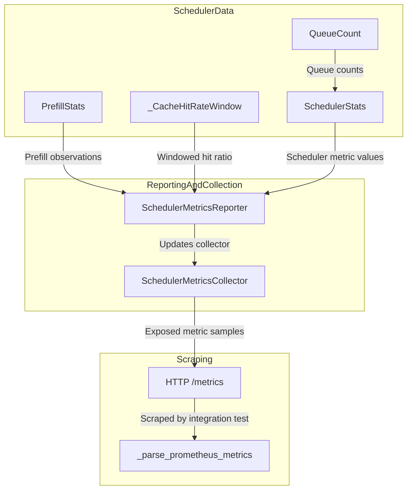
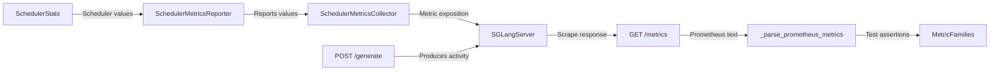
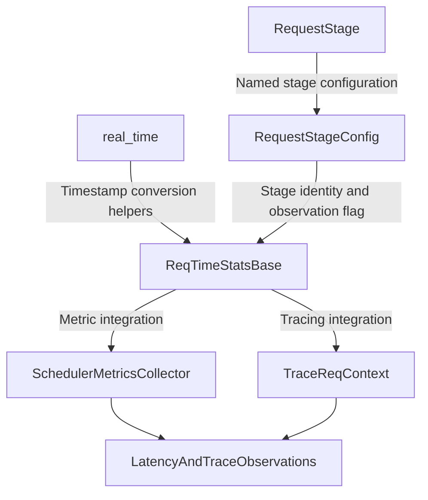
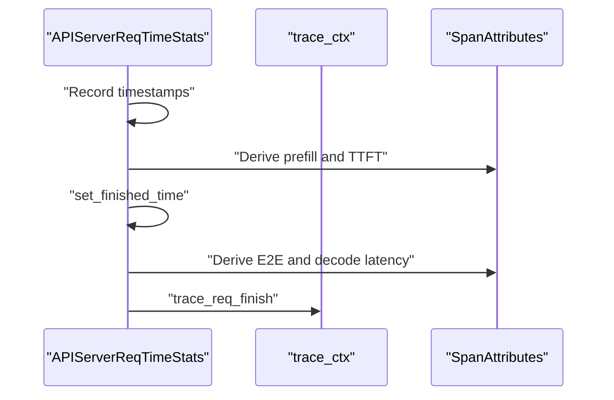

<!-- source: DeepWiki mcp.deepwiki.com · repo sgl-project/sglang · page 19.3 Observability and Monitoring · fetched 2026-10-30 -->

# Observability and Monitoring

Relevant source files

The following files were used as context for generating this wiki page:

- [benchmark/hicache/bench_host_memory_migration.py](benchmark/hicache/bench_host_memory_migration.py)
- [docs/docs/advanced_features/expert_parallelism.mdx](docs/docs/advanced_features/expert_parallelism.mdx)
- [docs/docs/advanced_features/hicache_best_practices.mdx](docs/docs/advanced_features/hicache_best_practices.mdx)
- [python/sglang/multimodal_gen/runtime/utils/trace_wrapper.py](python/sglang/multimodal_gen/runtime/utils/trace_wrapper.py)
- [python/sglang/srt/configs/zaya.py](python/sglang/srt/configs/zaya.py)
- [python/sglang/srt/debug_utils/dump_comparator.py](python/sglang/srt/debug_utils/dump_comparator.py)
- [python/sglang/srt/layers/attention/hpc_ops_backend.py](python/sglang/srt/layers/attention/hpc_ops_backend.py)
- [python/sglang/srt/layers/layer_boundary/residual/add_norm.py](python/sglang/srt/layers/layer_boundary/residual/add_norm.py)
- [python/sglang/srt/layers/moe/moe_runner/hpc_ops.py](python/sglang/srt/layers/moe/moe_runner/hpc_ops.py)
- [python/sglang/srt/managers/scheduler_components/metrics_reporter.py](python/sglang/srt/managers/scheduler_components/metrics_reporter.py)
- [python/sglang/srt/mem_cache/pool_host/base.py](python/sglang/srt/mem_cache/pool_host/base.py)
- [python/sglang/srt/mem_cache/pool_host/common.py](python/sglang/srt/mem_cache/pool_host/common.py)
- [python/sglang/srt/mem_cache/pool_host/dsa.py](python/sglang/srt/mem_cache/pool_host/dsa.py)
- [python/sglang/srt/mem_cache/pool_host/mamba.py](python/sglang/srt/mem_cache/pool_host/mamba.py)
- [python/sglang/srt/mem_cache/pool_host/mha.py](python/sglang/srt/mem_cache/pool_host/mha.py)
- [python/sglang/srt/mem_cache/pool_host/mla.py](python/sglang/srt/mem_cache/pool_host/mla.py)
- [python/sglang/srt/models/iquest_q1.py](python/sglang/srt/models/iquest_q1.py)
- [python/sglang/srt/models/zaya.py](python/sglang/srt/models/zaya.py)
- [python/sglang/srt/observability/metrics_collector.py](python/sglang/srt/observability/metrics_collector.py)
- [python/sglang/srt/observability/mooncake_trace.py](python/sglang/srt/observability/mooncake_trace.py)
- [python/sglang/srt/observability/req_time_stats.py](python/sglang/srt/observability/req_time_stats.py)
- [python/sglang/srt/observability/scheduler_stage_metrics.py](python/sglang/srt/observability/scheduler_stage_metrics.py)
- [python/sglang/srt/observability/trace.py](python/sglang/srt/observability/trace.py)
- [python/sglang/test/layer_ut_utils.py](python/sglang/test/layer_ut_utils.py)
- [python/sglang/test/quant_ref_utils.py](python/sglang/test/quant_ref_utils.py)
- [scripts/convert_otel_2_perfetto.py](scripts/convert_otel_2_perfetto.py)
- [test/registered/backends/test_deepseek_v3_fp4_cutedsl_moe.py](test/registered/backends/test_deepseek_v3_fp4_cutedsl_moe.py)
- [test/registered/core/test_engine_child_pids.py](test/registered/core/test_engine_child_pids.py)
- [test/registered/debug_utils/test_tensor_dump_forward_hook.py](test/registered/debug_utils/test_tensor_dump_forward_hook.py)
- [test/registered/kernels/ops/moe/test_fp4_moe.py](test/registered/kernels/ops/moe/test_fp4_moe.py)
- [test/registered/moe/test_hpc_ops_moe.py](test/registered/moe/test_hpc_ops_moe.py)
- [test/registered/observability/test_metrics.py](test/registered/observability/test_metrics.py)
- [test/registered/observability/test_tracing.py](test/registered/observability/test_tracing.py)
- [test/registered/observability/test_tracing_disaggregation.py](test/registered/observability/test_tracing_disaggregation.py)
- [test/registered/openai_server/function_call/test_anthropic_tool_use.py](test/registered/openai_server/function_call/test_anthropic_tool_use.py)
- [test/registered/openai_server/function_call/test_openai_function_calling.py](test/registered/openai_server/function_call/test_openai_function_calling.py)
- [test/registered/reasoning/test_reasoning.py](test/registered/reasoning/test_reasoning.py)
- [test/registered/sessions/test_session_control.py](test/registered/sessions/test_session_control.py)
- [test/registered/sessions/test_streaming_session.py](test/registered/sessions/test_streaming_session.py)
- [test/registered/sessions/test_streaming_session_swa.py](test/registered/sessions/test_streaming_session_swa.py)
- [test/registered/unit/configs/test_zaya_config.py](test/registered/unit/configs/test_zaya_config.py)
- [test/registered/unit/layers/quantization/test_nvfp4_linear_backends.py](test/registered/unit/layers/quantization/test_nvfp4_linear_backends.py)
- [test/registered/unit/layers/quantization/test_nvfp4_moe_backends.py](test/registered/unit/layers/quantization/test_nvfp4_moe_backends.py)
- [test/registered/unit/managers/test_scheduler_on_idle_load.py](test/registered/unit/managers/test_scheduler_on_idle_load.py)
- [test/registered/unit/mem_cache/test_asymmetric_mha_pool_host_unit.py](test/registered/unit/mem_cache/test_asymmetric_mha_pool_host_unit.py)
- [test/registered/unit/mem_cache/test_hicache_dcp_host_pool.py](test/registered/unit/mem_cache/test_hicache_dcp_host_pool.py)
- [test/registered/unit/mem_cache/test_hicache_host_register.py](test/registered/unit/mem_cache/test_hicache_host_register.py)
- [test/registered/unit/mem_cache/test_hicache_storage_registration_hook.py](test/registered/unit/mem_cache/test_hicache_storage_registration_hook.py)
- [test/registered/unit/mem_cache/test_mem_pool_host.py](test/registered/unit/mem_cache/test_mem_pool_host.py)
- [test/registered/unit/mem_cache/test_mla_host_dedup_primitives.py](test/registered/unit/mem_cache/test_mla_host_dedup_primitives.py)
- [test/registered/unit/models/test_zaya_cca.py](test/registered/unit/models/test_zaya_cca.py)
- [test/registered/unit/models/test_zaya_mod_tp.py](test/registered/unit/models/test_zaya_mod_tp.py)
- [test/registered/unit/observability/test_forward_pass_metrics.py](test/registered/unit/observability/test_forward_pass_metrics.py)
- [test/registered/unit/observability/test_req_time_stats.py](test/registered/unit/observability/test_req_time_stats.py)
- [test/registered/unit/observability/test_request_metrics_exporter.py](test/registered/unit/observability/test_request_metrics_exporter.py)
- [test/registered/unit/observability/test_scheduler_stage_metrics.py](test/registered/unit/observability/test_scheduler_stage_metrics.py)
- [test/registered/unit/observability/test_stat_loggers_di.py](test/registered/unit/observability/test_stat_loggers_di.py)
- [test/registered/unit/observability/test_trace.py](test/registered/unit/observability/test_trace.py)

## Purpose and scope

This page documents the observability surfaces evidenced in the supplied code: scheduler and runtime metrics, Prometheus scraping, request timing, and tracing integration points. The available source excerpts identify metric data structures and request-stage definitions, but do not include enough implementation detail to specify the full OpenTelemetry exporter configuration or a Grafana deployment. [python/sglang/srt/observability/metrics_collector.py:59-177]() [python/sglang/srt/observability/req_time_stats.py:28-45]()

Sources: [python/sglang/srt/observability/metrics_collector.py:59-177]() [python/sglang/srt/observability/req_time_stats.py:28-45]()

## Overview and Metrics Collection Architecture

The observability path has two complementary forms in the supplied sources. `SchedulerStats` defines scheduler-level values such as queue counts, throughput, cache hit rate, KV-pool usage, speculative-decoding statistics, and disaggregation queue and transfer statistics. [python/sglang/srt/observability/metrics_collector.py:79-177]() `SchedulerMetricsReporter` imports that data model and `SchedulerMetricsCollector`, and also provides helpers for deriving prefill statistics and maintaining a time-windowed cache hit rate. [python/sglang/srt/managers/scheduler_components/metrics_reporter.py:19-30]()

`ReqTimeStats` supplies a separate request-latency view. It imports scheduler, tokenizer, and encoder metric collectors as well as synchronous and asynchronous tracing contexts. [python/sglang/srt/observability/req_time_stats.py:26-45]() The metrics integration test launches a server with `--enable-metrics`, makes requests, and scrapes `/metrics`. [test/registered/observability/test_metrics.py:104-175]()

### Metrics Collection Flow

This diagram maps runtime monitoring concepts to the source entities present in the supplied excerpts.

Sources: [python/sglang/srt/observability/metrics_collector.py:59-177]() [python/sglang/srt/managers/scheduler_components/metrics_reporter.py:19-30]()

The metric model distinguishes queue counts from per-priority queue breakdowns: `QueueCount.from_reqs` populates the breakdown only when priority scheduling is enabled. [python/sglang/srt/observability/metrics_collector.py:59-76]() `SchedulerStats` holds the aggregate values that reporting code can use, including separate full, SWA, and Mamba pool measures. [python/sglang/srt/observability/metrics_collector.py:79-123]()

Sources: [python/sglang/srt/observability/metrics_collector.py:59-123]() [python/sglang/srt/managers/scheduler_components/metrics_reporter.py:19-30]()

## Prometheus Integration and Production Metrics

The integration test demonstrates the observable server contract: start a server with `--enable-metrics`, generate traffic, then issue a GET request to `/metrics` and parse the returned Prometheus text. [test/registered/observability/test_metrics.py:104-175]() The test checks for metric families including `sglang:num_running_reqs`, `sglang:num_used_tokens`, `sglang:token_usage`, `sglang:gen_throughput`, `sglang:num_queue_reqs`, `sglang:num_grammar_queue_reqs`, and `sglang:cache_hit_rate`. [test/registered/observability/test_metrics.py:178-187]()

The test also enables device-timer and DP-attention metric paths through environment overrides. For multi-GPU coverage, it checks DP cooperation token totals, scheduled attention tokens and pairs, attention steps, imbalance, and synchronization wait time. [test/registered/observability/test_metrics.py:70-102] [test/registered/observability/test_metrics.py:111-123]()

### Production metric groups

| Group | Values represented in the supplied source |
|---|---|
| Scheduler queues | Running and queued request counts, grammar queue count, and optional per-priority counts. [python/sglang/srt/observability/metrics_collector.py:59-85]() |
| Throughput and cache | Generation throughput and cache hit rate. [python/sglang/srt/observability/metrics_collector.py:79-87]() |
| KV and memory pools | Usage ratios and absolute availability, evictable, and used-token counts for full-attention KV, SWA, and Mamba pools. [python/sglang/srt/observability/metrics_collector.py:89-123]() |
| Speculative decoding | Acceptance length and rate, cap and block acceptance lengths, active step count, and draft-token count. [python/sglang/srt/observability/metrics_collector.py:124-132]() |
| Disaggregation | Prefill/decode queue counts, KV transfer speed and latency, pending token usage, and preallocated full/SWA pool usage. [python/sglang/srt/observability/metrics_collector.py:137-151]() |
| Runtime and features | Utilization, forward occupancy, CUDA-graph state, LoRA pool usage, HiCache host tokens, streaming sessions, and routing-key counts. [python/sglang/srt/observability/metrics_collector.py:153-177]() |

`SchedulerStats` documents the pool usage ratios as `used / total`, where used excludes available and evictable capacity. It defines `token_usage` as the maximum across full, SWA, and Mamba pools, while also exposing individual ratios. [python/sglang/srt/observability/metrics_collector.py:89-100]() The absolute full-attention counters distinguish free slots, evictable cached slots, and actively used slots. [python/sglang/srt/observability/metrics_collector.py:102-115]()

Sources: [python/sglang/srt/observability/metrics_collector.py:59-177]() [test/registered/observability/test_metrics.py:70-102] [test/registered/observability/test_metrics.py:104-187]()

### Prometheus data flow

This diagram links the documented metric names to the test path that exercises the HTTP scrape.

Sources: [python/sglang/srt/observability/metrics_collector.py:79-123]() [python/sglang/srt/managers/scheduler_components/metrics_reporter.py:19-30] [test/registered/observability/test_metrics.py:104-187]()

### Collector customization

The unit tests document a dependency-injection seam for metric collectors. `resolve_collector_class` uses a registered subclass when the relevant `stat_loggers` role is configured and otherwise uses the default collector class. [test/registered/unit/observability/test_stat_loggers_di.py:93-129]() The role strings tested include `scheduler`, `tokenizer`, `storage`, `radix_cache`, and `expert_dispatch`. [test/registered/unit/observability/test_stat_loggers_di.py:131-138]() The default collector path uses `prometheus_client` metric types in the tested radix-cache collector case. [test/registered/unit/observability/test_stat_loggers_di.py:141-151]()

Sources: [test/registered/unit/observability/test_stat_loggers_di.py:93-151]()

## Request Time Stats and Pipeline Tracing

`req_time_stats.py` defines `RequestStageConfig`, whose fields include a stage name, trace hierarchy level, and a flag indicating whether the stage is observed by the per-stage latency metric collector. [python/sglang/srt/observability/req_time_stats.py:88-104]() `RequestStage` names stages spanning tokenization, API dispatch, request processing, prefill and decode, speculative decoding, and disaggregation. [python/sglang/srt/observability/req_time_stats.py:106-226]()

Examples of stages marked for per-stage metric observation include `REQUEST_PROCESS`, `PREFILL_FORWARD`, `PREFILL_CHUNKED_FORWARD`, `PREFILL_BOOTSTRAP`, `PREFILL_TRANSFER_KV_CACHE`, and several decode-transfer stages. [python/sglang/srt/observability/req_time_stats.py:123-152] [python/sglang/srt/observability/req_time_stats.py:160-206]() Stage hierarchy levels distinguish atomic stages from dispatch or composite stages in the configuration’s documentation. [python/sglang/srt/observability/req_time_stats.py:88-104]()

### Request timing stages

| Stage | Role indicated by its name and configuration |
|---|---|
| `TOKENIZE` | Tokenization stage. [python/sglang/srt/observability/req_time_stats.py:106-111]() |
| `API_SERVER_DISPATCH` | API-server dispatch stage. [python/sglang/srt/observability/req_time_stats.py:112-115]() |
| `REQUEST_PROCESS` | Common request-processing stage; configured for per-stage metric observation. [python/sglang/srt/observability/req_time_stats.py:123-128]() |
| `PREFILL_FORWARD` and `PREFILL_CHUNKED_FORWARD` | Prefill forward and chunked-prefill stages; both configured for per-stage metric observation. [python/sglang/srt/observability/req_time_stats.py:143-152]() |
| `DECODE_FORWARD` and `DECODE_LOOP` | Decode forward and enclosing decode-loop stages. [python/sglang/srt/observability/req_time_stats.py:135-142]() |
| `SPEC_DRAFT` and `SPEC_VERIFY` | Speculative draft and verification stages. [python/sglang/srt/observability/req_time_stats.py:208-217]() |
| `PREFILL_TRANSFER_KV_CACHE` | Prefill-side KV-cache transfer stage, configured for per-stage metric observation. [python/sglang/srt/observability/req_time_stats.py:160-174]() |
| `DECODE_PREPARE`, `DECODE_BOOTSTRAP`, `DECODE_WAITING`, `DECODE_TRANSFERRED` | Decode-side disaggregation stages, configured for per-stage metric observation. [python/sglang/srt/observability/req_time_stats.py:176-196]() |

Sources: [python/sglang/srt/observability/req_time_stats.py:88-226]()

### Request time data flow

The request statistics module contains time conversion helpers that calibrate the difference between wall-clock time and monotonic time, and can translate monotonic timestamps to realtime values. [python/sglang/srt/observability/req_time_stats.py:56-85]() Its imports show the integration points with metric collectors and trace contexts; the available excerpt does not show the full stage-recording call path. [python/sglang/srt/observability/req_time_stats.py:26-45]()

Sources: [python/sglang/srt/observability/req_time_stats.py:26-45] [python/sglang/srt/observability/req_time_stats.py:56-104] [python/sglang/srt/observability/req_time_stats.py:106-226]()

## Request latency values in API metadata

The unit tests specify validation behavior for API request timing metadata. `first_token_latency` is included only when the creation and first-token timestamps form a valid positive interval. [test/registered/unit/observability/test_req_time_stats.py:49-66]() Decode throughput and time per output token use the interval after the first token; the test verifies that 101 completion tokens over a two-second decode interval yield 50 tokens per second and 0.02 seconds per output token. [test/registered/unit/observability/test_req_time_stats.py:68-78]() Undefined cases—including missing timestamps or one or fewer completion tokens—do not produce decode-throughput metadata. [test/registered/unit/observability/test_req_time_stats.py:79-102]()

Sources: [test/registered/unit/observability/test_req_time_stats.py:49-102]()

## OpenTelemetry tracing

`req_time_stats.py` imports `SpanAttributes`, `TraceNullContext`, `TraceReqContext`, and `TraceSliceContext`, and also imports `TraceReqContextAsync` and `is_async_tracing_available`. These imports establish that request timing is connected to both synchronous and asynchronous tracing contexts. [python/sglang/srt/observability/req_time_stats.py:33-43]() The supplied excerpts do not include the implementation of `trace.py` or `trace_async.py`, so they do not substantiate exporter protocols, propagation behavior, trace-ID generation, or configuration options.

The request-time unit tests verify GenAI latency span attributes derived from request timestamps. With a first-token timestamp but no finish timestamp, prefill and time-to-first-token attributes are present while end-to-end and decode latency attributes are absent. [test/registered/unit/observability/test_req_time_stats.py:104-118]() When a finish timestamp is present, the tests verify end-to-end, model-decode, model-prefill, and model-inference latency values. [test/registered/unit/observability/test_req_time_stats.py:120-134]() `set_finished_time` is tested as the point that passes attributes to the trace context’s request-finish method. [test/registered/unit/observability/test_req_time_stats.py:136-151]()

### Tracing and request completion

Sources: [test/registered/unit/observability/test_req_time_stats.py:104-134] [test/registered/unit/observability/test_req_time_stats.py:136-151]()

### Timestamp transport across processes

The request-time tests document that `ReqTimeStatsBase.__setstate__` rebases serialized monotonic timestamps onto the receiving process’s clock anchor while preserving an unstamped `0.0` sentinel. [test/registered/unit/observability/test_req_time_stats.py:1-15]() A test exercises a two-hop pickle round trip and verifies that the unset timestamp remains zero while a stamped timestamp is adjusted. [test/registered/unit/observability/test_req_time_stats.py:30-47]() This protects downstream timing calculations from treating an unset timestamp as a real event time. [test/registered/unit/observability/test_req_time_stats.py:1-15]()

Sources: [test/registered/unit/observability/test_req_time_stats.py:1-15] [test/registered/unit/observability/test_req_time_stats.py:30-47]()

## Scheduler timing and forward-pass measurements

`SchedulerMetricsReporter` imports `ScheduledRequestMetrics`, `WelfordAccumulator`, and `wrap_forward_with_fpm` from `forward_pass_metrics`, along with `DeviceTimer` and scheduler-stage metrics support. [python/sglang/srt/managers/scheduler_components/metrics_reporter.py:19-46]() It defines a one-second scheduler-time accounting interval and a cache-hit-rate window helper that adds samples and removes samples older than the configured cutoff. [python/sglang/srt/managers/scheduler_components/metrics_reporter.py:65-95]()

The scheduler reporter also contains helpers for decode sequence-length totals and prefill attention-pair counts, and `PrefillStats.from_adder` copies token, cache-hit, running-request, and pending-token values from a `PrefillAdder`. [python/sglang/srt/managers/scheduler_components/metrics_reporter.py:97-155]() The supplied excerpt identifies these calculations but does not include the remainder of the reporter’s update and emission methods.

Sources: [python/sglang/srt/managers/scheduler_components/metrics_reporter.py:19-46] [python/sglang/srt/managers/scheduler_components/metrics_reporter.py:65-155]()

## Grafana stack and request metrics exporters

The supplied files demonstrate Prometheus exposition and test scraping, but do not show Grafana dashboards, provisioning files, or deployment configuration. The integration test validates the `/metrics` response by parsing Prometheus text and checking expected metric samples. [test/registered/observability/test_metrics.py:164-187]()

The file list includes request-metrics-exporter tests, but their contents are not provided. Consequently, exporter types, serialization formats, batching behavior, and Grafana integration cannot be documented from the available source material.

Sources: [test/registered/observability/test_metrics.py:164-187]()

## Configuration and environment variables

The reporter reads observability-related environment settings for step-time recording, forward-iteration logging, device-timer metrics, and the cache-hit-rate window. [python/sglang/srt/managers/scheduler_components/metrics_reporter.py:58-73]() The metrics integration test starts its server with `--enable-metrics`; it also enables device-timer and DP-attention metrics through environment overrides. [test/registered/observability/test_metrics.py:104-123]()

| Setting | Evidence in supplied source |
|---|---|
| `--enable-metrics` | Used by the integration test to launch a server whose `/metrics` response is then checked. [test/registered/observability/test_metrics.py:116-128] |
| `SGLANG_ENABLE_METRICS_DEVICE_TIMER` | Read by `metrics_reporter.py`; overridden to `True` in the metrics integration test. [python/sglang/srt/managers/scheduler_components/metrics_reporter.py:58-65] [test/registered/observability/test_metrics.py:111-115] |
| `SGLANG_CACHE_HIT_RATE_WINDOW_SECONDS` | Read by the reporter and used by `_CacheHitRateWindow.add` to expire old samples. [python/sglang/srt/managers/scheduler_components/metrics_reporter.py:65-71] [python/sglang/srt/managers/scheduler_components/metrics_reporter.py:76-95] |
| `SGLANG_RECORD_STEP_TIME` | Read by `metrics_reporter.py`; the supplied excerpt does not show its downstream use. [python/sglang/srt/managers/scheduler_components/metrics_reporter.py:58-59] |
| `SGLANG_LOG_FORWARD_ITERS` | Read by `metrics_reporter.py`; the supplied excerpt does not show its downstream use. [python/sglang/srt/managers/scheduler_components/metrics_reporter.py:58-59] |
| `SGLANG_TEST_REQUEST_TIME_STATS` | Read in both request-time and metric-collector modules; its downstream behavior is not shown in the supplied excerpts. [python/sglang/srt/observability/req_time_stats.py:51-51] [python/sglang/srt/observability/metrics_collector.py:54-54] |

Sources: [python/sglang/srt/managers/scheduler_components/metrics_reporter.py:58-95] [python/sglang/srt/observability/req_time_stats.py:51-51] [python/sglang/srt/observability/metrics_collector.py:54-54] [test/registered/observability/test_metrics.py:104-128]()

---

