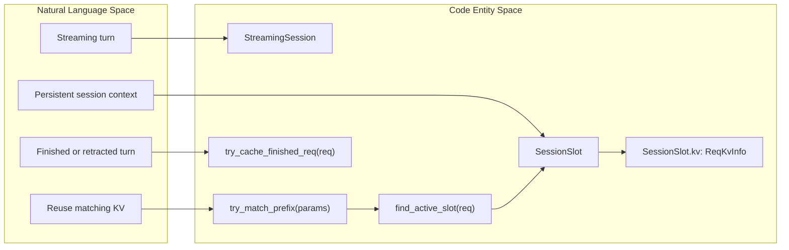
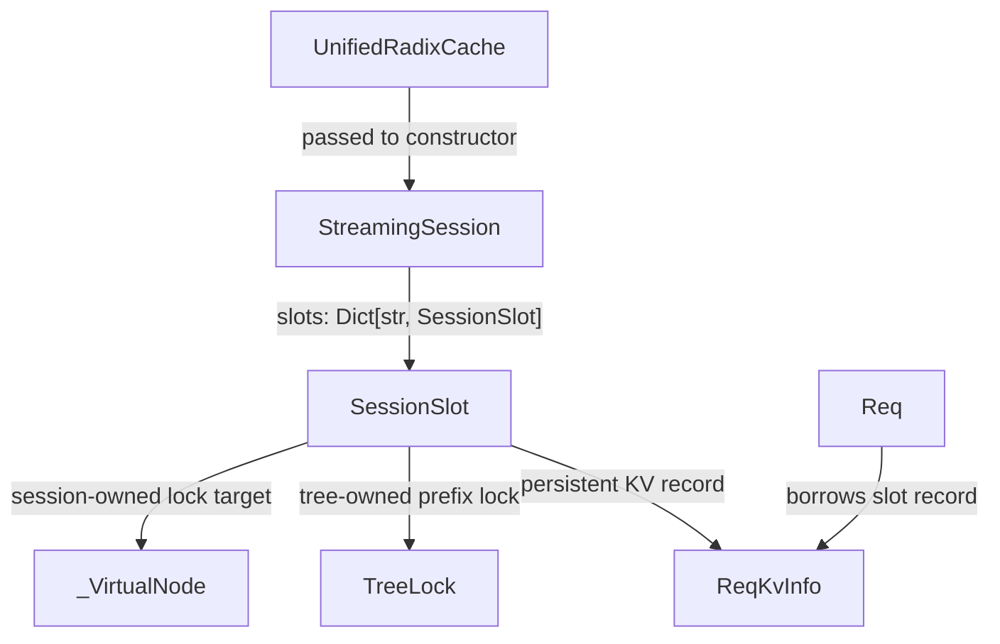
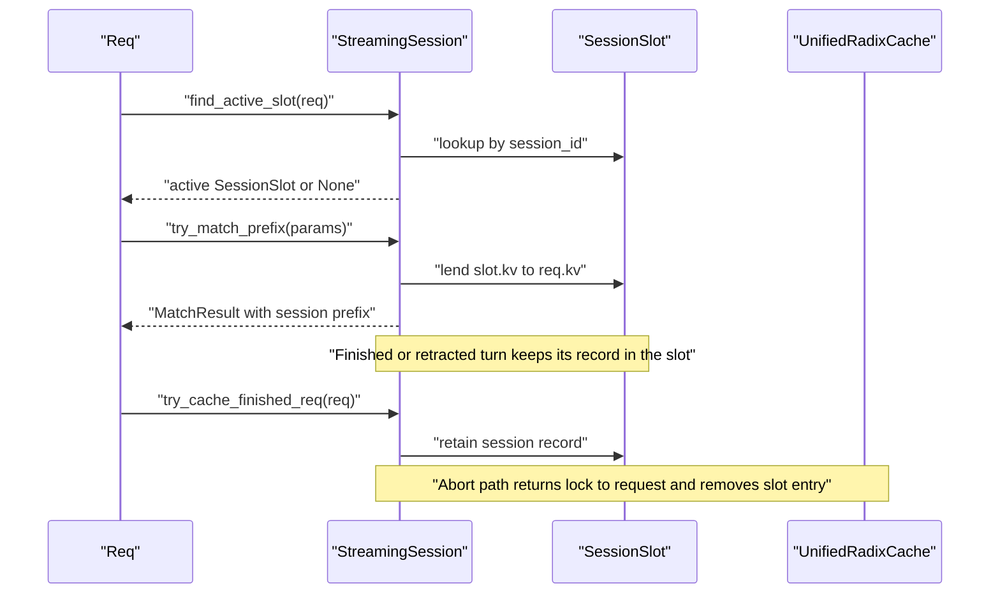
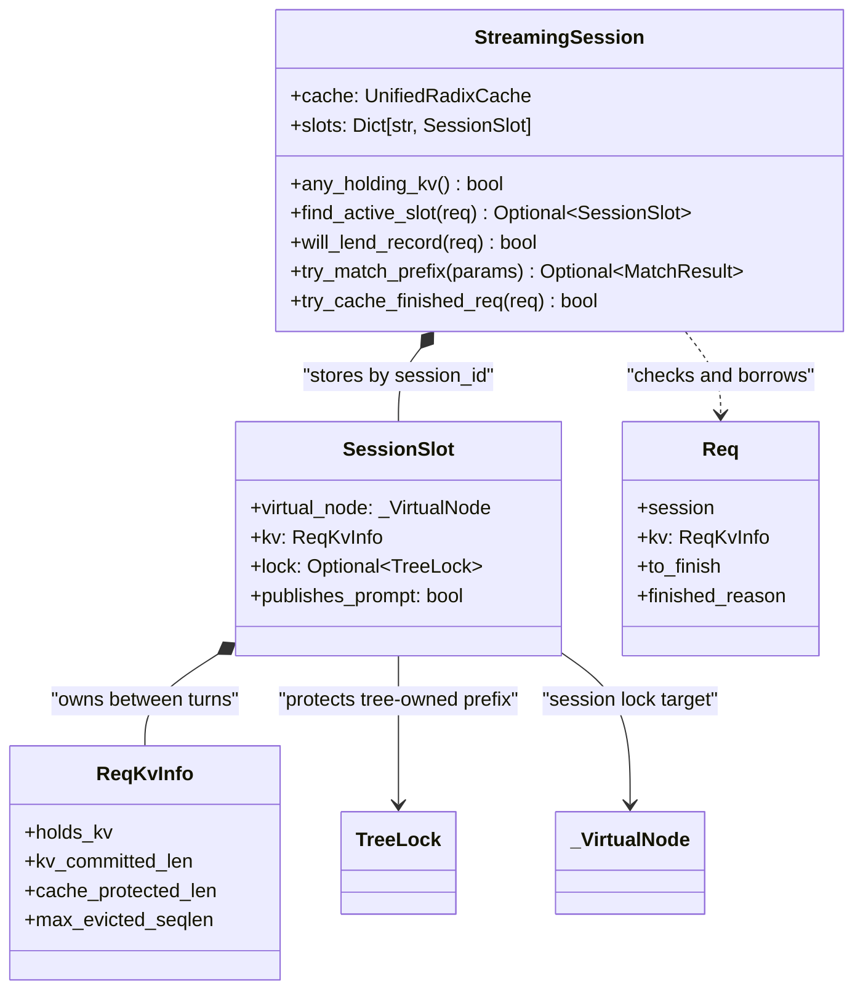

<!-- source: DeepWiki mcp.deepwiki.com · repo sgl-project/sglang · page 19.4 Session Management · fetched 2026-10-30 -->

# Session Management

Relevant source files

The following files were used as context for generating this wiki page:

- [docs/docs/advanced_features/expert_parallelism.mdx](docs/docs/advanced_features/expert_parallelism.mdx)
- [python/sglang/multimodal_gen/runtime/utils/trace_wrapper.py](python/sglang/multimodal_gen/runtime/utils/trace_wrapper.py)
- [python/sglang/srt/configs/zaya.py](python/sglang/srt/configs/zaya.py)
- [python/sglang/srt/debug_utils/dump_comparator.py](python/sglang/srt/debug_utils/dump_comparator.py)
- [python/sglang/srt/layers/attention/hpc_ops_backend.py](python/sglang/srt/layers/attention/hpc_ops_backend.py)
- [python/sglang/srt/layers/layer_boundary/residual/add_norm.py](python/sglang/srt/layers/layer_boundary/residual/add_norm.py)
- [python/sglang/srt/layers/moe/moe_runner/hpc_ops.py](python/sglang/srt/layers/moe/moe_runner/hpc_ops.py)
- [python/sglang/srt/managers/cache_controller.py](python/sglang/srt/managers/cache_controller.py)
- [python/sglang/srt/managers/schedule_policy.py](python/sglang/srt/managers/schedule_policy.py)
- [python/sglang/srt/mem_cache/base_prefix_cache.py](python/sglang/srt/mem_cache/base_prefix_cache.py)
- [python/sglang/srt/mem_cache/buffer_mode/pipeline.py](python/sglang/srt/mem_cache/buffer_mode/pipeline.py)
- [python/sglang/srt/mem_cache/cache_init_params.py](python/sglang/srt/mem_cache/cache_init_params.py)
- [python/sglang/srt/mem_cache/hicache_storage.py](python/sglang/srt/mem_cache/hicache_storage.py)
- [python/sglang/srt/mem_cache/hybrid_cache/hybrid_cache_controller.py](python/sglang/srt/mem_cache/hybrid_cache/hybrid_cache_controller.py)
- [python/sglang/srt/mem_cache/hybrid_cache/hybrid_pool_assembler.py](python/sglang/srt/mem_cache/hybrid_cache/hybrid_pool_assembler.py)
- [python/sglang/srt/mem_cache/hybrid_cache/linker_pool_assembler.py](python/sglang/srt/mem_cache/hybrid_cache/linker_pool_assembler.py)
- [python/sglang/srt/mem_cache/kv_cache_builder.py](python/sglang/srt/mem_cache/kv_cache_builder.py)
- [python/sglang/srt/mem_cache/memory_pool_host.py](python/sglang/srt/mem_cache/memory_pool_host.py)
- [python/sglang/srt/mem_cache/storage/file/__init__.py](python/sglang/srt/mem_cache/storage/file/__init__.py)
- [python/sglang/srt/mem_cache/storage/file/lru_file_evictor.py](python/sglang/srt/mem_cache/storage/file/lru_file_evictor.py)
- [python/sglang/srt/mem_cache/storage/mooncake_store/README.md](python/sglang/srt/mem_cache/storage/mooncake_store/README.md)
- [python/sglang/srt/mem_cache/storage/mooncake_store/mooncake_store.py](python/sglang/srt/mem_cache/storage/mooncake_store/mooncake_store.py)
- [python/sglang/srt/mem_cache/unified_radix_cache.py](python/sglang/srt/mem_cache/unified_radix_cache.py)
- [python/sglang/srt/models/iquest_q1.py](python/sglang/srt/models/iquest_q1.py)
- [python/sglang/srt/models/zaya.py](python/sglang/srt/models/zaya.py)
- [python/sglang/srt/observability/mooncake_trace.py](python/sglang/srt/observability/mooncake_trace.py)
- [python/sglang/srt/observability/req_time_stats.py](python/sglang/srt/observability/req_time_stats.py)
- [python/sglang/srt/observability/trace.py](python/sglang/srt/observability/trace.py)
- [python/sglang/srt/session/streaming_session.py](python/sglang/srt/session/streaming_session.py)
- [python/sglang/test/layer_ut_utils.py](python/sglang/test/layer_ut_utils.py)
- [python/sglang/test/quant_ref_utils.py](python/sglang/test/quant_ref_utils.py)
- [scripts/convert_otel_2_perfetto.py](scripts/convert_otel_2_perfetto.py)
- [test/registered/backends/test_deepseek_v3_fp4_cutedsl_moe.py](test/registered/backends/test_deepseek_v3_fp4_cutedsl_moe.py)
- [test/registered/core/test_engine_child_pids.py](test/registered/core/test_engine_child_pids.py)
- [test/registered/debug_utils/test_tensor_dump_forward_hook.py](test/registered/debug_utils/test_tensor_dump_forward_hook.py)
- [test/registered/kernels/ops/mamba/test_mtp_hicache.py](test/registered/kernels/ops/mamba/test_mtp_hicache.py)
- [test/registered/kernels/ops/moe/test_fp4_moe.py](test/registered/kernels/ops/moe/test_fp4_moe.py)
- [test/registered/moe/test_hpc_ops_moe.py](test/registered/moe/test_hpc_ops_moe.py)
- [test/registered/observability/test_tracing.py](test/registered/observability/test_tracing.py)
- [test/registered/observability/test_tracing_disaggregation.py](test/registered/observability/test_tracing_disaggregation.py)
- [test/registered/openai_server/function_call/test_anthropic_tool_use.py](test/registered/openai_server/function_call/test_anthropic_tool_use.py)
- [test/registered/openai_server/function_call/test_openai_function_calling.py](test/registered/openai_server/function_call/test_openai_function_calling.py)
- [test/registered/radix_cache/unified_radix_tree/linker/test_unified_cache_linker_kimi_linear.py](test/registered/radix_cache/unified_radix_tree/linker/test_unified_cache_linker_kimi_linear.py)
- [test/registered/reasoning/test_reasoning.py](test/registered/reasoning/test_reasoning.py)
- [test/registered/sessions/test_session_control.py](test/registered/sessions/test_session_control.py)
- [test/registered/sessions/test_streaming_session.py](test/registered/sessions/test_streaming_session.py)
- [test/registered/sessions/test_streaming_session_swa.py](test/registered/sessions/test_streaming_session_swa.py)
- [test/registered/unit/configs/test_zaya_config.py](test/registered/unit/configs/test_zaya_config.py)
- [test/registered/unit/layers/quantization/test_nvfp4_linear_backends.py](test/registered/unit/layers/quantization/test_nvfp4_linear_backends.py)
- [test/registered/unit/layers/quantization/test_nvfp4_moe_backends.py](test/registered/unit/layers/quantization/test_nvfp4_moe_backends.py)
- [test/registered/unit/managers/test_prefill_adder.py](test/registered/unit/managers/test_prefill_adder.py)
- [test/registered/unit/mem_cache/test_buffer_mode_sidecar.py](test/registered/unit/mem_cache/test_buffer_mode_sidecar.py)
- [test/registered/unit/mem_cache/test_hicache_file_lru_unit.py](test/registered/unit/mem_cache/test_hicache_file_lru_unit.py)
- [test/registered/unit/mem_cache/test_hicache_staged_write_back_dispatch.py](test/registered/unit/mem_cache/test_hicache_staged_write_back_dispatch.py)
- [test/registered/unit/mem_cache/test_hybrid_pool_assembler.py](test/registered/unit/mem_cache/test_hybrid_pool_assembler.py)
- [test/registered/unit/mem_cache/test_linker_pool_assembler.py](test/registered/unit/mem_cache/test_linker_pool_assembler.py)
- [test/registered/unit/mem_cache/test_mooncake_group_semantics.py](test/registered/unit/mem_cache/test_mooncake_group_semantics.py)
- [test/registered/unit/mem_cache/test_mooncake_tenant_config.py](test/registered/unit/mem_cache/test_mooncake_tenant_config.py)
- [test/registered/unit/mem_cache/test_storage_prefetch_lifecycle.py](test/registered/unit/mem_cache/test_storage_prefetch_lifecycle.py)
- [test/registered/unit/mem_cache/test_streaming_session_unit.py](test/registered/unit/mem_cache/test_streaming_session_unit.py)
- [test/registered/unit/mem_cache/test_unified_hicache_regressions.py](test/registered/unit/mem_cache/test_unified_hicache_regressions.py)
- [test/registered/unit/models/test_zaya_cca.py](test/registered/unit/models/test_zaya_cca.py)
- [test/registered/unit/models/test_zaya_mod_tp.py](test/registered/unit/models/test_zaya_mod_tp.py)
- [test/registered/unit/observability/test_req_time_stats.py](test/registered/unit/observability/test_req_time_stats.py)
- [test/registered/unit/observability/test_request_metrics_exporter.py](test/registered/unit/observability/test_request_metrics_exporter.py)
- [test/registered/unit/observability/test_trace.py](test/registered/unit/observability/test_trace.py)

## Purpose and Scope

This page describes the session-related KV-cache behavior visible in SGLang’s streaming-session implementation: how a streaming turn can borrow persistent KV state, how finished turns return it to a session slot, and how aborts affect that state. The provided source does not establish a public session API or HTTP route, so this page focuses on the runtime session and cache integration rather than client-facing endpoint details. [python/sglang/srt/session/streaming_session.py:29-63]()

Sources: [python/sglang/srt/session/streaming_session.py:29-63]()

## 1. Overview and Architecture

`StreamingSession` manages session slots for `UnifiedRadixCache`. A slot combines a `ReqKvInfo` record with a tree lock on the session’s tree-owned prefix; it also has a virtual-node sentinel and a flag used when the first turn is publishing its prompt. [python/sglang/srt/session/streaming_session.py:23-45]()

The cache imports `StreamingSession` and `is_virtual_node`, and `UnifiedRadixCache.__init__` records the `enable_session_radix_cache` setting. The shown cache excerpt establishes this integration point but does not show the later cache methods that invoke the session. [python/sglang/srt/mem_cache/unified_radix_cache.py:199-218] [python/sglang/srt/mem_cache/unified_radix_cache.py:114-120]()

| Entity | Role |
|---|---|
| `StreamingSession` | Stores session slots and provides try-handle methods for active-session lookup, prefix matching, and finished-request handling. [python/sglang/srt/session/streaming_session.py:56-67] [python/sglang/srt/session/streaming_session.py:72-99] [python/sglang/srt/session/streaming_session.py:156-172]() |
| `SessionSlot` | Holds the session’s `ReqKvInfo`, optional `TreeLock`, virtual node, and prompt-publication flag. [python/sglang/srt/session/streaming_session.py:29-45]() |
| `_VirtualNode` | Sentinel lock target for session-owned KV; locking it is described as a no-op. [python/sglang/srt/session/streaming_session.py:23-27] |
| `ReqKvInfo` | Per-request KV record stored in the slot; the visible session code reads its committed length and protected-cache length. [python/sglang/srt/managers/schedule_batch.py:7-12] [python/sglang/srt/session/streaming_session.py:106-154]() |
| `UnifiedRadixCache` | Cache associated with the session manager; it is passed to `StreamingSession` at construction. [python/sglang/srt/mem_cache/unified_radix_cache.py:114-120] [python/sglang/srt/session/streaming_session.py:56-67]() |

Sources: [python/sglang/srt/session/streaming_session.py:7-67] [python/sglang/srt/session/streaming_session.py:72-99] [python/sglang/srt/session/streaming_session.py:106-172] [python/sglang/srt/mem_cache/unified_radix_cache.py:199-218]()

### Mapping Natural Language to Code Entities: Turn and Matching Flow

This diagram maps the concepts of a streaming turn and persistent context to the code entities and methods shown in the supplied source. It does not imply a particular client API or HTTP route. [python/sglang/srt/session/streaming_session.py:52-63] [python/sglang/srt/session/streaming_session.py:74-99] [python/sglang/srt/session/streaming_session.py:121-154]()

**Diagram: Streaming Turn Concepts and Runtime Entities**

Sources: [python/sglang/srt/session/streaming_session.py:29-45] [python/sglang/srt/session/streaming_session.py:52-99] [python/sglang/srt/session/streaming_session.py:121-154] [python/sglang/srt/session/streaming_session.py:156-172]()

### Mapping Natural Language to Code Entities: Ownership and Cache Integration

A session slot owns the persistent record and tree lock between turns; a request borrows the record while its turn is processed. The cache-side integration is through `UnifiedRadixCache`, which is the type accepted by `StreamingSession.__init__`. [python/sglang/srt/session/streaming_session.py:29-45] [python/sglang/srt/session/streaming_session.py:56-67]()

**Diagram: Session Ownership and Cache Integration**

Sources: [python/sglang/srt/session/streaming_session.py:23-45] [python/sglang/srt/session/streaming_session.py:56-67] [python/sglang/srt/mem_cache/unified_radix_cache.py:199-218]()

## 2. Session Lifecycle and Data Flow

### Flow Description

The visible implementation supports a lifecycle in which a streaming request can find an active slot, borrow its KV record during prefix matching, and return the record to the slot when the turn finishes or is retracted. An aborted turn follows a different path: `try_cache_finished_req` removes the slot entry and hands its lock back to the request for normal release by its caller. [python/sglang/srt/session/streaming_session.py:74-87] [python/sglang/srt/session/streaming_session.py:121-154] [python/sglang/srt/session/streaming_session.py:156-172]()

**Diagram: Streaming Session Turn Lifecycle**

Sources: [python/sglang/srt/session/streaming_session.py:74-87] [python/sglang/srt/session/streaming_session.py:97-154] [python/sglang/srt/session/streaming_session.py:156-172]()

### Active Slot Lookup and Pre-Abort Handling

`find_active_slot(req)` applies only when the request has a session and that session is marked streaming. It looks up the slot by `req.session.session_id` and returns no slot if the slot is absent or does not hold KV. [python/sglang/srt/session/streaming_session.py:52-53] [python/sglang/srt/session/streaming_session.py:74-81]()

If `req.to_finish` is already set, lookup releases multimodal inputs on abort, calls `req.session.abort_req()`, detaches the request by setting `req.session = None`, and returns no slot. The method’s documentation says the slot remains available for the next request. [python/sglang/srt/session/streaming_session.py:74-87]()

`will_lend_record(req)` provides a related predicate: it returns true only for a streaming request that is not already marked to finish and whose session slot exists and holds KV. Unlike `find_active_slot`, it does not detach a pre-aborted request. [python/sglang/srt/session/streaming_session.py:89-95]()

Sources: [python/sglang/srt/session/streaming_session.py:52-53] [python/sglang/srt/session/streaming_session.py:74-95]()

### Prefix Matching and KV Reuse

`try_match_prefix(params)` returns `None` when the request has no active session slot, allowing its caller to use the ordinary prefix-match path. When a slot is found, the method lends `slot.kv` to `req.kv` and calculates the reusable prefix as the lesser of the committed KV length and the request key length. [python/sglang/srt/session/streaming_session.py:97-104] [python/sglang/srt/session/streaming_session.py:121-129]()

The session code treats streaming prefixes as append-only: it asserts that the current prefix is not shorter than `cache_protected_len`. Its comment attributes this invariant to session-controller rollback keeping `req_nodes` at the last successful request. [python/sglang/srt/session/streaming_session.py:130-135]()

For page sizes greater than one, the method aligns the reusable prefix down to a page boundary when running on NPU or when the record’s maximum evicted sequence length exceeds the prefix. It then updates the committed length as needed, frees the unused tail, and returns a `MatchResult` anchored to the slot’s virtual node. [python/sglang/srt/session/streaming_session.py:137-154]()

On NPU with page size greater than one, an aligned prefix that is zero or falls below `cache_protected_len` causes the session slot to be released and matching to fall back rather than reusing a too-short prefix. [python/sglang/srt/session/streaming_session.py:106-119]()

Sources: [python/sglang/srt/session/streaming_session.py:97-154]()

### Finished Turns and Abort Behavior

`try_cache_finished_req(req)` first checks whether the request is a streaming-session request. For an abort finish reason, it removes the slot from `slots`, transfers the slot lock back to the request, releases multimodal inputs on abort, and returns `False`; its docstring describes the caller as releasing the record like an ordinary request. [python/sglang/srt/session/streaming_session.py:156-172]()

The shown excerpt ends within the abort branch. It establishes the abort behavior above but does not show the remainder of `try_cache_finished_req` or the implementation of session release and prompt-publication operations. [python/sglang/srt/session/streaming_session.py:156-172]()

Sources: [python/sglang/srt/session/streaming_session.py:156-172]()

## 3. Cache Management and Memory Entities

### Session Slot and KV Cache Persistence

A `SessionSlot` groups the persistent KV record (`kv`) with an optional tree lock (`lock`). It also has a `_VirtualNode` instance and a `publishes_prompt` flag. The class documentation describes the slot as owning the record and tree lock from the first turn’s row allocation until the session closes or a turn aborts; turns use that record as borrowers. [python/sglang/srt/session/streaming_session.py:29-45]()

`StreamingSession.slots` is a dictionary keyed by session ID. `any_holding_kv()` checks whether any stored slot’s `ReqKvInfo` reports `holds_kv`. [python/sglang/srt/session/streaming_session.py:56-70]()

**Diagram: Session Memory Classes**

Sources: [python/sglang/srt/session/streaming_session.py:23-45] [python/sglang/srt/session/streaming_session.py:56-70] [python/sglang/srt/session/streaming_session.py:74-95] [python/sglang/srt/session/streaming_session.py:121-154] [python/sglang/srt/session/streaming_session.py:156-172]()

### Multi-Turn Context Persistence

When a streaming request matches an active session, `try_match_prefix` assigns the slot’s `ReqKvInfo` object directly to `req.kv`. It derives the prefix length from the record’s committed length and the current match key, then returns the session’s virtual node as the device, host, and best-match node in the result. [python/sglang/srt/session/streaming_session.py:121-154]()

The implementation’s append-only assertion and protected-length check constrain how a later turn may reuse session context. The source comment states that rollback keeps the request-node tracking at the last successful request; it does not describe conversation-message formatting or how clients construct the next turn’s prompt. [python/sglang/srt/session/streaming_session.py:130-135]()

The slot’s KV state can include more than a committed token count: the unit test verifies preservation of `mamba_next_track_idx` and per-component evicted-sequence metadata in a finished turn’s record. [test/registered/unit/mem_cache/test_streaming_session_unit.py:141-155]()

Sources: [python/sglang/srt/session/streaming_session.py:121-154] [test/registered/unit/mem_cache/test_streaming_session_unit.py:141-155]()

## 4. Observability and State Validation

The session implementation exposes `any_holding_kv()` as a check over the slots’ `holds_kv` state. The supplied code does not show session-specific metrics or establish that session-held KV contributes to a particular metrics collector, so no such metric behavior is asserted here. [python/sglang/srt/session/streaming_session.py:56-70]()

The unit tests exercise session ownership and cleanup: a finished turn leaves the same KV record in the session slot, while a pre-aborted request is detached without discarding the slot’s existing record. [test/registered/unit/mem_cache/test_streaming_session_unit.py:133-155] [test/registered/unit/mem_cache/test_streaming_session_unit.py:157-202]()

Sources: [python/sglang/srt/session/streaming_session.py:56-70] [test/registered/unit/mem_cache/test_streaming_session_unit.py:133-155] [test/registered/unit/mem_cache/test_streaming_session_unit.py:157-202]()

## 5. Session State Reference

| Field or method | Meaning in the session implementation |
|---|---|
| `session_id` | Key used to find a session slot in `StreamingSession.slots`. [python/sglang/srt/session/streaming_session.py:74-81]() |
| `streaming` | Session flag checked by `_is_streaming(req)` before session-specific handling. [python/sglang/srt/session/streaming_session.py:52-53]() |
| `SessionSlot.kv` | The `ReqKvInfo` record retained by the slot and lent to a matching request. [python/sglang/srt/session/streaming_session.py:29-45] [python/sglang/srt/session/streaming_session.py:121-124]() |
| `kv_committed_len` | Upper bound on the session prefix length considered for reuse, further limited by the request key length. [python/sglang/srt/session/streaming_session.py:125-129]() |
| `cache_protected_len` | Lower bound enforced by the append-only prefix assertion and used in the NPU alignment fallback. [python/sglang/srt/session/streaming_session.py:106-119] [python/sglang/srt/session/streaming_session.py:130-135]() |
| `SessionSlot.lock` | Optional tree lock held with the session’s tree-owned prefix; the abort branch transfers it back to the request. [python/sglang/srt/session/streaming_session.py:29-45] [python/sglang/srt/session/streaming_session.py:164-172]() |
| `SessionSlot.virtual_node` | Sentinel used as the node anchor in the session match result; locking this target is documented as a no-op. [python/sglang/srt/session/streaming_session.py:23-27] [python/sglang/srt/session/streaming_session.py:148-154]() |
| `SessionSlot.publishes_prompt` | Flag indicating that the first turn’s checkpoints publish the prompt into the tree and move the lock to the deepest published node. [python/sglang/srt/session/streaming_session.py:41-45]() |
| `find_active_slot(req)` | Finds an active slot for a streaming request and handles a pre-aborted request by detaching it. [python/sglang/srt/session/streaming_session.py:74-87]() |
| `will_lend_record(req)` | Tests whether the request has a slot record to borrow without detaching pre-aborted requests. [python/sglang/srt/session/streaming_session.py:89-95]() |
| `try_match_prefix(params)` | Attempts session-specific prefix reuse; returns `None` when no active slot applies. [python/sglang/srt/session/streaming_session.py:97-104]() |
| `try_cache_finished_req(req)` | Handles a finished streaming request; the shown abort path removes the slot and returns its lock to the request. [python/sglang/srt/session/streaming_session.py:156-172]() |

Sources: [python/sglang/srt/session/streaming_session.py:23-53] [python/sglang/srt/session/streaming_session.py:56-95] [python/sglang/srt/session/streaming_session.py:97-154] [python/sglang/srt/session/streaming_session.py:156-172]()

---

## Summary

SGLang’s visible streaming-session implementation keeps a `ReqKvInfo` record and tree lock in a `SessionSlot`, indexed by session ID. An active streaming request can borrow that record and reuse a prefix subject to committed-length, protected-length, and—in relevant cases—page-alignment constraints. [python/sglang/srt/session/streaming_session.py:29-45] [python/sglang/srt/session/streaming_session.py:74-95] [python/sglang/srt/session/streaming_session.py:97-154]()

Pre-aborted requests are detached during active-slot lookup while the slot remains available. The shown finished-request abort path removes the slot entry and returns its lock to the request. The supplied excerpts do not establish public API routes, session creation or close semantics, or the complete non-abort finish path. [python/sglang/srt/session/streaming_session.py:74-87] [python/sglang/srt/session/streaming_session.py:156-172]()

Sources: [python/sglang/srt/session/streaming_session.py:29-45] [python/sglang/srt/session/streaming_session.py:74-95] [python/sglang/srt/session/streaming_session.py:97-154] [python/sglang/srt/session/streaming_session.py:156-172]()

---

