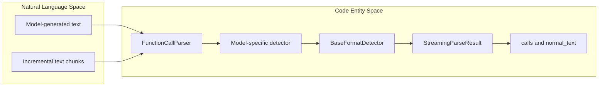
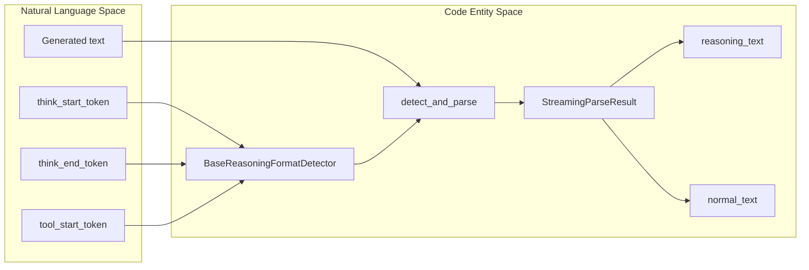
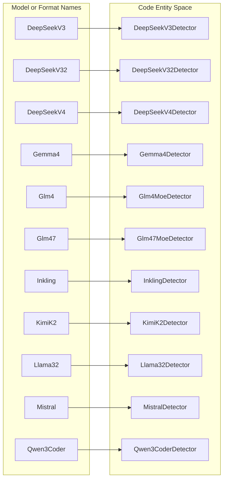
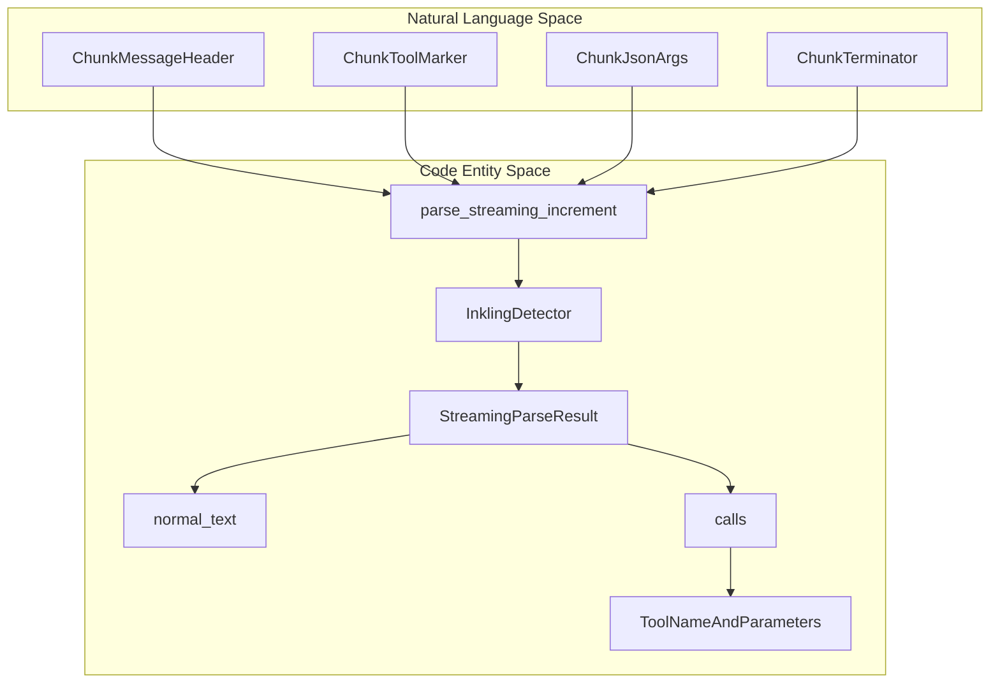
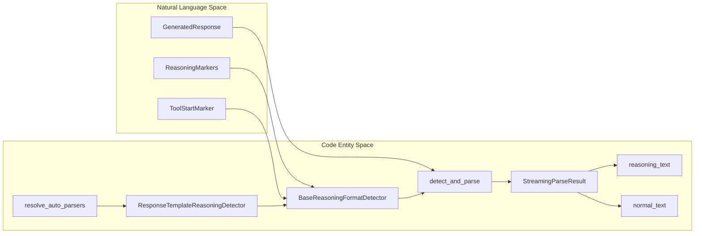
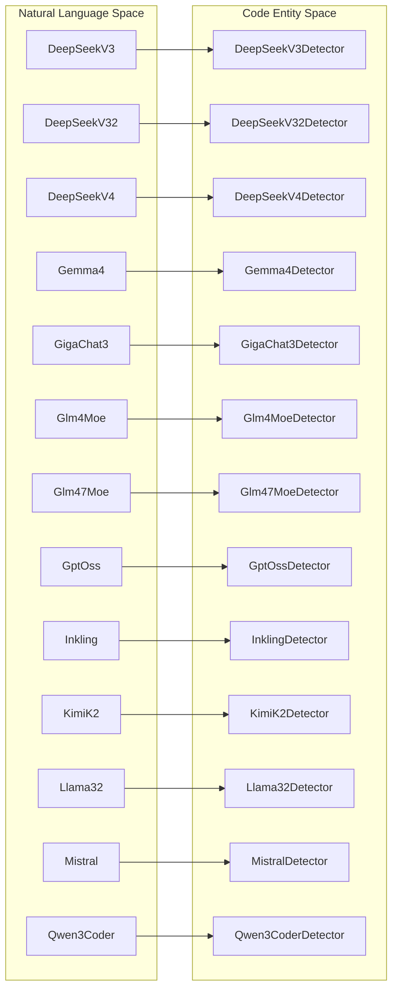
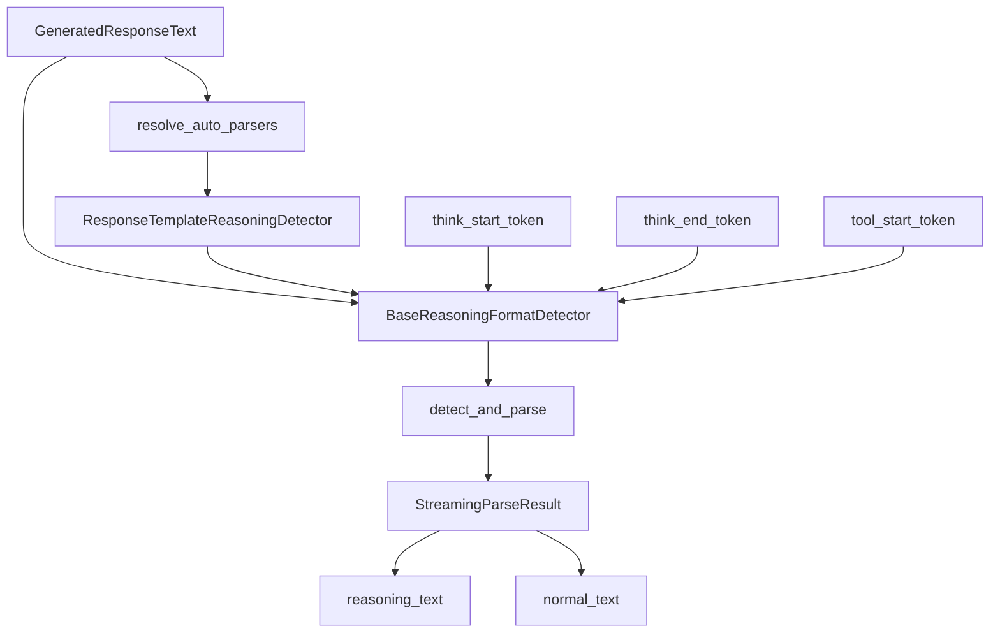

<!-- source: DeepWiki mcp.deepwiki.com · repo sgl-project/sglang · page 19.5 Function Calling and Tool Use · fetched 2026-10-30 -->

# Function Calling and Tool Use

Relevant source files

The following files were used as context for generating this wiki page:

- [.github/workflows/release-pypi-nightly.yml](.github/workflows/release-pypi-nightly.yml)
- [.github/workflows/release-pypi-pr.yml](.github/workflows/release-pypi-pr.yml)
- [3rdparty/amd/wheel/sglang/pyproject.toml](3rdparty/amd/wheel/sglang/pyproject.toml)
- [docker/Dockerfile](docker/Dockerfile)
- [python/pyproject.toml](python/pyproject.toml)
- [python/pyproject_cpu.toml](python/pyproject_cpu.toml)
- [python/pyproject_npu.toml](python/pyproject_npu.toml)
- [python/pyproject_other.toml](python/pyproject_other.toml)
- [python/pyproject_xpu.toml](python/pyproject_xpu.toml)
- [python/sglang/srt/arg_groups/model_overrides/__init__.py](python/sglang/srt/arg_groups/model_overrides/__init__.py)
- [python/sglang/srt/configs/__init__.py](python/sglang/srt/configs/__init__.py)
- [python/sglang/srt/configs/minimax_vl.py](python/sglang/srt/configs/minimax_vl.py)
- [python/sglang/srt/configs/model_config.py](python/sglang/srt/configs/model_config.py)
- [python/sglang/srt/entrypoints/engine.py](python/sglang/srt/entrypoints/engine.py)
- [python/sglang/srt/entrypoints/openai/usage_processor.py](python/sglang/srt/entrypoints/openai/usage_processor.py)
- [python/sglang/srt/function_call/base_format_detector.py](python/sglang/srt/function_call/base_format_detector.py)
- [python/sglang/srt/function_call/deepseekv32_detector.py](python/sglang/srt/function_call/deepseekv32_detector.py)
- [python/sglang/srt/function_call/dots_detector.py](python/sglang/srt/function_call/dots_detector.py)
- [python/sglang/srt/function_call/function_call_parser.py](python/sglang/srt/function_call/function_call_parser.py)
- [python/sglang/srt/function_call/glm47_moe_detector.py](python/sglang/srt/function_call/glm47_moe_detector.py)
- [python/sglang/srt/function_call/glm4_moe_detector.py](python/sglang/srt/function_call/glm4_moe_detector.py)
- [python/sglang/srt/function_call/hunyuan_detector.py](python/sglang/srt/function_call/hunyuan_detector.py)
- [python/sglang/srt/function_call/inkling_detector.py](python/sglang/srt/function_call/inkling_detector.py)
- [python/sglang/srt/function_call/kimik2_detector.py](python/sglang/srt/function_call/kimik2_detector.py)
- [python/sglang/srt/function_call/mimo_detector.py](python/sglang/srt/function_call/mimo_detector.py)
- [python/sglang/srt/function_call/minicpm5_detector.py](python/sglang/srt/function_call/minicpm5_detector.py)
- [python/sglang/srt/function_call/minimax_m2.py](python/sglang/srt/function_call/minimax_m2.py)
- [python/sglang/srt/function_call/minimax_m3.py](python/sglang/srt/function_call/minimax_m3.py)
- [python/sglang/srt/function_call/poolside_v1_detector.py](python/sglang/srt/function_call/poolside_v1_detector.py)
- [python/sglang/srt/function_call/qwen3_coder_detector.py](python/sglang/srt/function_call/qwen3_coder_detector.py)
- [python/sglang/srt/function_call/step3_detector.py](python/sglang/srt/function_call/step3_detector.py)
- [python/sglang/srt/function_call/utils.py](python/sglang/srt/function_call/utils.py)
- [python/sglang/srt/layers/quantization/__init__.py](python/sglang/srt/layers/quantization/__init__.py)
- [python/sglang/srt/layers/quantization/base_config.py](python/sglang/srt/layers/quantization/base_config.py)
- [python/sglang/srt/parser/reasoning_parser.py](python/sglang/srt/parser/reasoning_parser.py)
- [python/sglang/srt/parser/template_detection.py](python/sglang/srt/parser/template_detection.py)
- [python/sglang/srt/utils/common.py](python/sglang/srt/utils/common.py)
- [python/sglang/srt/utils/hf_transformers/common.py](python/sglang/srt/utils/hf_transformers/common.py)
- [python/sglang/srt/utils/json_response.py](python/sglang/srt/utils/json_response.py)
- [scripts/update_nightly_whl_index.py](scripts/update_nightly_whl_index.py)
- [test/registered/function_call/test_kimik2_detector.py](test/registered/function_call/test_kimik2_detector.py)
- [test/registered/moe/test_cutedsl_moe.py](test/registered/moe/test_cutedsl_moe.py)
- [test/registered/unit/function_call/test_deepseekv4_detector.py](test/registered/unit/function_call/test_deepseekv4_detector.py)
- [test/registered/unit/function_call/test_function_call_parser.py](test/registered/unit/function_call/test_function_call_parser.py)
- [test/registered/unit/function_call/test_glm47_schema_types.py](test/registered/unit/function_call/test_glm47_schema_types.py)
- [test/registered/unit/function_call/test_json_schema_constraint.py](test/registered/unit/function_call/test_json_schema_constraint.py)
- [test/registered/unit/function_call/test_minimax_m3_detector.py](test/registered/unit/function_call/test_minimax_m3_detector.py)
- [test/registered/unit/function_call/test_normalize_json_schema_types.py](test/registered/unit/function_call/test_normalize_json_schema_types.py)
- [test/registered/unit/function_call/test_structural_tag_excludes.py](test/registered/unit/function_call/test_structural_tag_excludes.py)
- [test/registered/unit/function_call/test_unknown_tool_name.py](test/registered/unit/function_call/test_unknown_tool_name.py)
- [test/registered/unit/parser/test_reasoning_parser.py](test/registered/unit/parser/test_reasoning_parser.py)
- [test/registered/unit/parser/test_template_manager.py](test/registered/unit/parser/test_template_manager.py)
- [test/registered/unit/utils/test_common.py](test/registered/unit/utils/test_common.py)
- [test/registered/unit/utils/test_json_response.py](test/registered/unit/utils/test_json_response.py)

## Purpose and Scope

This page describes SGLang’s function-call parsing and reasoning-parsing components: the parser and detector roles, model-specific detector coverage, incremental parsing, tool-call representations, and how reasoning text is separated from ordinary output. It documents parsing and response formatting—not tool execution. The available sources identify the parser interfaces and tests, but do not establish a general mechanism for invoking external tools. [test/registered/unit/function_call/test_function_call_parser.py:8-41](), [python/sglang/srt/parser/reasoning_parser.py:50-63]()

Sources: [test/registered/unit/function_call/test_function_call_parser.py:8-41](), [python/sglang/srt/parser/reasoning_parser.py:50-63]()

---

## 1. Architecture Overview

Function-call parsing converts model-generated text or token-derived text into ordinary response text plus structured tool-call data. The unit-test imports identify `FunctionCallParser`, `BaseFormatDetector`, `StreamingParseResult`, and model-specific detector classes as the central parser-side entities. [test/registered/unit/function_call/test_function_call_parser.py:14-41]()

The reasoning parser has a separate interface. Its `StreamingParseResult` holds `normal_text` and `reasoning_text`; `BaseReasoningFormatDetector` supports one-time parsing and streaming incremental parsing. Do not confuse this reasoning result type with the function-call parser’s result type, which is imported from `sglang.srt.function_call.core_types` in the tests. [python/sglang/srt/parser/reasoning_parser.py:50-63](), [test/registered/unit/function_call/test_function_call_parser.py:14-19]()

### Key Components

| Entity | Role | Source |
|---|---|---|
| `FunctionCallParser` | Function-call parser entry point imported by the function-call unit tests. | [test/registered/unit/function_call/test_function_call_parser.py:14-19]() |
| `BaseFormatDetector` | Base detector interface used by model-specific function-call detectors. | [test/registered/unit/function_call/test_function_call_parser.py:14-19]() |
| Function-call `StreamingParseResult` | Parser result type imported from `function_call.core_types`. | [test/registered/unit/function_call/test_function_call_parser.py:14-19]() |
| `ToolCallItem` | Not identified in the supplied file contents; consult the function-call core types implementation before relying on its exact fields. | [test/registered/unit/function_call/test_function_call_parser.py:14-19]() |
| `BaseReasoningFormatDetector` | Base class for reasoning-format detectors, with one-time and incremental parsing interfaces. | [python/sglang/srt/parser/reasoning_parser.py:50-63]() |
| Reasoning `StreamingParseResult` | Contains `normal_text` and `reasoning_text`, defaulting missing values to empty strings. | [python/sglang/srt/parser/reasoning_parser.py:50-60]() |

### Data Flow: Model Output to Parsed Tool Call

The test suite exercises detector input as strings containing model-format markers and JSON-like payloads. In the Inkling case, the parser output is checked for ordinary text and structured calls; streaming tests feed chunks incrementally and collect call names and parameters. [test/registered/unit/function_call/test_function_call_parser.py:56-103]()

Diagram: Natural-language output to function-call parser entities

Sources: [test/registered/unit/function_call/test_function_call_parser.py:14-19](), [test/registered/unit/function_call/test_function_call_parser.py:69-103]()

### Data Flow: Reasoning Text to Parser Result

`BaseReasoningFormatDetector` exposes `detect_and_parse` for complete text and maintains parsing state for reasoning delimiters. The result separates reasoning from normal text. [python/sglang/srt/parser/reasoning_parser.py:62-63](), [python/sglang/srt/parser/reasoning_parser.py:80-100](), [python/sglang/srt/parser/reasoning_parser.py:144-151]()

Diagram: Reasoning text to reasoning-parser entities

Sources: [python/sglang/srt/parser/reasoning_parser.py:62-100](), [python/sglang/srt/parser/reasoning_parser.py:127-151]()

---

## 2. Model-Specific Detectors

The detector tests import a broad set of model-specific implementations. This list is a code-level inventory from the test module; it does not imply that every detector uses the same wire format or has identical streaming behavior. [test/registered/unit/function_call/test_function_call_parser.py:14-40]()

| Detector class | Detector module indicated by class name | Evidence in supplied tests |
|---|---|---|
| `DeepSeekV3Detector` | `deepseekv3_detector` | Imported by the unit-test module. [test/registered/unit/function_call/test_function_call_parser.py:16]() |
| `DeepSeekV32Detector` | `deepseekv32_detector` | Imported by the unit-test module. [test/registered/unit/function_call/test_function_call_parser.py:18]() |
| `DeepSeekV4Detector` | `deepseekv4_detector` | Imported by the unit-test module. [test/registered/unit/function_call/test_function_call_parser.py:17]() |
| `Gemma4Detector` | `gemma4_detector` | Detector and argument/value parsing helpers are imported. [test/registered/unit/function_call/test_function_call_parser.py:20-24]() |
| `GigaChat3Detector` | `gigachat3_detector` | Imported by the unit-test module. [test/registered/unit/function_call/test_function_call_parser.py:26]() |
| `Glm4MoeDetector` | `glm4_moe_detector` | Imported by the unit-test module. [test/registered/unit/function_call/test_function_call_parser.py:27]() |
| `Glm47MoeDetector` | `glm47_moe_detector` | Imported by the unit-test module. [test/registered/unit/function_call/test_function_call_parser.py:28]() |
| `GptOssDetector` | `gpt_oss_detector` | Imported by the unit-test module. [test/registered/unit/function_call/test_function_call_parser.py:29]() |
| `InklingDetector` | `inkling_detector` | Tested for canonical headers, streaming, payload naming, fallback, legacy input, and multiple calls. [test/registered/unit/function_call/test_function_call_parser.py:56-159]() |
| `KimiK2Detector` | `kimik2_detector` | Imported by the unit-test module. [test/registered/unit/function_call/test_function_call_parser.py:32]() |
| `Lfm2Detector` | `lfm2_detector` | Imported by the unit-test module. [test/registered/unit/function_call/test_function_call_parser.py:33]() |
| `Ling3Detector` | `ling3_detector` | Imported by the unit-test module. [test/registered/unit/function_call/test_function_call_parser.py:34]() |
| `Llama32Detector` | `llama32_detector` | Imported by the unit-test module. [test/registered/unit/function_call/test_function_call_parser.py:35]() |
| `MistralDetector` | `mistral_detector` | Imported by the unit-test module. [test/registered/unit/function_call/test_function_call_parser.py:36]() |
| `PythonicDetector` | `pythonic_detector` | Imported by the unit-test module. [test/registered/unit/function_call/test_function_call_parser.py:38]() |
| `Qwen3CoderDetector` | `qwen3_coder_detector` | Imported by the unit-test module. [test/registered/unit/function_call/test_function_call_parser.py:39]() |

`TOOL_CALL_PARSER_NAMES` is also imported by the tests, indicating a named parser-selection registry or list exists in `parser_names.py`; the supplied excerpt does not show its entries or selection rules. [test/registered/unit/function_call/test_function_call_parser.py:37]()

Sources: [test/registered/unit/function_call/test_function_call_parser.py:14-40]()

### Detector Mapping: Model Names to Code Entities

Diagram: Detector classes and their code modules

Sources: [test/registered/unit/function_call/test_function_call_parser.py:16-39]()

---

## 3. Streaming and Incremental Parsing

Incremental parsing matters when model output is delivered in pieces. The Inkling tests demonstrate a canonical tool-call header split across chunks, followed by a payload split across chunks; results are accumulated until the call name and JSON parameters can be checked. [test/registered/unit/function_call/test_function_call_parser.py:81-103]()

The same tests exercise two calls in one response and verify that they receive distinct `tool_index` values. The test excerpt establishes the expected behavior, but does not expose the detector’s internal buffer fields or the exact emission policy for partial JSON. [test/registered/unit/function_call/test_function_call_parser.py:151-159]()

### Inkling Format Example

The tested canonical form uses `<|message_model|>` followed by a header value, `<|content_invoke_tool_json|>`, a JSON payload, and `<|end_message|>`. The payload contains a `name` and an `args` object. In the tested case, the payload name determines the parsed call name even when the header value differs. [test/registered/unit/function_call/test_function_call_parser.py:69-79](), [test/registered/unit/function_call/test_function_call_parser.py:105-117]()

| Input characteristic | Tested result |
|---|---|
| Canonical header and JSON payload | No normal text; one call named `weather`; parameters decode to the `args` object. [test/registered/unit/function_call/test_function_call_parser.py:69-79]() |
| Header and payload name differ | The call name comes from the payload. [test/registered/unit/function_call/test_function_call_parser.py:105-117]() |
| Invalid JSON payload | No call is produced; visible fallback text excludes protocol-style `<|...|>` tokens. [test/registered/unit/function_call/test_function_call_parser.py:119-130]() |
| Headerless legacy tool-call block | The test expects the payload to parse in one-shot and streaming modes. [test/registered/unit/function_call/test_function_call_parser.py:132-149]() |
| Two sequential calls | The test expects separate indices and per-call argument data. [test/registered/unit/function_call/test_function_call_parser.py:151-159]() |

Diagram: Streaming detector flow

Sources: [test/registered/unit/function_call/test_function_call_parser.py:56-67](), [test/registered/unit/function_call/test_function_call_parser.py:81-103]()

---

## 4. Reasoning Parser and Toggle Configuration

Reasoning parsing separates reasoning content from normal response text. `BaseReasoningFormatDetector` is initialized with start and end markers and options that control reasoning behavior, including `force_reasoning`, `stream_reasoning`, `continue_final_message`, and `reasoning_default`. It tracks whether parsing is currently inside a reasoning block. [python/sglang/srt/parser/reasoning_parser.py:62-112]()

For complete text, `detect_and_parse` delegates to `_detect_and_parse_impl` and applies the optional nonempty-content adjustment. If no reasoning block is detected, the input is returned as normal text. When reasoning is active, the detector removes leading start markers and searches for the end marker. If the end marker is missing, it can look for a configured tool-start marker and split the text there, preserving the tool marker in normal text. [python/sglang/srt/parser/reasoning_parser.py:120-151](), [python/sglang/srt/parser/reasoning_parser.py:153-181]()

The shown `reasoning_parser.py` imports `ResponseTemplateReasoningDetector`, `HarmonyParser`, and format-specific helpers for Hunyuan, Kimi K3, Muse/Glimmer, and Inkling. The supplied excerpt does not include the complete `ReasoningParser` registry or its parser-selection logic, so selection details should be verified in the full implementation. [python/sglang/srt/parser/reasoning_parser.py:11-47]()

### Reasoning/Normal-Text Separation

| Input or state | Behavior evidenced by implementation |
|---|---|
| No active reasoning block | Returns the input as `normal_text`. [python/sglang/srt/parser/reasoning_parser.py:153-158]() |
| Reasoning start marker at the beginning | Repeated leading start-marker text is removed before parsing the reasoning body. [python/sglang/srt/parser/reasoning_parser.py:159-164]() |
| End marker absent | The detector treats the content as truncated reasoning unless a configured tool-start marker interrupts it. [python/sglang/srt/parser/reasoning_parser.py:165-181]() |
| Tool marker interrupts reasoning | Reasoning text is returned separately, and the tool-start marker remains in `normal_text`. [python/sglang/srt/parser/reasoning_parser.py:169-176]() |
| Continued final message | The detector records prior content and derives initial reasoning state from whether the start or end marker appears in that content. [python/sglang/srt/parser/reasoning_parser.py:101-112]() |

### Template Detection

`ResponseTemplateReasoningDetector` is imported by `reasoning_parser.py`, and the engine imports `resolve_auto_parsers` from `template_detection.py`. These imports show integration points for response-template reasoning detection and automatic parser resolution, but the supplied excerpts do not show the detection rules or configuration flow. [python/sglang/srt/parser/reasoning_parser.py:47](), [python/sglang/srt/entrypoints/engine.py:111-115]()

Diagram: Reasoning text parsing and parser integration

Sources: [python/sglang/srt/parser/reasoning_parser.py:47-63](), [python/sglang/srt/parser/reasoning_parser.py:127-151](), [python/sglang/srt/entrypoints/engine.py:111-115]()

---

## 5. Tool Call Formats, JSON Schema Normalization, and Coercion

The function-call tests import the OpenAI-compatible protocol types `Function`, `Tool`, `ToolChoice`, and `ToolChoiceFuncName`, as well as `get_schema_properties` from `function_call.utils`. This establishes the protocol and schema utility touchpoints, but the supplied content does not show the utility implementation or enough parser code to specify schema normalization and coercion rules. [test/registered/unit/function_call/test_function_call_parser.py:8-13](), [test/registered/unit/function_call/test_function_call_parser.py:40]()

The Inkling tests provide a concrete tool format: a protocol-marked message contains a JSON payload with `name` and `args`. The detector produces a call whose parameters are checked by decoding them as JSON. A separate malformed-payload test verifies fallback to ordinary text rather than producing a call. [test/registered/unit/function_call/test_function_call_parser.py:69-79](), [test/registered/unit/function_call/test_function_call_parser.py:119-130]()

The test module also imports `JsonArrayParser` and `_parse_gemma4_args`, `_parse_gemma4_array`, and `_parse_gemma4_value`, indicating dedicated parsing code exists for JSON arrays and Gemma 4 argument values. The supplied tests excerpt does not establish their detailed grammars or conversion semantics. [test/registered/unit/function_call/test_function_call_parser.py:20-24](), [test/registered/unit/function_call/test_function_call_parser.py:31]()

### Format-Specific Parsing Coverage

| Format or utility | What the supplied sources establish |
|---|---|
| Inkling canonical tool call | Header and tool-kind markers precede a JSON payload; payload `name` and `args` are parsed into a call. [test/registered/unit/function_call/test_function_call_parser.py:69-79]() |
| Inkling legacy form | A headerless tool payload is expected to parse in one-shot and incremental modes. [test/registered/unit/function_call/test_function_call_parser.py:132-149]() |
| Inkling malformed payload | A non-JSON payload yields no call and is surfaced as normal text with protocol markers stripped. [test/registered/unit/function_call/test_function_call_parser.py:119-130]() |
| Gemma 4 argument helpers | Argument, array, and value parsing helpers are imported and exercised by the test module; detailed behavior is not shown in the supplied excerpt. [test/registered/unit/function_call/test_function_call_parser.py:20-24]() |
| JSON array parser | `JsonArrayParser` is imported by the test module; detailed behavior is not shown in the supplied excerpt. [test/registered/unit/function_call/test_function_call_parser.py:31]() |
| Schema properties | `get_schema_properties` is imported; its transformation and normalization rules are not shown. [test/registered/unit/function_call/test_function_call_parser.py:40]() |

Sources: [test/registered/unit/function_call/test_function_call_parser.py:8-13](), [test/registered/unit/function_call/test_function_call_parser.py:20-24](), [test/registered/unit/function_call/test_function_call_parser.py:31](), [test/registered/unit/function_call/test_function_call_parser.py:40](), [test/registered/unit/function_call/test_function_call_parser.py:69-79](), [test/registered/unit/function_call/test_function_call_parser.py:119-149]()

---

## Additional Diagrams

### Function-Call Detector Coverage

Diagram: Model families to detector classes

Sources: [test/registered/unit/function_call/test_function_call_parser.py:16-39]()

### Reasoning Parser Code Path

Diagram: Reasoning parser entities and output fields

Sources: [python/sglang/srt/parser/reasoning_parser.py:47-63](), [python/sglang/srt/parser/reasoning_parser.py:127-151](), [python/sglang/srt/entrypoints/engine.py:111-115]()

---

