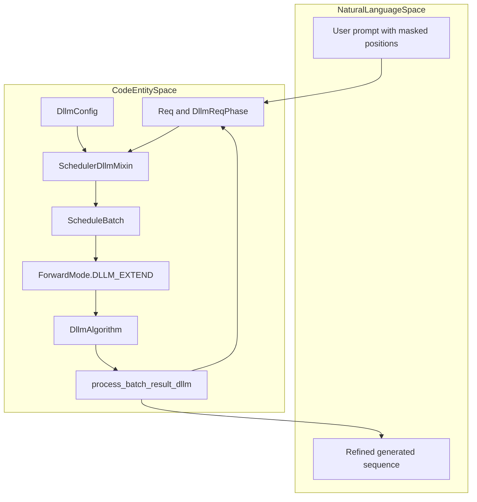
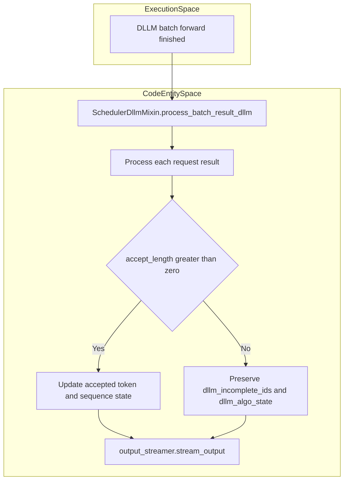

<!-- source: DeepWiki mcp.deepwiki.com · repo sgl-project/sglang · page 19.6 Diffusion LLM (DLLM) Support · fetched 2026-10-30 -->

# Diffusion LLM (DLLM) Support

Relevant source files

The following files were used as context for generating this wiki page:

- [python/sglang/srt/configs/laguna.py](python/sglang/srt/configs/laguna.py)
- [python/sglang/srt/dllm/mixin/scheduler.py](python/sglang/srt/dllm/mixin/scheduler.py)
- [python/sglang/srt/managers/scheduler_components/batch_result_processor.py](python/sglang/srt/managers/scheduler_components/batch_result_processor.py)
- [python/sglang/srt/managers/scheduler_components/output_streamer.py](python/sglang/srt/managers/scheduler_components/output_streamer.py)
- [python/sglang/srt/managers/utils.py](python/sglang/srt/managers/utils.py)
- [python/sglang/srt/mem_cache/allocation.py](python/sglang/srt/mem_cache/allocation.py)
- [python/sglang/srt/models/bailing_moe.py](python/sglang/srt/models/bailing_moe.py)
- [python/sglang/srt/models/bailing_moe_linear.py](python/sglang/srt/models/bailing_moe_linear.py)
- [python/sglang/srt/models/bailing_moe_v3.py](python/sglang/srt/models/bailing_moe_v3.py)
- [python/sglang/srt/models/dots3_common/modeling.py](python/sglang/srt/models/dots3_common/modeling.py)
- [python/sglang/srt/models/glm4_moe.py](python/sglang/srt/models/glm4_moe.py)
- [python/sglang/srt/models/glm4_moe_lite.py](python/sglang/srt/models/glm4_moe_lite.py)
- [python/sglang/srt/models/glm5_next.py](python/sglang/srt/models/glm5_next.py)
- [python/sglang/srt/models/gpt_oss.py](python/sglang/srt/models/gpt_oss.py)
- [python/sglang/srt/models/laguna.py](python/sglang/srt/models/laguna.py)
- [python/sglang/srt/models/llada2.py](python/sglang/srt/models/llada2.py)
- [python/sglang/srt/models/llama4.py](python/sglang/srt/models/llama4.py)
- [python/sglang/srt/models/mimo_v2.py](python/sglang/srt/models/mimo_v2.py)
- [python/sglang/srt/models/minimax_m2.py](python/sglang/srt/models/minimax_m2.py)
- [python/sglang/srt/models/minimax_m3.py](python/sglang/srt/models/minimax_m3.py)
- [python/sglang/srt/models/minimax_m3_vl.py](python/sglang/srt/models/minimax_m3_vl.py)
- [python/sglang/srt/models/qwen2_moe.py](python/sglang/srt/models/qwen2_moe.py)
- [python/sglang/srt/models/qwen3.py](python/sglang/srt/models/qwen3.py)
- [python/sglang/srt/models/qwen3_5.py](python/sglang/srt/models/qwen3_5.py)
- [python/sglang/srt/models/qwen3_moe.py](python/sglang/srt/models/qwen3_moe.py)
- [python/sglang/srt/models/qwen3_next.py](python/sglang/srt/models/qwen3_next.py)
- [python/sglang/srt/models/sarvam_moe.py](python/sglang/srt/models/sarvam_moe.py)
- [python/sglang/srt/models/sdar.py](python/sglang/srt/models/sdar.py)
- [python/sglang/srt/models/sdar_moe.py](python/sglang/srt/models/sdar_moe.py)
- [python/sglang/srt/models/step3p5.py](python/sglang/srt/models/step3p5.py)
- [test/registered/amd/test_qwen3_aiter_fused_qk_norm_rope.py](test/registered/amd/test_qwen3_aiter_fused_qk_norm_rope.py)
- [test/registered/scheduler/test_retract_decode_logprob.py](test/registered/scheduler/test_retract_decode_logprob.py)
- [test/registered/unit/configs/test_laguna_config.py](test/registered/unit/configs/test_laguna_config.py)
- [test/registered/unit/managers/test_batch_result_processor_hidden_states.py](test/registered/unit/managers/test_batch_result_processor_hidden_states.py)
- [test/registered/unit/managers/test_batch_result_processor_mamba_boundary.py](test/registered/unit/managers/test_batch_result_processor_mamba_boundary.py)
- [test/registered/unit/managers/test_batch_result_processor_spec_grammar.py](test/registered/unit/managers/test_batch_result_processor_spec_grammar.py)
- [test/registered/unit/managers/test_mm_token_counts.py](test/registered/unit/managers/test_mm_token_counts.py)
- [test/registered/unit/managers/test_output_streamer_customized_info.py](test/registered/unit/managers/test_output_streamer_customized_info.py)
- [test/registered/unit/managers/test_output_streamer_logprobs.py](test/registered/unit/managers/test_output_streamer_logprobs.py)
- [test/registered/unit/managers/test_scheduler_chunked_req_gate.py](test/registered/unit/managers/test_scheduler_chunked_req_gate.py)
- [test/registered/unit/mem_cache/test_dllm_fdfo_kv_reuse.py](test/registered/unit/mem_cache/test_dllm_fdfo_kv_reuse.py)
- [test/registered/unit/spec/test_decode_bookkeeping_ownership.py](test/registered/unit/spec/test_decode_bookkeeping_ownership.py)

## Purpose and Scope

This page documents SGLang’s discrete diffusion LLM (DLLM) support: its configuration and scheduler integration, request-state handling, and iterative denoising flow for masked language models such as LLaDA2 and SDAR. DLLMs refine masked token sequences through repeated model evaluations rather than generating only one token at a time. [python/sglang/srt/models/llada2.py:1-25](), [python/sglang/srt/models/sdar.py:1-20](), [python/sglang/srt/dllm/config.py:7-78](), [python/sglang/srt/dllm/mixin/scheduler.py:22-158]()

The topics covered are `DllmConfig`, `SchedulerDllmMixin`, request phases, FDFO scheduling, and the data flow that coordinates repeated denoising passes. [python/sglang/srt/dllm/config.py:7-78](), [python/sglang/srt/dllm/mixin/scheduler.py:22-158](), [python/sglang/srt/dllm/mixin/req.py:8-14]()

Sources: [python/sglang/srt/dllm/config.py:7-78](), [python/sglang/srt/dllm/mixin/scheduler.py:22-158](), [python/sglang/srt/dllm/mixin/req.py:8-14](), [python/sglang/srt/models/llada2.py:1-25](), [python/sglang/srt/models/sdar.py:1-20]()

---

## Architecture Overview

DLLM support adds diffusion-specific configuration, request lifecycle state, and scheduling behavior to the serving runtime. The scheduler coordinates repeated denoising passes and tracks tokens that are accepted or still unresolved. [python/sglang/srt/dllm/config.py:7-78](), [python/sglang/srt/dllm/mixin/req.py:8-14](), [python/sglang/srt/dllm/mixin/scheduler.py:22-158]()

### Key Components

| Name | Role | Location |
|---|---|---|
| `DllmConfig` | Stores DLLM decoding configuration, including algorithm and block-related settings. | [python/sglang/srt/dllm/config.py:7-78]() |
| `SchedulerDllmMixin` | Provides DLLM-specific scheduler behavior, including request staging, batch creation, and batch-result processing. | [python/sglang/srt/dllm/mixin/scheduler.py:22-158]() |
| `DllmReqPhase` | Represents DLLM request lifecycle phases. | [python/sglang/srt/dllm/mixin/req.py:8-14]() |
| `DllmAlgorithm` | Defines the denoising-algorithm interface used to refine tokens and determine block progress. | [python/sglang/srt/dllm/algorithm/base.py:1-30]() |
| `ForwardMode.DLLM_EXTEND` | Identifies a DLLM forward pass in the scheduling and execution path. | [python/sglang/srt/dllm/mixin/scheduler.py:22-67]() |

Sources: [python/sglang/srt/dllm/config.py:7-78](), [python/sglang/srt/dllm/mixin/req.py:8-14](), [python/sglang/srt/dllm/mixin/scheduler.py:22-158](), [python/sglang/srt/dllm/algorithm/base.py:1-30]()

---

### DLLM Request Dataflow

This diagram bridges the user-visible task of refining a masked prompt with the runtime entities that carry out DLLM serving. The scheduler’s DLLM path repeatedly forms batches and processes results, while request state preserves progress between denoising passes. [python/sglang/srt/dllm/mixin/scheduler.py:22-158](), [python/sglang/srt/dllm/mixin/req.py:8-14]()

**Diagram: Masked-prompt refinement mapped to runtime entities**

Sources: [python/sglang/srt/dllm/config.py:7-78](), [python/sglang/srt/dllm/mixin/req.py:8-14](), [python/sglang/srt/dllm/mixin/scheduler.py:22-158](), [python/sglang/srt/dllm/algorithm/base.py:1-30]()

---

## Scheduling and Execution Details

DLLM requests require multiple refinement passes. `SchedulerDllmMixin` integrates DLLM-specific queueing, batch construction, and result processing into the scheduler so that requests can progress through those passes while retaining their per-request state. [python/sglang/srt/dllm/mixin/scheduler.py:22-158]()

### First-Done-First-Out (FDFO) Scheduling

The DLLM scheduler supports FDFO behavior to let requests or blocks that make progress move forward without requiring every request in a batch to complete at the same rate. The mixin processes per-request acceptance results and maintains unresolved token and algorithm state for future passes. [python/sglang/srt/dllm/mixin/scheduler.py:83-150](), [python/sglang/srt/dllm/config.py:7-78]()

At a high level:

- The denoising algorithm returns an `accept_length` indicating how many tokens in a request’s current block can be accepted. [python/sglang/srt/dllm/mixin/scheduler.py:83-150]()
- Accepted tokens advance the request’s committed sequence state. [python/sglang/srt/dllm/mixin/scheduler.py:83-150]()
- Unresolved token IDs and algorithm state are retained for subsequent processing. [python/sglang/srt/dllm/mixin/scheduler.py:113-119]()
- The configuration can enable or tune FDFO-related behavior. [python/sglang/srt/dllm/config.py:7-78]()

Sources: [python/sglang/srt/dllm/config.py:7-78](), [python/sglang/srt/dllm/mixin/scheduler.py:83-150]()

### Iterative Denoising Loop

The scheduler mixin provides the DLLM-specific operations that participate in the iterative loop. These include initialization, fetching waiting requests, constructing a DLLM batch, and processing the completed batch result. [python/sglang/srt/dllm/mixin/scheduler.py:22-170]()

1. **Initialize DLLM scheduling.** `init_diffusion_llm()` initializes DLLM-specific manager and state. [python/sglang/srt/dllm/mixin/scheduler.py:22-67]()
2. **Fetch requests.** `_fetch_waiting_reqs()` moves eligible waiting requests into the running DLLM pool, subject to the configured concurrency limit. [python/sglang/srt/dllm/mixin/scheduler.py:22-82]()
3. **Build a batch.** `get_new_batch_dllm()` constructs a batch for DLLM work. [python/sglang/srt/dllm/mixin/scheduler.py:22-82]()
4. **Execute a DLLM forward pass.** The batch uses `ForwardMode.DLLM_EXTEND` for the diffusion-specific execution path. [python/sglang/srt/dllm/mixin/scheduler.py:22-67]()
5. **Process results and continue or finish.** `process_batch_result_dllm()` updates accepted tokens, preserves unresolved state, and handles output streaming. [python/sglang/srt/dllm/mixin/scheduler.py:83-150]()

Sources: [python/sglang/srt/dllm/mixin/scheduler.py:22-170]()

---

### DLLM Batch Result Processing Flow

The result-processing path branches on whether a request made progress in its current denoising step. Accepted work updates request sequence state; unfinished work keeps its incomplete IDs and algorithm state available for a later pass. [python/sglang/srt/dllm/mixin/scheduler.py:83-150]()

**Diagram: Batch results mapped to scheduler actions**

Sources: [python/sglang/srt/dllm/mixin/scheduler.py:83-150](), [python/sglang/srt/dllm/mixin/req.py:8-14]()

---

## Denoising Algorithms and States

The algorithm abstraction separates token refinement from scheduler bookkeeping. The scheduler coordinates repeated execution and retains per-request state, while the selected denoising algorithm determines how logits are used to produce token updates. [python/sglang/srt/dllm/algorithm/base.py:1-30](), [python/sglang/srt/dllm/mixin/scheduler.py:113-119]()

| Concept | Description | Code entity |
|---|---|---|
| Denoising algorithm | Interface for converting model outputs into token updates and reporting block progress. | `DllmAlgorithm` [python/sglang/srt/dllm/algorithm/base.py:1-30]() |
| Algorithm state | Per-request state retained between denoising rounds. | `dllm_algo_state` [python/sglang/srt/dllm/mixin/scheduler.py:113-119]() |
| Incomplete token IDs | Token IDs that have not yet been accepted and must be available for continued refinement. | `dllm_incomplete_ids` [python/sglang/srt/dllm/mixin/scheduler.py:113-119]() |
| Request phase | DLLM-specific lifecycle phase tracked for a request. | `DllmReqPhase` [python/sglang/srt/dllm/mixin/req.py:8-14]() |

Sources: [python/sglang/srt/dllm/algorithm/base.py:1-30](), [python/sglang/srt/dllm/mixin/req.py:8-14](), [python/sglang/srt/dllm/mixin/scheduler.py:113-119]()

---

## Configuration and Supported Models

### DLLM Configuration (`DllmConfig`)

`DllmConfig` is the central DLLM configuration object. Its settings describe the denoising algorithm and the token-block and masking behavior used by DLLM execution. [python/sglang/srt/dllm/config.py:7-78]()

| Setting | Purpose |
|---|---|
| `algorithm` | Selects a denoising algorithm, such as `low_confidence` or `joint_threshold`. [python/sglang/srt/dllm/config.py:7-78]() |
| `block_size` | Sets the number of tokens handled in a denoising block. [python/sglang/srt/dllm/config.py:7-78]() |
| `mask_id` | Identifies the token used to represent masked positions. [python/sglang/srt/dllm/config.py:7-78]() |
| `joint_threshold_joint_length` | Supplies a tuning parameter for joint-threshold decoding. [python/sglang/srt/dllm/config.py:7-78]() |
| `joint_threshold_token_ratio` | Supplies a token-ratio tuning parameter for joint-threshold decoding. [python/sglang/srt/dllm/config.py:7-78]() |
| `emulate_mlm` | Controls the configured MLM-emulation behavior. [python/sglang/srt/dllm/config.py:7-78]() |
| `fdfo_enabled` | Controls whether FDFO scheduling is enabled. [python/sglang/srt/dllm/config.py:7-78]() |

Sources: [python/sglang/srt/dllm/config.py:7-78]()

### Supported DLLM Architectures

- **LLaDA2:** The runtime includes the `LLaDA2ForCausalLM` model implementation. [python/sglang/srt/models/llada2.py:1-25]()
- **SDAR:** The runtime includes an SDAR model implementation and DLLM-specific support. [python/sglang/srt/models/sdar.py:1-20]()

Sources: [python/sglang/srt/models/llada2.py:1-25](), [python/sglang/srt/models/sdar.py:1-20]()

### Runtime Configuration and Flags

DLLM runtime behavior is controlled through `DllmConfig` and its algorithm, block, masking, and FDFO settings. The available configuration fields are defined in `python/sglang/srt/dllm/config.py`; consult that definition for the current configuration surface. [python/sglang/srt/dllm/config.py:7-78]()

Sources: [python/sglang/srt/dllm/config.py:7-78]()

---

## Summary

SGLang’s DLLM path combines `DllmConfig`, `SchedulerDllmMixin`, request lifecycle phases, and denoising algorithms to serve masked language models such as LLaDA2 and SDAR. The scheduler runs DLLM batches through repeated forward passes, processes per-request acceptance results, and preserves unfinished token and algorithm state for later refinement. [python/sglang/srt/dllm/config.py:7-78](), [python/sglang/srt/dllm/mixin/scheduler.py:22-158](), [python/sglang/srt/dllm/mixin/req.py:8-14](), [python/sglang/srt/models/llada2.py:1-25](), [python/sglang/srt/models/sdar.py:1-20]()

Sources: [python/sglang/srt/dllm/config.py:7-78](), [python/sglang/srt/dllm/mixin/scheduler.py:22-158](), [python/sglang/srt/dllm/mixin/req.py:8-14](), [python/sglang/srt/models/llada2.py:1-25](), [python/sglang/srt/models/sdar.py:1-20]()

---

## References

- `DllmConfig`: [python/sglang/srt/dllm/config.py:7-78]()
- `SchedulerDllmMixin`: [python/sglang/srt/dllm/mixin/scheduler.py:22-158]()
- `DllmReqPhase`: [python/sglang/srt/dllm/mixin/req.py:8-14]()
- `DllmAlgorithm`: [python/sglang/srt/dllm/algorithm/base.py:1-30]()
- LLaDA2: [python/sglang/srt/models/llada2.py:1-25]()
- SDAR: [python/sglang/srt/models/sdar.py:1-20]()

Sources: [python/sglang/srt/dllm/config.py:7-78](), [python/sglang/srt/dllm/mixin/scheduler.py:22-158](), [python/sglang/srt/dllm/mixin/req.py:8-14](), [python/sglang/srt/dllm/algorithm/base.py:1-30](), [python/sglang/srt/models/llada2.py:1-25](), [python/sglang/srt/models/sdar.py:1-20]()

---

