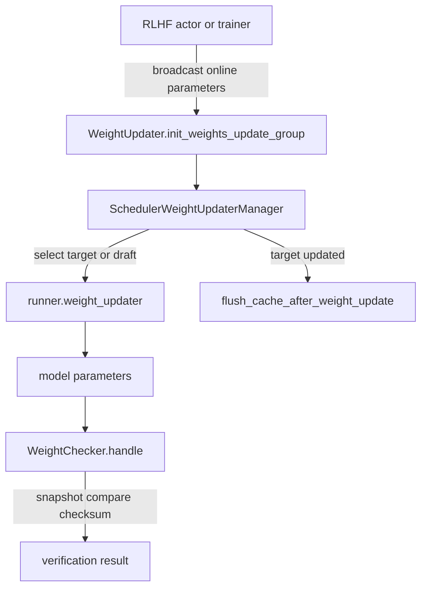
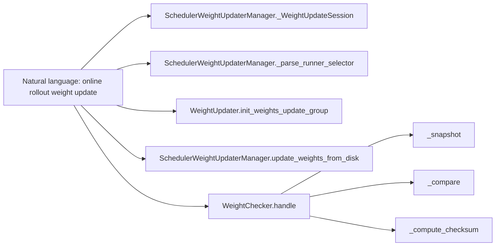
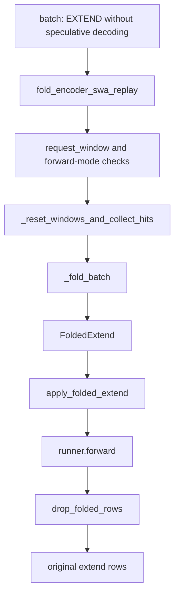
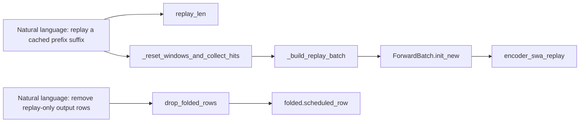

<!-- source: DeepWiki mcp.deepwiki.com · repo sgl-project/sglang · page 19.7 RL Integration and Advanced Engine Features · fetched 2026-10-30 -->

# RL Integration and Advanced Engine Features

Relevant source files

The following files were used as context for generating this wiki page:

- [python/sglang/kernels/jit/csrc/gemm/small_gemm_bf16.cuh](python/sglang/kernels/jit/csrc/gemm/small_gemm_bf16.cuh)
- [python/sglang/kernels/ops/attention/dsv4/attn_metadata_kernels.py](python/sglang/kernels/ops/attention/dsv4/attn_metadata_kernels.py)
- [python/sglang/kernels/ops/attention/dsv4/flashmla_sched_meta.py](python/sglang/kernels/ops/attention/dsv4/flashmla_sched_meta.py)
- [python/sglang/kernels/ops/diffusion/norm/layernorm_modulate_xpu_triton.py](python/sglang/kernels/ops/diffusion/norm/layernorm_modulate_xpu_triton.py)
- [python/sglang/kernels/ops/embeddings/engram_gate.py](python/sglang/kernels/ops/embeddings/engram_gate.py)
- [python/sglang/multimodal_gen/runtime/layers/attention/backends/xpu_backend.py](python/sglang/multimodal_gen/runtime/layers/attention/backends/xpu_backend.py)
- [python/sglang/multimodal_gen/runtime/pipelines_core/stages/model_specific_stages/minimax_h3/keyframe_encoding.py](python/sglang/multimodal_gen/runtime/pipelines_core/stages/model_specific_stages/minimax_h3/keyframe_encoding.py)
- [python/sglang/srt/layers/engram.py](python/sglang/srt/layers/engram.py)
- [python/sglang/srt/layers/n_gram_embedding.py](python/sglang/srt/layers/n_gram_embedding.py)
- [python/sglang/srt/managers/scheduler_components/weight_updater.py](python/sglang/srt/managers/scheduler_components/weight_updater.py)
- [python/sglang/srt/model_executor/encoder_swa_replay.py](python/sglang/srt/model_executor/encoder_swa_replay.py)
- [python/sglang/srt/model_executor/model_runner_components/ngram_embedding_manager.py](python/sglang/srt/model_executor/model_runner_components/ngram_embedding_manager.py)
- [python/sglang/srt/model_executor/model_runner_components/weight_updater.py](python/sglang/srt/model_executor/model_runner_components/weight_updater.py)
- [python/sglang/srt/model_executor/runner/row_bucket_graph_runner.py](python/sglang/srt/model_executor/runner/row_bucket_graph_runner.py)
- [python/sglang/srt/models/deepseek_v4_replay_tail.py](python/sglang/srt/models/deepseek_v4_replay_tail.py)
- [python/sglang/srt/utils/weight_checker.py](python/sglang/srt/utils/weight_checker.py)
- [python/sglang/srt/utils/weight_checker_comparator.py](python/sglang/srt/utils/weight_checker_comparator.py)
- [python/sglang/srt/weight_sync/tensor_bucket.py](python/sglang/srt/weight_sync/tensor_bucket.py)
- [test/registered/e2e/model_executor/test_decoder_tail_moe_bound.py](test/registered/e2e/model_executor/test_decoder_tail_moe_bound.py)
- [test/registered/kernels/ops/diffusion/test_flux2_xpu_norm_fusions.py](test/registered/kernels/ops/diffusion/test_flux2_xpu_norm_fusions.py)
- [test/registered/rl/test_tensor_bucket.py](test/registered/rl/test_tensor_bucket.py)
- [test/registered/rl/test_weight_checker_e2e.py](test/registered/rl/test_weight_checker_e2e.py)
- [test/registered/unit/layers/test_engram_history.py](test/registered/unit/layers/test_engram_history.py)
- [test/registered/unit/model_executor/test_encoder_swa_replay.py](test/registered/unit/model_executor/test_encoder_swa_replay.py)
- [test/registered/unit/model_executor/test_num_token_non_padded_localization.py](test/registered/unit/model_executor/test_num_token_non_padded_localization.py)
- [test/registered/unit/model_executor/test_weight_update_tensor_rank.py](test/registered/unit/model_executor/test_weight_update_tensor_rank.py)
- [test/registered/unit/models/test_deepseek_v41_bcg_multimodal.py](test/registered/unit/models/test_deepseek_v41_bcg_multimodal.py)
- [test/registered/unit/models/test_glm_moe_gate_fp32.py](test/registered/unit/models/test_glm_moe_gate_fp32.py)
- [test/registered/unit/utils/test_weight_checker.py](test/registered/unit/utils/test_weight_checker.py)
- [test/registered/unit/utils/test_weight_checker_comparator.py](test/registered/unit/utils/test_weight_checker_comparator.py)
- [test/registered/unit/utils/test_weight_checker_cpu.py](test/registered/unit/utils/test_weight_checker_cpu.py)

## Overview and Purpose

This page documents the RL-related engine capabilities evidenced by the source codebase: online weight updates, weight verification, and an encoder-SWA replay path that folds cached-prefix replay into an extend batch. The codebase also includes request types for memory release and resume, though implementation details for deterministic inference, state capturers, checkpoint engines, partial rollout APIs, or post-training framework adapters outside of direct weight broadcasting are noted where applicable [python/sglang/srt/managers/scheduler_components/weight_updater.py:20-46]().

Sources: [python/sglang/srt/managers/scheduler_components/weight_updater.py:20-46]()

## Weight Synchronization and Refitting

The shown weight-update path is organized around `SchedulerWeightUpdaterManager` and per-runner `WeightUpdater` objects. The manager selects target and/or draft runners, invokes runner-specific update methods, records a supplied weight version after successful disk updates, and can request a cache flush after the target runner changes [python/sglang/srt/managers/scheduler_components/weight_updater.py:71-79](), [python/sglang/srt/managers/scheduler_components/weight_updater.py:87-103](), [python/sglang/srt/managers/scheduler_components/weight_updater.py:120-163]().

### Dynamic Weight Updates

`SchedulerWeightUpdaterManager` accepts update request structures for disk, distributed, IPC, and tensor sources. Its constructor receives the target worker, draft worker, cache-flush callback, idle-state callback, and optional scheduler and metrics collector. It also captures a TP CPU group during initialization [python/sglang/srt/managers/scheduler_components/weight_updater.py:20-46](), [python/sglang/srt/managers/scheduler_components/weight_updater.py:87-103]().

For disk updates, `update_weights_from_disk` iterates the selected runners and delegates to each runner’s `weight_updater.update_weights_from_disk`. On success it records the requested weight version. If the target runner was updated, it applies the requested cache-flush policy; a refused flush returns a failure response explaining that requests remain active or queued. Weight-load duration is observed with a source label, here `"disk"` [python/sglang/srt/managers/scheduler_components/weight_updater.py:105-118](), [python/sglang/srt/managers/scheduler_components/weight_updater.py:120-163]().

Runner selection supports `"target"`, `"draft"`, and `"all"`; `"all"` selects both target and draft roles, while other values are rejected. A weight-update session records the selector chosen at begin time so that end-of-update handling can finalize the same runner set [python/sglang/srt/managers/scheduler_components/weight_updater.py:71-85]().

The model-side `WeightUpdater` can initialize a named custom Torch process group for online parameter updates. Its documented RLHF arrangement places the actor/training engine at rank 0 and inference rollout ranks in the same update group; the trainer broadcasts updated parameters through that group. Group initialization derives the rank from `rank_offset + tp_rank`, creates the group with `init_custom_process_group`, and reports initialization failure as a `(success, message)` result [python/sglang/srt/model_executor/model_runner_components/weight_updater.py:100-144]().

| Concern | Code entity | Evidence |
|---|---|---|
| Update request types | `UpdateWeightFromDiskReqInput`, `UpdateWeightsFromDistributedReqInput`, `UpdateWeightsFromIPCReqInput`, `UpdateWeightsFromTensorReqInput` | [python/sglang/srt/managers/scheduler_components/weight_updater.py:20-46]() |
| Runner selection | `_parse_runner_selector` | [python/sglang/srt/managers/scheduler_components/weight_updater.py:71-79]() |
| Disk update orchestration | `SchedulerWeightUpdaterManager.update_weights_from_disk` | [python/sglang/srt/managers/scheduler_components/weight_updater.py:138-163]() |
| Custom update process group | `WeightUpdater.init_weights_update_group` | [python/sglang/srt/model_executor/model_runner_components/weight_updater.py:100-144]() |
| Cache flush after target update | `flush_cache_after_weight_update` | [python/sglang/srt/managers/scheduler_components/weight_updater.py:120-133]() |

Sources: [python/sglang/srt/managers/scheduler_components/weight_updater.py:20-46](), [python/sglang/srt/managers/scheduler_components/weight_updater.py:71-163](), [python/sglang/srt/model_executor/model_runner_components/weight_updater.py:100-144]()

### Update Safety and Cache Consistency

The model-side updater rejects online mutations when derived-weight caches may remain stale. `_unsupported_derived_weight_cache_error` checks for compensated mHC weight splits, model-published `_derived_weight_cache_error` constraints, and an HPC-Ops bf16xfp32 GEMM optimization whose cached split would retain old weights. The stated rationale includes references retained by captured CUDA graphs [python/sglang/srt/model_executor/model_runner_components/weight_updater.py:43-84]().

The updater also rejects weight mutation while the CUDA IPC weight cache is active: in that mode, `param.data` is described as a daemon’s shared master copy, so in-place mutation could affect co-attached engines [python/sglang/srt/model_executor/model_runner_components/weight_updater.py:159-170]().

After a target weight update, `flush_cache_after_weight_update` calls the injected flush callback only when the request asks for a flush. If the callback refuses, the manager reports that requests are still running or queued and the update call fails, even though the weights may already have changed [python/sglang/srt/managers/scheduler_components/weight_updater.py:120-133]().

Sources: [python/sglang/srt/managers/scheduler_components/weight_updater.py:120-133](), [python/sglang/srt/model_executor/model_runner_components/weight_updater.py:43-84](), [python/sglang/srt/model_executor/model_runner_components/weight_updater.py:159-170]()

## Weight Verification and Checkpoint Integrity

`WeightChecker` provides four actions through `handle`: `"snapshot"`, `"reset_tensors"`, `"compare"`, and `"checksum"`. Snapshot copies model state into views backed by one mmap arena; comparison checks the current model against that snapshot and releases the snapshot references after the check. The checker captures TP, DP, and PP placement at construction for checksum metadata [python/sglang/srt/utils/weight_checker.py:95-123](), [python/sglang/srt/utils/weight_checker.py:126-168](), [python/sglang/srt/utils/weight_checker.py:185-205]().

The checker uses shared skip rules for reset and comparison. Non-persistent buffers, tensors marked `_skip_weight_check`, and names matching caller-supplied skip patterns are excluded. The overall checksum is SHA-256 over sorted tensor names and their corresponding checksum strings [python/sglang/srt/utils/weight_checker.py:60-88](), [python/sglang/srt/utils/weight_checker.py:169-183]().

Sources: [python/sglang/srt/utils/weight_checker.py:60-205]()

## Engine Lifecycle: Sleep and Wake

The scheduler weight-updater module imports `ReleaseMemoryOccupationReqInput` and `ResumeMemoryOccupationReqInput` along with their corresponding output structures. The available codebase structures do not show request handlers or establish which resources are released or restored, leaving sleep/wake sequencing, memory accounting, or recovery behavior unspecified [python/sglang/srt/managers/scheduler_components/weight_updater.py:20-46]().

The manager constructor includes a `memory_saver_adapter` field, though release or resume operations are managed externally [python/sglang/srt/managers/scheduler_components/weight_updater.py:87-100]().

Sources: [python/sglang/srt/managers/scheduler_components/weight_updater.py:20-46](), [python/sglang/srt/managers/scheduler_components/weight_updater.py:87-100]()

## Partial Rollout and Cached-Prefix Replay

Implementation evidence concerns encoder-SWA replay during extend processing, rather than an arbitrary continuation API. `fold_encoder_swa_replay` applies only when the request window exists and the batch is an extend without speculative decoding. It resets eligible request windows, collects cached-prefix hits, and folds replay rows into the extend batch [python/sglang/srt/model_executor/encoder_swa_replay.py:21-31]().

For a cached prefix, `replay_len(prefix_len)` returns at most 128 tokens. `_reset_windows_and_collect_hits` selects the suffix of that length for replay and requires an even cached-prefix boundary. `_build_replay_batch` copies the batch and replaces its request list, input IDs, prefix and extend lengths, sequence lengths, and cache locations for the replay subset [python/sglang/srt/model_executor/encoder_swa_replay.py:39-43](), [python/sglang/srt/model_executor/encoder_swa_replay.py:120-169]().

`apply_folded_extend` attaches row-floor and compression-row metadata to a `ForwardBatch`. After execution, `drop_folded_rows` maps hidden-state outputs back to original scheduled rows, excluding replay-only rows where appropriate, allowing downstream code to consume the folded forward [python/sglang/srt/model_executor/encoder_swa_replay.py:55-80]().

Sources: [python/sglang/srt/model_executor/encoder_swa_replay.py:21-80](), [python/sglang/srt/model_executor/encoder_swa_replay.py:93-169]()

## Deterministic Inference and State Capture

Deterministic-inference configurations, state-capturer classes, and persistent checkpoint storage adapters are outside the scope of the current SRT execution engine paths covered by the weight checker and weight updater modules [python/sglang/srt/utils/weight_checker.py:1-20]().

Sources: [python/sglang/srt/utils/weight_checker.py:1-20]()

## Post-Training Framework Integrations

The model-side updater documents an RLHF workflow in which an actor model in a training engine broadcasts online updates to an inference engine used for rollout. The mechanism shown is the custom Torch process group initialized by `WeightUpdater.init_weights_update_group` [python/sglang/srt/model_executor/model_runner_components/weight_updater.py:109-144]().

Sources: [python/sglang/srt/model_executor/model_runner_components/weight_updater.py:109-144]()

## Architecture and Data Flow Diagrams

### Diagram: RL Trainer Update to Runtime Weight Verification

Sources: [python/sglang/srt/model_executor/model_runner_components/weight_updater.py:100-144](), [python/sglang/srt/managers/scheduler_components/weight_updater.py:71-79](), [python/sglang/srt/managers/scheduler_components/weight_updater.py:120-163](), [python/sglang/srt/utils/weight_checker.py:126-205]()

### Diagram: Natural-Language Concepts Mapped to Code Entities for Updates

Sources: [python/sglang/srt/managers/scheduler_components/weight_updater.py:71-85](), [python/sglang/srt/managers/scheduler_components/weight_updater.py:138-163](), [python/sglang/srt/model_executor/model_runner_components/weight_updater.py:100-144](), [python/sglang/srt/utils/weight_checker.py:126-205]()

### Diagram: Cached-Prefix Replay in Encoder-SWA Extend Processing

Sources: [python/sglang/srt/model_executor/encoder_swa_replay.py:10-31](), [python/sglang/srt/model_executor/encoder_swa_replay.py:55-80]()

### Diagram: Natural-Language Concepts Mapped to Replay Code Entities

Sources: [python/sglang/srt/model_executor/encoder_swa_replay.py:39-43](), [python/sglang/srt/model_executor/encoder_swa_replay.py:93-118](), [python/sglang/srt/model_executor/encoder_swa_replay.py:120-169]()

---

*This document is a leaf page in the SGLang documentation hierarchy and does not have child pages.*

---

