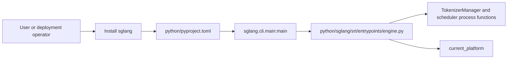
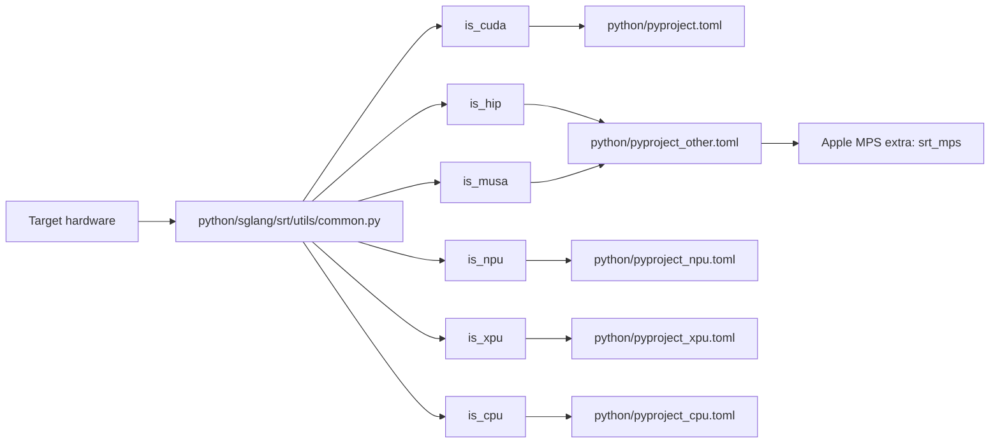
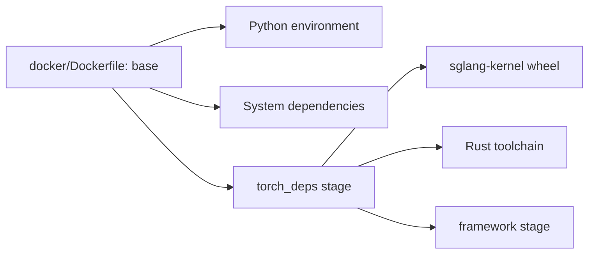
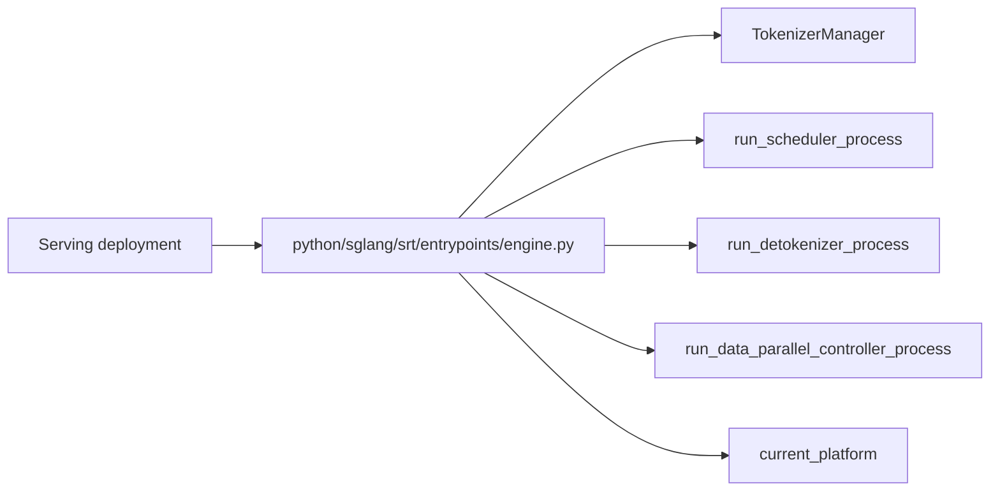

<!-- source: DeepWiki mcp.deepwiki.com · repo sgl-project/sglang · page 2 Installation and Deployment · fetched 2026-10-30 -->

# Installation and Deployment

Relevant source files

The following files were used as context for generating this wiki page:

- [.github/workflows/release-pypi-nightly.yml](.github/workflows/release-pypi-nightly.yml)
- [.github/workflows/release-pypi-pr.yml](.github/workflows/release-pypi-pr.yml)
- [3rdparty/amd/wheel/sglang/pyproject.toml](3rdparty/amd/wheel/sglang/pyproject.toml)
- [docker/Dockerfile](docker/Dockerfile)
- [python/pyproject.toml](python/pyproject.toml)
- [python/pyproject_cpu.toml](python/pyproject_cpu.toml)
- [python/pyproject_npu.toml](python/pyproject_npu.toml)
- [python/pyproject_other.toml](python/pyproject_other.toml)
- [python/pyproject_xpu.toml](python/pyproject_xpu.toml)
- [python/sglang/srt/entrypoints/engine.py](python/sglang/srt/entrypoints/engine.py)
- [python/sglang/srt/function_call/deepseekv32_detector.py](python/sglang/srt/function_call/deepseekv32_detector.py)
- [python/sglang/srt/function_call/kimik2_detector.py](python/sglang/srt/function_call/kimik2_detector.py)
- [python/sglang/srt/utils/common.py](python/sglang/srt/utils/common.py)
- [python/sglang/srt/utils/json_response.py](python/sglang/srt/utils/json_response.py)
- [scripts/update_nightly_whl_index.py](scripts/update_nightly_whl_index.py)
- [test/registered/function_call/test_kimik2_detector.py](test/registered/function_call/test_kimik2_detector.py)
- [test/registered/moe/test_cutedsl_moe.py](test/registered/moe/test_cutedsl_moe.py)
- [test/registered/unit/function_call/test_deepseekv4_detector.py](test/registered/unit/function_call/test_deepseekv4_detector.py)
- [test/registered/unit/function_call/test_json_schema_constraint.py](test/registered/unit/function_call/test_json_schema_constraint.py)
- [test/registered/unit/function_call/test_structural_tag_excludes.py](test/registered/unit/function_call/test_structural_tag_excludes.py)
- [test/registered/unit/function_call/test_unknown_tool_name.py](test/registered/unit/function_call/test_unknown_tool_name.py)
- [test/registered/unit/utils/test_common.py](test/registered/unit/utils/test_common.py)
- [test/registered/unit/utils/test_json_response.py](test/registered/unit/utils/test_json_response.py)

## Purpose and Scope

This page is a high-level guide to the main ways to install and deploy SGLang. It connects package and platform choices to container and distributed serving, and links to child pages for detailed procedures.

Sources: [python/pyproject.toml:11-17](), [python/sglang/srt/entrypoints/engine.py:14-18]()

---

## Package and Runtime Overview

SGLang is distributed as the `sglang` Python package. Its project metadata defines Python requirements, dependencies, optional extras, and the `sglang` CLI entry point. The runtime engine entry point is implemented in `python/sglang/srt/entrypoints/engine.py`; its imports show the managers and platform abstractions used to initialize serving. [python/pyproject.toml:11-17](), [python/pyproject.toml:216-218](), [python/sglang/srt/entrypoints/engine.py:14-18](), [python/sglang/srt/entrypoints/engine.py:66-117]()

The dependency manifests vary by platform. The default project manifest includes the core dependency set and optional extras; separate manifests describe CPU, XPU, and NPU dependency choices, while `pyproject_other.toml` includes extras for ROCm, MUSA, and Apple MPS. [python/pyproject.toml:24-103](), [python/pyproject_other.toml:19-85](), [python/pyproject_other.toml:122-171](), [python/pyproject_other.toml:173-214](), [python/pyproject_cpu.toml:18-77](), [python/pyproject_xpu.toml:18-75](), [python/pyproject_npu.toml:18-71]()

**Installation and runtime entities**

Sources: [python/pyproject.toml:11-17](), [python/pyproject.toml:216-218](), [python/sglang/srt/entrypoints/engine.py:66-117]()

---

## Installation Methods

The package metadata defines `sglang` and optional extras for features such as diffusion, tracing, HTTP/2, Ray, and testing. The repository also contains platform-specific manifests, so installation choices depend on the target hardware and its compatible PyTorch stack. [python/pyproject.toml:11-17](), [python/pyproject.toml:110-204](), [python/pyproject_other.toml:19-85]()

For PyPI installation, source builds, and platform-specific installation procedures, see [Installation Methods](#2.1). For platform dependency choices, see [Hardware Platform Configuration](#2.2).

Sources: [python/pyproject.toml:1-17](), [python/pyproject.toml:110-204](), [python/pyproject_other.toml:19-85]()

---

## Hardware Platform Configuration

The runtime utilities include cached checks for CUDA, HIP, NPU, XPU, CPU, and MUSA availability. The project’s manifests define different dependency sets for platforms including CUDA, ROCm, CPU, XPU, NPU, MUSA, and Apple MPS. [python/sglang/srt/utils/common.py:139-164](), [python/sglang/srt/utils/common.py:168-235](), [python/pyproject.toml:24-103](), [python/pyproject_other.toml:122-214](), [python/pyproject_cpu.toml:18-77](), [python/pyproject_xpu.toml:18-75](), [python/pyproject_npu.toml:18-71]()

The platform-specific manifests are the installation layer; runtime detection is a separate layer. For the supported backends and configuration details, see [Hardware Platform Configuration](#2.2).

**Hardware choice mapped to detection and dependency manifests**

Sources: [python/sglang/srt/utils/common.py:139-164](), [python/sglang/srt/utils/common.py:168-235](), [python/pyproject.toml:24-103](), [python/pyproject_other.toml:122-214](), [python/pyproject_cpu.toml:18-77](), [python/pyproject_xpu.toml:18-75](), [python/pyproject_npu.toml:18-71]()

---

## Docker Deployment

The provided `docker/Dockerfile` defaults to an NVIDIA CUDA base image, creates a Python virtual environment, installs system dependencies, and uses BuildKit stages for dependency and framework build work. Its dependency stage installs an `sglang-kernel` wheel and sets up Rust for native extensions. [docker/Dockerfile:1-8](), [docker/Dockerfile:40-60](), [docker/Dockerfile:62-132](), [docker/Dockerfile:158-207]()

For image variants, build options, and container deployment guidance, see [Docker Deployment](#2.3).

**Docker build entities**

Sources: [docker/Dockerfile:1-8](), [docker/Dockerfile:40-60](), [docker/Dockerfile:62-132](), [docker/Dockerfile:158-207]()

---

## Multi-Node and Distributed Deployment

The engine entry point imports process launch functions for the scheduler and data-parallel controller, along with the tokenizer and detokenizer managers. These are the runtime components relevant to serving setup; this page does not specify cluster initialization or network behavior. [python/sglang/srt/entrypoints/engine.py:66-110]()

For multi-node setup, distributed initialization, network configuration, and Kubernetes-native fleet orchestration, see [Multi-Node and Distributed Deployment](#2.4).

**Deployment concepts mapped to engine entities**

Sources: [python/sglang/srt/entrypoints/engine.py:66-117]()

---

## Further Reading

- [Installation Methods](#2.1) — PyPI installation, source builds, and platform-specific procedures.
- [Hardware Platform Configuration](#2.2) — Platform detection and hardware-specific dependencies.
- [Docker Deployment](#2.3) — Docker builds, image variants, and container deployment.
- [Multi-Node and Distributed Deployment](#2.4) — Distributed setup, networking, and Kubernetes-native fleet orchestration.

Sources: [python/pyproject.toml:11-17](), [python/sglang/srt/utils/common.py:139-235](), [docker/Dockerfile:1-8](), [python/sglang/srt/entrypoints/engine.py:66-117]()

---

