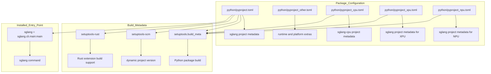
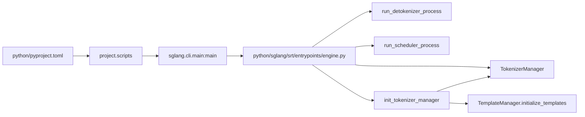

<!-- source: DeepWiki mcp.deepwiki.com · repo sgl-project/sglang · page 2.1 Installation Methods · fetched 2026-10-30 -->

# Installation Methods

Relevant source files

The following files were used as context for generating this wiki page:

- [.github/workflows/release-pypi-nightly.yml](.github/workflows/release-pypi-nightly.yml)
- [.github/workflows/release-pypi-pr.yml](.github/workflows/release-pypi-pr.yml)
- [3rdparty/amd/wheel/sglang/pyproject.toml](3rdparty/amd/wheel/sglang/pyproject.toml)
- [docker/Dockerfile](docker/Dockerfile)
- [python/pyproject.toml](python/pyproject.toml)
- [python/pyproject_cpu.toml](python/pyproject_cpu.toml)
- [python/pyproject_npu.toml](python/pyproject_npu.toml)
- [python/pyproject_other.toml](python/pyproject_other.toml)
- [python/pyproject_xpu.toml](python/pyproject_xpu.toml)
- [python/sglang/srt/entrypoints/engine.py](python/sglang/srt/entrypoints/engine.py)
- [python/sglang/srt/function_call/deepseekv32_detector.py](python/sglang/srt/function_call/deepseekv32_detector.py)
- [python/sglang/srt/function_call/kimik2_detector.py](python/sglang/srt/function_call/kimik2_detector.py)
- [python/sglang/srt/utils/common.py](python/sglang/srt/utils/common.py)
- [python/sglang/srt/utils/json_response.py](python/sglang/srt/utils/json_response.py)
- [scripts/update_nightly_whl_index.py](scripts/update_nightly_whl_index.py)
- [test/registered/function_call/test_kimik2_detector.py](test/registered/function_call/test_kimik2_detector.py)
- [test/registered/moe/test_cutedsl_moe.py](test/registered/moe/test_cutedsl_moe.py)
- [test/registered/unit/function_call/test_deepseekv4_detector.py](test/registered/unit/function_call/test_deepseekv4_detector.py)
- [test/registered/unit/function_call/test_json_schema_constraint.py](test/registered/unit/function_call/test_json_schema_constraint.py)
- [test/registered/unit/function_call/test_structural_tag_excludes.py](test/registered/unit/function_call/test_structural_tag_excludes.py)
- [test/registered/unit/function_call/test_unknown_tool_name.py](test/registered/unit/function_call/test_unknown_tool_name.py)
- [test/registered/unit/utils/test_common.py](test/registered/unit/utils/test_common.py)
- [test/registered/unit/utils/test_json_response.py](test/registered/unit/utils/test_json_response.py)

## Purpose and Scope

This page documents the available SGLang installation paths: installing the Python package and its declared dependencies, building from source, and selecting platform-specific package configurations. The project metadata describes SGLang as a serving framework for large language models and vision-language models. Container image construction is covered separately in **2.3 Docker Deployment**; runtime hardware detection is covered in **2.2 Hardware Platform Configuration**. [python/pyproject.toml:11-17]()

Sources: [python/pyproject.toml:11-17]()

---

## Installation Architecture Overview

SGLang’s package metadata is split across several project configuration files. The main `python/pyproject.toml` declares the default package and its dependencies, while `pyproject_cpu.toml`, `pyproject_xpu.toml`, `pyproject_npu.toml`, and `pyproject_other.toml` define additional platform-oriented package configurations and dependency sets. [python/pyproject.toml:11-24](), [python/pyproject_cpu.toml:6-19](), [python/pyproject_xpu.toml:5-18](), [python/pyproject_npu.toml:5-18](), [python/pyproject_other.toml:5-23]()

The default package requires Python 3.11 or later and uses a setuptools build backend. Its build requirements include `setuptools-rust`, `setuptools-scm`, and a pinned PyTorch build dependency. The default project metadata also declares a dynamic version and a console script named `sglang`. [python/pyproject.toml:1-16](), [python/pyproject.toml:216-219]()

### Installation Artifact Flow

Sources: [python/pyproject.toml:1-16](), [python/pyproject.toml:216-219](), [python/pyproject_cpu.toml:1-11](), [python/pyproject_xpu.toml:1-10](), [python/pyproject_npu.toml:1-10](), [python/pyproject_other.toml:1-10]()

---

## Method 1: PyPI Installation

The main project is named `sglang`, declares Python `>=3.11`, and lists its runtime requirements in the default project dependency array. Those dependencies include PyTorch, serving and API libraries, tokenizer and model utilities, and packages for kernel and accelerator integrations. [python/pyproject.toml:11-17](), [python/pyproject.toml:24-103]()

The base package also defines optional dependency groups for capabilities that are not included in the ordinary dependency list. These include `checkpoint-engine`, `instanttensor`, `runai`, `diffusion`, `ray`, `tracing`, `http2`, `fastokens`, `test`, `dev`, and `all`. The `all` extra composes the `diffusion`, `fastokens`, `http2`, and `tracing` extras. [python/pyproject.toml:110-204]()

| Installation concern | Package metadata location | What it controls |
|---|---|---|
| Base runtime requirements | `dependencies` | Dependencies installed for the main `sglang` project. [python/pyproject.toml:11-24]() |
| Optional features | `project.optional-dependencies` | Named extras, including `diffusion`, `tracing`, `http2`, and `ray`. [python/pyproject.toml:110-162]() |
| Development and test requirements | `test`, `dev` extras | Test dependencies and the development extra that includes `sglang[test]`. [python/pyproject.toml:164-198]() |
| Aggregate feature installation | `all` extra | Combines the `diffusion`, `fastokens`, `http2`, and `tracing` extras. [python/pyproject.toml:199-204]() |
| Package command | `project.scripts` | Registers `sglang` and `killall_sglang` console commands. [python/pyproject.toml:216-219]() |

The metadata declares the PyPI simple index as the default index for `uv`. The project’s dependency specifications include environment markers for selected platform- and architecture-specific packages, so dependency resolution can vary with the installation environment. [python/pyproject.toml:105-108](), [python/pyproject.toml:24-103]()

Sources: [python/pyproject.toml:11-17](), [python/pyproject.toml:24-108](), [python/pyproject.toml:110-204](), [python/pyproject.toml:216-219]()

---

## Method 2: Source Builds and Kernel Compilation

The main project uses `setuptools.build_meta` with build requirements that include `setuptools>=61.0`, `setuptools-rust>=1.11`, `setuptools-scm>=8.0`, `torch==2.14.1`, and `wheel`. The project version is dynamic, and package data configuration includes files under the `sglang` runtime and kernel package trees. [python/pyproject.toml:1-9](), [python/pyproject.toml:11-16](), [python/pyproject.toml:220-225]()

`setuptools-rust` is part of the declared build system. The Docker build configuration also installs a Rust toolchain in its `torch_deps` stage and identifies Rust extensions such as `sglang-grpc` as a use case. This is evidence of Rust extension support in the build environment; it is not, by itself, a complete host source-build procedure. [python/pyproject.toml:1-9](), [docker/Dockerfile:176-193]()

For the Docker build’s CUDA path, `sglang-kernel` is installed from a prebuilt wheel. The Dockerfile pins its version through `SGL_KERNEL_VERSION`, checks the configured CUDA version, and uses `--no-deps` when installing the wheel so that the installer does not pull PyTorch from the default package index. This is a container-build procedure, not a general instruction to compile the kernel from source. [docker/Dockerfile:11-14](), [docker/Dockerfile:179-203]()

| Build area | Configuration evidence |
|---|---|
| Python build backend | `setuptools.build_meta` in the main project metadata. [python/pyproject.toml:1-9]() |
| Rust build integration | `setuptools-rust` is a build requirement; the Docker build installs Rust before assembling the framework stage. [python/pyproject.toml:1-9](), [docker/Dockerfile:188-193]() |
| Version generation | The project declares a dynamic version and uses `setuptools-scm`; the platform-specific metadata shown also declares a version-file path and fallback version. [python/pyproject.toml:11-16](), [python/pyproject_cpu.toml:157-164](), [python/pyproject_npu.toml:157-162](), [python/pyproject_xpu.toml:173-178]() |
| Kernel dependency in Docker | The Docker build installs the configured `sglang-kernel` wheel and guards its supported CUDA version. [docker/Dockerfile:195-203]() |

Sources: [python/pyproject.toml:1-16](), [python/pyproject.toml:220-225](), [python/pyproject_cpu.toml:157-164](), [python/pyproject_npu.toml:157-162](), [python/pyproject_xpu.toml:173-178](), [docker/Dockerfile:176-203]()

---

## Platform-Specific Installation

Platform-specific configuration files make dependency choices explicit rather than relying on one identical dependency set for every backend. The files shown define configurations for CUDA-oriented installation, CPU, XPU, NPU, and a collection of other platform configurations. The presence of a platform configuration does not by itself establish that all combinations of hardware, operating system, and package versions are supported. [python/pyproject.toml:24-103](), [python/pyproject_cpu.toml:6-19](), [python/pyproject_xpu.toml:5-18](), [python/pyproject_npu.toml:5-18](), [python/pyproject_other.toml:5-23]()

### 1. NVIDIA CUDA

The main `python/pyproject.toml` declares the default `sglang` project and includes CUDA-oriented dependencies such as `cuda-python`, `flash-attn-4`, `flashinfer_python[cu13]`, `humming-kernels[cu13]`, and `sglang-kernel`. It pins PyTorch and several accelerator-related packages in the project dependency list. [python/pyproject.toml:11-16](), [python/pyproject.toml:24-103]()

The Dockerfile’s shown CUDA dependency stage accepts a `CUDA_VERSION` build argument, checks it against `13.0.3`, and installs a versioned `sglang-kernel` wheel. Those details describe the Docker build configuration and should not be treated as a universal host installation recipe. [docker/Dockerfile:1-3](), [docker/Dockerfile:179-203]()

Sources: [python/pyproject.toml:11-16](), [python/pyproject.toml:24-103](), [docker/Dockerfile:1-3](), [docker/Dockerfile:179-203]()

### 2. AMD ROCm (HIP)

`python/pyproject_other.toml` defines HIP-related optional dependency groups, including `srt_hip`, `srt_hip_rocm724`, and `srt_hip_rocm101`. These groups combine the runtime dependencies with platform-specific PyTorch versions and packages such as `petit_kernel` and `wave-lang`; the variants differ in their declared PyTorch and compressed-tensors pins. [python/pyproject_other.toml:111-150]()

A separate AMD wheel project is defined in `3rdparty/amd/wheel/sglang/pyproject.toml` under the project name `amd-sglang`. Its `rocm720` group declares AMD-hosted PyTorch, Triton, torchaudio, and torchvision wheels, as well as an ROCm-specific `sglang-kernel` wheel. The file documents an installation combination using the `srt_hip` and `rocm720` extras. [3rdparty/amd/wheel/sglang/pyproject.toml:5-16](), [3rdparty/amd/wheel/sglang/pyproject.toml:69-86]()

Sources: [python/pyproject_other.toml:111-150](), [3rdparty/amd/wheel/sglang/pyproject.toml:5-16](), [3rdparty/amd/wheel/sglang/pyproject.toml:69-86]()

### 3. Intel XPU

`python/pyproject_xpu.toml` pins XPU builds of PyTorch, torchaudio, and torchvision. It also declares an `sglang-kernel-xpu` wheel by direct URL, and its build requirements include an XPU-specific PyTorch build. [python/pyproject_xpu.toml:1-3](), [python/pyproject_xpu.toml:60-68]()

The XPU configuration has its own project dependency set and optional groups, including `diffusion`, `ray`, `tracing`, `test`, `dev`, and `all`. The `all` group shown combines diffusion and tracing extras. [python/pyproject_xpu.toml:77-132]()

Sources: [python/pyproject_xpu.toml:1-3](), [python/pyproject_xpu.toml:60-75](), [python/pyproject_xpu.toml:77-132]()

### 4. CPU

`python/pyproject_cpu.toml` defines the project name `sglang-cpu`, requires Python 3.11 or later, and declares CPU-oriented dependencies, including `torch==2.14.0`, `triton==3.8.0`, and an `intel-openmp` dependency guarded by the `x86_64` platform marker. [python/pyproject_cpu.toml:6-16](), [python/pyproject_cpu.toml:18-77]()

The runtime utility `is_cpu()` does not infer CPU mode solely from the presence of a CPU. It first checks whether `SGLANG_USE_CPU_ENGINE` is set to `"1"` and then checks for a supported x86 or ARM host CPU. [python/sglang/srt/utils/common.py:202-224]()

Sources: [python/pyproject_cpu.toml:6-16](), [python/pyproject_cpu.toml:18-77](), [python/sglang/srt/utils/common.py:202-224]()

### 5. Ascend NPU

`python/pyproject_npu.toml` defines an NPU-oriented `sglang` project configuration. Its dependencies include the serving runtime packages and do not declare a PyTorch package in the shown main dependency list. It defines an empty `srt_npu` extra, an `all_npu` extra that includes diffusion, and a `dev_npu` extra that includes both `all_npu` and tests. [python/pyproject_npu.toml:5-18](), [python/pyproject_npu.toml:18-71](), [python/pyproject_npu.toml:113-116]()

At runtime, `is_npu()` returns `False` if `torch.npu` is absent. If the module exists but reports no available NPU device, the function raises a `RuntimeError`; otherwise, it returns `True`. [python/sglang/srt/utils/common.py:188-198]()

Sources: [python/pyproject_npu.toml:5-18](), [python/pyproject_npu.toml:18-71](), [python/pyproject_npu.toml:113-116](), [python/sglang/srt/utils/common.py:188-198]()

### 6. Moore Threads MUSA and Apple Silicon MPS

`python/pyproject_other.toml` defines `srt_musa` with a platform-specific stack that includes `torch_musa`, `torchada`, MUSA-specific kernel packages, and pinned versions of related components. It also defines `diffusion_musa` as a separate optional group. [python/pyproject_other.toml:173-203]()

The same file defines `srt_mps`, which includes `mlx`, `mlx-lm`, and pinned PyTorch-related dependencies. A separate `diffusion_mps` group contains dependencies for diffusion workloads. [python/pyproject_other.toml:205-226]()

The runtime helper `is_musa()` checks for a MUSA version on `torch.version` and then attempts to import `torchada`; it returns `False` if either check fails. [python/sglang/srt/utils/common.py:227-235]()

Sources: [python/pyproject_other.toml:173-226](), [python/sglang/srt/utils/common.py:227-235]()

---

## Installation Implementation Details

The packaging metadata provides a connection between install-time configuration and runtime entry points. The package registers `sglang.cli.main:main` as the `sglang` console script. The runtime engine module imports managers and process launch functions, including `TokenizerManager`, `run_detokenizer_process`, and `run_scheduler_process`; it also defines `init_tokenizer_manager`, which constructs a tokenizer manager and initializes templates. [python/pyproject.toml:216-219](), [python/sglang/srt/entrypoints/engine.py:66-110](), [python/sglang/srt/entrypoints/engine.py:195-208]()

### Relationship Diagram: Package Metadata to Runtime Entry Points

Sources: [python/pyproject.toml:216-219](), [python/sglang/srt/entrypoints/engine.py:66-110](), [python/sglang/srt/entrypoints/engine.py:195-208]()

### Versioning and Console Scripts

The main `pyproject.toml` declares a dynamic project version. Platform-specific CPU, NPU, and XPU metadata shown here use `setuptools-scm`, set `python/sglang/_version.py` as the version file, and specify a fallback version for editable installs without Git metadata. [python/pyproject.toml:11-16](), [python/pyproject_cpu.toml:157-164](), [python/pyproject_npu.toml:157-162](), [python/pyproject_xpu.toml:173-178]()

The main project registers two console scripts: `sglang`, mapped to `sglang.cli.main:main`, and `killall_sglang`, mapped to `sglang.cli.killall:main`. The XPU, NPU, and CPU project files shown register `sglang` as a console script. [python/pyproject.toml:216-219](), [python/pyproject_cpu.toml:124-125](), [python/pyproject_npu.toml:122-124](), [python/pyproject_xpu.toml:138-140]()

Sources: [python/pyproject.toml:11-16](), [python/pyproject.toml:216-219](), [python/pyproject_cpu.toml:124-125](), [python/pyproject_cpu.toml:157-164](), [python/pyproject_npu.toml:122-124](), [python/pyproject_npu.toml:157-162](), [python/pyproject_xpu.toml:138-140](), [python/pyproject_xpu.toml:173-178]()

---

## Summary

SGLang’s installation configuration is organized around a default `sglang` project and platform-specific metadata for CPU, XPU, NPU, and other backends. The main project declares its runtime dependencies and optional feature groups; platform metadata supplies backend-specific pins and wheels where applicable. Source-build support is reflected in the setuptools build configuration and Rust build integration, while the Docker build has its own CUDA and kernel-wheel installation path. [python/pyproject.toml:1-16](), [python/pyproject.toml:24-103](), [python/pyproject.toml:110-204](), [python/pyproject_cpu.toml:6-19](), [python/pyproject_xpu.toml:5-18](), [python/pyproject_npu.toml:5-18](), [python/pyproject_other.toml:5-23](), [docker/Dockerfile:176-203]()

For container deployment workflows, refer to **2.3 Docker Deployment**. For hardware runtime configuration and detection, refer to **2.2 Hardware Platform Configuration**.

Sources: [python/pyproject.toml:1-16](), [python/pyproject.toml:24-103](), [python/pyproject.toml:110-204](), [python/pyproject_cpu.toml:6-19](), [python/pyproject_xpu.toml:5-18](), [python/pyproject_npu.toml:5-18](), [python/pyproject_other.toml:5-23](), [docker/Dockerfile:176-203]()

---

## References

- [python/pyproject.toml]()
- [python/pyproject_other.toml]()
- [python/pyproject_cpu.toml]()
- [python/pyproject_xpu.toml]()
- [python/pyproject_npu.toml]()
- [3rdparty/amd/wheel/sglang/pyproject.toml]()
- [docker/Dockerfile]()
- [python/sglang/srt/utils/common.py]()
- [python/sglang/srt/entrypoints/engine.py]()

---

