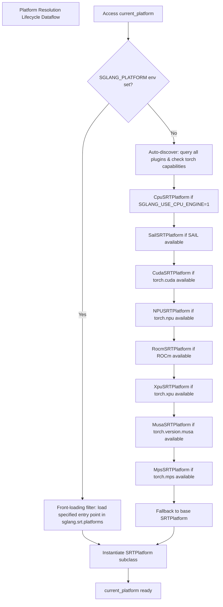
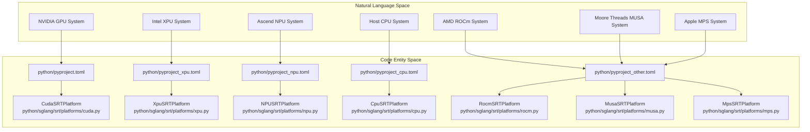

<!-- source: DeepWiki mcp.deepwiki.com · repo sgl-project/sglang · page 2.2 Hardware Platform Configuration · fetched 2026-10-30 -->

# Hardware Platform Configuration

<details>
<summary>Relevant source files</summary>

The following files were used as context for generating this wiki page:

- [.github/workflows/nightly-test-intel-wheel.yml](.github/workflows/nightly-test-intel-wheel.yml)
- [.github/workflows/nightly-test-intel.yml](.github/workflows/nightly-test-intel.yml)
- [.github/workflows/pr-test-xpu.yml](.github/workflows/pr-test-xpu.yml)
- [.github/workflows/release-docker-intel-xpu-nightly.yml](.github/workflows/release-docker-intel-xpu-nightly.yml)
- [.github/workflows/xpu-ci-job-monitor.yml](.github/workflows/xpu-ci-job-monitor.yml)
- [docker/xpu.Dockerfile](docker/xpu.Dockerfile)
- [docs/docs/hardware-platforms/plugin.mdx](docs/docs/hardware-platforms/plugin.mdx)
- [docs/docs/hardware-platforms/xpu.mdx](docs/docs/hardware-platforms/xpu.mdx)
- [python/sglang/kernels/ops/speculative/spec_tree.py](python/sglang/kernels/ops/speculative/spec_tree.py)
- [python/sglang/srt/hardware_backend/npu/graph_runner/npu_cudagraph_backend.py](python/sglang/srt/hardware_backend/npu/graph_runner/npu_cudagraph_backend.py)
- [python/sglang/srt/platforms/__init__.py](python/sglang/srt/platforms/__init__.py)
- [python/sglang/srt/platforms/cpu.py](python/sglang/srt/platforms/cpu.py)
- [python/sglang/srt/platforms/cuda.py](python/sglang/srt/platforms/cuda.py)
- [python/sglang/srt/platforms/device_mixin.py](python/sglang/srt/platforms/device_mixin.py)
- [python/sglang/srt/platforms/interface.py](python/sglang/srt/platforms/interface.py)
- [python/sglang/srt/platforms/musa.py](python/sglang/srt/platforms/musa.py)
- [python/sglang/srt/platforms/npu.py](python/sglang/srt/platforms/npu.py)
- [python/sglang/srt/platforms/rocm.py](python/sglang/srt/platforms/rocm.py)
- [python/sglang/srt/platforms/sail.py](python/sglang/srt/platforms/sail.py)
- [python/sglang/srt/platforms/xpu.py](python/sglang/srt/platforms/xpu.py)
- [python/sglang/srt/speculative/adaptive_runtime_state.py](python/sglang/srt/speculative/adaptive_runtime_state.py)
- [python/sglang/srt/speculative/adaptive_spec_params.py](python/sglang/srt/speculative/adaptive_spec_params.py)
- [python/sglang/srt/utils/torch_memory_saver_adapter.py](python/sglang/srt/utils/torch_memory_saver_adapter.py)
- [python/sglang/test/ci/ci_utils.py](python/sglang/test/ci/ci_utils.py)
- [python/sglang/test/xpu/__init__.py](python/sglang/test/xpu/__init__.py)
- [python/sglang/test/xpu/simple_eval_gsm8k_xpu_mixin.py](python/sglang/test/xpu/simple_eval_gsm8k_xpu_mixin.py)
- [python/sglang/test/xpu/test_xpu_utils.py](python/sglang/test/xpu/test_xpu_utils.py)
- [scripts/ci/utils/xpu_job_monitor.py](scripts/ci/utils/xpu_job_monitor.py)
- [scripts/ci/xpu/xpu_ci_start_container.sh](scripts/ci/xpu/xpu_ci_start_container.sh)
- [test/registered/spec/eagle/test_adaptive_speculative.py](test/registered/spec/eagle/test_adaptive_speculative.py)
- [test/registered/spec/test_frozen_kv_mtp.py](test/registered/spec/test_frozen_kv_mtp.py)
- [test/registered/spec/test_gemma4_mtp_31b_extra.py](test/registered/spec/test_gemma4_mtp_31b_extra.py)
- [test/registered/unit/distributed/test_get_default_distributed_backend.py](test/registered/unit/distributed/test_get_default_distributed_backend.py)
- [test/registered/unit/distributed/test_oot_group_coordinator_hooks.py](test/registered/unit/distributed/test_oot_group_coordinator_hooks.py)
- [test/registered/unit/platforms/test_platform_interface.py](test/registered/unit/platforms/test_platform_interface.py)
- [test/registered/unit/spec/test_adaptive_runtime_state.py](test/registered/unit/spec/test_adaptive_runtime_state.py)
- [test/registered/unit/spec/test_adaptive_spec_params.py](test/registered/unit/spec/test_adaptive_spec_params.py)
- [test/registered/unit/spec/test_oot_eagle_hooks.py](test/registered/unit/spec/test_oot_eagle_hooks.py)
- [test/registered/xpu/llm_models/test_xpu_gemma_4_26b_a4b.py](test/registered/xpu/llm_models/test_xpu_gemma_4_26b_a4b.py)
- [test/registered/xpu/llm_models/test_xpu_llama_3_1_8b.py](test/registered/xpu/llm_models/test_xpu_llama_3_1_8b.py)
- [test/registered/xpu/llm_models/test_xpu_nemotron_3_nano_30b_a3b.py](test/registered/xpu/llm_models/test_xpu_nemotron_3_nano_30b_a3b.py)
- [test/registered/xpu/llm_models/test_xpu_qwen3_30b_a3b.py](test/registered/xpu/llm_models/test_xpu_qwen3_30b_a3b.py)
- [test/registered/xpu/llm_models/test_xpu_qwen3_5_35b_a3b.py](test/registered/xpu/llm_models/test_xpu_qwen3_5_35b_a3b.py)
- [test/registered/xpu/llm_models/test_xpu_qwen3_5_9b.py](test/registered/xpu/llm_models/test_xpu_qwen3_5_9b.py)
- [test/registered/xpu/test_deepseek_ocr_2_olmbench.py](test/registered/xpu/test_deepseek_ocr_2_olmbench.py)
- [test/registered/xpu/test_triton_attention_backend.py](test/registered/xpu/test_triton_attention_backend.py)
- [test/registered/xpu/test_xpu_flux2_dev.py](test/registered/xpu/test_xpu_flux2_dev.py)
- [test/registered/xpu/test_xpu_memory_saver.py](test/registered/xpu/test_xpu_memory_saver.py)
- [test/registered/xpu/test_xpu_zimage_turbo.py](test/registered/xpu/test_xpu_zimage_turbo.py)

</details>


This page provides a technical explanation of how SGLang detects hardware platforms at runtime, supports CUDA, ROCm, NPU, XPU, CPU, and MLX/MPS backends, manages platform-specific dependencies, and exposes out-of-tree (OOT) platform extension mechanisms.

---

## 1. Platform Detection and Resolution Lifecycle

SGLang determines the active hardware backend at runtime through cached introspection queries against PyTorch and environment variables. The platform selection logic is coordinated by module-level lazy singletons and discovery hooks in `python/sglang/srt/platforms/__init__.py` and `python/sglang/srt/platforms/interface.py` [python/sglang/srt/platforms/__init__.py:1-12](), [python/sglang/srt/platforms/interface.py:1-11]().

The base class `DeviceMixin` (`python/sglang/srt/platforms/device_mixin.py`) defines shared device identity queries (`is_cuda()`, `is_rocm()`, `is_npu()`, `is_xpu()`, `is_cpu()`, `is_musa()`, `is_mps()`, `is_sail()`) [test/registered/unit/platforms/test_platform_interface.py:91-100](). Subclassing `SRTPlatform` binds these device traits to runtime subsystem factories such as attention backends, graph runners, and memory pools [python/sglang/srt/platforms/interface.py:106-179]().


Sources: [python/sglang/srt/platforms/__init__.py:75-107](), [python/sglang/srt/platforms/interface.py:106-179](), [test/registered/unit/platforms/test_platform_interface.py:91-100]()

---

## 2. Supported Platforms and Build Configurations

SGLang structures its platform-specific Python dependencies and build targets across distinct dependency files and configuration matrices.

| Platform | Device Type | Detection Function | Build Config File | Kernel Package |
|:---|:---|:---|:---|:---|
| NVIDIA CUDA | GPU | `_is_cuda_available()` [python/sglang/srt/platforms/__init__.py:38-39]() | `python/pyproject.toml` | `sglang-kernel` |
| AMD ROCm (HIP) | GPU | `_is_rocm_available()` [python/sglang/srt/platforms/__init__.py:42-43]() | `python/pyproject_other.toml` | `sglang-kernel` (ROCm) |
| Intel XPU | GPU | `_is_xpu_available()` [python/sglang/srt/platforms/__init__.py:58-59]() | `python/pyproject_xpu.toml` | `sgl-kernel-xpu` |
| Intel CPU | CPU | `_is_cpu_available()` [python/sglang/srt/platforms/__init__.py:49-50]() | `python/pyproject_cpu.toml` | `sglang-kernel-cpu` |
| Ascend NPU | NPU | `_is_npu_available()` [python/sglang/srt/platforms/__init__.py:53-54]() | `python/pyproject_npu.toml` | `sgl-kernel-npu` |
| Moore Threads GPU | GPU | `_is_musa_available()` [python/sglang/srt/platforms/__init__.py:61-68]() | `python/pyproject_other.toml` | `srt_musa` extra |
| Apple Silicon MPS | GPU | `_is_mps_available()` [python/sglang/srt/platforms/__init__.py:71-72]() | `python/pyproject_other.toml` | `srt_mps` extra |

### Dependency Ecosystem Mapping


Sources: [python/sglang/srt/platforms/__init__.py:21-29](), [python/sglang/srt/platforms/__init__.py:38-72]()

---

## 3. Out-of-Tree (OOT) Plugin System

External hardware vendors can integrate custom platform runtimes without modifying the core SGLang codebase by implementing setuptools entry points under the `sglang.srt.platforms` group [docs/docs/hardware-platforms/plugin.mdx:11-38]().

### Plugin Contract and Lifecycle
An OOT platform must subclass `SRTPlatform` (`python/sglang/srt/platforms/interface.py`) and expose an activation callback matching [docs/docs/hardware-platforms/plugin.mdx:56-61]():
```python
def activate() -> str | None:
    """Return the platform class qualname when this hardware is available."""
```

The runtime loader (`_resolve_platform` in `python/sglang/srt/platforms/__init__.py`) discovers these plugins dynamically [python/sglang/srt/platforms/__init__.py:112-138]() and validates their compute capabilities before assigning them to `current_platform`.

Sources: [docs/docs/hardware-platforms/plugin.mdx:11-116](), [python/sglang/srt/platforms/__init__.py:112-138](), [python/sglang/srt/platforms/interface.py:76-86]()

---

## 4. Platform-Specific Backend Subsystems

Each platform implementation overrides specific hooks in `SRTPlatform` to inject custom graph runners, memory pools, and compilation backends:

- **Ascend NPU**: Implements `NPUCudaGraphBackend` (`python/sglang/srt/hardware_backend/npu/graph_runner/npu_cudagraph_backend.py`) using `torch.npu.NPUGraph` and `replay_with_input_update` to rebind input shapes dynamically [python/sglang/srt/hardware_backend/npu/graph_runner/npu_cudagraph_backend.py:1-46](). Specialized memory pools like `NPUDeepSeekV4SingleKVPool` manage complex KV caching structures [python/sglang/srt/hardware_backend/npu/dsv4/dsv4_memory_pool.py:40-94]().
- **Intel XPU**: Integrates through `XpuSRTPlatform` (`python/sglang/srt/platforms/xpu.py`), leveraging `sgl-kernel-xpu` and optimized oneAPI kernels for Triton and grouped GEMM operations. The `docker/xpu.Dockerfile` [docker/xpu.Dockerfile:1-111]() details the installation of `torch==2.14.0+xpu` and `sgl-kernel-xpu` from source or prebuilt wheels. XPU CI workflows (`.github/workflows/pr-test-xpu.yml`, `.github/workflows/nightly-test-intel.yml`) ensure continuous validation on Intel hardware [pr-test-xpu.yml:1-346](), [nightly-test-intel.yml:1-456]().
- **Intel CPU**: Utilizes `CpuSRTPlatform` (`python/sglang/srt/platforms/cpu.py`) with `intel-openmp` threading and AMX extensions for high-performance CPU serving.

Sources: [python/sglang/srt/hardware_backend/npu/graph_runner/npu_cudagraph_backend.py:1-46](), [python/sglang/srt/hardware_backend/npu/dsv4/dsv4_memory_pool.py:40-94](), [python/sglang/srt/platforms/xpu.py](), [python/sglang/srt/platforms/cpu.py](), [docker/xpu.Dockerfile:1-111](), [.github/workflows/pr-test-xpu.yml:1-345](), [.github/workflows/nightly-test-intel.yml:1-455]()

---

