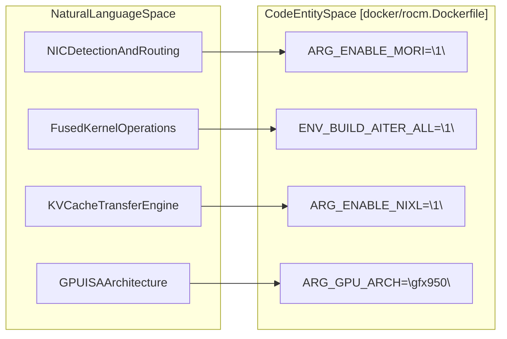

<!-- source: DeepWiki mcp.deepwiki.com · repo sgl-project/sglang · page 2.3 Docker Deployment · fetched 2026-10-30 -->

# Docker Deployment

<details>
<summary>Relevant source files</summary>

The following files were used as context for generating this wiki page:

- [.github/workflows/auto-tune.yml](.github/workflows/auto-tune.yml)
- [.github/workflows/nightly-test-amd.yml](.github/workflows/nightly-test-amd.yml)
- [.github/workflows/pr-test-amd.yml](.github/workflows/pr-test-amd.yml)
- [.github/workflows/release-docker-amd-gfx1151-nightly.yml](.github/workflows/release-docker-amd-gfx1151-nightly.yml)
- [.github/workflows/release-docker-amd-rocm10.yml](.github/workflows/release-docker-amd-rocm10.yml)
- [.github/workflows/release-docker-amd-rocm720-nightly.yml](.github/workflows/release-docker-amd-rocm720-nightly.yml)
- [.github/workflows/release-docker-amd.yml](.github/workflows/release-docker-amd.yml)
- [.github/workflows/release-whl-kernel-xpu.yml](.github/workflows/release-whl-kernel-xpu.yml)
- [.github/workflows/release-whl-kernel.yml](.github/workflows/release-whl-kernel.yml)
- [.pre-commit-config.yaml](.pre-commit-config.yaml)
- [3rdparty/amd/wheel/README.md](3rdparty/amd/wheel/README.md)
- [3rdparty/amd/wheel/sgl-kernel/build_rocm.sh](3rdparty/amd/wheel/sgl-kernel/build_rocm.sh)
- [3rdparty/amd/wheel/sgl-kernel/rename_wheels_rocm.sh](3rdparty/amd/wheel/sgl-kernel/rename_wheels_rocm.sh)
- [docker/Dockerfile.cu134](docker/Dockerfile.cu134)
- [docker/patches/sgl-kernel-gfx1151.sh](docker/patches/sgl-kernel-gfx1151.sh)
- [docker/rocm-gfx1151.Dockerfile](docker/rocm-gfx1151.Dockerfile)
- [docker/rocm.Dockerfile](docker/rocm.Dockerfile)
- [python/sglang/kernels/aot/csrc/elementwise/pos_enc.cu](python/sglang/kernels/aot/csrc/elementwise/pos_enc.cu)
- [python/sglang/kernels/jit/csrc/deepseek_v4/mega_moe_pre_dispatch.cuh](python/sglang/kernels/jit/csrc/deepseek_v4/mega_moe_pre_dispatch.cuh)
- [python/sglang/kernels/ops/moe/__init__.py](python/sglang/kernels/ops/moe/__init__.py)
- [python/sglang/kernels/ops/moe/dsv4.py](python/sglang/kernels/ops/moe/dsv4.py)
- [python/sglang/kernels/ops/moe/mega_gate.py](python/sglang/kernels/ops/moe/mega_gate.py)
- [python/sglang/multimodal_gen/test/unit/test_diffusion_import_isolation.py](python/sglang/multimodal_gen/test/unit/test_diffusion_import_isolation.py)
- [python/sglang/srt/arg_groups/mega_moe_hook.py](python/sglang/srt/arg_groups/mega_moe_hook.py)
- [python/sglang/srt/layers/moe/mega_gate.py](python/sglang/srt/layers/moe/mega_gate.py)
- [python/sglang/srt/layers/moe/mega_moe.py](python/sglang/srt/layers/moe/mega_moe.py)
- [scripts/ci/amd/amd_ci_install_dependency.sh](scripts/ci/amd/amd_ci_install_dependency.sh)
- [scripts/ci/amd/amd_ci_start_container.sh](scripts/ci/amd/amd_ci_start_container.sh)
- [scripts/ci/amd/amd_ci_start_container_disagg.sh](scripts/ci/amd/amd_ci_start_container_disagg.sh)
- [scripts/ci/utils/git_clone_with_retry.sh](scripts/ci/utils/git_clone_with_retry.sh)
- [scripts/lint/check_dockerfile_wheel_pins.py](scripts/lint/check_dockerfile_wheel_pins.py)
- [scripts/release/get_version_tag.py](scripts/release/get_version_tag.py)
- [scripts/update_kernel_whl_index.py](scripts/update_kernel_whl_index.py)
- [test/README.md](test/README.md)
- [test/registered/amd/perf/mi35x/test_qwen35_fp8_ar_fusion_mi35x.py](test/registered/amd/perf/mi35x/test_qwen35_fp8_ar_fusion_mi35x.py)
- [test/registered/amd/test_deepseek_v32_basic.py](test/registered/amd/test_deepseek_v32_basic.py)
- [test/registered/amd/test_kimi_k2_instruct.py](test/registered/amd/test_kimi_k2_instruct.py)
- [test/registered/amd/test_moriep_small.py](test/registered/amd/test_moriep_small.py)
- [test/registered/amd/test_moriep_small_extra.py](test/registered/amd/test_moriep_small_extra.py)
- [test/registered/amd/test_qwen3_coder_next_8gpu.py](test/registered/amd/test_qwen3_coder_next_8gpu.py)
- [test/registered/attention/test_aiter_cross_layer_kv_guard.py](test/registered/attention/test_aiter_cross_layer_kv_guard.py)
- [test/registered/attention/test_aiter_swa_kv_pool_resolver.py](test/registered/attention/test_aiter_swa_kv_pool_resolver.py)
- [test/registered/basic_perf/test_vlm_serving_aiter.py](test/registered/basic_perf/test_vlm_serving_aiter.py)
- [test/registered/dllm/test_llada2_mini_amd.py](test/registered/dllm/test_llada2_mini_amd.py)
- [test/registered/kernels/ops/moe/test_mega_moe_pre_dispatch.py](test/registered/kernels/ops/moe/test_mega_moe_pre_dispatch.py)
- [test/registered/kernels/ops/moe/test_moe_align_small_numel.py](test/registered/kernels/ops/moe/test_moe_align_small_numel.py)
- [test/registered/rotary/test_rope_rocm.py](test/registered/rotary/test_rope_rocm.py)
- [test/registered/unit/layers/moe/test_mega_moe_deepgemm_api.py](test/registered/unit/layers/moe/test_mega_moe_deepgemm_api.py)
- [test/registered/unit/models/test_mamba2.py](test/registered/unit/models/test_mamba2.py)
- [test/run_suite.py](test/run_suite.py)

</details>


This page documents the Docker deployment strategy for SGLang, detailing Docker image variants, multi-stage build architectures, platform-specific configurations (NVIDIA CUDA, AMD ROCm, Huawei NPU, Intel XPU), core build arguments, CI/CD release pipelines, and container deployment best practices.

---

## Overview

SGLang provides containerized deployment options as the primary vehicle for running high-performance large language model (LLM) and vision-language model (VLM) serving engines in production. The container build infrastructure utilizes a **multi-stage Docker build** pattern to isolate heavy compilation dependencies from lean, security-hardened production runtime environments.

- **Framework Image**: Contains complete development tools, source code, JIT compilers, profiling utilities, and build dependencies.
- **Runtime Image**: A minimized production image containing only necessary shared libraries, Python wheel installations, and runtime entrypoints.

This approach enables rapid iteration during development while shipping optimized runtime containers ready for production deployment.

Sources: `[docker/Dockerfile.cu134:1-1155]()`

---

## Image Variants and Multi-Stage Build Architecture

### Multi-Stage Build Flow

The multi-stage build architecture leverages Docker BuildKit to parallelize compilation tasks across specialized build targets before assembling the final images. This improves build times and creates clean separation between build and runtime environments.

```mermaid
graph TB
    subgraph "Base Stage [docker/Dockerfile.cu134]"
        uv_stage["uv_builder"]
        base["base_image[\"nvidia/cuda:*-cudnn-devel\"]"]
        base_deps["SystemDependencies[\"Python3.12,GDRCopy,BuildTools\"]"]
    end
    
    subgraph "Parallel Builder Stages [docker/Dockerfile.cu134]"
        torch_deps["torch_deps[\"sgl-kernel_install\"]"]
        deepep_builder["deepep_builder[\"NCCL_EP_RDMA\"]"]
        mooncake_builder["mooncake_builder[\"TransferEngine\"]"]
        gateway_builder["gateway_builder[\"Rust_Router_Gateway\"]"]
    end
    
    subgraph "Framework Stage [docker/Dockerfile.cu134]"
        framework["framework_final[\"DevelopmentImage\"]"]
    end
    
    subgraph "Runtime Stage [docker/Dockerfile.cu134]"
        runtime["runtime_final[\"ProductionImage\"]"]
        runtime_deps["MinimalRuntimeBase"]
        copy_packages["CopyPackages[\"/opt/sglang\"]"]
    end
    
    uv_stage --> base_deps
    base --> base_deps
    base_deps --> torch_deps
    torch_deps --> deepep_builder
    base_deps --> gateway_builder
    
    deepep_builder --> framework
    mooncake_builder --> framework
    gateway_builder --> framework
    
    runtime_base["NvidiaCUDA_Base"] --> runtime_deps
    framework --> copy_packages
    copy_packages --> runtime
    runtime_deps --> runtime
```

- **Base Stage**: Setup of OS-level dependencies and runtime essentials such as Python 3.12, GDRCopy (for NVIDIA GPU direct RDMA), and build-essential tools. The `uv` stage provides the `uv` package manager for efficient Python environment setup `[docker/Dockerfile.cu134:58-69]()`.
- **Parallel Builder Stages**: Independent build processes for:
  - `torch_deps`: Installing the core `sgl-kernel` wheel matching the target CUDA version. This stage also installs the Rust toolchain for `setuptools-rust` extensions like `sglang-grpc`.
  - `deepep_builder`: Components related to distributed expert parallelism with NCCL and RDMA.
  - `mooncake_builder`: Mooncake transfer engine compilation.
  - `gateway_builder`: Builds the Rust-based `sgl-router` and `sgl-model-gateway` components.

- **Framework Stage**: Combines outputs of builder stages into a comprehensive development image including source code, build artifacts, tooling, and runtime libraries.

- **Runtime Stage**: Creates lean images containing only runtime dependencies and installed Python packages, ensuring minimal attack surface and fast start times in production.

Sources: `[docker/Dockerfile.cu134:1-1155]()`

---

### Platform Support and Image Variants

SGLang supports multiple hardware platforms with distinct build pipelines and package dependencies. Each platform has its own Dockerfile or PyPI project configuration to resolve platform-specific dependencies and optimizations.

| Platform       | Build Configuration       | Image Registry / PyPI Package           | Target Hardware Features                                        |
|----------------|---------------------------|-----------------------------------------|----------------------------------------------------------------|
| NVIDIA CUDA    | `docker/Dockerfile.cu134` | `lmsysorg/sglang` (Docker Hub)          | SM80, SM90, SM100 GPU architectures                            |
| AMD ROCm       | `docker/rocm.Dockerfile`  | `lmsysorg/sglang-rocm` (Docker Hub)     | AMD MI30x (gfx942), MI35x (gfx950) GPUs                       |
| Huawei NPU     | `docker/npu.Dockerfile`   | `lmsysorg/sglang` (Docker Hub)          | Huawei Ascend 910b and A3 NPUs                                 |
| Intel XPU      | `python/pyproject_xpu.toml`| PyPI package `sglang` with XPU dependencies| Intel Data Center GPU Max                                      |
| CPU Only       | `python/pyproject_cpu.toml`| PyPI package `sglang-cpu`                | x86_64/ARM CPUs, no GPU                                        |

Sources: `[docker/Dockerfile.cu134:1-1155]()`, `[docker/rocm.Dockerfile:1-126]()`

---

### ROCm Component Mapping from Natural Language to Code Entities

This diagram bridges natural language system descriptions to Dockerfile build args and code entities for the AMD ROCm build pipeline.



These build arguments enable advanced features such as MoRI NIC support, AITER fused-kernel ops, NIXL disaggregation backends, and selection of the target AMD GPU ISA.

Sources: `[docker/rocm.Dockerfile:26-41]()`, `[scripts/ci/amd/amd_ci_install_dependency.sh:1-159]()`

---

## Core Docker Build Arguments

The Docker build system exposes multiple tuning arguments allowing customization of the build scope and target platform.

| Argument              | Default       | Description                                                  |
|-----------------------|---------------|--------------------------------------------------------------|
| `CUDA_VERSION`        | `13.4.1`      | Target CUDA Toolkit version for NVIDIA base image `[docker/Dockerfile.cu134:26]()` |
| `BUILD_TYPE`          | `all`         | Controls what components are built (`all` = full build) `[docker/Dockerfile.cu134:30]()` |
| `BRANCH_TYPE`         | `remote`      | Source code fetch method (`local`=local build, `remote`=git) `[docker/Dockerfile.cu134:31]()` |
| `GPU_ARCH`            | `gfx950`      | Target GPU architecture for ROCm builds `[docker/rocm.Dockerfile:58]()` |
| `ENABLE_MORI`         | `0`           | Enable MoRI NIC auto-detection and RDMA support `[docker/rocm.Dockerfile:26-34]()` |
| `ENABLE_NIXL`         | `1`           | Enable NIXL backend for prefill/decode disaggregation `[docker/rocm.Dockerfile:36-41]()` |
| `SGL_KERNEL_VERSION`  | e.g. `0.4.10` | Version of the `sglang-kernel` wheel to install `[docker/Dockerfile.cu134:16]()` |

These arguments propagate through the build stages to select dependencies, compiler flags, and package versions, yielding highly customized Docker images.

Sources: `[docker/Dockerfile.cu134:14-32]()`, `[docker/rocm.Dockerfile:26-58]()`

---

## CI/CD and Release Pipelines

SGLang manages continuous integration and Docker image publishing using GitHub Actions workflows, enabling automated builds, testing, and release management.

Key workflows:

- **Development & Nightly Builds**: Scheduled or manual triggers build development and nightly images with date-stamped or commit-sha tags (e.g. `lmsysorg/sglang:dev`, `lmsysorg/sglang:nightly-dev-{date}-{sha}`). Examples include `release-docker-amd-rocm720-nightly.yml` `[.github/workflows/release-docker-amd-rocm720-nightly.yml:1-165]()` and `release-docker-amd-rocm10.yml` `[.github/workflows/release-docker-amd-rocm10.yml:1-154]()`.
- **Versioned Releases**: Trigger on tag creation to produce multi-platform release images, covering NVIDIA CUDA, AMD ROCm, and Huawei NPU variants.
- **Local Registry Mirroring**: Images are mirrored to local private registries to mitigate public Docker Hub rate limits during concurrent test runs and deployment.

These pipelines integrate with multi-architecture builds and use BuildKit's caching features for efficient incremental builds.

Sources: `[.github/workflows/release-docker-amd-rocm720-nightly.yml:1-165]()`, `[.github/workflows/release-docker-amd-rocm10.yml:1-154]()`, `[.github/workflows/pr-test-amd.yml:1-170]()`, `[.github/workflows/nightly-test-amd.yml:1-165]()`

---

## Deployment Best Practices and Container Execution

To maximize performance, deployed containers should be configured with careful device and IPC settings.

```mermaid
graph TD
    subgraph "NaturalLanguageSpace"
        container_launch["ContainerLaunchOrchestration"]
        engine_runtime["EngineRuntimeExecution"]
    end

    subgraph "CodeEntitySpace [scripts/ci/amd/amd_ci_start_container.sh]"
        docker_run["docker_run[\"--gpus all --device /dev/dri\"]"]
        ipc_host["--ipc=\"host\""]
        shm_size["--shm-size=\"32g\""]
        net_host["--network=\"host\""]
    end

    subgraph "CodeEntitySpace [python/sglang/srt/entrypoints/engine.py]"
        server_args["ServerArgs"]
        engine_init["EngineInit"]
    end

    container_launch --> docker_run
    docker_run --> ipc_host
    docker_run --> shm_size
    docker_run --> net_host
    ipc_host --> server_args
    net_host --> server_args
    server_args --> engine_runtime
    engine_runtime --> engine_init
```

Recommended container launch options:

- Map all GPU devices (`--gpus all`) or specific devices (AMD: `--device=/dev/kfd --device=/dev/dri` plus `--group-add video`).
- Use IPC sharing mode (`--ipc=host`) for intra-container shared memory and CUDA IPC communication.
- Enlarge shared memory partition (`--shm-size 32g`) for large token and KV caches communication.
- Employ host networking (`--network=host`) for minimal network latency.

### Example Launch Commands

- **NVIDIA CUDA**

```bash
docker run --rm -it --gpus all --shm-size 32g -p 30000:30000 \
  -v ~/.cache/huggingface:/root/.cache/huggingface \
  --ipc=host \
  lmsysorg/sglang:latest-runtime \
  python3 -m sglang.launch_server --model-path meta-llama/Llama-3.1-8B-Instruct \
  --host 0.0.0.0 --port 30000
```

- **AMD ROCm**

```bash
docker run --rm -it --device=/dev/kfd --device=/dev/dri --group-add video \
  -e GPU_ARCH=gfx950 -e MORI_DEVICE_NIC=mlx5 \
  --ipc=host --network=host \
  lmsysorg/sglang-rocm:latest-runtime \
  python3 -m sglang.launch_server --model-path meta-llama/Llama-3.1-8B-Instruct \
  --host 0.0.0.0 --port 30000
```

These flags provide optimized environment for distributed GPU scheduling, kernel acceleration, and fast IPC pathways between processes.

Sources: `[scripts/ci/amd/amd_ci_start_container.sh:1-128]()`, `[scripts/ci/amd/amd_ci_start_container_disagg.sh:1-120]()`

---

## Dependency Management by Platform

SGLang segregates platform-specific runtime dependencies and Python package versioning into distinct project configuration files. This avoids package version conflicts and ensures platform-optimized builds.

| Platform      | Configuration File           | Description                           |
|---------------|------------------------------|-------------------------------------|
| NVIDIA CUDA   | `python/pyproject.toml`      | Main CUDA wheel and runtime deps    |
| AMD ROCm      | `python/pyproject_other.toml` (extras `dev_hip`, `dev_hip_rocm724`) | ROCm-enabled PyTorch stacks and Triton kernels `[scripts/ci/amd/amd_ci_install_dependency.sh:91-96]()` |
| Intel XPU     | `python/pyproject_xpu.toml`  | Intel XPU backend and dependencies  |
| CPU Only      | `python/pyproject_cpu.toml`  | CPU-only runtime and packages       |
| Huawei NPU    | `python/pyproject_npu.toml`  | Huawei NPU backend and dependencies |

This modular dependency system facilitates targeted installation for heterogeneous hardware, leveraging latest features and GPU backends per platform.

Sources: `[scripts/ci/amd/amd_ci_install_dependency.sh:28-97]()`

---

Sources:  
`[.github/workflows/nightly-test-amd.yml:1-165]()`  
`[.github/workflows/pr-test-amd.yml:1-170]()`  
`[.github/workflows/release-docker-amd-rocm10.yml:1-154]()`  
`[.github/workflows/release-docker-amd-rocm720-nightly.yml:1-165]()`  
`[docker/Dockerfile.cu134:1-1155]()`  
`[docker/rocm.Dockerfile:1-126]()`  
`[scripts/ci/amd/amd_ci_install_dependency.sh:1-159]()`  
`[scripts/ci/amd/amd_ci_start_container.sh:1-128]()`  
`[scripts/ci/amd/amd_ci_start_container_disagg.sh:1-120]()`

---

