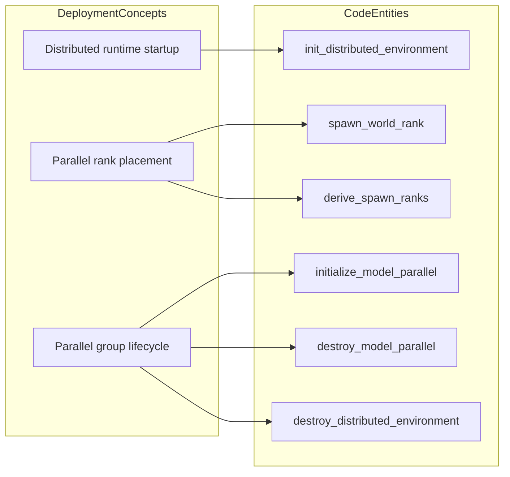
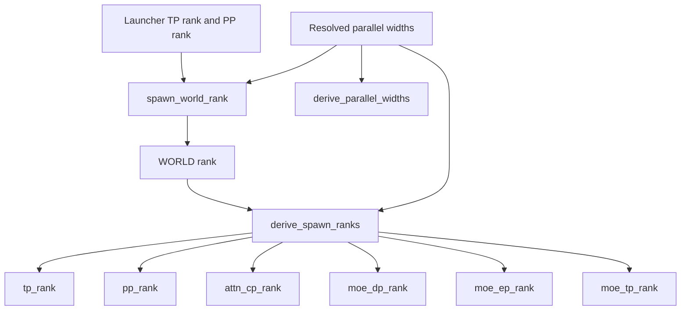
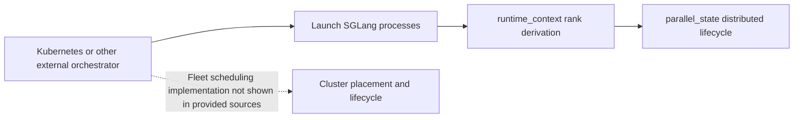
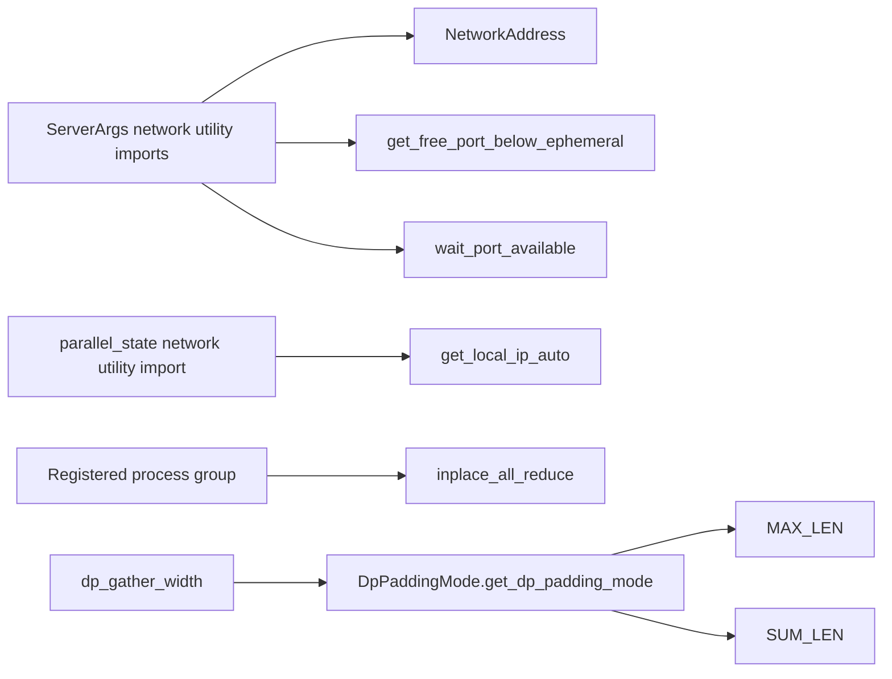

<!-- source: DeepWiki mcp.deepwiki.com · repo sgl-project/sglang · page 2.4 Multi-Node and Distributed Deployment · fetched 2026-10-30 -->

# Multi-Node and Distributed Deployment

Relevant source files

The following files were used as context for generating this wiki page:

- [docs/docs/references/environment_variables.mdx](docs/docs/references/environment_variables.mdx)
- [python/sglang/benchmark/one_batch.py](python/sglang/benchmark/one_batch.py)
- [python/sglang/srt/arg_groups/attention_hook.py](python/sglang/srt/arg_groups/attention_hook.py)
- [python/sglang/srt/arg_groups/overrides.py](python/sglang/srt/arg_groups/overrides.py)
- [python/sglang/srt/arg_groups/pd_disaggregation_hook.py](python/sglang/srt/arg_groups/pd_disaggregation_hook.py)
- [python/sglang/srt/disaggregation/role_switch.py](python/sglang/srt/disaggregation/role_switch.py)
- [python/sglang/srt/distributed/bootstrap.py](python/sglang/srt/distributed/bootstrap.py)
- [python/sglang/srt/distributed/parallel_state.py](python/sglang/srt/distributed/parallel_state.py)
- [python/sglang/srt/environ.py](python/sglang/srt/environ.py)
- [python/sglang/srt/layers/dp_attention.py](python/sglang/srt/layers/dp_attention.py)
- [python/sglang/srt/managers/schedule_batch.py](python/sglang/srt/managers/schedule_batch.py)
- [python/sglang/srt/managers/scheduler.py](python/sglang/srt/managers/scheduler.py)
- [python/sglang/srt/mem_cache/common.py](python/sglang/srt/mem_cache/common.py)
- [python/sglang/srt/mem_cache/storage/eic/eic_storage.py](python/sglang/srt/mem_cache/storage/eic/eic_storage.py)
- [python/sglang/srt/mem_cache/storage/hf3fs/mini_3fs_metadata_server.py](python/sglang/srt/mem_cache/storage/hf3fs/mini_3fs_metadata_server.py)
- [python/sglang/srt/mem_cache/storage/hf3fs/storage_hf3fs.py](python/sglang/srt/mem_cache/storage/hf3fs/storage_hf3fs.py)
- [python/sglang/srt/model_executor/model_runner.py](python/sglang/srt/model_executor/model_runner.py)
- [python/sglang/srt/runtime_context.py](python/sglang/srt/runtime_context.py)
- [python/sglang/srt/server_args.py](python/sglang/srt/server_args.py)
- [python/sglang/test/kits/pd_parity_kit.py](python/sglang/test/kits/pd_parity_kit.py)
- [python/sglang/test/server_fixtures/disaggregation_fixture.py](python/sglang/test/server_fixtures/disaggregation_fixture.py)
- [test/manual/test_forward_split_prefill.py](test/manual/test_forward_split_prefill.py)
- [test/manual/test_vlm_accuracy.py](test/manual/test_vlm_accuracy.py)
- [test/registered/cp/test_deepseek_v4_flash_fp4_b200_cp.py](test/registered/cp/test_deepseek_v4_flash_fp4_b200_cp.py)
- [test/registered/disaggregation/test_disaggregation_aarch64.py](test/registered/disaggregation/test_disaggregation_aarch64.py)
- [test/registered/disaggregation/test_disaggregation_basic.py](test/registered/disaggregation/test_disaggregation_basic.py)
- [test/registered/disaggregation/test_disaggregation_decode_radix_cache.py](test/registered/disaggregation/test_disaggregation_decode_radix_cache.py)
- [test/registered/disaggregation/test_disaggregation_different_tp.py](test/registered/disaggregation/test_disaggregation_different_tp.py)
- [test/registered/disaggregation/test_disaggregation_dp_attention.py](test/registered/disaggregation/test_disaggregation_dp_attention.py)
- [test/registered/disaggregation/test_disaggregation_dsv4.py](test/registered/disaggregation/test_disaggregation_dsv4.py)
- [test/registered/disaggregation/test_disaggregation_hisparse.py](test/registered/disaggregation/test_disaggregation_hisparse.py)
- [test/registered/disaggregation/test_disaggregation_hybrid_attention.py](test/registered/disaggregation/test_disaggregation_hybrid_attention.py)
- [test/registered/disaggregation/test_disaggregation_inkling_mxfp8.py](test/registered/disaggregation/test_disaggregation_inkling_mxfp8.py)
- [test/registered/disaggregation/test_disaggregation_kimi_linear.py](test/registered/disaggregation/test_disaggregation_kimi_linear.py)
- [test/registered/disaggregation/test_disaggregation_nixl.py](test/registered/disaggregation/test_disaggregation_nixl.py)
- [test/registered/disaggregation/test_disaggregation_pp.py](test/registered/disaggregation/test_disaggregation_pp.py)
- [test/registered/hicache/test_hicache_storage_3fs_backend.py](test/registered/hicache/test_hicache_storage_3fs_backend.py)
- [test/registered/pp/test_pp_gemma4.py](test/registered/pp/test_pp_gemma4.py)
- [test/registered/pp/test_pp_single_node.py](test/registered/pp/test_pp_single_node.py)
- [test/registered/pp/test_pp_single_node_extra.py](test/registered/pp/test_pp_single_node_extra.py)
- [test/registered/unit/disaggregation/test_pd_role_switch.py](test/registered/unit/disaggregation/test_pd_role_switch.py)
- [test/registered/unit/server_args/test_server_args.py](test/registered/unit/server_args/test_server_args.py)
- [test/registered/unit/test_model_overrides.py](test/registered/unit/test_model_overrides.py)
- [test/registered/unit/test_runtime_context.py](test/registered/unit/test_runtime_context.py)

## Purpose and scope

This page describes the distributed-runtime mechanisms visible in the provided code: how parallel ranks are derived, how distributed process groups are organized, and how network-related utilities enter server configuration. Kubernetes-native fleet orchestration is an operational concern beyond the runtime mechanisms shown here; the available source excerpts do not establish a Kubernetes controller or fleet-orchestration implementation. [python/sglang/srt/runtime_context.py:95-157](), [python/sglang/srt/distributed/parallel_state.py:9-23](), [python/sglang/srt/server_args.py:61-65]()

Sources: [python/sglang/srt/runtime_context.py:95-157](), [python/sglang/srt/distributed/parallel_state.py:9-23](), [python/sglang/srt/server_args.py:61-65]()

---

## Multi-Node Deployment Overview

Distributed execution separates two related concerns: assigning processes to parallel ranks, and creating the distributed environment and model-parallel groups those ranks use. The documented lifecycle in `parallel_state.py` initializes the distributed environment first, then initializes model-parallel groups; teardown destroys the model-parallel groups before the distributed environment. [python/sglang/srt/distributed/parallel_state.py:9-23]()

`runtime_context.py` provides rank and width calculations used to describe the topology. Its helpers derive WORLD size, TP/PP rank coordinates, and attention/MoE widths from configuration. These calculations describe rank layout; they do not themselves create process groups. [python/sglang/srt/runtime_context.py:73-103](), [python/sglang/srt/runtime_context.py:106-157](), [python/sglang/srt/runtime_context.py:173-183]()

| Code entity | Role established by the provided source |
|---|---|
| `init_distributed_environment` | First step in the distributed lifecycle; initializes the distributed environment. [python/sglang/srt/distributed/parallel_state.py:9-19]() |
| `initialize_model_parallel` | Lifecycle step for initializing model-parallel groups after the distributed environment. [python/sglang/srt/distributed/parallel_state.py:13-19]() |
| `destroy_model_parallel` | Teardown step for model-parallel groups. [python/sglang/srt/distributed/parallel_state.py:18-19]() |
| `destroy_distributed_environment` | Teardown step for the distributed environment. [python/sglang/srt/distributed/parallel_state.py:18-19]() |
| `spawn_world_rank` | Computes a WORLD rank from launcher TP and PP ranks using the resolved configuration. [python/sglang/srt/runtime_context.py:95-104]() |
| `derive_spawn_ranks` | Derives TP, PP, attention-CP, and MoE rank coordinates from a WORLD rank and topology widths. [python/sglang/srt/runtime_context.py:106-134]() |
| `derive_parallel_widths` | Derives attention and MoE parallel widths and DCP settings. [python/sglang/srt/runtime_context.py:137-157]() |

### Diagram: Deployment concepts mapped to runtime entities

Sources: [python/sglang/srt/distributed/parallel_state.py:9-23](), [python/sglang/srt/runtime_context.py:95-134]()

---

## Distributed Initialization Architecture

### Coordination parameters and rank derivation

`spawn_world_rank(server_args, tp_rank, pp_rank)` obtains a resolving view of the server configuration and computes the WORLD rank as `ep_join_rank_offset + tp_size * pp_rank + tp_rank`. The ordering makes TP ranks contiguous within a PP stage; the PP coordinate advances by a stride of `tp_size`. [python/sglang/srt/runtime_context.py:95-104](), [python/sglang/srt/runtime_context.py:106-120]()

`derive_spawn_ranks` reverses this mapping after subtracting `ep_join_rank_offset`: TP rank is the local WORLD rank modulo `tp_size`, and PP rank is integer division by `tp_size`. It then derives attention-CP and MoE rank coordinates from the TP rank and configured widths. [python/sglang/srt/runtime_context.py:106-134]()

`derive_parallel_widths` computes `attn_tp_size` by dividing TP width by attention-DP and attention-CP widths. It computes `moe_tp_size` from TP width, MoE-EP width, and MoE-DP width; DCP is enabled when configured, and its attention width is otherwise set to one. [python/sglang/srt/runtime_context.py:73-76](), [python/sglang/srt/runtime_context.py:137-157]()

### Diagram: Rank coordinates mapped to code entities

Sources: [python/sglang/srt/runtime_context.py:73-76](), [python/sglang/srt/runtime_context.py:95-157]()

### Process-group lifecycle

The distributed-state module describes an explicit lifecycle: call `init_distributed_environment`, optionally call `initialize_model_parallel`, execute distributed work, then destroy model-parallel groups and the distributed environment. Applications that need a distributed environment but not model or pipeline parallelism may omit model-parallel initialization and teardown. [python/sglang/srt/distributed/parallel_state.py:9-23]()

The module imports PyTorch Distributed process-group types and contains group-registration and collective-operation infrastructure. `inplace_all_reduce` resolves a named group from the registered groups and delegates the reduction to its coordinator. [python/sglang/srt/distributed/parallel_state.py:43-45](), [python/sglang/srt/distributed/parallel_state.py:177-192]()

Sources: [python/sglang/srt/distributed/parallel_state.py:9-23](), [python/sglang/srt/distributed/parallel_state.py:43-45](), [python/sglang/srt/distributed/parallel_state.py:177-192]()

---

## Kubernetes-Native Fleet Orchestration

Kubernetes-native fleet orchestration is in scope for deployment planning, but no Kubernetes resource definitions, controller implementation, or fleet-management code is included in the provided source excerpts. Therefore this page does not prescribe SGLang-specific `StatefulSet`, `Job`, service-discovery, or pod-placement behavior.

At the runtime boundary, an orchestrator must arrange for participating processes to receive a consistent topology and reach the rendezvous/network endpoints required by the deployment. Rank mapping and process-group lifecycle are implemented in the runtime; cluster scheduling and pod lifecycle are not demonstrated by the available sources. [python/sglang/srt/runtime_context.py:95-134](), [python/sglang/srt/distributed/parallel_state.py:9-23]()

### Diagram: Orchestration boundary

Sources: [python/sglang/srt/runtime_context.py:95-134](), [python/sglang/srt/distributed/parallel_state.py:9-23]()

---

## Network Communication Stack

### Network-related configuration utilities

`server_args.py` imports `NetworkAddress`, `get_free_port_below_ephemeral`, and `wait_port_available` from `sglang.srt.utils.network`. This establishes that server-argument code has access to address and port utilities; the provided excerpt does not show their call sites or establish which ports are used for particular distributed services. [python/sglang/srt/server_args.py:61-65]()

`parallel_state.py` imports `get_local_ip_auto` from the same network utility module. The shown code establishes the dependency but does not expose its invocation or the rules used to choose an address. [python/sglang/srt/distributed/parallel_state.py:79-81]()

For deployment configuration, ensure that the addresses and ports selected by the actual launch path are reachable between participating processes. The excerpts provided here do not specify required firewall rules, interface-selection settings, rendezvous environment variables, or a port matrix; those details should be verified against the deployed launcher and the relevant network utility call sites.

Sources: [python/sglang/srt/server_args.py:61-65](), [python/sglang/srt/distributed/parallel_state.py:79-81]()

### Collective operations and group lookup

`parallel_state.py` registers `inplace_all_reduce` as a custom operation. At execution, it checks that `group_name` exists in `_groups`, resolves the registered coordinator, rejects a destroyed group, and invokes `_all_reduce_in_place`. [python/sglang/srt/distributed/parallel_state.py:177-192]()

The same excerpt defines `outplace_all_reduce` as a custom operation with a group name and method argument; the available lines do not show its implementation body, so its algorithmic variants are not documented here. [python/sglang/srt/distributed/parallel_state.py:194-198]()

### Data-parallel attention communication

`dp_attention.py` determines the deployment attention-DP replica count through `deployment_attn_dp_size()`. `dp_gather_width()` selects a gather width based on whether WORLD-wide gathering is enabled, whether a scoped gather slot is active, and the configured attention-DP width. `dp_gather_slot()` maps the process to its gather slot, including an elastic-scale path that maps a physical EP rank to a logical attention-DP rank. [python/sglang/srt/layers/dp_attention.py:60-82](), [python/sglang/srt/layers/dp_attention.py:103-120]()

`DpPaddingMode.get_dp_padding_mode` chooses between padding modes according to the gather width, batch type, token counts, and MoE all-to-all backend constraints. The excerpt specifies that the `pplx` backend requires `MAX_LEN`; it also describes conditions for choosing `SUM_LEN` on extend batches with multiple gather ranks. [python/sglang/srt/layers/dp_attention.py:164-192]()

### Diagram: Network and collective code path

Sources: [python/sglang/srt/server_args.py:61-65](), [python/sglang/srt/distributed/parallel_state.py:79-81](), [python/sglang/srt/distributed/parallel_state.py:177-192](), [python/sglang/srt/layers/dp_attention.py:60-82](), [python/sglang/srt/layers/dp_attention.py:164-192]()

---

## Prefill-Decode Disaggregation and Load Management

Disaggregation is represented in the scheduler by imports for prefill and decode mixins, queues, transfer-backend types, and metadata utilities. The supplied scheduler excerpt shows those dependencies but does not include the implementation paths that establish the complete transfer protocol, configuration validation, or inter-node network requirements. [python/sglang/srt/managers/scheduler.py:79-104]()

`ScheduleBatch` also imports `ScheduleBatchDisaggregationDecodeMixin`, `BaseKVSender`, and disaggregation mode definitions, showing that request-batch handling has disaggregation-specific components. Their behavior and transfer-engine selection cannot be detailed from the excerpted lines alone. [python/sglang/srt/managers/schedule_batch.py:95-100]()

For deployment, treat prefill/decode separation as a distinct topology that requires the relevant transfer backend and endpoints to be configured and reachable. Exact flags, supported backend choices, bootstrap exchanges, and transfer-port requirements are not established by the source content shown here. [python/sglang/srt/managers/scheduler.py:79-104](), [python/sglang/srt/managers/schedule_batch.py:95-100]()

Sources: [python/sglang/srt/managers/scheduler.py:79-104](), [python/sglang/srt/managers/schedule_batch.py:95-100]()

---

## Practical Configuration and Verification

Use the configuration and topology helpers as separate diagnostic layers:

1. Inspect resolved parallel configuration and derived widths. `runtime_context.py` exposes `parallel_widths_of` and `launch_world_size_of`; the latter computes initial WORLD width from `ep_join_rank_offset + tp_size * pp_size`. [python/sglang/srt/runtime_context.py:160-183]()
2. Check rank mapping with `spawn_world_rank` and `derive_spawn_ranks`, particularly when PP or an EP join offset is involved. [python/sglang/srt/runtime_context.py:95-134]()
3. Confirm the distributed lifecycle is followed: initialize the distributed environment, initialize required model-parallel groups, and destroy them in the documented order during shutdown. [python/sglang/srt/distributed/parallel_state.py:9-23]()
4. Verify network reachability using the actual launch path and configuration. The shown imports identify available address/port helpers but do not provide a complete port list or deployment-specific network policy. [python/sglang/srt/server_args.py:61-65](), [python/sglang/srt/distributed/parallel_state.py:79-81]()

Sources: [python/sglang/srt/runtime_context.py:95-134](), [python/sglang/srt/runtime_context.py:160-183](), [python/sglang/srt/distributed/parallel_state.py:9-23](), [python/sglang/srt/server_args.py:61-65]()

---

## References

- Distributed lifecycle and process-group infrastructure: [python/sglang/srt/distributed/parallel_state.py:9-23]()
- Network helper imports in server arguments: [python/sglang/srt/server_args.py:61-65]()
- Rank derivation and parallel-width calculations: [python/sglang/srt/runtime_context.py:73-183]()
- Data-parallel attention gather and padding decisions: [python/sglang/srt/layers/dp_attention.py:60-120](), [python/sglang/srt/layers/dp_attention.py:164-192]()
- Scheduler disaggregation dependencies: [python/sglang/srt/managers/scheduler.py:79-104]()
- Batch-level disaggregation dependencies: [python/sglang/srt/managers/schedule_batch.py:95-100]()

---

