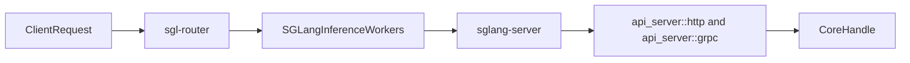
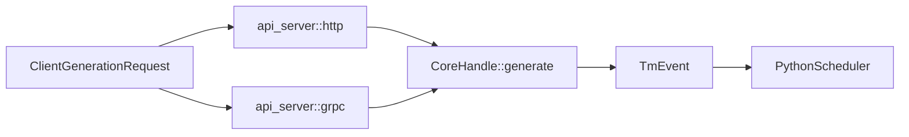

<!-- source: DeepWiki mcp.deepwiki.com · repo sgl-project/sglang · page 20 SGLang Router (sgl-router) · fetched 2026-10-30 -->

# SGLang Router (sgl-router)

Relevant source files

The following files were used as context for generating this wiki page:

- [proto/sglang/api/v1/sampling.proto](proto/sglang/api/v1/sampling.proto)
- [python/sglang/srt/managers/disagg_service.py](python/sglang/srt/managers/disagg_service.py)
- [python/sglang/srt/rust_server/config.py](python/sglang/srt/rust_server/config.py)
- [python/sglang/srt/rust_server/server.py](python/sglang/srt/rust_server/server.py)
- [rust/sglang-server/src/api_server/core/handle.rs](rust/sglang-server/src/api_server/core/handle.rs)
- [rust/sglang-server/src/api_server/core/prefetch.rs](rust/sglang-server/src/api_server/core/prefetch.rs)
- [rust/sglang-server/src/api_server/http.rs](rust/sglang-server/src/api_server/http.rs)
- [rust/sglang-server/src/api_server/http/app.rs](rust/sglang-server/src/api_server/http/app.rs)
- [rust/sglang-server/src/api_server/http/info.rs](rust/sglang-server/src/api_server/http/info.rs)
- [rust/sglang-server/src/api_server/http/loads.rs](rust/sglang-server/src/api_server/http/loads.rs)
- [rust/sglang-server/src/api_server/http/metrics.rs](rust/sglang-server/src/api_server/http/metrics.rs)
- [rust/sglang-server/src/api_server/http/native_api.rs](rust/sglang-server/src/api_server/http/native_api.rs)
- [rust/sglang-server/src/api_server/http/openai.rs](rust/sglang-server/src/api_server/http/openai.rs)
- [rust/sglang-server/src/api_server/http/openai/chat.rs](rust/sglang-server/src/api_server/http/openai/chat.rs)
- [rust/sglang-server/src/api_server/http/openai/completions.rs](rust/sglang-server/src/api_server/http/openai/completions.rs)
- [rust/sglang-server/src/api_server/http/openai/template.rs](rust/sglang-server/src/api_server/http/openai/template.rs)
- [rust/sglang-server/src/api_server/http/openai/test_utils.rs](rust/sglang-server/src/api_server/http/openai/test_utils.rs)
- [rust/sglang-server/src/api_server/http/openai/tokenize.rs](rust/sglang-server/src/api_server/http/openai/tokenize.rs)
- [rust/sglang-server/src/api_server/http/openai/tools.rs](rust/sglang-server/src/api_server/http/openai/tools.rs)
- [rust/sglang-server/src/lib.rs](rust/sglang-server/src/lib.rs)
- [rust/sglang-server/src/message.rs](rust/sglang-server/src/message.rs)
- [rust/sglang-server/src/message/config.rs](rust/sglang-server/src/message/config.rs)
- [rust/sglang-server/src/message/detok.rs](rust/sglang-server/src/message/detok.rs)
- [rust/sglang-server/src/message/finish_reason.rs](rust/sglang-server/src/message/finish_reason.rs)
- [rust/sglang-server/src/message/multimodal.rs](rust/sglang-server/src/message/multimodal.rs)
- [rust/sglang-server/src/message/types.rs](rust/sglang-server/src/message/types.rs)
- [rust/sglang-server/src/message/wire.rs](rust/sglang-server/src/message/wire.rs)
- [rust/sglang-server/src/multi_modality/payload.rs](rust/sglang-server/src/multi_modality/payload.rs)
- [rust/sglang-server/src/multi_modality/worker.rs](rust/sglang-server/src/multi_modality/worker.rs)
- [rust/sglang-server/src/tokenizer_manager.rs](rust/sglang-server/src/tokenizer_manager.rs)
- [rust/sglang-server/src/tokenizer_manager/detokenizer.rs](rust/sglang-server/src/tokenizer_manager/detokenizer.rs)
- [rust/sglang-server/src/tokenizer_manager/to_scheduler.rs](rust/sglang-server/src/tokenizer_manager/to_scheduler.rs)
- [rust/sglang-server/src/tokenizer_manager/to_scheduler_tests.rs](rust/sglang-server/src/tokenizer_manager/to_scheduler_tests.rs)
- [rust/sglang-server/src/tokenizer_manager/to_scheduler_validation.rs](rust/sglang-server/src/tokenizer_manager/to_scheduler_validation.rs)
- [rust/sglang-server/src/tokenizer_manager/tokenizer.rs](rust/sglang-server/src/tokenizer_manager/tokenizer.rs)
- [rust/sglang-server/src/tokenizer_manager/wiring.rs](rust/sglang-server/src/tokenizer_manager/wiring.rs)
- [rust/sglang-server/src/utils/runtime.rs](rust/sglang-server/src/utils/runtime.rs)
- [test/registered/unit/entrypoints/test_rust_server_dp_ports.py](test/registered/unit/entrypoints/test_rust_server_dp_ports.py)
- [test/registered/unit/multimodal/rust/shared/test_rust_server_extension.py](test/registered/unit/multimodal/rust/shared/test_rust_server_extension.py)

## Purpose and Scope

This parent page introduces the Rust-based router ecosystem around SGLang and points to the detailed router pages below. It stays at the ecosystem level: the child pages cover the slim `sgl-router` crate and its gRPC pipeline. The Rust `sglang-server` crate is a separate frontend component: it embeds HTTP and gRPC transports in the Python scheduler process and exposes a Python extension boundary. [rust/sglang-server/Cargo.toml:1-18](), [rust/sglang-server/src/lib.rs:1-12]()

Sources: [rust/sglang-server/Cargo.toml:1-18](), [rust/sglang-server/src/lib.rs:1-12]()

---

## System Overview and Architecture

At a high level, routing and serving sit between clients and SGLang inference workers. The supplied code documents the Rust server frontend: `api_server` provides HTTP and gRPC wire adapters over a shared, transport-neutral `CoreHandle`. The slim router’s routing policies, worker discovery, and KV-aware behavior are detailed on the child page rather than here. [rust/sglang-server/src/api_server.rs:1-10](), [rust/sglang-server/src/api_server/core/handle.rs:95-117]()

### Router Ecosystem and Code Entities

This is a conceptual boundary map, not a claim that `sgl-router` calls the embedded server frontend directly. The supplied Rust server code identifies `api_server::http`, `api_server::grpc`, and `CoreHandle` as frontend entities; detailed router internals belong to the child page. [rust/sglang-server/src/api_server.rs:1-10](), [rust/sglang-server/src/api_server/core/handle.rs:95-117]()

Sources: [rust/sglang-server/src/api_server.rs:1-10](), [rust/sglang-server/src/api_server/core/handle.rs:95-117]()

---

## Core Runtime Components

The Rust server frontend provides a useful point of comparison within the ecosystem: `CoreHandle` is the shared capability for submitting work, while HTTP and gRPC act as transport adapters. The `sglang-server` crate is built as both a `cdylib` PyO3 extension and an `rlib`; its Python module is registered as `sglang.srt.rust_extensions._server`. [rust/sglang-server/src/api_server.rs:1-10](), [rust/sglang-server/src/api_server/core/handle.rs:95-117](), [rust/sglang-server/Cargo.toml:8-18]()

The runtime wiring separates API I/O from CPU-bound tokenizer and detokenizer pools, and provides channels between Rust stages and the Python scheduler boundary. This frontend architecture is distinct from the slim router’s worker-selection and discovery responsibilities. [rust/sglang-server/src/utils/runtime.rs:1-15](), [rust/sglang-server/src/utils/runtime.rs:128-150](), [rust/sglang-server/src/lib.rs:1-12]()

Sources: [rust/sglang-server/src/api_server.rs:1-10](), [rust/sglang-server/src/api_server/core/handle.rs:95-117](), [rust/sglang-server/Cargo.toml:8-18](), [rust/sglang-server/src/utils/runtime.rs:1-15](), [rust/sglang-server/src/utils/runtime.rs:128-150](), [rust/sglang-server/src/lib.rs:1-12]()

---

## Bridging Natural Language Space to Code Entity Space

A client’s generation request enters a transport adapter and is submitted through `CoreHandle::generate`. This diagram names the Rust server entities that implement that request boundary; it does not describe the slim router’s internal selection path. [rust/sglang-server/src/api_server.rs:1-10](), [rust/sglang-server/src/api_server/core/handle.rs:161-177]()

### 1. Generation Request to Rust Server Entities

Sources: [rust/sglang-server/src/api_server.rs:1-10](), [rust/sglang-server/src/api_server/core/handle.rs:95-117](), [rust/sglang-server/src/api_server/core/handle.rs:161-177]()

### 2. Frontend Pipeline to Code Entities

The Rust runtime wires transport, tokenizer, scheduler, and detokenizer stages. Named channels expose the Rust–Python boundary; the runtime also keeps CPU-bound tokenizer and detokenizer work off the API I/O executor. [rust/sglang-server/src/utils/runtime.rs:1-15](), [rust/sglang-server/src/utils/runtime.rs:128-150]()

```mermaid
graph LR
    Api["api_server"]
    Core["CoreHandle"]
    Tm["tok_manager_tx and tok_manager_rx"]
    Tok["tokenizer_tx and tokenizer_rx"]
    ToScheduler["to_scheduler_tx and to_scheduler_rx"]
    FromScheduler["from_scheduler_tx and from_scheduler_rx"]
    Detok["detokenizer_tx and detokenizer_rx"]

    Api --> Core
    Core --> Tm
    Tm --> Tok
    Tok --> ToScheduler
    ToScheduler --> PythonScheduler
    PythonScheduler --> FromScheduler
    FromScheduler --> Detok
```

Sources: [rust/sglang-server/src/utils/runtime.rs:1-15](), [rust/sglang-server/src/utils/runtime.rs:128-150]()

---

## Child Pages and Detailed Topics

- **sgl-router: Slim KV-Aware Router** — For details on the slim Rust router, KV-event-driven cache-aware routing, Kubernetes `EndpointSlice` discovery, static worker pools, load-balancing policies, and PD disaggregation, see [sgl-router: Slim KV-Aware Router](#20.1).
- **Router gRPC Pipeline and Tool Parsing** — For details on the gRPC router pipeline, Rust tool-call parsing, and streaming response handling, see [Router gRPC Pipeline and Tool Parsing](#20.2).

Sources: [rust/sglang-server/src/api_server.rs:1-10](), [rust/sglang-server/src/api_server/core/handle.rs:95-117]()

---

