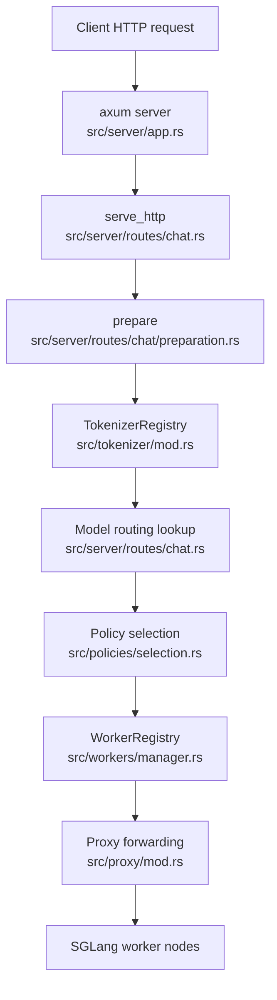
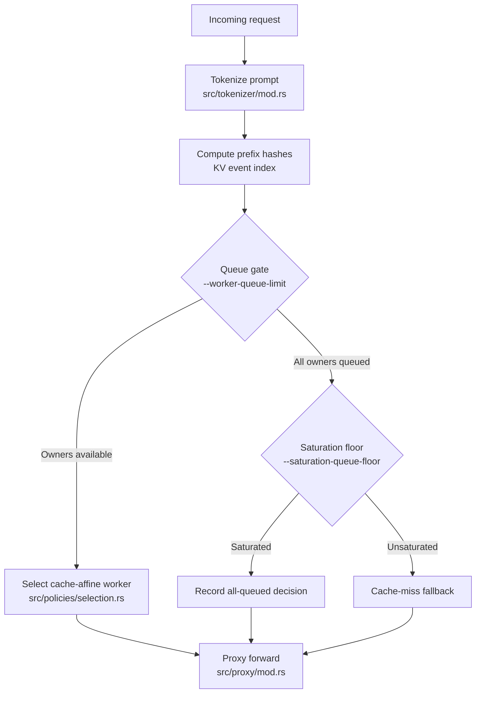
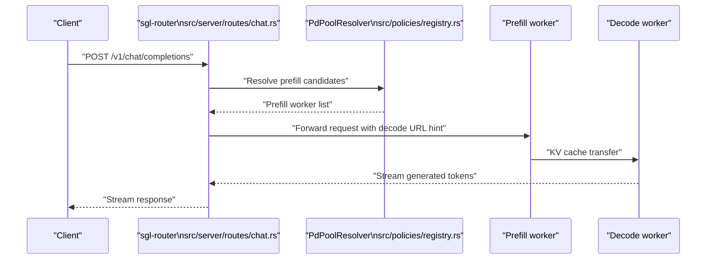
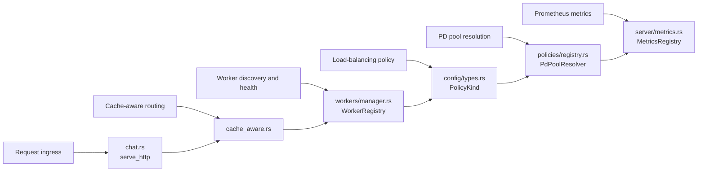

<!-- source: DeepWiki mcp.deepwiki.com · repo sgl-project/sglang · page 20.1 sgl-router: Slim KV-Aware Router · fetched 2026-10-30 -->

# sgl-router: Slim KV-Aware Router

Relevant source files

The following files were used as context for generating this wiki page:

- [docs/docs/advanced_features/radix_eviction_policy.mdx](docs/docs/advanced_features/radix_eviction_policy.mdx)
- [proto/sglang/api/v1/sampling.proto](proto/sglang/api/v1/sampling.proto)
- [python/sglang/srt/disaggregation/kv_events.py](python/sglang/srt/disaggregation/kv_events.py)
- [python/sglang/srt/managers/disagg_service.py](python/sglang/srt/managers/disagg_service.py)
- [python/sglang/srt/managers/scheduler_components/kv_events_publisher.py](python/sglang/srt/managers/scheduler_components/kv_events_publisher.py)
- [python/sglang/srt/mem_cache/events.py](python/sglang/srt/mem_cache/events.py)
- [python/sglang/srt/mem_cache/evict_policy.py](python/sglang/srt/mem_cache/evict_policy.py)
- [python/sglang/srt/mem_cache/radix_cache.py](python/sglang/srt/mem_cache/radix_cache.py)
- [python/sglang/srt/mem_cache/utils.py](python/sglang/srt/mem_cache/utils.py)
- [python/sglang/srt/rust_server/config.py](python/sglang/srt/rust_server/config.py)
- [python/sglang/srt/rust_server/server.py](python/sglang/srt/rust_server/server.py)
- [rust/sglang-server/src/api_server/core/handle.rs](rust/sglang-server/src/api_server/core/handle.rs)
- [rust/sglang-server/src/api_server/core/prefetch.rs](rust/sglang-server/src/api_server/core/prefetch.rs)
- [rust/sglang-server/src/api_server/http.rs](rust/sglang-server/src/api_server/http.rs)
- [rust/sglang-server/src/api_server/http/app.rs](rust/sglang-server/src/api_server/http/app.rs)
- [rust/sglang-server/src/api_server/http/info.rs](rust/sglang-server/src/api_server/http/info.rs)
- [rust/sglang-server/src/api_server/http/loads.rs](rust/sglang-server/src/api_server/http/loads.rs)
- [rust/sglang-server/src/api_server/http/metrics.rs](rust/sglang-server/src/api_server/http/metrics.rs)
- [rust/sglang-server/src/api_server/http/native_api.rs](rust/sglang-server/src/api_server/http/native_api.rs)
- [rust/sglang-server/src/api_server/http/openai.rs](rust/sglang-server/src/api_server/http/openai.rs)
- [rust/sglang-server/src/api_server/http/openai/chat.rs](rust/sglang-server/src/api_server/http/openai/chat.rs)
- [rust/sglang-server/src/api_server/http/openai/completions.rs](rust/sglang-server/src/api_server/http/openai/completions.rs)
- [rust/sglang-server/src/api_server/http/openai/template.rs](rust/sglang-server/src/api_server/http/openai/template.rs)
- [rust/sglang-server/src/api_server/http/openai/test_utils.rs](rust/sglang-server/src/api_server/http/openai/test_utils.rs)
- [rust/sglang-server/src/api_server/http/openai/tokenize.rs](rust/sglang-server/src/api_server/http/openai/tokenize.rs)
- [rust/sglang-server/src/api_server/http/openai/tools.rs](rust/sglang-server/src/api_server/http/openai/tools.rs)
- [rust/sglang-server/src/lib.rs](rust/sglang-server/src/lib.rs)
- [rust/sglang-server/src/message.rs](rust/sglang-server/src/message.rs)
- [rust/sglang-server/src/message/config.rs](rust/sglang-server/src/message/config.rs)
- [rust/sglang-server/src/message/detok.rs](rust/sglang-server/src/message/detok.rs)
- [rust/sglang-server/src/message/finish_reason.rs](rust/sglang-server/src/message/finish_reason.rs)
- [rust/sglang-server/src/message/multimodal.rs](rust/sglang-server/src/message/multimodal.rs)
- [rust/sglang-server/src/message/types.rs](rust/sglang-server/src/message/types.rs)
- [rust/sglang-server/src/message/wire.rs](rust/sglang-server/src/message/wire.rs)
- [rust/sglang-server/src/multi_modality/payload.rs](rust/sglang-server/src/multi_modality/payload.rs)
- [rust/sglang-server/src/multi_modality/worker.rs](rust/sglang-server/src/multi_modality/worker.rs)
- [rust/sglang-server/src/tokenizer_manager.rs](rust/sglang-server/src/tokenizer_manager.rs)
- [rust/sglang-server/src/tokenizer_manager/detokenizer.rs](rust/sglang-server/src/tokenizer_manager/detokenizer.rs)
- [rust/sglang-server/src/tokenizer_manager/to_scheduler.rs](rust/sglang-server/src/tokenizer_manager/to_scheduler.rs)
- [rust/sglang-server/src/tokenizer_manager/to_scheduler_tests.rs](rust/sglang-server/src/tokenizer_manager/to_scheduler_tests.rs)
- [rust/sglang-server/src/tokenizer_manager/to_scheduler_validation.rs](rust/sglang-server/src/tokenizer_manager/to_scheduler_validation.rs)
- [rust/sglang-server/src/tokenizer_manager/tokenizer.rs](rust/sglang-server/src/tokenizer_manager/tokenizer.rs)
- [rust/sglang-server/src/tokenizer_manager/wiring.rs](rust/sglang-server/src/tokenizer_manager/wiring.rs)
- [rust/sglang-server/src/utils/runtime.rs](rust/sglang-server/src/utils/runtime.rs)
- [test/registered/unit/disaggregation/test_kv_events.py](test/registered/unit/disaggregation/test_kv_events.py)
- [test/registered/unit/entrypoints/test_rust_server_dp_ports.py](test/registered/unit/entrypoints/test_rust_server_dp_ports.py)
- [test/registered/unit/mem_cache/test_mamba_unittest.py](test/registered/unit/mem_cache/test_mamba_unittest.py)
- [test/registered/unit/mem_cache/test_radix_cache_unit.py](test/registered/unit/mem_cache/test_radix_cache_unit.py)
- [test/registered/unit/mem_cache/test_tlru_eviction_policy.py](test/registered/unit/mem_cache/test_tlru_eviction_policy.py)
- [test/registered/unit/multimodal/rust/shared/test_rust_server_extension.py](test/registered/unit/multimodal/rust/shared/test_rust_server_extension.py)

## Purpose and scope

This page documents the `sgl-router` Rust crate at `experimental/sgl-router`: its slim routing role, KV-event-driven cache-aware routing, worker discovery, load-balancing policies, and Prefill-Decode (PD) disaggregation support. The router is described as a component for directing requests to SGLang workers, rather than as the model-serving runtime itself. [experimental/sgl-router/README.md:1-13]()

Sources: [experimental/sgl-router/README.md:1-13]()

---

## 1. Slim architecture and application context

The router’s request path uses `AppContext` to bring together runtime configuration, tokenizer and worker registries, routing policies, and proxy clients. HTTP handlers use `prepare` and `Endpoint`-related routing code to inspect and prepare requests before forwarding them. [experimental/sgl-router/src/server/app_context.rs:51-151]()[experimental/sgl-router/src/server/routes/chat.rs:18]()[experimental/sgl-router/src/server/routes/chat.rs:43-118]()

The documented routes include `/v1/chat/completions`, `/v1/completions`, `/generate`, `/v1/embeddings`, `/v1/classify`, and `/v1/rerank`. [experimental/sgl-router/src/server/routes/chat.rs:45-52]()

### High-level request dataflow

**Diagram: Request path from ingress to worker**

The request preparation path can tokenize prompt prefixes used for cache-aware routing. Forwarding supports cleartext HTTP/2 (`h2c`) or HTTP/1.1, depending on upstream capabilities. [experimental/sgl-router/src/main.rs:69-71]()[experimental/sgl-router/README.md:10-12]()

Sources: [experimental/sgl-router/src/server/routes/chat.rs:43-118](), [experimental/sgl-router/src/server/app_context.rs:51-151](), [experimental/sgl-router/src/policies/selection.rs:13-16](), [experimental/sgl-router/src/main.rs:69-71](), [experimental/sgl-router/README.md:10-12]()

---

## 2. KV-event-driven cache-aware routing and advanced features

The router can use worker-reported KV-cache events to prefer workers that already hold blocks for a request’s prompt prefix. The `KvEventIndex` maintains a radix-tree index populated from engine events received over ZeroMQ subscriptions. [experimental/sgl-router/src/main.rs:48-50]()

### Cache-aware routing components and mechanisms

| Mechanism | Role |
|---|---|
| `KvEventIndex` | Tracks KV block hashes in a radix tree, using worker KV events received over ZeroMQ. [experimental/sgl-router/src/main.rs:48-50]() |
| KV-event gap repair | Uses engine replay sockets to recover skipped event sequence gaps. [experimental/sgl-router/README.md:112-125]() |
| Pending prefixes | Temporarily credits workers with prompt prefixes, using a configurable TTL, to reduce duplicate prefill work during parallel sampling or agent fan-out. [experimental/sgl-router/README.md:127-137]() |
| Kubernetes peer bootstrap | Allows a starting replica to retrieve radix-tree snapshots from warm peers through `/internal/kv_snapshot`. [experimental/sgl-router/README.md:139-160]() |
| LoRA cache identity | Derives adapter-aware cache lookup identity from inputs such as `model: "base:adapter"` or `lora_path`. [experimental/sgl-router/src/server/routes/chat/preparation.rs:38-70]() |

### Admission control

Cache ownership is combined with queue-based admission controls. If an owner worker’s queue exceeds `--worker-queue-limit`, it is gated; if all prefix owners are gated, `--saturation-queue-floor` can relax the constraint so routing can make progress. [experimental/sgl-router/src/server/metrics.rs:69-83]()

### Cache-aware routing dataflow

**Diagram: Prefix lookup, admission, and worker selection**

Sources: [experimental/sgl-router/README.md:69-160](), [experimental/sgl-router/src/server/routes/chat/preparation.rs:38-70](), [experimental/sgl-router/src/server/metrics.rs:69-83]()

---

## 3. Worker discovery, static pools, and Kubernetes EndpointSlice

The router supports two worker-discovery modes: a static URL list supplied through `--worker-urls`, and Kubernetes EndpointSlice discovery using label selectors. The static mode suits fixed worker topologies; EndpointSlice discovery is intended for dynamically changing Kubernetes worker sets. [experimental/sgl-router/README.md:30-67]()

| Discovery mode | Configuration and role |
|---|---|
| Static URL list | Supply worker URLs with `--worker-urls`. [experimental/sgl-router/README.md:30-38]() |
| Kubernetes EndpointSlice | Discover worker pods by watching EndpointSlices with label selectors. [experimental/sgl-router/README.md:40-67]() |

Worker health and reliability use per-worker circuit breakers. The proxy tracks errors, timeouts, and backpressure responses—including `503 Service Unavailable` and `429 Too Many Requests`—to avoid repeatedly routing to unhealthy or overloaded workers. [experimental/sgl-router/src/proxy/mod.rs:29-97]()

Sources: [experimental/sgl-router/README.md:30-67](), [experimental/sgl-router/src/proxy/mod.rs:29-97]()

---

## 4. Load-balancing policies and selection ladders

The policy framework defines `PolicyKind` for general worker selection and `DecodePolicyKind` for decode-worker selection. [experimental/sgl-router/src/config/types.rs:114-154]()

| Policy | Selection behavior |
|---|---|
| `round_robin` | Selects healthy workers sequentially. [experimental/sgl-router/src/config/types.rs:119-120]() |
| `random` | Selects a worker uniformly at random. [experimental/sgl-router/src/config/types.rs:121-122]() |
| `power_of_two` | Samples two workers and chooses the less-loaded one. [experimental/sgl-router/src/config/types.rs:123-124]() |
| `load_based` | Selects the least-loaded worker. [experimental/sgl-router/src/config/types.rs:125-127]() |
| `cache_aware` | Prefers workers that cache prompt-token prefixes. [experimental/sgl-router/src/config/types.rs:137-139]() |
| `sticky` | Pins requests using routing keys or headers. [experimental/sgl-router/src/config/types.rs:140-142]() |

Sources: [experimental/sgl-router/src/config/types.rs:114-154]()

---

## 5. Prefill-Decode (PD) disaggregation support

The router supports distinct prefill and decode worker pools. `PdPoolResolver` resolves the pools using version-group labels and selectors. In the forwarding path, the router sends a request to a prefill worker and injects an `x-sgl-decode-url` hint for the selected decode peer. [experimental/sgl-router/README.md:53-67]()[experimental/sgl-router/src/server/routes/chat.rs:12-15]()[experimental/sgl-router/src/server/routes/chat/forward.rs:36-81]()

### PD routing flow

**Diagram: Prefill routing and decode-peer assignment**

Sources: [experimental/sgl-router/README.md:53-67](), [experimental/sgl-router/src/server/routes/chat.rs:12-15](), [experimental/sgl-router/src/server/routes/chat/forward.rs:36-81]()

---

## 6. Observability and Prometheus metrics

The router exposes a Prometheus metrics endpoint backed by `MetricsRegistry`. The metrics surface includes request and response counters, worker request outcomes, cache-aware decisions, and worker active-load gauges. [experimental/sgl-router/src/server/metrics.rs:4-118]()

| Metric | Type | Labels |
|---|---|---|
| `sgl_router_requests_total` | Counter | `route`, `method` [experimental/sgl-router/src/server/metrics.rs:21]() |
| `sgl_router_responses_total` | Counter | `route`, `method`, `status_code` [experimental/sgl-router/src/server/metrics.rs:22]() |
| `sgl_router_worker_requests_total` | Counter | `worker_url`, `model_id`, `mode`, `outcome` [experimental/sgl-router/src/server/metrics.rs:23]() |
| `sgl_router_cache_aware_decisions_total` | Counter | `model_id`, `decision` [experimental/sgl-router/src/server/metrics.rs:43]() |
| `sgl_router_active_load` | Gauge | `worker_url`, `kind` [experimental/sgl-router/src/server/metrics.rs:27]() |

Sources: [experimental/sgl-router/src/server/metrics.rs:4-118]()

---

## 7. System-to-code mapping

This diagram connects user-visible routing concepts to the crate’s named code entities. The request path links ingress handling to `chat.rs`; cache-aware selection links to `cache_aware.rs`; worker discovery and health link to `WorkerRegistry`; and the policy, PD, and metrics concepts map to their corresponding modules. [experimental/sgl-router/src/server/routes/chat.rs:43-118]()[experimental/sgl-router/src/policies/cache_aware.rs]()[experimental/sgl-router/src/workers/manager.rs]()[experimental/sgl-router/src/config/types.rs:114-144]()[experimental/sgl-router/src/server/metrics.rs:4-118]()

**Diagram: Natural-language routing functions mapped to code entities**

Sources: [experimental/sgl-router/src/server/routes/chat.rs:43-118](), [experimental/sgl-router/src/policies/cache_aware.rs](), [experimental/sgl-router/src/workers/manager.rs](), [experimental/sgl-router/src/config/types.rs:114-144](), [experimental/sgl-router/src/policies/registry.rs](), [experimental/sgl-router/src/server/metrics.rs:4-118]()

### Natural-language concepts to router symbols

The following mapping summarizes the names used in the request path and their corresponding code entities. [experimental/sgl-router/src/server/routes/chat.rs:43-118]()[experimental/sgl-router/src/server/routes/chat/preparation.rs:38-70]()[experimental/sgl-router/src/policies/selection.rs:13-16]()[experimental/sgl-router/src/proxy/mod.rs:29-97]()

| Concept | Code entity |
|---|---|
| Accept and route a chat request | `serve_http` in `src/server/routes/chat.rs`. [experimental/sgl-router/src/server/routes/chat.rs:43-118]() |
| Prepare request data and cache identity | `prepare` and LoRA identity handling in `src/server/routes/chat/preparation.rs`. [experimental/sgl-router/src/server/routes/chat/preparation.rs:38-70]() |
| Choose a routing policy | Policy selection in `src/policies/selection.rs`. [experimental/sgl-router/src/policies/selection.rs:13-16]() |
| Track and select workers | `WorkerRegistry` in `src/workers/manager.rs`. [experimental/sgl-router/src/workers/manager.rs]() |
| Forward requests and apply health protection | Proxy and circuit-breaker logic in `src/proxy/mod.rs`. [experimental/sgl-router/src/proxy/mod.rs:29-97]() |
| Resolve PD worker pools | `PdPoolResolver` in `src/policies/registry.rs`. [experimental/sgl-router/src/policies/registry.rs]() |

Sources: [experimental/sgl-router/src/server/routes/chat.rs:43-118](), [experimental/sgl-router/src/server/routes/chat/preparation.rs:38-70](), [experimental/sgl-router/src/policies/selection.rs:13-16](), [experimental/sgl-router/src/workers/manager.rs](), [experimental/sgl-router/src/proxy/mod.rs:29-97](), [experimental/sgl-router/src/policies/registry.rs]()

---

