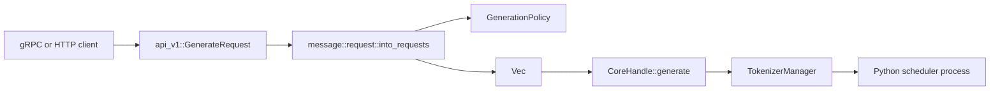
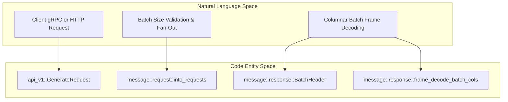
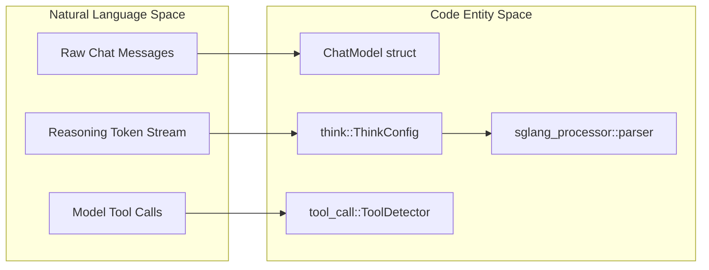

<!-- source: DeepWiki mcp.deepwiki.com · repo sgl-project/sglang · page 20.2 Router gRPC Pipeline and Tool Parsing · fetched 2026-10-30 -->

# Router gRPC Pipeline and Tool Parsing

Relevant source files

The following files were used as context for generating this wiki page:

- [proto/sglang/api/v1/generate.proto](proto/sglang/api/v1/generate.proto)
- [python/sglang/api/v1/api_types.py](python/sglang/api/v1/api_types.py)
- [rust/Cargo.lock](rust/Cargo.lock)
- [rust/sglang-api-types/src/generated/sglang.api.v1.rs](rust/sglang-api-types/src/generated/sglang.api.v1.rs)
- [rust/sglang-api-types/src/generated/sglang.api.v1.serde.rs](rust/sglang-api-types/src/generated/sglang.api.v1.serde.rs)
- [rust/sglang-api-types/testdata/json_parity.json](rust/sglang-api-types/testdata/json_parity.json)
- [rust/sglang-api-types/tests/json_contract.rs](rust/sglang-api-types/tests/json_contract.rs)
- [rust/sglang-bench/src/request.rs](rust/sglang-bench/src/request.rs)
- [rust/sglang-bench/tests/grpc.rs](rust/sglang-bench/tests/grpc.rs)
- [rust/sglang-processor/Cargo.toml](rust/sglang-processor/Cargo.toml)
- [rust/sglang-processor/README.md](rust/sglang-processor/README.md)
- [rust/sglang-processor/src/lib.rs](rust/sglang-processor/src/lib.rs)
- [rust/sglang-processor/src/openai/chat.rs](rust/sglang-processor/src/openai/chat.rs)
- [rust/sglang-processor/src/openai/completions.rs](rust/sglang-processor/src/openai/completions.rs)
- [rust/sglang-processor/src/openai/mod.rs](rust/sglang-processor/src/openai/mod.rs)
- [rust/sglang-processor/src/openai/request.rs](rust/sglang-processor/src/openai/request.rs)
- [rust/sglang-processor/src/openai/wire.rs](rust/sglang-processor/src/openai/wire.rs)
- [rust/sglang-processor/src/render/mod.rs](rust/sglang-processor/src/render/mod.rs)
- [rust/sglang-processor/src/render/models/glm53.rs](rust/sglang-processor/src/render/models/glm53.rs)
- [rust/sglang-processor/src/render/models/kimi_k3.rs](rust/sglang-processor/src/render/models/kimi_k3.rs)
- [rust/sglang-processor/src/render/models/qwen38.rs](rust/sglang-processor/src/render/models/qwen38.rs)
- [rust/sglang-processor/src/render/template.rs](rust/sglang-processor/src/render/template.rs)
- [rust/sglang-processor/src/render/thinking.rs](rust/sglang-processor/src/render/thinking.rs)
- [rust/sglang-processor/tests/openai_parity.rs](rust/sglang-processor/tests/openai_parity.rs)
- [rust/sglang-server/Cargo.toml](rust/sglang-server/Cargo.toml)
- [rust/sglang-server/src/api_server/core/frame.rs](rust/sglang-server/src/api_server/core/frame.rs)
- [rust/sglang-server/src/api_server/grpc/service.rs](rust/sglang-server/src/api_server/grpc/service.rs)
- [rust/sglang-server/src/message/io_struct.rs](rust/sglang-server/src/message/io_struct.rs)
- [rust/sglang-server/src/message/request.rs](rust/sglang-server/src/message/request.rs)
- [rust/sglang-server/src/message/response.rs](rust/sglang-server/src/message/response.rs)
- [sgl-router/Cargo.lock](sgl-router/Cargo.lock)
- [sgl-router/deny.toml](sgl-router/deny.toml)
- [sgl-router/src/server/routes/chat/openai.rs](sgl-router/src/server/routes/chat/openai.rs)
- [sgl-router/src/server/routes/chat/preparation.rs](sgl-router/src/server/routes/chat/preparation.rs)
- [test/registered/unit/api/v1/test_json_contract.py](test/registered/unit/api/v1/test_json_contract.py)
- [test/registered/unit/api/v1/test_parity.py](test/registered/unit/api/v1/test_parity.py)

## Purpose and scope

This page details the gRPC-facing Rust server pipeline, request parsing, tool-call parsing, and streaming response handling. The Rust implementation uses `sglang-server`, `sglang-processor`, and `sglang-api-types` to handle request lowering, tokenization, prompt rendering via Dynamo backend wrappers, and columnar response decoding [rust/sglang-server/src/message/request.rs:1-78]() [rust/sglang-processor/README.md:1-27]() [rust/sglang-server/src/message/response.rs:1-76]().

Sources: `rust/sglang-server/src/message/request.rs:1-78`; `rust/sglang-processor/README.md:1-27`; `rust/sglang-server/src/message/response.rs:1-76`

---

## gRPC-facing pipeline architecture and request translation

The request pipeline begins when wire inputs (such as generated `api_v1::GenerateRequest` structures) enter the Rust server layer. The function `into_requests` validates, normalizes, and fans out incoming request payloads into individual `GenerateRequest` items according to a specified `GenerationPolicy` [rust/sglang-server/src/message/request.rs:51-78]().

To control memory resident usage under high load, `MAX_BATCH_REQS_PER_HTTP_REQ` (governed by `SGLANG_MAX_BATCH_REQS_PER_HTTP_REQ`) enforces a strict hard cap on the number of scheduler requests a single call may expand into before pre-allocation occurs [rust/sglang-server/src/message/request.rs:24-40]().

**Diagram: transport-to-runtime request entities**

Sources: `rust/sglang-server/src/message/request.rs:24-78`; `rust/sglang-server/src/api_server/core/handle.rs:95-117`

### Natural-language concepts mapped to code

The following mapping associates abstract pipeline operations with their corresponding Rust symbols and structs.

**Diagram: API concepts and Rust entities**

Sources: `rust/sglang-server/src/message/request.rs:51-78`; `rust/sglang-server/src/message/response.rs:131-160`

---

## Tool-call parsing and reasoning in Rust

The `sglang-processor` crate acts as a thin wrapper over Dynamo's frontend crates (`dynamo-renderer`, `dynamo-tokenizers`, `dynamo-parsers`) [rust/sglang-processor/README.md:1-13](). It handles prompt rendering, chat templates, and output parsing for advanced models (such as DeepSeek, GLM, Qwen, and Kimi).

### Parser boundary and Dynamo integration

Hosts use re-exported Dynamo protocols through `sglang_processor` to process chat events, split reasoning streams, and parse tool calls [rust/sglang-processor/src/lib.rs:30-46](). 

`ChatModel` and `ChatRequest` structures in `sglang-processor/src/openai/chat.rs` manage reasoning flags, token inclusion rules, and template kwargs resolution (`template_kwargs`) [rust/sglang-processor/src/openai/chat.rs:30-141]().

**Diagram: parser concepts and code entities**

Sources: `rust/sglang-processor/README.md:1-13`; `rust/sglang-processor/src/openai/chat.rs:30-141`; `rust/sglang-processor/src/lib.rs:30-46`

Sources: `rust/sglang-processor/README.md:1-13`; `rust/sglang-processor/src/openai/chat.rs:30-141`; `rust/sglang-processor/src/lib.rs:30-46`

---

## Streaming response handling and batch headers

Response handling uses specialized channels and columnar batch decoders to transfer token outputs back to clients efficiently without incurring per-request FFI overhead [rust/sglang-server/src/message/response.rs:1-76]().

### ResponseSink and ResponseItem

`ResponseSink` provides a back-channel for the detokenization shard to write runtime outputs (`ResponseItem::Frame`, `ResponseItem::Done`, `ResponseItem::Data`, `ResponseItem::Error`) [rust/sglang-server/src/message/response.rs:14-66]().

`BatchHeader` structures columnar scalar headers for entire decode batches, tracking request IDs (`rid`), logprobs, and hidden states [rust/sglang-server/src/message/response.rs:143-160](). `frame_decode_batch_cols` constructs binary frame buffers combining the dispatch tag, header length, serialized msgpack header, and concatenated data columns in a single zero-copy layout [rust/sglang-server/src/message/response.rs:131-141]().

Sources: `rust/sglang-server/src/message/response.rs:1-160`

---

